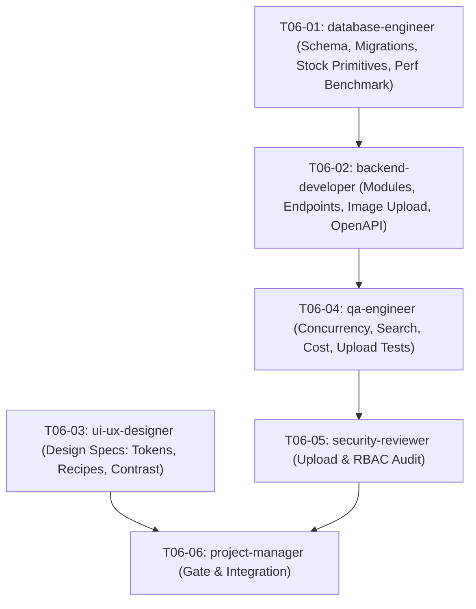

# Phase 06 — Products, Categories, Brands, Inventory, Purchasing Execution Plan

- **Phase:** 06
- **Integration Branch:** `integration/phase-06`
- **Lead / Integration Owner:** `project-manager`
- **Requirements:** `FR-CUS-002`, `FR-CUS-003`, `FR-CUS-004`, `FR-ADM-002`..`006`, `FR-STF-004`..`005`, `BR-01`, `BR-02`, `BR-11`, `BR-12`, `NFR-001`, `NFR-008`

---

## 1. Task Breakdown & Ownership

| Task ID | Role Agent | Branch | Description & Scope |
|---|---|---|---|
| **T06-01** | `database-engineer` | `agent/database-engineer/phase-06-catalog-inventory-schema` | Schema, entities, configurations for `catalog`, `inventory`, and `purchasing`. Check constraints (`SellingPrice <= ListPrice`, `OnHand >= 0`, `0 <= Reserved <= OnHand`), indexes (unique Sku, Slug, Barcode). Vietnamese `SearchText` normalization and index strategy. Perf seed command (20k products, Dev-only) & benchmark evidence. Atomic stock primitives (`ExecuteUpdateAsync`). Moving-average cost transaction. |
| **T06-02** | `backend-developer` | `agent/backend-developer/phase-06-catalog-inventory-modules` | Catalog, Inventory, Purchasing domain & application services. Image upload handling (`IFileStorage`, allowlist JPEG/PNG/WebP, magic bytes, 5MB limit, re-encoding, random storage keys). Public & admin endpoints per Spec 07 §4.3 & §5.1-5.3. Moving-average cost math with integer VND rounding. Unit tests for domain state machines. OpenAPI export. |
| **T06-03** | `ui-ux-designer` | `agent/ui-ux-designer/phase-06-design-docs` | Parallel design documentation: `docs/design/{tokens,contrast,font-check,components,recipes}.md`. Tokens, contrast validation, Vietnamese font evidence, shadcn primitives, storefront page recipes. (Documents only; no web/ code until Phase 08). |
| **T06-04** | `qa-engineer` | `agent/qa-engineer/phase-06-tests` | Integration tests on SQL Server: 50 concurrent stock reservations on 10 units (exactly 10 succeed), moving-average cost calculations across 3 scenarios, price history audits, search accent-insensitivity ("sua tuoi" -> "Sữa tươi"), upload validation, RBAC checks, Dev sample seeder isolation. |
| **T06-05** | `security-reviewer` | `agent/security-reviewer/phase-06-security-review` | Security audit of file uploads (polyglot files, magic bytes, re-encoding, path traversal, extension allowlist) and RBAC matrix. Produces `docs/security/review-phase-06.md`. |
| **T06-06** | `project-manager` | `integration/phase-06` | Clean checkout verification, `verify-reality`, update progress & decisions, create `phase-06-report.md`, merge to `main`, tag `phase-06-done`, and push to `origin`. |

---

## 2. Dependencies & Sequence

