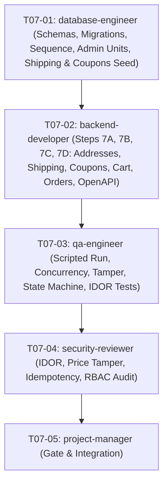

# Phase 07 — Customers/Addresses, Shipping, Coupons, Cart, Orders Execution Plan

- **Phase:** 07
- **Integration Branch:** `integration/phase-07`
- **Lead / Integration Owner:** `project-manager`
- **Requirements:** `FR-CUS-005`, `FR-CUS-008`..`012`, `FR-CUS-014`, `FR-CUS-015`, `FR-ADM-007`, `FR-ADM-012`, `FR-ADM-017`, `FR-STF-001`..`003`, `BR-02`..`BR-08`, `BR-10`, `BR-16`, `BR-17`, `NFR-003`

---

## 1. Task Breakdown & Ownership

| Task ID | Role Agent | Branch | Description & Scope |
|---|---|---|---|
| **T07-01** | `database-engineer` | `agent/database-engineer/phase-07-cart-ordering-schema` | Schema, entities, configurations and migrations for: `customers.Addresses`, `promotions.Coupons`/`Scopes`/`Redemptions`, `cart.Carts`/`Items`, `ordering.Orders`/`Items`/`History`/`ShippingZones`/`Rates`, `payments.Payments`/`Attempts`/`CodCollections`. Sequence `ordering.OrderNumberSeq`. Admin units seeder (34 provinces, ~3,321 wards, `AdminUnitDataVersion` MIT/Public dataset), initial shipping zones seeder (HCM 25k, BD/DN 35k, Free-ship threshold 300k), and sample coupons seeder. |
| **T07-02** | `backend-developer` | `agent/backend-developer/phase-07-cart-ordering-modules` | Implement 4 internal steps: **7A** Customers, Addresses (max 10, default filtered index, VN phone validation), Administrative units endpoints, and Shipping quote/zones. **7B** Promotions coupons CRUD, validation (`BR-04`), and redemption tracking. **7C** Server-side cart, `gh_cart` cookie, login merge hook, quantity caps (20), price revalidation. **7D** Checkout quote, idempotent order creation (`Idempotency-Key`), atomic stock & coupon deduction, sequence order number, COD order lifecycle (`Draft` -> `Placed` -> `Confirmed` -> `Preparing` -> `Packed` -> `Shipping` [stock commit to Sale] -> `Delivered` [COD cash]), cancellation with stock/coupon release (`BR-07`), reservation sweeper, `SEPAY_QR` returning 409 `PAYMENT_METHOD_UNAVAILABLE` until Phase 10. Regenerate OpenAPI contract. |
| **T07-03** | `qa-engineer` | `agent/qa-engineer/phase-07-tests` | End-to-end integration tests on SQL Server: full scripted lifecycle (quote -> checkout -> staff transitions -> delivered), concurrency tests (last stock unit across 20 checkouts, coupon limit across 10 checkouts), idempotency key duplicate tests, client price tampering tests, state machine matrix, guest cart merge, 11th address rejection, non-serviceable shipping rejection, IDOR ownership tests, and RBAC matrix report (`docs/security/rbac-test-phase-07.md`). |
| **T07-04** | `security-reviewer` | `agent/security-reviewer/phase-07-security-review` | Security audit of IDOR vulnerabilities, price/total tampering defenses, idempotency replay protections, rate limiting, and RBAC matrix. Produces `docs/security/review-phase-07.md`. |
| **T07-05** | `project-manager` | `integration/phase-07` | Clean checkout verification, `verify-reality`, update progress & decisions, create `phase-07-report.md`, merge to `main`, tag `phase-07-done`, and push to `origin`. |

---

## 2. Dependencies & Sequence

