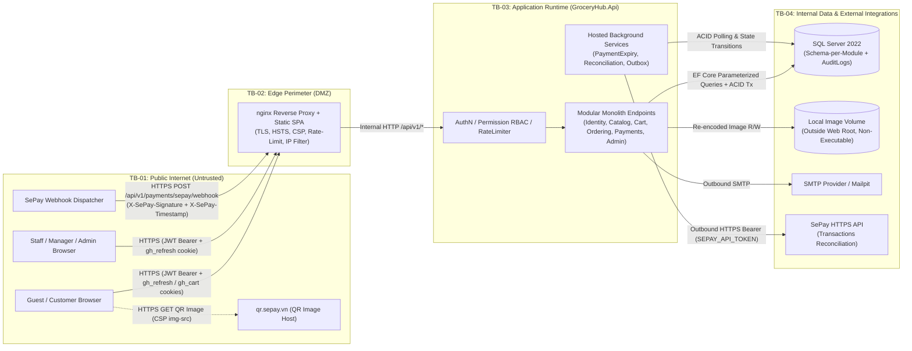

# GroceryHub — STRIDE Threat Model (`P01-T3`)

- **Version**: 1.0 (Phase 01 Baseline)
- **Baseline Standards**: OWASP ASVS v4.0.3 Level 2, OWASP API Security Top 10 (2023)
- **Scope**: Modular monolith (`GroceryHub.Api`), React 19 SPA (`web`), SQL Server persistence, local image storage volume, SMTP/Mailpit, and SePay VietQR + Webhook integration.
- **Governed Requirements**: `NFR-003`, `NFR-005`, `NFR-008`, `NFR-010`, `FR-CUS-005`..`FR-CUS-016`, `FR-ADM-001`..`FR-ADM-017`, `FR-STF-001`..`FR-STF-005`, `BR-01`..`BR-17`.

---

## 1. System Scope, Trust Boundaries & Data Flow Diagram

GroceryHub operates across four distinct trust boundaries:
1. **TB-01 — Public Internet (Untrusted)**: Anonymous visitors, registered customers, staff/admin browsers, external SePay webhook dispatchers, and potential attackers.
2. **TB-02 — Edge / Reverse Proxy Perimeter (DMZ)**: `nginx` container terminating TLS, serving static SPA assets, enforcing strict Content Security Policy (CSP), HSTS, security headers, request body limits, edge rate-limiting, and SePay IP allowlisting before forwarding `/api/*` to the backend.
3. **TB-03 — Application Runtime (`GroceryHub.Api` — Semi-Trusted)**: ASP.NET Core 10 modular monolith enforcing authentication (`JwtBearer` + `gh_refresh` cookie), permission-based RBAC (`PermissionAuthorizationHandler`), object-level ownership checks, input validation (`FluentValidation`), idempotency, and HMAC-SHA256 webhook verification.
4. **TB-04 — Internal Data & Storage Plane (Restricted Internal Network)**: SQL Server (isolated Docker network, no public port bindings in production), non-executable local product image volume, and outbound-only connections to SMTP and SePay Reconciliation HTTPS API.

---

## 2. Assets & Sensitivity Classification

| Asset ID | Asset Name | Classification | Storage / Transit Location | Security Objective (CIA + Accountability) | Related Requirements |
|---|---|---|---|---|---|
| **AST-01** | **Credentials & Password Hashes** | **Critical (Secret)** | `identity.Users` (`PasswordHash` via ASP.NET Core Identity PBKDF2/Argon2); verification & reset tokens | Confidentiality & Integrity: Irreversible hashing; reset/verify tokens single-use, time-bounded, never leaked in logs or responses. | `FR-CUS-006`, `FR-CUS-007`, `NFR-003`, `NFR-010` |
| **AST-02** | **JWT Signing Key** | **Critical (Secret)** | Environment variable / Docker secret injected into `GroceryHub.Api` | Confidentiality & Integrity: Compromise allows arbitrary role/user impersonation. Never committed to Git; ≥ 256-bit entropy; rotated per environment. | `NFR-003`, `FR-ADM-009`, `FR-ADM-010` |
| **AST-03** | **Refresh Tokens (`gh_refresh`) & Guest Cart Token (`gh_cart`)** | **Critical (Secret)** | Browser `HttpOnly; Secure; SameSite=Strict` cookie (`gh_refresh`); SHA-256 hash stored in `identity.RefreshTokens` with token family tracking | Confidentiality & Integrity: Plaintext token never persisted in DB or `localStorage`; rotation on every `/auth/refresh`; reuse of rotated token revokes entire token family. | `FR-CUS-005`, `FR-CUS-006`, `NFR-003` |
| **AST-04** | **SePay Secrets (`SEPAY_WEBHOOK_SECRET`, `SEPAY_API_TOKEN`)** | **Critical (Secret)** | Environment variables / Docker secrets (`SePay:Webhook:HmacSecret`, `SePay:Api:Token`) | Confidentiality & Integrity: Protects payment confirmation authenticity (`POST /payments/sepay/webhook`) and reconciliation polling. | `FR-CUS-013`, `FR-ADM-011`, `NFR-003` |
| **AST-05** | **Customer PII (Full Name, Phone, Email, 2-Level VN Delivery Addresses)** | **High (Confidential PII)** | `customers.Customers`, `customers.Addresses`, and immutable snapshots on `ordering.Orders` | Confidentiality, Privacy & Integrity: Object-level access control (owner or authorized Staff/Manager/Admin); normalized phone (`BR-17`); right-to-erasure/anonymization (`POST /admin/customers/{id}/anonymize`). | `FR-CUS-007`, `FR-CUS-008`, `FR-ADM-008`, `BR-10`, `BR-17`, `NFR-010` |
| **AST-06** | **Order Totals, Stock Ledger, Coupons & Cost Prices (`catalog.cost.read`)** | **High (Financial & Commercial)** | `ordering.Orders`, `inventory.StockItems`, `inventory.StockMovements`, `promotions.CouponRedemptions`, `catalog.Products.CostPrice`, `purchasing.GoodsReceipts` | Integrity & Confidentiality: Money in integer VND (`BR-01`); server-side total calculation (`BR-03`); atomic stock reservation/deduction (`BR-02`); moving-average COGS hidden from Customers and regular Staff (`BR-01`, `FR-ADM-015`). | `FR-CUS-009`..`FR-CUS-012`, `FR-ADM-002`..`FR-ADM-006`, `FR-ADM-014`, `FR-ADM-015`, `BR-01`..`BR-06`, `BR-11`..`BR-13`, `NFR-008` |
| **AST-07** | **Uploaded Product Images** | **Medium (Public Integrity)** | Mounted Docker volume outside web root; metadata in `catalog.ProductImages` | Integrity & Availability: Prevent stored XSS, polyglot execution, path traversal, and disk exhaustion; serve with `X-Content-Type-Options: nosniff`. | `FR-ADM-002`, `NFR-003` |
| **AST-08** | **Audit Log (`audit.AuditLogs`) & Payment Webhook Inbox (`payments.WebhookEvents`)** | **High (Forensic & Non-Repudiation)** | `audit.AuditLogs`, `payments.WebhookEvents`, `ordering.OrderStatusHistory` | Integrity & Non-Repudiation: Append-only record of actor, timestamp, correlation ID, before/after state for prices, stock adjustments, role/permission grants, order cancellations, payment reviews, and refunds. | `FR-ADM-004`, `FR-ADM-010`, `FR-ADM-011`, `FR-ADM-016`, `BR-01`, `BR-12`, `BR-15`, `NFR-005` |

---

## 3. Threat Actors

| Actor ID | Threat Actor | Capability & Access Level | Primary Motivations & Attack Vectors |
|---|---|---|---|
| **TA-01** | **Anonymous External Attacker** | Unauthenticated network access to public HTTPS endpoints (`/api/v1/auth/*`, `/products`, `/cart`, `/payments/sepay/webhook`). | Credential stuffing, brute-force login, account enumeration, guest cart exhaustion, DDoS/oversized payloads, exploiting exposed dev endpoints (`/dev/*`), or forging SePay webhooks. |
| **TA-02** | **Malicious or Compromised Customer** | Authenticated `Customer` JWT + `gh_refresh` cookie. | Horizontal privilege escalation (IDOR on other customers' orders, addresses, payments, carts, reviews), vertical privilege escalation to `/admin/*`, price/shipping/discount manipulation at checkout, race-condition overselling of last stock items, or multi-redemption of single-use coupons. |
| **TA-03** | **Malicious or Compromised Insider (Staff / Manager)** | Authenticated `Staff` or `Manager` account with operational permissions (`orders.*`, `inventory.read`, `refunds.request`, etc.). | Unauthorized viewing of confidential supplier cost prices (`catalog.cost.read`) or gross profit reports (`reports.profit`), un-audited inventory shrinkage, fraudulent single-actor refund creation + self-approval (`BR-15`), COD cash skimming (`FR-STF-003`), or unauthorized role/permission elevation (`roles.manage`). |
| **TA-04** | **External Payment / Webhook Spoofer & Replay Attacker** | Network actor targeting `POST /api/v1/payments/sepay/webhook` or intercepting QR parameters. | Sending forged `transferType="in"` webhooks without valid HMAC-SHA256 signatures, replaying captured valid webhook payloads, exploiting concurrent webhook race conditions, or tricking the system into marking an order `Paid` via underpaid, wrong-account, or expired transfers. |
| **TA-05** | **Supply-Chain / Dependency & CI Attacker** | Indirect vector via compromised NuGet/npm packages, base Docker images, or leaked repository secrets. | Malicious transitive dependencies, commercial-license traps, secret leakage in git history or container layers, or exposed database ports in Docker Compose. |

---

## 4. Module-by-Module STRIDE Analysis Tables

**STRIDE Legend**: **S** = Spoofing | **T** = Tampering | **R** = Repudiation | **I** = Information Disclosure | **D** = Denial of Service | **E** = Elevation of Privilege

### 4.1 Identity & Session Management

| Threat ID | STRIDE Category (S/T/R/I/D/E) | Module / Component | Abuse Case / Attack Scenario | Severity (Critical/High/Medium/Low) | Required Control (Architecture/Code/DB) | Requirement & Rule Mapping (FR-*/NFR-*/BR-*) | Verification Test Phase/ID |
|---|---|---|---|---|---|---|---|
| **TM-ID-01** | **S / D** | `Identity` (`POST /auth/login`, `/auth/register`, `/auth/forgot-password`) | **Brute Force & Credential Stuffing**: Automated attacker sprays passwords against customer or admin accounts, or floods registration/password-reset endpoints to exhaust SMTP quotas and lock legitimate users. | **High** | ASP.NET Core Identity account lockout after configurable failed attempts; server-side rate limiting (`5 req/min/IP+email` returning `429` with `Retry-After`); PBKDF2/Argon2 password hashing. | `FR-CUS-006`, `FR-ADM-008`, `NFR-003` | Phase 05 (`T-AUTH-LOCKOUT`, `T-AUTH-RATELIMIT`) |
| **TM-ID-02** | **I** | `Identity` (`POST /auth/login`, `/auth/forgot-password`, `/auth/resend-verification`) | **Account Enumeration**: Attacker probes which email addresses are registered by comparing HTTP status codes, error codes, or response timing on login, forgot-password, and resend-verification endpoints. | **Medium** | `/auth/forgot-password` and `/auth/resend-verification` always return `202 Accepted` with identical generic payload whether email exists or not; `/auth/login` returns generic invalid-credentials message without distinguishing unknown email vs wrong password. | `FR-CUS-006`, `NFR-003`, `NFR-010` | Phase 05 (`T-AUTH-NO-ENUM`) |
| **TM-ID-03** | **S / E** | `Identity` (`JwtBearer` middleware & token validation) | **JWT Forgery / Algorithm Confusion / Weak Signing Secret**: Attacker crafts a forged JWT with `"alg": "none"` or brute-forces a weak signing secret to impersonate `Admin` (`sub`, `role` claims). | **Critical** | Enforce explicit `HS256`/`RS256` algorithm allowlist in `TokenValidationParameters`; require `ValidateIssuer`, `ValidateAudience`, `ValidateLifetime`, `ClockSkew <= 30s`; enforce ≥ 256-bit secret via startup validation; short access token TTL (15 min). | `FR-CUS-006`, `FR-ADM-009`, `FR-ADM-010`, `NFR-003` | Phase 05 (`T-AUTH-JWT-FORGE`) |
| **TM-ID-04** | **S / E** | `Identity` (`POST /auth/refresh`, `identity.RefreshTokens`) | **Refresh Token Theft, Replay & Family Compromise**: Attacker intercepts or steals a refresh token and attempts to mint new access tokens alongside the legitimate user, or reads plaintext tokens from a leaked DB backup. | **Critical** | Store only SHA-256 hash of refresh tokens in `identity.RefreshTokens`; rotate token on every `/auth/refresh` call within a tracked `FamilyId`; if an already-rotated/revoked token is presented, immediately revoke the entire token family and force re-authentication (`REFRESH_TOKEN_INVALID`); require `X-Requested-With: XMLHttpRequest` header. | `FR-CUS-006`, `FR-CUS-007`, `NFR-003` | Phase 05 (`T-AUTH-REFRESH-REUSE`) |
| **TM-ID-05** | **I / S** | `web` SPA + `Identity` Cookie Handling | **XSS Token Exfiltration via `localStorage`**: Injected script or third-party dependency reads long-lived tokens from `localStorage`/`sessionStorage` or URL query parameters. | **High** | Never store refresh tokens or long-lived secrets in `localStorage`, `sessionStorage`, or URLs. Issue `gh_refresh` exclusively as `HttpOnly; Secure; SameSite=Strict; Path=/api/v1/auth` cookie; keep short-lived access JWT in memory only; enforce strict CSP (`script-src 'self'`). | `FR-CUS-006`, `NFR-003` | Phase 05 & Phase 08 (`T-SEC-COOKIE-FLAGS`, `T-SEC-NO-LOCALSTORAGE`) |
| **TM-ID-06** | **E / R** | `Identity` (`PermissionAuthorizationHandler` & Role/Permission Cache) | **Permission Cache Staleness & Unrevoked Access**: A compromised or terminated Staff/Manager has their role or `UserPermissions` revoked (`PUT /admin/staff/{id}/permissions`, `POST /admin/customers/{id}/lock`), but continues executing privileged actions until JWT expiry. | **High** | JWT contains only `sub`, `role`, `jti` (no embedded permission list); `PermissionAuthorizationHandler` resolves effective permissions server-side with cache TTL ≤ 60s and explicit cache eviction on any role/permission/lock/password change; write `audit.AuditLogs` on every role/permission mutation. | `FR-CUS-007`, `FR-ADM-008`, `FR-ADM-009`, `FR-ADM-010`, `FR-ADM-016`, `BR-14`, `NFR-003`, `NFR-005` | Phase 05 (`T-RBAC-CACHE-EVICT`, `T-AUDIT-ROLES`) |

---

### 4.2 Cart, Checkout, Stock & Order Lifecycle

| Threat ID | STRIDE Category (S/T/R/I/D/E) | Module / Component | Abuse Case / Attack Scenario | Severity (Critical/High/Medium/Low) | Required Control (Architecture/Code/DB) | Requirement & Rule Mapping (FR-*/NFR-*/BR-*) | Verification Test Phase/ID |
|---|---|---|---|---|---|---|---|
| **TM-ORD-01** | **T** | `Cart` & `Ordering` (`POST /checkout/orders`, `POST /checkout/quote`, `POST /shipping/quote`) | **Client-Side Price, Discount, or Shipping Fee Tampering**: Customer modifies request payload or intercepts API calls to submit negative quantities, zero unit prices, fabricated coupon discounts, or `shippingFee: 0` for non-qualifying orders. | **Critical** | Request DTOs for `/cart/items` and `/checkout/orders` accept only `productId`, `quantity` (1..max 20 per `BR-16`), `addressId`, `couponCode`, and `paymentMethod`. Server recomputes all line prices from `catalog.Products.SellingPrice`, zone shipping fee from `ordering.ShippingZones`, and coupon discount in integer VND (`long`, `BR-01`, `BR-03`, `BR-05`). | `FR-CUS-005`, `FR-CUS-009`, `FR-CUS-010`, `FR-CUS-011`, `BR-01`, `BR-03`, `BR-05`, `BR-16`, `NFR-003` | Phase 07 (`T-ORD-SERVER-TOTALS`, `T-ORD-QTY-LIMIT`) |
| **TM-ORD-02** | **T / D** | `Inventory` & `Ordering` (`POST /checkout/orders`, `StockItems`) | **Race Condition Overselling Last Stock Item**: 20 concurrent checkout requests attempt to buy the last 5 units of a product, bypassing naive read-then-write checks and driving `available` stock negative. | **Critical** | Atomic conditional SQL update (`UPDATE inventory.StockItems SET Reserved = Reserved + @qty WHERE ProductId = @id AND (OnHand - Reserved) >= @qty`) + `rowversion` concurrency token + DB `CHECK (OnHand >= 0 AND Reserved >= 0 AND Reserved <= OnHand)` inside the order placement transaction (`BR-02`). | `FR-CUS-005`, `FR-CUS-009`, `FR-ADM-005`, `FR-STF-004`, `BR-02`, `BR-16`, `NFR-008` | Phase 07 (`T-CONC-STOCK-OVERSELL`) |
| **TM-ORD-03** | **T / E** | `Promotions` & `Ordering` (`POST /checkout/orders`, `CouponRedemptions`) | **Coupon Multi-Redemption Race Condition**: Customer fires parallel checkout requests with the same single-use or limited-quota coupon code to exceed `MaxUses` or `MaxUsesPerCustomer`. | **High** | Record `promotions.CouponRedemptions` inside the same ACID database transaction as order placement (`BR-04`) with a unique/filtered index or atomic usage counter update (`UPDATE Coupons SET UsedCount = UsedCount + 1 WHERE Id = @id AND UsedCount < MaxUses`) and per-user redemption count lock. | `FR-CUS-009`, `FR-CUS-011`, `FR-ADM-012`, `BR-04`, `NFR-008` | Phase 07 (`T-CONC-COUPON-RACE`) |
| **TM-ORD-04** | **S / I / T** | `Cart` (`GET/POST/PATCH/DELETE /cart`, `POST /auth/login` merge) | **Guest Cart Fixation, Predictable Token IDOR & Merge Abuse**: Attacker guesses sequential guest cart IDs to read/modify another visitor's cart, or crafts a guest cart cookie to exceed per-line quantity limits (`BR-16`) during login cart merge. | **Medium** | `gh_cart` cookie uses a cryptographically random ≥ 128-bit token (`HttpOnly; Secure; SameSite=Lax`); cart merge on `/auth/login` caps merged line quantities at `min(availableStock, MaxQuantityPerLine)` (`BR-16`) and invalidates/unbinds the guest cart token after merge. | `FR-CUS-005`, `BR-14`, `BR-16`, `NFR-003` | Phase 07 (`T-CART-MERGE-CAP`, `T-CART-TOKEN-ENTROPY`) |
| **TM-ORD-05** | **T / R** | `Ordering` (`POST /checkout/orders`, `POST /me/orders/{id}/payment-attempts`) | **Idempotency-Key Replay with Mutated Payload or Cross-User Collision**: Client reuses an `Idempotency-Key` with a different cart/address payload to bypass validation, or two users collide on the same key. | **High** | Scope idempotency keys by `(UserId, Endpoint, IdempotencyKey)` with a SHA-256 request body hash stored in DB; return cached response if body hash matches, or `409 Conflict` (`IDEMPOTENCY_KEY_REUSED`) if payload differs. | `FR-CUS-009`, `FR-CUS-013`, `NFR-003`, `NFR-008` | Phase 07 (`T-ORD-IDEMPOTENCY`) |
| **TM-ORD-06** | **T / E** | `Ordering` (`POST /me/orders/{id}/cancel`, `POST /admin/orders/{id}/transition`) | **Illegal Order Status Transition & Late Customer Cancellation**: Customer cancels an order already in `Preparing`/`Shipping` to receive free goods, or Staff transitions an unpaid QR order directly to `Shipping` without payment confirmation. | **High** | Enforce strict state-machine transition matrix in Domain (`BR-07`, `BR-08`); customer cancel allowed only in `PendingPayment`, `Placed`, `Confirmed`; transitions from `Preparing` onward require `orders.process`/`orders.ship`/`orders.cancel` permissions plus mandatory reason; invalid transitions fail with `409 ORDER_INVALID_TRANSITION`. | `FR-CUS-014`, `FR-ADM-007`, `FR-STF-001`, `FR-STF-002`, `FR-STF-003`, `BR-07`, `BR-08`, `NFR-003` | Phase 07 (`T-ORD-STATE-MACHINE`, `T-ORD-CANCEL-RULES`) |
| **TM-ORD-07** | **I / T** | `Ordering`, `Customers`, `Reviews` (`/me/orders/{id}`, `/me/addresses/{id}`, `/payments/{code}/status`, `/products/{id}/reviews`) | **Horizontal Privilege Escalation (IDOR), PII/Phone Tampering & Unverified Review Spoofing**: Customer A accesses or cancels Customer B's order/address/payment status by UUID/code, injects malformed phone/address data bypassing 2-level VN unit validation (`BR-10`, `BR-17`), or submits a fake review (`FR-CUS-016`) for a product they never bought and received. | **High** | Every `/me/*` and `/payments/{paymentCode}/status` query filters by `WHERE CustomerId == currentUserId` (returning `404`/`403` on mismatch); validate 2-level VN province/ward codes (`BR-10`) and normalized Vietnamese phone format (`BR-17`); review creation verifies `Order.CustomerId == currentUserId AND Order.Status == Delivered` and enforces unique review per `OrderItemId` (`BR-09`, `REVIEW_NOT_ELIGIBLE`). | `FR-CUS-007`, `FR-CUS-008`, `FR-CUS-014`, `FR-CUS-015`, `FR-CUS-016`, `BR-09`, `BR-10`, `BR-17`, `NFR-003`, `NFR-010` | Phase 07 & Phase 11 (`T-SEC-IDOR-ORDERS`, `T-SEC-IDOR-ADDRESSES`, `T-REV-VERIFIED-ONLY`) |

---

### 4.3 Payments & SePay Webhook Integration

| Threat ID | STRIDE Category (S/T/R/I/D/E) | Module / Component | Abuse Case / Attack Scenario | Severity (Critical/High/Medium/Low) | Required Control (Architecture/Code/DB) | Requirement & Rule Mapping (FR-*/NFR-*/BR-*) | Verification Test Phase/ID |
|---|---|---|---|---|---|---|---|
| **TM-PAY-01** | **S / T** | `Payments` (`POST /api/v1/payments/sepay/webhook`) | **Forged Webhook POST / Signature Bypass**: External attacker sends a crafted JSON POST claiming `transferType: "in"` and `transferAmount: 500000` for payment code `GH1000000123` to mark their order `Paid` without paying. | **Critical** | Read raw request bytes (max 64 KB); require `X-SePay-Timestamp` and `X-SePay-Signature` (`sha256=<hex>`) over `"{timestamp}.{rawBody}"` using `SEPAY_WEBHOOK_SECRET` (or `Authorization: Apikey` in fallback mode) compared via `CryptographicOperations.FixedTimeEquals`; enforce proxy IP allowlist; return `401` with zero business state mutation on failure. | `FR-CUS-013`, `FR-ADM-011`, `BR-06`, `NFR-003`, `NFR-005` | Phase 10 (`T-PAY-04`, `T-PAY-05`, `T-PAY-07`) |
| **TM-PAY-02** | **S / R** | `Payments` (`POST /api/v1/payments/sepay/webhook`) | **Webhook Replay Attack**: Attacker or misconfigured proxy replays an old captured request with a valid signature outside the freshness window. | **High** | Reject webhook requests where `abs(now - X-SePay-Timestamp) > 300` seconds (`401 Unauthorized`); persist `(Provider, ProviderTransactionId)` in `payments.WebhookEvents` with a unique constraint so already-processed transaction IDs are idempotent no-ops. | `FR-CUS-013`, `FR-ADM-011`, `NFR-003`, `NFR-005`, `NFR-008` | Phase 10 (`T-PAY-02`, `T-PAY-06`) |
| **TM-PAY-03** | **T / D** | `Payments` (`WebhookEvents`, `Payments`, `Orders`) | **Concurrent Duplicate Webhook Delivery Race**: SePay or network retry delivers the exact same webhook payload 10 times concurrently, risking duplicate order transitions, duplicate outbox events, or corrupted ledger entries. | **High** | Unique index on `payments.WebhookEvents(Provider, ProviderTransactionId)` + atomic conditional status transition (`Received -> Processing`) and `rowversion` concurrency checks on `Payments` and `Orders` inside a single DB transaction. | `FR-CUS-013`, `FR-ADM-011`, `BR-08`, `NFR-008` | Phase 10 (`T-PAY-03`, `T-PAY-14`) |
| **TM-PAY-04** | **T** | `Payments` (`POST /api/v1/payments/sepay/webhook` validation logic) | **Underpaid, Wrong-Account, Outgoing, or Late-After-Expiry Transfer Tricks**: Attacker transfers 1,000 VND for a 500,000 VND order (`GH1000000123`), transfers after order expiration + grace window, or triggers an outgoing (`transferType: "out"`) notification hoping naive code only checks the payment code. | **Critical** | Explicitly verify `transferType == "in"`, `accountNumber == SePay:AccountNumber`, `attempt` exists for an order in `PendingPayment` within `ExpiresAt + ExpiryGraceMinutes`, and `transferAmount == payment.Amount`. Any mismatch (`Underpaid`, `Overpaid`, `WrongAccount`, `UnknownCode`, `LateAfterExpiry`, `DuplicatePayment`) leaves order unconfirmed and routes the transaction to `NeedsReview` queue (`FR-ADM-011`). | `FR-CUS-013`, `FR-ADM-001`, `FR-ADM-011`, `FR-ADM-017`, `BR-06`, `BR-08`, `NFR-003`, `NFR-008` | Phase 10 (`T-PAY-08`, `T-PAY-09`, `T-PAY-10`, `T-PAY-11`, `T-PAY-17`) |
| **TM-PAY-05** | **T / E** | `Payments` & `web` Storefront (`/payments/{paymentCode}/status`, QR generation) | **Client-Side "Mark as Paid" or QR Parameter Tampering**: Attacker looks for a client-callable endpoint/query param to confirm payment, or manipulates the QR amount/account displayed in the browser. | **Critical** | Server constructs QR URL from authoritative order total and `SePay:AccountNumber` (`FR-ADM-017`); `GET /payments/{paymentCode}/status` is strictly read-only (`owner` auth); no client-facing endpoint can transition payment to `Paid`. Static codebase scan verifies zero client-side paid paths. | `FR-CUS-013`, `FR-ADM-017`, `BR-03`, `BR-06`, `NFR-003` | Phase 10 (`T-PAY-20`, `T-PAY-21`) |
| **TM-PAY-06** | **E / S** | `GroceryHub.Api` (`POST /dev/sepay/simulate`) | **Dev Webhook Simulator Exposed in Production**: If `/dev/sepay/simulate` is accidentally mapped in Staging/Production, anyone could trigger signed webhook simulations. | **Critical** | Map `/dev/*` endpoints strictly inside `if (app.Environment.IsDevelopment())`; startup validation rejects `SePay:Environment=Sandbox` or missing secrets when `ASPNETCORE_ENVIRONMENT=Production`; automated integration test asserts `POST /dev/sepay/simulate` returns `404` in Production configuration. | `FR-CUS-013`, `NFR-003` | Phase 10 (`T-PAY-22`) |
| **TM-PAY-07** | **E / R** | `Payments` (`POST /admin/refunds`, `POST /admin/refunds/{id}/approve`) | **Segregation-of-Duties Bypass on Refunds (Self-Approval or Over-Refund)**: Compromised Manager/Staff requests a refund and approves it with the same user account, or refunds more than `paid - refunded`. | **High** | Enforce four-eyes principle in Domain (`BR-15`): `Refund.ApprovedByUserId != Refund.RequestedByUserId` (reject self-approval with `REFUND_SAME_APPROVER`); enforce `Refund.Amount <= Payment.PaidAmount - Payment.RefundedAmount` (`REFUND_INVALID_AMOUNT`); require `refunds.request` and `refunds.approve` permissions; audit every step in `audit.AuditLogs`. | `FR-ADM-011`, `FR-ADM-016`, `BR-15`, `NFR-003`, `NFR-005` | Phase 10 (`T-PAY-18`, `T-PAY-19`) |
| **TM-PAY-08** | **T / R** | `Payments` & `Ordering` (`POST /admin/orders/{id}/transition` to `Delivered`, `CodCollections`) | **COD Cash Collection Mismatch / Unrecorded Cash**: Delivery staff marks a COD order `Delivered` while entering a lower cash amount than the order total, or places a COD order exceeding `CodMaxAmount`. | **High** | Enforce `order.Total <= Payments:CodMaxAmount` at checkout (`BR-06`, `COD_LIMIT_EXCEEDED`); on transition to `Delivered`, require `codAmount == order.Total` (else block with `COD_AMOUNT_MISMATCH` requiring Manager intervention) and atomically record `payments.CodCollections` + audit log (`FR-STF-003`, `FR-ADM-011`). | `FR-CUS-012`, `FR-ADM-011`, `FR-ADM-017`, `FR-STF-003`, `BR-06`, `NFR-003`, `NFR-005` | Phase 10 (`T-PAY-24`) |

---

### 4.4 File Uploads (Product Images)

| Threat ID | STRIDE Category (S/T/R/I/D/E) | Module / Component | Abuse Case / Attack Scenario | Severity (Critical/High/Medium/Low) | Required Control (Architecture/Code/DB) | Requirement & Rule Mapping (FR-*/NFR-*/BR-*) | Verification Test Phase/ID |
|---|---|---|---|---|---|---|---|
| **TM-UPL-01** | **T / E** | `Catalog` (`POST /admin/products/{id}/images`) | **Polyglot / Malicious File Upload (SVG/HTML Stored XSS or Webshell RCE)**: Attacker with `catalog.write` uploads an HTML/SVG containing `<script>` or an executable payload disguised with a `.jpg`/`.png` extension and forged `Content-Type` header. | **High** | Require `catalog.write` permission; validate both `Content-Type` allowlist (`image/jpeg`, `image/png`, `image/webp` — never SVG/HTML) AND magic-byte file signatures; decode and re-encode image pixels server-side (stripping EXIF/metadata and embedded scripts); reject mismatches with `FILE_TYPE_NOT_ALLOWED`. | `FR-ADM-002`, `NFR-003` | Phase 06 & Phase 11 (`T-UPL-POLYGLOT`, `T-UPL-MIME-MAGIC`) |
| **TM-UPL-02** | **T / I** | `Catalog` (`POST /admin/products/{id}/images`) | **Path Traversal via Client-Supplied Filename**: Attacker uploads file named `../../../../etc/passwd` or `..\appsettings.Production.json` to overwrite system files or escape the image directory. | **High** | Never use user-supplied `Content-Disposition` filename for filesystem paths; generate a new random UUID (`Guid.NewGuid()`) filename with a fixed canonical extension (`.webp`/`.jpg`) inside the dedicated image storage directory. | `FR-ADM-002`, `NFR-003` | Phase 06 & Phase 11 (`T-UPL-PATH-TRAVERSAL`) |
| **TM-UPL-03** | **D** | `Catalog` (`POST /admin/products/{id}/images`) & `nginx` | **Oversized File Upload or Image Decompression Bomb (Pixel Flood)**: Attacker uploads a 500 MB file or a small compressed image with `65000 x 65000` pixel dimensions that exhausts API memory/CPU during decoding. | **Medium** | Enforce strict multipart body size limit at `nginx` (`client_max_body_size`) and ASP.NET Core endpoint level (e.g., max 5 MB per image, returning `FILE_TOO_LARGE` / `413`); inspect image header dimensions before full pixel allocation (cap width/height ≤ 4096 px). | `FR-ADM-002`, `NFR-001`, `NFR-003` | Phase 06 & Phase 11 (`T-UPL-OVERSIZE`, `T-UPL-DIMENSIONS`) |
| **TM-UPL-04** | **E / I** | `nginx` & Local Image Storage Volume | **Direct Script Execution or MIME-Sniffing from Image Volume**: Uploaded file is stored inside the executable web root or served without `nosniff`, allowing browser MIME-sniffing execution. | **High** | Mount image volume outside the application bin/web root; serve static image paths via `nginx` with script execution disabled, `X-Content-Type-Options: nosniff`, `Content-Security-Policy: default-src 'none'`, and read-only delivery headers. | `FR-ADM-002`, `NFR-003` | Phase 11 & Phase 12 (`T-UPL-NOSNIFF-HEADERS`) |

---

### 4.5 Admin, Staff, Reporting & Infrastructure

| Threat ID | STRIDE Category (S/T/R/I/D/E) | Module / Component | Abuse Case / Attack Scenario | Severity (Critical/High/Medium/Low) | Required Control (Architecture/Code/DB) | Requirement & Rule Mapping (FR-*/NFR-*/BR-*) | Verification Test Phase/ID |
|---|---|---|---|---|---|---|---|
| **TM-ADM-01** | **E** | `GroceryHub.Api` (All `/api/v1/admin/*` and module endpoints) | **Missing `.RequireAuthorization` Policy / Default-Deny Bypass**: Developer adds a new admin endpoint (e.g., price update, PO receipt, or customer lock) and forgets `.RequireAuthorization("<permission>")`, allowing anonymous or regular `Customer` access. | **Critical** | Configure global fallback authorization policy (default-deny); enforce an automated `GroceryHub.ArchitectureTests` rule (from Phase 04 onward) that inspects all registered minimal API endpoints and fails the build if any endpoint lacks an explicit permission policy or documented `AllowAnonymous`. | `FR-ADM-001`..`FR-ADM-017`, `FR-STF-001`..`FR-STF-005`, `NFR-003`, `NFR-009` | Phase 04, 05, 07, 10, 11 (`T-ARCH-DEFAULT-DENY`, `T-RBAC-MATRIX`) |
| **TM-ADM-02** | **I / E** | `Catalog`, `Purchasing`, `Reporting` (`/admin/products`, `/admin/reports/profit`, `/admin/reports/stock-valuation`, `/admin/goods-receipts`) | **Privilege Boundary Violation — Staff Accessing Cost Prices (`COGS`) or Profit Reports**: A `Staff` user (who has `catalog.read` and `inventory.read` but NOT `catalog.cost.read` or `reports.profit`) queries product details or report endpoints to leak supplier cost prices and profit margins, or submits goods receipts without `purchasing.receive`. | **High** | Strip/null `costPrice` from `/admin/products` responses unless the caller holds `catalog.cost.read` (`BR-01`); gate `/admin/reports/profit` and `/admin/reports/stock-valuation` behind `reports.profit` (`FR-ADM-015`); gate `/admin/goods-receipts` behind `purchasing.receive` (`FR-STF-005`, `FR-ADM-006`). | `FR-ADM-002`, `FR-ADM-006`, `FR-ADM-014`, `FR-ADM-015`, `FR-STF-004`, `FR-STF-005`, `BR-01`, `BR-11`, `BR-13`, `NFR-003` | Phase 06, 09, 11 (`T-RBAC-COST-MASKING`, `T-RBAC-REPORTS`, `T-RBAC-PURCHASING`) |
| **TM-ADM-03** | **T / E** | `Reporting` (`GET /admin/reports/*?format=csv`) & `Reviews` (`POST /admin/reviews/{id}/approve`) | **CSV Formula Injection in Exported Reports & Stored XSS in Customer Reviews/Notes**: Customer submits a product name, delivery note, or review starting with `=cmd|' /C calc'!A0` (`=SUM(...)`, `+`, `-`, `@`) to execute formulas when a Manager opens exported CSV in Excel, or `<script>` in review body to hijack admin sessions during moderation (`FR-ADM-013`). | **Medium** | Prefix any CSV cell beginning with `=`, `+`, `-`, `@`, `\t`, or `\r` with a single quote (`'`) during CSV serialization (`FR-ADM-015`); sanitize/encode all user-supplied review text and order notes; never use `dangerouslySetInnerHTML` in React (`FR-CUS-016`, `FR-ADM-013`). | `FR-CUS-016`, `FR-ADM-013`, `FR-ADM-014`, `FR-ADM-015`, `NFR-003` | Phase 09 & Phase 11 (`T-SEC-CSV-INJECTION`, `T-SEC-XSS-REVIEWS`) |
| **TM-ADM-04** | **R / T** | `Catalog`, `Inventory`, `Identity`, `Payments`, `Settings` (`audit.AuditLogs`) | **Un-Audited Price, Stock, Role, or Settings Manipulation**: Insider modifies selling/cost prices (`PUT /admin/products/{id}/price`), performs manual stock adjustments (`POST /admin/inventory/{productId}/adjust`), edits shipping rates/bank account (`PUT /admin/settings`), or changes user permissions without leaving an immutable audit trail. | **High** | Enforce mandatory reason on stock adjustments (`BR-12`), order cancellations (`BR-07`), and payment reviews; write `audit.AuditLogs` (actor ID, action, entity ID, old/new JSON snapshot, correlation ID, timestamp) inside the same DB transaction for all price/cost changes (`BR-01`), stock adjustments, role/permission mutations, refunds, and settings updates; expose read-only viewer under `audit.read` (`FR-ADM-016`). | `FR-ADM-003`, `FR-ADM-004`, `FR-ADM-005`, `FR-ADM-010`, `FR-ADM-016`, `FR-ADM-017`, `BR-01`, `BR-12`, `NFR-005` | Phase 06, 09, 11 (`T-AUDIT-COMPLETENESS`) |
| **TM-ADM-05** | **I / D / E** | Docker Compose, `sqlserver`, `nginx`, Exception Handling | **Exposed SQL Server Port in Production, Stack Trace Leakage, or Root Container Execution**: Production `docker-compose.yml` binds `1433:1433` on `0.0.0.0` exposing SQL Server to internet brute-force; unhandled exceptions return raw stack traces/connection strings to clients; containers run as `root`. | **High** | In production `docker-compose.yml`, bind `sqlserver` only to internal Docker network (no host port publishing); run `GroceryHub.Api` as non-root user; global exception handler returns RFC 7807 `ProblemDetails` with `traceId` (`X-Correlation-Id`) and hides internal stack traces; enforce HSTS, `X-Frame-Options: DENY`, and CSP (`img-src 'self' https://qr.sepay.vn`) at `nginx`. | `NFR-003`, `NFR-004`, `NFR-005` | Phase 04 & Phase 12 (`T-INFRA-COMPOSE-PORTS`, `T-SEC-PROBLEMDETAILS`, `T-SEC-HEADERS`) |
| **TM-ADM-06** | **I / E** | Git Repository, CI Pipeline, NuGet / npm Dependencies | **Hardcoded Secrets in Git or Vulnerable / Commercial-Trap Dependencies**: Developer commits real `SEPAY_WEBHOOK_SECRET`, JWT signing key, or SA password into `.env` or `appsettings.json`, or adds a vulnerable or commercial-licensed package. | **Critical** | Ignore `.env` in `.gitignore`; commit only `.env.example` with placeholders; run `gitleaks detect` secret scanning, `dotnet list package --vulnerable --include-transitive`, and `npm audit --omit=dev` at phase gates and in CI; verify package licenses in `docs/progress/DEPENDENCIES.md`. | `NFR-003`, `NFR-009` | Phase 04, 05, 07, 10, 11, 12 (`T-SEC-GITLEAKS`, `T-SEC-DEP-AUDIT`) |

---

## 5. Security Gate Checklist by Phase

Every phase gate requires real command output and test evidence under `docs/evidence/phase-XX/`. No phase may receive a **GO** decision with an open **Critical** or **High** finding.

| Phase | Phase Scope | Mapped Threat IDs Verified at Gate | Mandatory Gate Verification Checks |
|---|---|---|---|
| **Phase 04** | Backend Foundation, DbContext, Outbox & CI Skeleton | `TM-ADM-01`, `TM-ADM-05`, `TM-ADM-06` | - Architecture test fails build if any endpoint lacks explicit `.RequireAuthorization` policy or `AllowAnonymous` (`TM-ADM-01`). - Global exception handler returns RFC 7807 `ProblemDetails` with `traceId` and zero stack traces (`TM-ADM-05`). - `gitleaks` and `dotnet list package --vulnerable` clean (`TM-ADM-06`). |
| **Phase 05** | Identity, Authentication & Permission RBAC (`/wf-security-review`) | `TM-ID-01`, `TM-ID-02`, `TM-ID-03`, `TM-ID-04`, `TM-ID-05`, `TM-ID-06`, `TM-ADM-01`, `TM-ADM-06` | - Brute-force lockout + `429` rate-limiting verified on `/auth/login`, `/auth/register`, `/auth/forgot-password` (`TM-ID-01`). - Non-enumerating responses on forgot-password and resend-verification (`TM-ID-02`). - Forged/expired JWT rejected (`TM-ID-03`). - Refresh token hashed at rest, rotation + family revocation on reuse, `HttpOnly; Secure; SameSite=Strict` cookie (`TM-ID-04`, `TM-ID-05`). - Permission cache invalidation ≤ 60s and audit logs written on role/permission changes (`TM-ID-06`). |
| **Phase 06** | Catalog, Inventory, Purchasing & Image Uploads | `TM-UPL-01`, `TM-UPL-02`, `TM-UPL-03`, `TM-ADM-02`, `TM-ADM-04` | - Multipart image upload enforces MIME + magic bytes, pixel re-encoding, size/dimension caps, and UUID filenames (`TM-UPL-01`, `TM-UPL-02`, `TM-UPL-03`). - `costPrice` hidden unless caller has `catalog.cost.read`; goods receipt requires `purchasing.receive` (`TM-ADM-02`). - Price changes and manual stock adjustments require reason and write `audit.AuditLogs` (`TM-ADM-04`). |
| **Phase 07** | Cart, Checkout, Stock Reservation, Coupons & Ordering (`/wf-security-review`) | `TM-ORD-01`, `TM-ORD-02`, `TM-ORD-03`, `TM-ORD-04`, `TM-ORD-05`, `TM-ORD-06`, `TM-ORD-07`, `TM-ADM-01` | - Server-side VND integer calculation ignores client price/total/shipping tampering (`TM-ORD-01`). - Parallel concurrency tests prove zero overselling of last stock item (`TM-ORD-02`) and zero coupon over-redemption (`TM-ORD-03`). - Guest cart random cookie + merge quantity cap (`TM-ORD-04`). - `Idempotency-Key` body-hash enforcement (`TM-ORD-05`). - Order state machine and customer/staff cancellation boundaries enforced (`TM-ORD-06`). - IDOR matrix tests across `/me/orders/{id}` and `/me/addresses/{id}` (`TM-ORD-07`). |
| **Phase 08** | Customer Storefront SPA | `TM-ID-05`, `TM-ORD-07`, `TM-ADM-03` | - Confirm SPA stores zero tokens in `localStorage`/`sessionStorage` (`TM-ID-05`). - Verified-purchase review submission and safe escaping of review text without `dangerouslySetInnerHTML` (`TM-ORD-07`, `TM-ADM-03`). |
| **Phase 09** | Admin & Staff Dashboard, Reports & Audit Viewer | `TM-ADM-02`, `TM-ADM-03`, `TM-ADM-04` | - Role boundaries verified for Staff vs Manager vs Admin on cost visibility, profit reports, and customer anonymization (`TM-ADM-02`). - CSV export neutralizes formula prefixes (`=`, `+`, `-`, `@`) (`TM-ADM-03`). - Audit log viewer filters and displays immutable records for all sensitive mutations (`TM-ADM-04`). |
| **Phase 10** | SePay VietQR, Webhook, Reconciliation, COD & Refunds (`/wf-security-review`) | `TM-PAY-01`, `TM-PAY-02`, `TM-PAY-03`, `TM-PAY-04`, `TM-PAY-05`, `TM-PAY-06`, `TM-PAY-07`, `TM-PAY-08` | - All 24 payment test scenarios (`T-PAY-01`..`T-PAY-24`) executed against real SQL Server (`TM-PAY-01`..`TM-PAY-08`). - Constant-time HMAC-SHA256 + 300s timestamp replay window + unique `WebhookEvents` inbox (`TM-PAY-01`, `TM-PAY-02`, `TM-PAY-03`). - Underpaid/overpaid/wrong-account/expired transfers routed to `NeedsReview` without confirming order (`TM-PAY-04`). - Zero client-side paid paths and `/dev/sepay/simulate` returns `404` in Production config (`TM-PAY-05`, `TM-PAY-06`). - Four-eyes refund approval (`REFUND_SAME_APPROVER`) and COD cash match check (`COD_AMOUNT_MISMATCH`) (`TM-PAY-07`, `TM-PAY-08`). |
| **Phase 11** | Comprehensive QA & Full Security Audit (`/wf-security-review`) | All Threat IDs (`TM-ID-01`..`TM-ID-06`, `TM-ORD-01`..`TM-ORD-07`, `TM-PAY-01`..`TM-PAY-08`, `TM-UPL-01`..`TM-UPL-04`, `TM-ADM-01`..`TM-ADM-06`) | - Full endpoint-by-endpoint RBAC + IDOR test matrix (`docs/security/rbac-test-11.md`) with real requests across Guest, Customer A, Customer B, Staff, Manager, Admin. - Negative webhook, upload polyglot, XSS, and SQLi/validation tests. - Clean `dotnet list package --vulnerable`, `npm audit --omit=dev`, and `gitleaks`. |
| **Phase 12** | Docker Hardening, Reverse Proxy, TLS/CSP & Deployment Gate (`/wf-security-review`) | `TM-ID-05`, `TM-PAY-06`, `TM-UPL-04`, `TM-ADM-05`, `TM-ADM-06` | - Production `docker-compose.yml` isolates SQL Server (no public `1433`), runs non-root containers, mounts images outside web root with `nosniff` (`TM-UPL-04`, `TM-ADM-05`). - `nginx` enforces TLS, HSTS, strict CSP (`img-src 'self' https://qr.sepay.vn`), rate limits, and body limits (`TM-ID-05`, `TM-ADM-05`). - Final secret and container image vulnerability scan clean (`TM-ADM-06`). |
