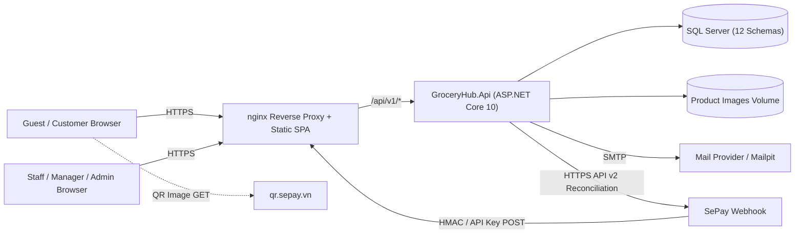
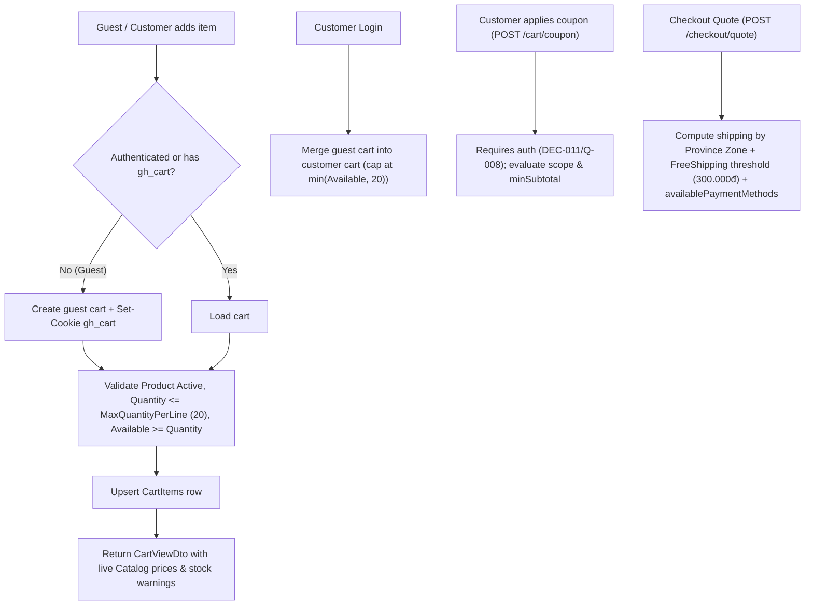

# 05 — System Architecture (`v1.0` Baseline)

> **Version & Change Control Note (Phase 03 Freeze — 2026-11-15):** This document is frozen at **v1.0**. Detailed cross-module C# contracts live in [`docs/spec/module-contracts.md`](./module-contracts.md), domain/integration events in [`docs/spec/events.md`](./events.md), domain state machines in [`docs/spec/state-machines.md`](./state-machines.md), RBAC permissions in [`docs/spec/permissions-seed.md`](./permissions-seed.md), and Architecture Decision Records in [`docs/spec/adr/ADR-001..007`](./adr/).

---

## 1. System Context



---

## 2. Architecture Decision Records (`docs/spec/adr/`)

| ADR | Title | Summary |
|---|---|---|
| [`ADR-001`](./adr/ADR-001-modular-monolith.md) | Modular Monolith & Project Boundaries | Single deployable `GroceryHub.Api` with 12 isolated module assemblies (`GroceryHub.Modules.<Name>`) + 12 contract assemblies (`GroceryHub.Modules.<Name>.Contracts`), enforced by compile-time `internal` visibility and NetArchTest architecture tests. |
| [`ADR-002`](./adr/ADR-002-single-dbcontext-schemas.md) | Single `GroceryHubDbContext` with Schema-Per-Module | Single EF Core 10 `GroceryHubDbContext` in `GroceryHub.Persistence` managing 12 logical SQL Server schemas (`identity`, `customers`, `catalog`, `inventory`, `purchasing`, `promotions`, `cart`, `ordering`, `payments`, `reviews`, `audit`, `shared`), enabling atomic cross-module ACID transactions without cross-schema FKs or navigation properties. |
| [`ADR-003`](./adr/ADR-003-auth-tokens-cookies.md) | Auth, Short-Lived JWT, Rotating Refresh Cookie & Permission Cache | ASP.NET Core Identity + 15-minute access JWT (no permission array in JWT) + rotating SHA-256 hashed refresh token in `HttpOnly; Secure; SameSite=Strict` cookie (`gh_refresh`) with family reuse detection + server-side `IMemoryCache` permission resolution (TTL $\le 60\text{s}$). |
| [`ADR-004`](./adr/ADR-004-no-mediator-mapper-libs.md) | Ban Commercial-License Mediator / Mapper / Assertion Libraries | Strictly bans `MediatR`, `AutoMapper`, `FluentAssertions` 8+, and `MassTransit` 9+ (`DEC-003`) in favor of explicit DI application services, static C# mapping extensions / EF projections, xUnit `Assert`, and an in-process transactional outbox dispatcher. |
| [`ADR-005`](./adr/ADR-005-contract-first-openapi.md) | Contract-First OpenAPI (`docs/contracts/openapi.json`) | ASP.NET Core 10 Minimal APIs (`TypedResults`) export OpenAPI 3.1 to `docs/contracts/openapi.json`; frontend generates TypeScript types via `openapi-typescript` with zero hand-written duplicate DTOs. |
| [`ADR-006`](./adr/ADR-006-error-model.md) | Domain `Result<T>` Pattern & RFC 7807 `ProblemDetails` | Expected business rule failures return `Result<T>` / `DomainError` across domain/application/contract boundaries and map to RFC 7807 `application/problem+json` (`type`, `title`, `status`, `detail`, `code`, `traceId`, `errors`). |
| [`ADR-007`](./adr/ADR-007-time-money-id-conventions.md) | Time, Money & Identifier Conventions | Injected `TimeProvider` (`datetimeoffset` UTC in DB, `Asia/Ho_Chi_Minh` `+07:00` for business days), `long` integer VND (`Money` value object), `Guid.CreateVersion7()` entity PKs, and SQL Server `SEQUENCE`s for human codes (`DHyyMMdd-NNNN`, `GH##########`). |

---

## 3. Solution Layout

```text
GroceryHub/
├─ AGENTS.md                                      # Always-on project charter
├─ .agents/{rules,skills,agents}                  # Antigravity role & skill definitions
├─ docs/{spec,contracts,design,progress,evidence,qa,security,ops,agent-notes}
├─ src/
│  ├─ GroceryHub.Api/                             # Composition root, middleware, OpenAPI, hosted services
│  ├─ GroceryHub.SharedKernel/                    # Result<T>, DomainError, Money, DomainEvent, VietnamTime, PagedResult
│  ├─ GroceryHub.Persistence/                     # GroceryHubDbContext, configurations, migrations, seeders, outbox
│  ├─ GroceryHub.Modules.<Name>.Contracts/        # Public interfaces, DTO records, integration events (references SharedKernel only)
│  └─ GroceryHub.Modules.<Name>/                  # 12 modules: Identity, Customers, Catalog, Inventory, Purchasing,
│       ├─ Domain/                                #   Promotions, Cart, Ordering, Payments, Reviews, Reporting, Audit
│       ├─ Application/
│       ├─ Infrastructure/
│       └─ Api/                                   #   Minimal API endpoint groups + module registration
├─ tests/
│  ├─ GroceryHub.UnitTests/
│  ├─ GroceryHub.IntegrationTests/                # Real SQL Server via Testcontainers + WebApplicationFactory
│  └─ GroceryHub.ArchitectureTests/               # Module boundary, default-deny auth, & banned-library checks
├─ web/                                           # React 19 + TypeScript + Vite SPA (src/{app,shared,storefront,admin}, e2e/)
├─ deploy/{nginx,db,security}
├─ scripts/
└─ docker-compose.yml, docker-compose.override.yml, .env.example
```

---

## 4. Module Catalog & Acyclic Dependency Rules (`docs/spec/module-contracts.md`)

| Module | Schema | Owns | Outbound Contract Dependencies (`GroceryHub.Modules.<Target>.Contracts`) |
|---|---|---|---|
| `Identity` | `identity` | Users, roles, permissions, refresh tokens, staff profiles | `Audit.Contracts` |
| `Customers` | `customers`, `shared` | Customer profile, addresses, VN 2-level provinces/wards | `Identity.Contracts`, `Audit.Contracts` |
| `Catalog` | `catalog` | Categories, brands, products, images, price history, banners | `Inventory.Contracts`, `Audit.Contracts` |
| `Inventory` | `inventory` | Stock items, movements ledger, reservations, expiry lots | `Catalog.Contracts`, `Audit.Contracts` |
| `Purchasing` | `purchasing` | Suppliers, purchase orders, immutable goods receipts | `Catalog.Contracts`, `Inventory.Contracts`, `Audit.Contracts` |
| `Promotions` | `promotions` | Coupons, scopes, coupon redemptions | `Catalog.Contracts`, `Audit.Contracts` |
| `Cart` | `cart` | Guest & customer carts, cart items | `Catalog.Contracts`, `Inventory.Contracts`, `Promotions.Contracts` |
| `Ordering` | `ordering`, `shared` | Orders, items, status history, shipping zones/rates, idempotency, settings | `Cart.Contracts`, `Catalog.Contracts`, `Inventory.Contracts`, `Promotions.Contracts`, `Customers.Contracts`, `Payments.Contracts` (`IPaymentService`), `Audit.Contracts` |
| `Payments` | `payments` | Payments, QR attempts, webhook inbox, transactions, refunds, COD collections | `Ordering.Contracts` (`IOrderPaymentPort`), `Inventory.Contracts`, `Audit.Contracts` |
| `Reviews` | `reviews` | Verified purchase reviews, moderation | `Ordering.Contracts` (`IOrderVerificationContract`), `Catalog.Contracts` (`ICatalogReviewSummaryPort`), `Audit.Contracts` |
| `Reporting` | *(read-only)* | Dashboard KPIs, revenue, gross profit, top products, stock valuation | Read-only projections in `GroceryHub.Persistence` |
| `Audit` | `audit` | Immutable `AuditLogs` | *(None — leaf module)* |

**Cycle-Free Guarantee (`ADR-001`):**
`Ordering` references `GroceryHub.Modules.Payments.Contracts` (`IPaymentService`), and `Payments` references `GroceryHub.Modules.Ordering.Contracts` (`IOrderPaymentPort`). Because `.Contracts` projects reference only `GroceryHub.SharedKernel` and no implementation project ever references another implementation project, the solution dependency graph is strictly acyclic.

---

## 5. Backend Runtime & Cross-Cutting Architecture

- **Layering inside each module:** `Api` (thin Minimal API endpoints) $\rightarrow$ `Application` (command/query services + FluentValidation) $\rightarrow$ `Domain` (aggregates enforcing invariants & state transitions) $\leftarrow$ `Infrastructure` / `Persistence`.
- **Cross-Cutting Pipeline (`GroceryHub.Api`):**
  1. `CorrelationIdMiddleware` (`X-Correlation-Id` propagation into `HttpContext` and Serilog `LogContext`).
  2. `GlobalExceptionHandler` (`IExceptionHandler` mapping unhandled exceptions to HTTP 500 `ProblemDetails` with `traceId`).
  3. Authentication (`JwtBearer`) & Authorization (`PermissionAuthorizationHandler` + `DynamicPermissionPolicyProvider`).
  4. Rate Limiting (`auth`, `checkout`, `public-read`).
  5. Endpoint Filters: `ValidationFilter<TRequest>` (`422 VALIDATION_FAILED`) and `IdempotencyFilter` (`Idempotency-Key` header check against `ordering.IdempotencyKeys`).
- **Hosted Background Services (`IHostedService` / `BackgroundService`):**
  - `PaymentExpiryService` (every 1m): expires QR attempts where `now > ExpiresAt + ExpiryGraceMinutes` (`30m + 5m`), cancels `PendingPayment` orders, and releases stock + coupon redemptions.
  - `ReconciliationService` (every 15m): queries SePay API v2 (`GET /v2/transactions`), deduplicates against `WebhookEvents` and `PaymentTransactions` (`ReferenceCode` / `PaymentCode` per `docs/spec/11-SEPAY-DIFFS.md`), and processes any missed incoming transfers.
  - `ReservationSweeper` (every 5m): safety net releasing any orphaned `Active` stock reservations whose order is already `Cancelled`.
  - `OutboxDispatcher` (every 2s): dispatches pending `shared.OutboxMessages` to `IIntegrationEventHandler<T>` implementations (`docs/spec/events.md`).
  - `CartCleanupService` (daily): purges guest/expired carts idle past `ExpiresAt` (30 days) and expired `IdempotencyKeys` (>24h).

---

## 6. Frontend Architecture (`web/`)

- Single React 19 + TypeScript (`strict: true`) + Vite SPA with two lazy-loaded route trees: `/` (Storefront) and `/admin` (Admin / Manager / Staff portal).
- Styling & primitives: Tailwind CSS v4 + **Radix UI** variant of `shadcn/ui` (`DEC-004`) + self-hosted `Be Vietnam Pro` & `Fraunces` fonts (`DEC-005`) implementing the **"Sổ chợ"** design system (`DEC-009`, `docs/spec/08-UI-DESIGN-SYSTEM.md`).
- API Client: Generated from `docs/contracts/openapi.json` via `openapi-typescript` (`ADR-005`), wrapped in TanStack Query v5 hooks.

---

## 7. Authentication & Authorization Flows (`ADR-003`, `docs/spec/permissions-seed.md`)

```mermaid
sequenceDiagram
  participant B as Browser (SPA)
  participant A as GroceryHub.Api
  participant C as IMemoryCache
  participant D as SQL Server (identity)

  B->>A: POST /api/v1/auth/login {email, password} (+ optional gh_cart cookie)
  A->>D: Verify password (PBKDF2), lockout & EmailConfirmed check, merge guest cart
  A-->>B: 200 {accessToken (15m), expiresIn: 900, user}; Set-Cookie gh_refresh (HttpOnly, Secure, SameSite=Strict, Path=/api/v1/auth)
  B->>A: POST /api/v1/admin/orders/{id}/transition (Authorization: Bearer <accessToken>)
  A->>C: GetEffectivePermissionsAsync(userId) [key: perm:user:{userId}, TTL 60s]
  alt Cache miss
    C->>D: Load Status==Active, RolePermissions(Roles) U UserPermissions(userId)
    D-->>C: Cached permission set
  end
  A->>A: Verify policy (orders.process / orders.ship / orders.cancel)
  A-->>B: 200 OK (or 403 FORBIDDEN ProblemDetails)
```

---

## 8. Shopping Cart & Checkout Flow (`DEC-007`, `DEC-011`)



---

## 9. Order, Inventory, Payment, Purchasing & Review State Machines (`docs/spec/state-machines.md`)

All 5 domain lifecycles are specified with complete guard and side-effect matrices in [`docs/spec/state-machines.md`](./state-machines.md):

1. **`Order` (`ordering.Orders.Status`):**
   - `PendingPayment` (QR) / `Placed` (COD) $\rightarrow$ `Confirmed` $\rightarrow$ `Preparing` $\rightarrow$ `Packed` $\rightarrow$ `Shipping` (commits reservation, writes `Sale` movement, snapshots `UnitCostSnapshot`) $\rightarrow$ `Delivered` (records `CodCollection` if COD; enables reviews & revenue recognition) / `DeliveryFailed` $\rightarrow$ `Cancelled`.
   - Cancellation permissions (`DEC-011` / `Q-006`): Customer may cancel own order in `PendingPayment`, `Placed`, `Confirmed`; Staff (`orders.process`) may cancel **unpaid** orders in `PendingPayment`, `Placed`, `Confirmed`; Manager/Admin (`orders.cancel`) is required to cancel in `Preparing`, `Packed`, `DeliveryFailed` (returning committed stock), or any **Paid** order (automatically creating a `Refund` in `Requested` state).
2. **`Payment` & `PaymentAttempt` (`payments.Payments`, `payments.PaymentAttempts`):**
   - `Payment`: `Unpaid` (COD) / `Pending` (QR) $\rightarrow$ `Paid` $\rightarrow$ `PartiallyRefunded` / `Refunded` (or `Expired` / `Failed`).
   - `PaymentAttempt`: `Open` $\rightarrow$ `Superseded` (up to **max 5 attempts** per `DEC-011` / `Q-010`) / `Paid` / `Expired`. Both `Open` and `Superseded` attempts match incoming SePay transfers while the order is in `PendingPayment` (`T-PAY-13`).
3. **`PurchaseOrder` (`purchasing.PurchaseOrders.Status`):**
   - `Draft` $\rightarrow$ `Ordered` $\rightarrow$ `PartiallyReceived` $\rightarrow$ `Received` $\rightarrow$ `Closed` (or `Cancelled` before any receipt). Posting a `GoodsReceipt` (`purchasing.receive`) is immutable, increments `StockItems.OnHand`, and updates `Products.CostPrice` via the moving-average formula (`ADR-007`, `BR-01`).
4. **`Refund` (`payments.Refunds.Status`):**
   - `Requested` (`refunds.request`) $\rightarrow$ `Approved` / `Rejected` (`refunds.approve`, enforcing Four-Eyes Rule `DecidedBy != RequestedBy` $\rightarrow$ `409 REFUND_SAME_APPROVER`) $\rightarrow$ `Completed` (`refunds.approve` with mandatory `BankReference`).
5. **`Review` (`reviews.Reviews.Status`):**
   - `Pending` (verified purchase on `OrderItemId` of a `Delivered` order; editable within 7 days returning to `Pending`) $\rightarrow$ `Approved` / `Rejected` (`reviews.moderate`, recomputing `Products.RatingAvg` and `RatingCount`).

---

## 10. Architecture Tests (`tests/GroceryHub.ArchitectureTests` — Enforced from Phase 04)

1. **Module Isolation:** `GroceryHub.Modules.<Caller>` references only `GroceryHub.SharedKernel`, `GroceryHub.Persistence`, its own `.Contracts`, and other modules' `.Contracts` assemblies (never another module's implementation assembly).
2. **Contract Purity:** `GroceryHub.Modules.*.Contracts` assemblies reference only `GroceryHub.SharedKernel` and contain no EF Core or ASP.NET Core types.
3. **No Entity Leaks:** No Minimal API endpoint signature or response type in `Api` namespaces references a `Domain` entity or EF Core type.
4. **Default-Deny Authorization:** Every registered Minimal API endpoint metadata contains either an `IAuthorizeData` policy or an explicit `IAllowAnonymous` marker.
5. **Time & Async Discipline:** No type in `src/` calls `DateTime.Now`, `DateTime.UtcNow`, `DateTimeOffset.Now`, `DateTimeOffset.UtcNow`, or `Thread.Sleep`.
6. **License Guardrail (`DEC-003`):** Zero references to `MediatR`, `AutoMapper`, `FluentAssertions`, or `MassTransit` across all projects.
