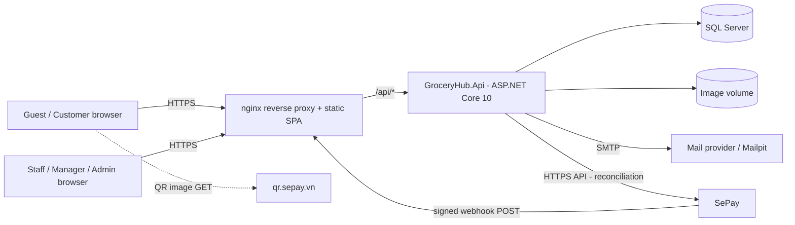
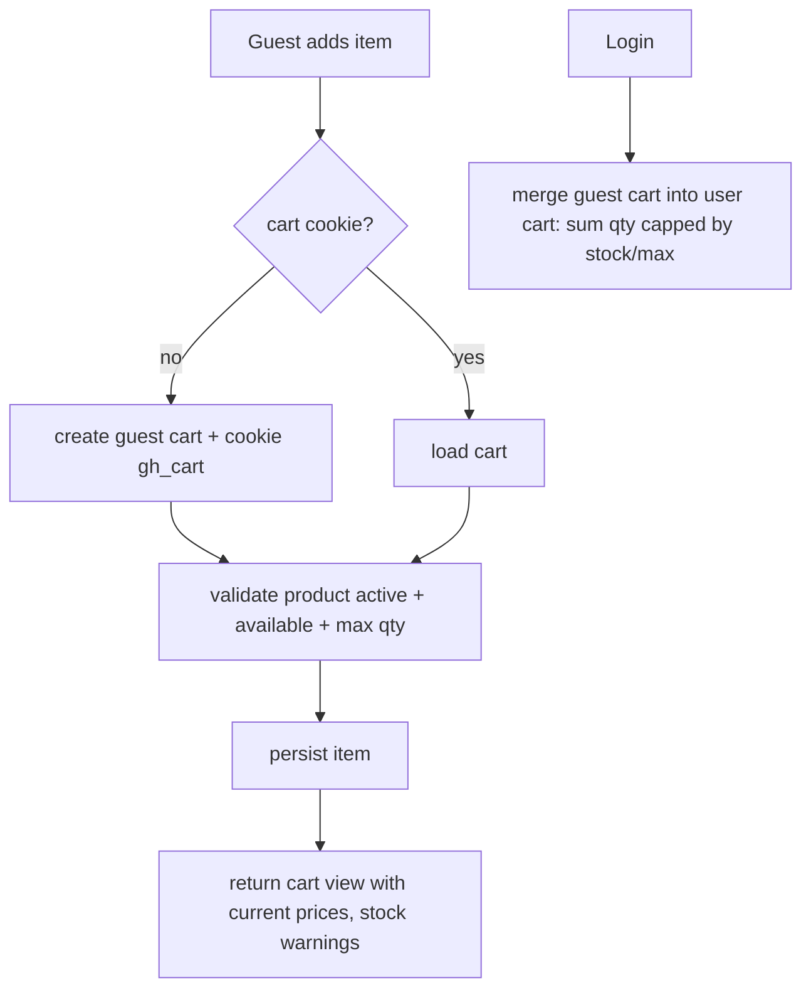
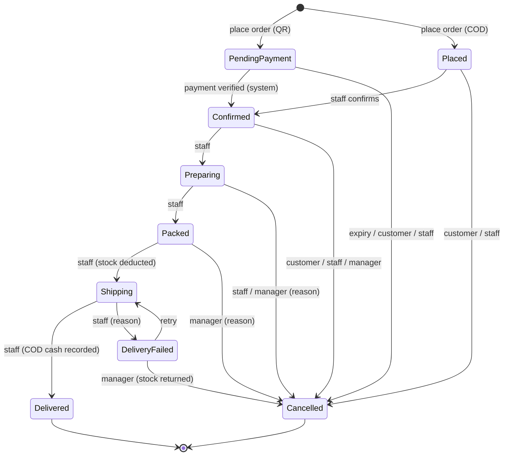
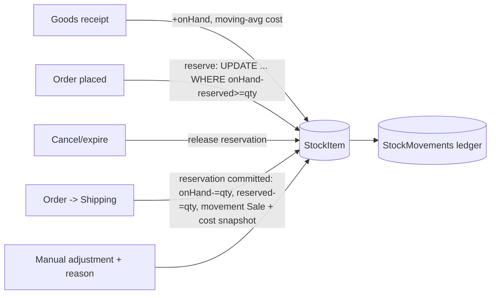

# 05 — System Architecture

## 1. Context


## 2. Architecture decision (ADR-001): modular monolith
- One deployable (`GroceryHub.Api`) hosting all modules; one SQL Server database; schema per module; single `GroceryHubDbContext`.
- Why: stock/order/payment/coupon invariants need ACID transactions; small team; simple Docker deploy; microservices would add distributed-transaction complexity with no benefit at this scale.
- Guardrails to keep it *modular*: separate projects per module; modules talk only through `Contracts`; no cross-module navigation properties; architecture tests; events through an outbox for non-critical side effects.
- Rejected: microservices (complexity), Clean-Architecture single-project (boundaries erode), controllers+MediatR (licence + ceremony).

## 3. Solution layout
```
GroceryHub/
├─ AGENTS.md                      # always-on charter
├─ .agents/{rules,skills,agents}  # Antigravity customisations
├─ docs/{spec,contracts,design,progress,evidence,qa,security,ops,agent-notes}
├─ src/
│  ├─ GroceryHub.Api/                 # composition root, middleware, OpenAPI, hosted services
│  ├─ GroceryHub.SharedKernel/        # Result, Money, DomainEvent, Clock, Guard, pagination
│  ├─ GroceryHub.Persistence/         # DbContext, interceptors, migrations, seeders, outbox
│  └─ GroceryHub.Modules.<Name>/      # Identity, Customers, Catalog, Inventory, Purchasing,
│       ├─ Domain/                     #   Promotions, Cart, Ordering, Payments, Reviews,
│       ├─ Application/                #   Reporting, Audit
│       ├─ Infrastructure/Persistence/ #   (EF configs + query services - DB engineer)
│       ├─ Api/                        #   endpoint classes
│       └─ Contracts/                  #   public interfaces/DTOs/events
├─ tests/{GroceryHub.UnitTests,GroceryHub.IntegrationTests,GroceryHub.ArchitectureTests}
├─ web/                             # Vite app (src/{app,shared,storefront,admin}, e2e/)
├─ deploy/{nginx,db,security}
├─ scripts/
└─ docker-compose.yml, docker-compose.override.yml, .env.example
```

## 4. Module catalog and allowed dependencies
| Module | Owns | May call (via Contracts) |
|---|---|---|
| Identity | users, roles, permissions, tokens, staff profiles | — |
| Customers | profiles, addresses, VN admin units | Identity |
| Catalog | categories, brands, products, images, price history, banners | — |
| Inventory | stock, movements, reservations, stocktake | Catalog (existence/cost) |
| Purchasing | suppliers, POs, goods receipts | Catalog, Inventory (receive → stock+cost) |
| Promotions | coupons, redemptions | Catalog (scope) |
| Cart | carts, items | Catalog (price/availability), Inventory (availability), Promotions (preview) |
| Ordering | orders, status history, shipping zones/rates, idempotency | Cart, Catalog, Inventory (reserve), Promotions (redeem), Customers (address), Payments (create payment) |
| Payments | payments, attempts, webhook inbox, transactions, refunds, COD collections | Ordering (state transitions), Audit |
| Reviews | reviews, moderation | Ordering (verified purchase), Catalog (aggregates) |
| Reporting | read models/queries over all schemas | read-only, via query services |
| Audit | audit logs | none (receives events/calls) |
Rule: arrows are one-way; Ordering→Payments and Payments→Ordering are resolved by `Ordering.Contracts.IOrderPaymentPort` implemented by Ordering and `Payments.Contracts.IPaymentService` implemented by Payments (no project cycle: each references the other's Contracts only).

## 5. Backend architecture
- **Layers per module**: Api (endpoints) → Application (use-cases) → Domain (aggregates, rules) ← Infrastructure (EF, adapters).
- **Cross-cutting (SharedKernel/Api)**: global exception handler → ProblemDetails; request logging with correlation id; auth (JwtBearer + permission policies); rate limiting; FluentValidation filter; idempotency filter; OpenAPI; health checks; Serilog.
- **Background services (hosted)**: `PaymentExpiryService` (expire QR attempts, cancel orders, release stock), `ReconciliationService` (SePay transactions API), `ReservationSweeper` (safety net), `OutboxDispatcher`, `CartCleanupService`.
- **Events**: domain events written to `shared.OutboxMessages` in the same transaction; dispatcher invokes in-process handlers (e.g. Audit, review aggregate update). Handlers are idempotent.
- **Read side**: list endpoints use projection queries (no tracking). Reporting uses SQL views/queries in the module `Infrastructure`.

## 6. Frontend architecture
- Single Vite SPA, two lazy-loaded route trees: `/` (storefront) and `/admin` (admin + staff). Shared: tokens, ui primitives, api client, i18n, formatting.
- Server state in TanStack Query; URL search params for filters; tiny Zustand store for cart drawer/theme; forms with RHF+Zod.
- nginx serves the SPA and proxies `/api` → API (same origin ⇒ simple cookies, no CORS in prod).
- Build output hashed; `index.html` no-cache; assets immutable.

## 7. Authentication flow
```mermaid
sequenceDiagram
  participant B as Browser (SPA)
  participant A as API
  participant D as DB
  B->>A: POST /auth/login {email,password}
  A->>D: verify password (Identity hasher), lockout check
  A-->>B: 200 {accessToken(15m), user, permissions}; Set-Cookie refresh (HttpOnly, Secure, SameSite=Strict, Path=/api/v1/auth)
  B->>A: GET /... Authorization: Bearer access
  A-->>B: 401 (expired)
  B->>A: POST /auth/refresh (cookie + X-Requested-With)
  A->>D: find hashed token, check family/reuse
  A-->>B: 200 new access + rotated refresh cookie
  Note over A,D: reuse of an old refresh token revokes the whole family
```
Register → email verification link (token) → login allowed only after verification (configurable; dev auto-verify forbidden in Production). Forgot/reset via Identity tokens; responses never reveal whether the email exists.

## 8. Authorization flow
1. JWT carries `sub`, `role` (names), `jti`; **no permission list** (fresh permissions resolved server-side).
2. `PermissionAuthorizationHandler` loads `effectivePermissions = RolePermissions(roles) ∪ UserPermissions(user)` from a cache (TTL ≤ 60 s, invalidated on role/permission change).
3. Endpoints declare `RequireAuthorization("<permission>")`. Default-deny architecture test fails the build if any endpoint lacks a policy or explicit `AllowAnonymous`.
4. Object-level checks (customer owns resource) are done in Application services with the current user id; Staff/Manager access to others' orders requires the relevant permission.
5. Frontend gets `permissions` from `GET /auth/me` for UX only.

## 9. Shopping cart flow

Cart view always recomputes prices from Catalog; the cart never stores authoritative totals.

## 10. Order flow and state machine

| Transition | Actor / permission | Side effects |
|---|---|---|
| place → PendingPayment/Placed | Customer | validate cart, reserve stock, redeem coupon, snapshot address/prices, create Payment (+attempt for QR), history row |
| PendingPayment → Confirmed | System (verified webhook) | Payment=Paid, history, event |
| * → Cancelled | per matrix; reason required | release reservation (or return stock if already deducted), release coupon redemption, create refund request if Paid, audit |
| Confirmed → Preparing → Packed | `orders.process` | history, assignment |
| Packed → Shipping | `orders.ship` | commit reservation → `Sale` movements with unit-cost snapshot |
| Shipping → Delivered | `orders.ship` | COD: record `CodCollection`, Payment=Paid; enable reviews |
Invalid transitions return 409 with `ORDER_INVALID_TRANSITION`.

## 11. Inventory flow

Invariants (DB check constraints): `OnHand ≥ 0`, `Reserved ≥ 0`, `Reserved ≤ OnHand`. Every change writes a movement row in the same transaction.

## 12. Payment flow (summary; full spec in doc 11)
Place order (QR) → Payment + Attempt (code `GH##########`, expiry) → QR URL returned → customer pays → SePay webhook → verify → persist inbox → match/validate → transaction: Payment=Paid, Order=Confirmed → status endpoint reflects → SPA shows success. Anything abnormal → review queue. Expiry/reconciliation jobs back it up.

## 13. Deployment architecture (summary; full spec in doc 13)
`web` (nginx, TLS termination or behind a managed proxy) → `api` → `sqlserver`; one-off `migrator`; volumes for DB and images; backups; CI builds images; secrets via env/Docker secrets.

## 14. Observability and errors
Correlation id (`X-Correlation-Id`) in logs and ProblemDetails `traceId`; domain error codes (doc 07 §3); metrics via OpenTelemetry optional (C).

## 15. Architecture tests (must exist from Phase 4)
1. Modules reference only SharedKernel and other modules' Contracts.
2. No type in `Api` depends on EF Core entities.
3. Every endpoint has a policy or explicit anonymous marker.
4. No `DateTime.Now/UtcNow`, `Thread.Sleep` in `src`.
5. No dependency on banned packages (MediatR, AutoMapper, FluentAssertions, MassTransit).
