# 06 — Database Design and ERD (SQL Server)

Conventions: PK `Id uniqueidentifier` unless noted; `CreatedAt/UpdatedAt datetimeoffset`; money `bigint` (VND); text `nvarchar`; `RowVersion` = `rowversion` where listed; enums stored as `nvarchar(32)` strings with check constraints. Schema per module. Cross-module references are by id only (no FK) except where stated.

## 1. ERD (logical)

```mermaid
erDiagram
  USERS ||--o{ USER_ROLES : has
  ROLES ||--o{ USER_ROLES : grants
  ROLES ||--o{ ROLE_PERMISSIONS : includes
  PERMISSIONS ||--o{ ROLE_PERMISSIONS : in
  USERS ||--o{ USER_PERMISSIONS : extra
  USERS ||--o{ REFRESH_TOKENS : owns
  USERS ||--o| STAFF_PROFILES : may_have
  USERS ||--o{ ADDRESSES : saves
  PROVINCES ||--o{ WARDS : contains
  CATEGORIES ||--o{ CATEGORIES : parent_of
  CATEGORIES ||--o{ PRODUCTS : classifies
  BRANDS ||--o{ PRODUCTS : makes
  PRODUCTS ||--o{ PRODUCT_IMAGES : has
  PRODUCTS ||--o{ PRODUCT_PRICE_HISTORY : tracks
  PRODUCTS ||--|| STOCK_ITEMS : stocked_as
  PRODUCTS ||--o{ STOCK_MOVEMENTS : ledger
  SUPPLIERS ||--o{ PURCHASE_ORDERS : receives
  PURCHASE_ORDERS ||--o{ PURCHASE_ORDER_LINES : contains
  SUPPLIERS ||--o{ GOODS_RECEIPTS : delivers
  GOODS_RECEIPTS ||--o{ GOODS_RECEIPT_LINES : contains
  COUPONS ||--o{ COUPON_REDEMPTIONS : used_in
  CARTS ||--o{ CART_ITEMS : contains
  USERS ||--o{ ORDERS : places
  ORDERS ||--o{ ORDER_ITEMS : contains
  ORDERS ||--o{ ORDER_STATUS_HISTORY : logs
  ORDERS ||--o{ STOCK_RESERVATIONS : reserves
  ORDERS ||--|| PAYMENTS : paid_by
  PAYMENTS ||--o{ PAYMENT_ATTEMPTS : tries
  PAYMENT_ATTEMPTS ||--o{ PAYMENT_TRANSACTIONS : matched_by
  WEBHOOK_EVENTS ||--o| PAYMENT_TRANSACTIONS : produces
  PAYMENTS ||--o{ REFUNDS : refunded_by
  ORDERS ||--o| COD_COLLECTIONS : collected
  ORDER_ITEMS ||--o| REVIEWS : reviewed_by
  PRODUCTS ||--o{ REVIEWS : receives
  SHIPPING_ZONES ||--o{ SHIPPING_RATES : priced_by
  SHIPPING_ZONES ||--o{ SHIPPING_ZONE_PROVINCES : covers
```

## 2. Tables by schema
### identity
| Table | Key columns | Constraints / notes |
|---|---|---|
| `Users` (ASP.NET Identity) | Id, Email, NormalizedEmail, PasswordHash, FullName(200), PhoneNumber(20), EmailConfirmed, Status(`Active/Locked/Disabled`), LockoutEnd, AccessFailedCount, SecurityStamp, DeletedAt | UQ NormalizedEmail; IX PhoneNumber |
| `Roles` | Id, Name | UQ Name: Customer, Staff, Manager, Admin (seeded) |
| `UserRoles` | UserId, RoleId | PK(UserId,RoleId) |
| `Permissions` | Code (PK, e.g. `orders.process`), Description, Group | seeded from spec 07 §2 |
| `RolePermissions` | RoleId, PermissionCode | PK both |
| `UserPermissions` | UserId, PermissionCode, GrantedBy, GrantedAt | extra grants (e.g. `purchasing.receive` to one Staff) |
| `RefreshTokens` | Id, UserId, TokenHash(64) UQ, FamilyId, ExpiresAt, RevokedAt, ReplacedByTokenId, CreatedByIp, UserAgent | IX(UserId), IX(FamilyId) |
| `StaffProfiles` | UserId PK, EmployeeCode UQ, Position, HiredAt, Note | |

### customers (+ shared admin units)
| Table | Columns | Notes |
|---|---|---|
| `Addresses` | Id, UserId, RecipientName(120), Phone(20), ProvinceCode, WardCode, ProvinceName, WardName, Street(250), Note(250), IsDefault, DeletedAt | IX(UserId); filtered UQ(UserId) WHERE IsDefault=1 AND DeletedAt IS NULL; max 10 per user enforced in app + test |
| `shared.Provinces` | Code PK, Name, FullName, Type | version-stamped import; 34 rows (2-level model) |
| `shared.Wards` | Code PK, ProvinceCode FK, Name, FullName, Type | ~3,321 rows; IX(ProvinceCode) |
| `shared.AdminUnitDataVersion` | Id, Source, Version, ImportedAt, Licence | provenance |

### catalog
| Table | Columns | Notes |
|---|---|---|
| `Categories` | Id, ParentId, Name, Slug, SortOrder, IsActive, ImageKey | UQ Slug; depth ≤ 3 |
| `Brands` | Id, Name, Slug, LogoKey, IsActive | UQ Slug |
| `Products` | Id, Sku(40), Barcode(32), Name(250), Slug(280), SearchText(500), CategoryId, BrandId, Unit(20), PackSize(60), ListPrice, SellingPrice, CostPrice, Status(`Draft/Active/Hidden`), ShortDescription, Description, SpecsJson, IsFeatured, RatingAvg decimal(3,2), RatingCount, SoldCount, ExpiryTracked bit, DeletedAt, RowVersion | UQ Sku, UQ Slug; CHECK SellingPrice>=0 AND SellingPrice<=ListPrice; IX(CategoryId,Status), IX(BrandId), IX Barcode, IX SearchText (or FTS) |
| `ProductImages` | Id, ProductId FK, FileKey, Alt, SortOrder, IsPrimary, Width, Height | filtered UQ(ProductId) WHERE IsPrimary=1 |
| `ProductPriceHistory` | Id, ProductId, OldSelling, NewSelling, OldList, NewList, ChangedBy, ChangedAt, Reason | IX(ProductId, ChangedAt) |
| `Banners` | Id, Title, ImageKey, LinkUrl, Placement, SortOrder, StartsAt, EndsAt, IsActive | |

### inventory
| Table | Columns | Notes |
|---|---|---|
| `StockItems` | ProductId PK, OnHand, Reserved, ReorderLevel, RowVersion | CHECK OnHand>=0, Reserved>=0, Reserved<=OnHand |
| `StockMovements` | Id bigint identity, ProductId, Type(`Receipt/Sale/Reserve/Release/Adjustment/Return`), Quantity (signed), UnitCost, ReferenceType, ReferenceId, Reason, CreatedBy, CreatedAt | IX(ProductId, CreatedAt); append-only |
| `StockReservations` | Id, OrderId, ProductId, Quantity, Status(`Active/Released/Committed`), ExpiresAt | UQ(OrderId, ProductId); IX(Status, ExpiresAt) |
| `ExpiryLots` (S) | Id, ProductId, ReceiptLineId, ExpiryDate, QuantityRemaining | near-expiry report; FEFO deduction is C |

### purchasing
`Suppliers`(Id, Code UQ, Name, Phone, Email, Address, TaxCode, Note, DeletedAt) · `PurchaseOrders`(Id, Code UQ, SupplierId FK, Status, ExpectedAt, Note, TotalCost, CreatedBy) · `PurchaseOrderLines`(Id, PurchaseOrderId, ProductId, QuantityOrdered, QuantityReceived, UnitCost) · `GoodsReceipts`(Id, Code UQ, PurchaseOrderId NULL, SupplierId, InvoiceNo, ReceivedAt, ReceivedBy, Note) · `GoodsReceiptLines`(Id, GoodsReceiptId, ProductId, Quantity, UnitCost, ExpiryDate NULL, BatchNo NULL). Receipts immutable.

### promotions
`Coupons`(Id, Code UQ, Name, Type `Percent/FixedAmount/FreeShipping`, Value, MaxDiscount NULL, MinSubtotal, StartsAt, EndsAt, UsageLimit NULL, PerUserLimit NULL, UsedCount, IsActive, RowVersion) · `CouponScopes`(CouponId, ScopeType `Category/Product`, ScopeId) · `CouponRedemptions`(Id, CouponId, UserId, OrderId UQ, Amount, RedeemedAt, ReleasedAt NULL). CHECK Percent value 1–100.

### cart
`Carts`(Id, UserId NULL, GuestToken NULL, CouponCode NULL, UpdatedAt, ExpiresAt) with filtered UQ(UserId) WHERE UserId IS NOT NULL and UQ(GuestToken) WHERE NOT NULL · `CartItems`(CartId, ProductId, Quantity, AddedAt) PK(CartId, ProductId), CHECK Quantity BETWEEN 1 AND 99.

### ordering
| Table | Columns | Notes |
|---|---|---|
| `Orders` | Id, OrderNumber(20), UserId, Status, PaymentMethod(`COD/SEPAY_QR`), PaymentStatus, Subtotal, CouponCode, CouponDiscount, ShippingFee, Total, Recipient*/Phone/ProvinceCode/WardCode/ProvinceName/WardName/Street (address snapshot), CustomerNote, InternalNote, AssignedToUserId, PlacedAt, ConfirmedAt, PackedAt, ShippedAt, DeliveredAt, CancelledAt, CancelReason, ExpiresAt, IdempotencyKey, RowVersion | UQ OrderNumber (format `DHyyMMdd-NNNN` from SEQUENCE); IX(UserId, PlacedAt DESC), IX(Status, PlacedAt), IX ExpiresAt WHERE Status='PendingPayment'; CHECK Total = Subtotal − CouponDiscount + ShippingFee |
| `OrderItems` | Id, OrderId FK, ProductId, Sku, Name, ImageKey, Unit, UnitPrice, ListPriceAtOrder, Quantity, LineSubtotal, DiscountAllocated, LineTotal, UnitCostSnapshot NULL (set at shipping) | IX(OrderId), IX(ProductId) |
| `OrderStatusHistory` | Id, OrderId FK, FromStatus, ToStatus, ActorUserId NULL (system), Reason, At | append-only |
| `ShippingZones` / `ShippingZoneProvinces` / `ShippingRates` | zone name; province→zone (UQ ProvinceCode); (ZoneId, MinSubtotal, Fee, FreeAboveSubtotal NULL) | editable settings |
| `IdempotencyKeys` | Key, Scope, RequestHash, ResponseStatus, ResponseBody, CreatedAt | UQ(Key, Scope); cleanup job |

### payments
| Table | Columns | Notes |
|---|---|---|
| `Payments` | Id, OrderId UQ, Method, Amount, Status(`Unpaid/Pending/Paid/Failed/Expired/PartiallyRefunded/Refunded`), PaidAt, RowVersion | one payment per order; attempts hold QR codes |
| `PaymentAttempts` | Id, PaymentId FK, PaymentCode(16) UQ, Amount, Status(`Open/Paid/Expired/Superseded`), ExpiresAt, CreatedAt | code `GH` + 10 digits from SEQUENCE |
| `WebhookEvents` | Id, Provider(`SEPAY`), ProviderTransactionId, RawBody nvarchar(max), SignatureValid bit, ReceivedAt, ProcessingStatus(`Received/Processed/Ignored/Failed`), Error, ProcessedAt, DeliveryCount | **UQ(Provider, ProviderTransactionId)** = idempotency anchor |
| `PaymentTransactions` | Id, WebhookEventId UQ, PaymentAttemptId NULL, Direction, Amount, AccountNumber, Gateway, ReferenceCode, Content, TransactionTime, MatchStatus(`Matched/UnknownCode/AmountMismatch/Overpaid/Underpaid/LateAfterExpiry/WrongAccount/DuplicatePayment/OutgoingIgnored`), ReviewStatus(`None/NeedsReview/Resolved`), ResolvedBy, ResolvedAt, ResolutionNote | IX(ReviewStatus) |
| `Refunds` | Id, PaymentId, OrderId, Amount, Reason, Status(`Requested/Approved/Rejected/Completed`), RequestedBy/At, DecidedBy/At, CompletedBy/At, BankReference, Note | CHECK Amount>0; app rule RequestedBy≠DecidedBy |
| `CodCollections` | Id, OrderId UQ, Amount, CollectedBy, CollectedAt, HandedOverAt NULL, HandedOverTo NULL | cash reconciliation |

### reviews
`Reviews`(Id, ProductId, UserId, OrderItemId UQ, Rating CHECK 1–5, Title, Body(2000), Status `Pending/Approved/Rejected`, ModeratedBy, ModeratedAt, ReplyBody, ReplyBy, ReplyAt, CreatedAt, EditedAt) · IX(ProductId, Status, CreatedAt).

### audit and shared
`audit.AuditLogs`(Id bigint identity, At, ActorUserId NULL, ActorRole, Action, EntityType, EntityId, BeforeJson, AfterJson, Ip, CorrelationId) append-only; IX(EntityType, EntityId), IX(ActorUserId, At). `shared.OutboxMessages`(Id, Type, Payload, OccurredAt, ProcessedAt, Attempts, Error). `shared.Settings`(Key PK, Value, UpdatedBy, UpdatedAt). SEQUENCEs: `ordering.OrderNumberSeq`, `payments.PaymentCodeSeq` (start 1000000001, no reuse).

## 3. Indexing and query notes
- Product list: `IX_Products_Category_Status` + `SearchText` match; measure with ≥ 20,000 dev products before choosing FTS vs `LIKE`/computed column.
- Orders list (customer): `IX(UserId, PlacedAt DESC)`; (staff queue): `IX(Status, PlacedAt)`.
- Expiry sweeps use filtered indexes on `ExpiresAt`.
- All unique constraints listed above are mandatory (they are business invariants).

## 4. Concurrency and transactions
- Reserve stock: single `UPDATE StockItems SET Reserved = Reserved + @q WHERE ProductId=@id AND OnHand - Reserved >= @q`; affected rows must equal 1.
- Coupon redemption: conditional increment `UsedCount < UsageLimit` and per-user count check inside the order transaction (serializable range lock or unique counter row).
- Webhook processing: unique `WebhookEvents` row first; then transaction with rowversion on `Payments`/`Orders`.
- Use `READ COMMITTED SNAPSHOT` at DB level (documented in migration script) to reduce reader/writer blocking.

## 5. Data lifecycle
Reference seeds (roles/permissions/provinces/wards/zones/settings) idempotent. Development sample data seeder (clearly marked, Development only). Retention: webhook raw bodies ≥ 24 months; audit logs ≥ 24 months; carts expire after 30 days idle.
