# 06 — Database Design and ERD (SQL Server — v1.0 Implementation Specification)

- **Version:** `1.0` (Phase 03 Frozen Baseline — changes require a Change Request `docs/agent-notes/CR-<nnn>-<slug>.md`)
- **Database Engine:** SQL Server 2022 (`Express` in initial single-VPS production per `DEC-010`, `Developer` in local/CI containers)
- **ORM & Persistence:** EF Core 10 (`GroceryHubDbContext`, single DbContext, schema-per-module, `IEntityTypeConfiguration<T>` discovered per module assembly)
- **Database-Level Settings:**
  - `ALTER DATABASE [GroceryHub] SET READ_COMMITTED_SNAPSHOT ON;` (enables row-versioned non-blocking reads under `READ COMMITTED`)
  - Default Collation: `Latin1_General_100_CI_AI_SC_UTF8` (or `Vietnamese_100_CI_AI_SC_UTF8`), paired with explicit diacritic-folded `SearchText` (`Đ/đ -> d`, NFC normalization + non-spacing mark removal) for deterministic Vietnamese search (`FR-CUS-003`).
- **Global Conventions (`.agents/rules/database.md`):**
  1. **Primary Keys:** `Id uniqueidentifier NOT NULL` (generated in application via `Guid.CreateVersion7()` for sequential index locality) unless a domain natural key, composite key, or `bigint IDENTITY(1,1)` append-only ledger key is explicitly specified.
  2. **Audit Timestamps:** Every table includes `CreatedAt datetimeoffset(7) NOT NULL DEFAULT (SYSDATETIMEOFFSET())` and `UpdatedAt datetimeoffset(7) NOT NULL DEFAULT (SYSDATETIMEOFFSET())` (automatically maintained by `AuditableEntitySaveChangesInterceptor`), except immutable append-only log/history tables which record their occurrence timestamp (`CreatedAt` / `At` / `OccurredAt` / `ReceivedAt`).
  3. **Concurrency Tokens:** Aggregates subject to concurrent mutation (`catalog.Products`, `inventory.StockItems`, `promotions.Coupons`, `ordering.Orders`, `payments.Payments`) include `RowVersion rowversion NOT NULL` (`IsRowVersion()`).
  4. **Money & Quantities:** All monetary amounts are integer VND stored as `bigint` (`long` in C#) — never `decimal`/`float`. Quantities are `int`.
  5. **Strings & Enums:** All Vietnamese text columns use `nvarchar(N)` with explicit max lengths. Status and type enums are persisted as `nvarchar(32)` (or `nvarchar(24)`) with explicit `CK_*` `CHECK` constraints enforcing the exact allowed values.
  6. **Cross-Module Foreign Keys:** Strictly forbidden across module schemas **except** explicit foreign keys to `identity.Users(Id)` (`ON DELETE NO ACTION`) where documented below. All other cross-module references store the target `uniqueidentifier` (or code) plus a non-clustered index and are validated via module `Contracts`.

---

## 1. Logical ERD & Module-to-Schema Ownership Map

### 1.1 Module-to-Schema Ownership Matrix

| Owning Module | SQL Schema | Owned Tables (`[schema].[Table]`) | Allowed Outbound FK Target |
|---|---|---|---|
| **Identity** (`GroceryHub.Modules.Identity`) | `identity` | `Users`, `Roles`, `UserRoles`, `Permissions`, `RolePermissions`, `UserPermissions`, `RefreshTokens`, `StaffProfiles`, `UserClaims`, `UserLogins`, `UserTokens`, `RoleClaims` | Intra-schema (`identity.*`) |
| **Customers** (`GroceryHub.Modules.Customers`) | `customers` | `Addresses` | `identity.Users(Id)` |
| **Shared / Reference** (`GroceryHub.Persistence`) | `shared` | `Provinces`, `Wards`, `AdminUnitDataVersion`, `OutboxMessages`, `Settings` | Intra-schema (`shared.Provinces`), `identity.Users(Id)` |
| **Catalog** (`GroceryHub.Modules.Catalog`) | `catalog` | `Categories`, `Brands`, `Products`, `ProductImages`, `ProductPriceHistory`, `Banners` | Intra-schema (`catalog.*`), `identity.Users(Id)` |
| **Inventory** (`GroceryHub.Modules.Inventory`) | `inventory` | `StockItems`, `StockMovements`, `StockReservations`, `ExpiryLots` | Intra-schema (`inventory.*`), `identity.Users(Id)` |
| **Purchasing** (`GroceryHub.Modules.Purchasing`) | `purchasing` | `Suppliers`, `PurchaseOrders`, `PurchaseOrderLines`, `GoodsReceipts`, `GoodsReceiptLines` | Intra-schema (`purchasing.*`), `identity.Users(Id)` |
| **Promotions** (`GroceryHub.Modules.Promotions`) | `promotions` | `Coupons`, `CouponScopes`, `CouponRedemptions` | Intra-schema (`promotions.*`), `identity.Users(Id)` |
| **Cart** (`GroceryHub.Modules.Cart`) | `cart` | `Carts`, `CartItems` | Intra-schema (`cart.Carts`), `identity.Users(Id)` |
| **Ordering** (`GroceryHub.Modules.Ordering`) | `ordering` | `Orders`, `OrderItems`, `OrderStatusHistory`, `ShippingZones`, `ShippingZoneProvinces`, `ShippingRates`, `IdempotencyKeys` | Intra-schema (`ordering.*`), `identity.Users(Id)` |
| **Payments** (`GroceryHub.Modules.Payments`) | `payments` | `Payments`, `PaymentAttempts`, `WebhookEvents`, `PaymentTransactions`, `Refunds`, `CodCollections` | Intra-schema (`payments.*`), `identity.Users(Id)` |
| **Reviews** (`GroceryHub.Modules.Reviews`) | `reviews` | `Reviews` | `identity.Users(Id)` |
| **Audit** (`GroceryHub.Modules.Audit`) | `audit` | `AuditLogs` | None (append-only) |

### 1.2 Logical Entity-Relationship Diagram

```mermaid
erDiagram
  %% identity schema
  IDENTITY_USERS ||--o{ IDENTITY_USER_ROLES : has
  IDENTITY_ROLES ||--o{ IDENTITY_USER_ROLES : grants
  IDENTITY_ROLES ||--o{ IDENTITY_ROLE_PERMISSIONS : includes
  IDENTITY_PERMISSIONS ||--o{ IDENTITY_ROLE_PERMISSIONS : in
  IDENTITY_USERS ||--o{ IDENTITY_USER_PERMISSIONS : extra
  IDENTITY_PERMISSIONS ||--o{ IDENTITY_USER_PERMISSIONS : grants_extra
  IDENTITY_USERS ||--o{ IDENTITY_REFRESH_TOKENS : owns
  IDENTITY_USERS ||--o| IDENTITY_STAFF_PROFILES : may_have

  %% customers + shared admin units
  IDENTITY_USERS ||--o{ CUSTOMERS_ADDRESSES : saves
  SHARED_PROVINCES ||--o{ SHARED_WARDS : contains

  %% catalog schema
  CATALOG_CATEGORIES ||--o{ CATALOG_CATEGORIES : parent_of
  CATALOG_CATEGORIES ||--o{ CATALOG_PRODUCTS : classifies
  CATALOG_BRANDS ||--o{ CATALOG_PRODUCTS : makes
  CATALOG_PRODUCTS ||--o{ CATALOG_PRODUCT_IMAGES : has
  CATALOG_PRODUCTS ||--o{ CATALOG_PRODUCT_PRICE_HISTORY : tracks

  %% inventory schema
  CATALOG_PRODUCTS ||--|| INVENTORY_STOCK_ITEMS : stocked_as
  CATALOG_PRODUCTS ||--o{ INVENTORY_STOCK_MOVEMENTS : ledger
  CATALOG_PRODUCTS ||--o{ INVENTORY_EXPIRY_LOTS : tracks_lots
  ORDERING_ORDERS ||--o{ INVENTORY_STOCK_RESERVATIONS : reserves

  %% purchasing schema
  PURCHASING_SUPPLIERS ||--o{ PURCHASING_PURCHASE_ORDERS : receives
  PURCHASING_PURCHASE_ORDERS ||--o{ PURCHASING_PURCHASE_ORDER_LINES : contains
  PURCHASING_SUPPLIERS ||--o{ PURCHASING_GOODS_RECEIPTS : delivers
  PURCHASING_PURCHASE_ORDERS ||--o{ PURCHASING_GOODS_RECEIPTS : fulfilled_by
  PURCHASING_GOODS_RECEIPTS ||--o{ PURCHASING_GOODS_RECEIPT_LINES : contains

  %% promotions schema
  PROMOTIONS_COUPONS ||--o{ PROMOTIONS_COUPON_SCOPES : targets
  PROMOTIONS_COUPONS ||--o{ PROMOTIONS_COUPON_REDEMPTIONS : used_in

  %% cart schema
  CART_CARTS ||--o{ CART_CART_ITEMS : contains

  %% ordering schema
  IDENTITY_USERS ||--o{ ORDERING_ORDERS : places
  ORDERING_ORDERS ||--o{ ORDERING_ORDER_ITEMS : contains
  ORDERING_ORDERS ||--o{ ORDERING_ORDER_STATUS_HISTORY : logs
  ORDERING_SHIPPING_ZONES ||--o{ ORDERING_SHIPPING_RATES : priced_by
  ORDERING_SHIPPING_ZONES ||--o{ ORDERING_SHIPPING_ZONE_PROVINCES : covers

  %% payments schema
  ORDERING_ORDERS ||--|| PAYMENTS_PAYMENTS : paid_by
  PAYMENTS_PAYMENTS ||--o{ PAYMENTS_PAYMENT_ATTEMPTS : tries
  PAYMENTS_PAYMENT_ATTEMPTS ||--o{ PAYMENTS_PAYMENT_TRANSACTIONS : matched_by
  PAYMENTS_WEBHOOK_EVENTS ||--o| PAYMENTS_PAYMENT_TRANSACTIONS : produces
  PAYMENTS_PAYMENTS ||--o{ PAYMENTS_REFUNDS : refunded_by
  ORDERING_ORDERS ||--o| PAYMENTS_COD_COLLECTIONS : collected

  %% reviews schema
  ORDERING_ORDER_ITEMS ||--o| REVIEWS_REVIEWS : reviewed_by
  CATALOG_PRODUCTS ||--o{ REVIEWS_REVIEWS : receives
```



---

## 2. Final Enum String Values & Check Constraints Summary

All enum columns use readable string literals enforced at the database level via `CHECK` constraints (`CK_<Table>_<Column>`):

| Schema.Table.Column | SQL Type | Allowed Values (`CHECK` Constraint) | Reference |
|---|---|---|---|
| `identity.Users.Status` | `nvarchar(24)` | `'Active'`, `'Locked'`, `'Disabled'` | `FR-ADM-008`, `FR-ADM-009` |
| `catalog.Products.Status` | `nvarchar(24)` | `'Draft'`, `'Active'`, `'Hidden'` | `FR-ADM-002` |
| `inventory.StockMovements.Type` | `nvarchar(24)` | `'Receipt'`, `'Sale'`, `'Reserve'`, `'Release'`, `'Adjustment'`, `'Return'` | `BR-02`, `FR-ADM-005` |
| `inventory.StockReservations.Status` | `nvarchar(24)` | `'Active'`, `'Released'`, `'Committed'` | `BR-02` |
| `purchasing.PurchaseOrders.Status` | `nvarchar(24)` | `'Draft'`, `'Ordered'`, `'PartiallyReceived'`, `'Received'`, `'Closed'`, `'Cancelled'` | `BR-11`, `FR-ADM-006` |
| `promotions.Coupons.Type` | `nvarchar(24)` | `'Percent'`, `'FixedAmount'`, `'FreeShipping'` | `BR-04`, `DEC-011` (`Q-009`) |
| `promotions.CouponScopes.ScopeType` | `nvarchar(24)` | `'Category'`, `'Product'` | `BR-04` |
| `ordering.Orders.Status` | `nvarchar(24)` | `'PendingPayment'`, `'Placed'`, `'Confirmed'`, `'Preparing'`, `'Packed'`, `'Shipping'`, `'Delivered'`, `'DeliveryFailed'`, `'Cancelled'` | `BR-08`, `DEC-011` (`Q-006`) |
| `ordering.Orders.PaymentMethod` | `nvarchar(24)` | `'COD'`, `'SEPAY_QR'` | `BR-06` |
| `ordering.Orders.PaymentStatus` | `nvarchar(24)` | `'Unpaid'`, `'Pending'`, `'Paid'`, `'Failed'`, `'Expired'`, `'PartiallyRefunded'`, `'Refunded'` | `BR-08` |
| `payments.Payments.Method` | `nvarchar(24)` | `'COD'`, `'SEPAY_QR'` | `BR-06` |
| `payments.Payments.Status` | `nvarchar(24)` | `'Unpaid'`, `'Pending'`, `'Paid'`, `'Failed'`, `'Expired'`, `'PartiallyRefunded'`, `'Refunded'` | `BR-08`, Spec 11 |
| `payments.PaymentAttempts.Status` | `nvarchar(24)` | `'Open'`, `'Paid'`, `'Expired'`, `'Superseded'` | Spec 11 §4, `DEC-011` (`Q-010`) |
| `payments.WebhookEvents.ProcessingStatus` | `nvarchar(24)` | `'Received'`, `'Processing'`, `'Processed'`, `'Ignored'`, `'Failed'` | Spec 11 §5.4 |
| `payments.PaymentTransactions.Direction` | `nvarchar(8)` | `'in'`, `'out'` | Spec 11 §5.5 |
| `payments.PaymentTransactions.MatchStatus` | `nvarchar(32)` | `'Matched'`, `'UnknownCode'`, `'WrongAccount'`, `'AmountMismatch'`, `'Underpaid'`, `'Overpaid'`, `'LateAfterExpiry'`, `'DuplicatePayment'`, `'OutgoingIgnored'` | Spec 11 §4 & §5.7 |
| `payments.PaymentTransactions.ReviewStatus` | `nvarchar(24)` | `'None'`, `'NeedsReview'`, `'Resolved'` | Spec 11 §4 & §6 |
| `payments.Refunds.Status` | `nvarchar(24)` | `'Requested'`, `'Approved'`, `'Rejected'`, `'Completed'` | `BR-15`, Spec 11 §8 |
| `reviews.Reviews.Status` | `nvarchar(24)` | `'Pending'`, `'Approved'`, `'Rejected'` | `BR-09`, `FR-ADM-013` |

---

## 3. Column-by-Column Table Specifications by Schema

### 3.1 Schema: `identity` (Owning Module: `GroceryHub.Modules.Identity`)

#### `identity.Users`
Backed by ASP.NET Core Identity `IdentityUser<Guid>` extended with GroceryHub profile, status, and soft-delete fields. *(Note: Standard ASP.NET Identity companion tables `identity.UserClaims`, `identity.UserLogins`, `identity.UserTokens`, and `identity.RoleClaims` are also mapped to the `identity` schema with standard EF Core Identity columns.)*

| Column Name | SQL Server Type | Nullability | Default | Constraints / Notes |
|---|---|---|---|---|
| `Id` | `uniqueidentifier` | `NOT NULL` | — | `PK_Users` (Clustered) |
| `UserName` | `nvarchar(256)` | `NULL` | `NULL` | Mirrors `Email` for ASP.NET Identity compatibility |
| `NormalizedUserName` | `nvarchar(256)` | `NULL` | `NULL` | `UQ_Users_NormalizedUserName` (filtered `WHERE NormalizedUserName IS NOT NULL`) |
| `Email` | `nvarchar(256)` | `NOT NULL` | — | User login email |
| `NormalizedEmail` | `nvarchar(256)` | `NOT NULL` | — | `UQ_Users_NormalizedEmail` (uppercase normalized) |
| `EmailConfirmed` | `bit` | `NOT NULL` | `0` | Must be `1` before login (`FR-CUS-006`) |
| `PasswordHash` | `nvarchar(512)` | `NOT NULL` | — | ASP.NET Core Identity PBKDF2 hash |
| `SecurityStamp` | `nvarchar(128)` | `NOT NULL` | — | Rotated on password/role/lockout change |
| `ConcurrencyStamp` | `nvarchar(128)` | `NOT NULL` | — | ASP.NET Core Identity optimistic concurrency token |
| `FullName` | `nvarchar(200)` | `NOT NULL` | — | Vietnamese full name (`FR-CUS-007`) |
| `PhoneNumber` | `nvarchar(20)` | `NULL` | `NULL` | Normalized VN phone (`0xxxxxxxxx`), `BR-17` |
| `PhoneNumberConfirmed` | `bit` | `NOT NULL` | `0` | Standard Identity field |
| `TwoFactorEnabled` | `bit` | `NOT NULL` | `0` | Standard Identity field |
| `Status` | `nvarchar(24)` | `NOT NULL` | `'Active'` | `CK_Users_Status CHECK (Status IN ('Active', 'Locked', 'Disabled'))` |
| `LockoutEnd` | `datetimeoffset(7)` | `NULL` | `NULL` | Lockout expiry timestamp |
| `LockoutEnabled` | `bit` | `NOT NULL` | `1` | Always `1` for brute-force protection |
| `AccessFailedCount` | `int` | `NOT NULL` | `0` | Failed login counter |
| `DeletedAt` | `datetimeoffset(7)` | `NULL` | `NULL` | Soft-delete / PII anonymization timestamp (`NFR-010`) |
| `CreatedAt` | `datetimeoffset(7)` | `NOT NULL` | `SYSDATETIMEOFFSET()` | Audit creation timestamp |
| `UpdatedAt` | `datetimeoffset(7)` | `NOT NULL` | `SYSDATETIMEOFFSET()` | Audit modification timestamp |

- **Constraints & Indexes:**
  - `PK_Users PRIMARY KEY CLUSTERED (Id)`
  - `UQ_Users_NormalizedEmail UNIQUE NONCLUSTERED (NormalizedEmail)`
  - `UQ_Users_NormalizedUserName UNIQUE NONCLUSTERED (NormalizedUserName) WHERE NormalizedUserName IS NOT NULL`
  - `CK_Users_Status CHECK (Status IN ('Active', 'Locked', 'Disabled'))`
  - `IX_Users_PhoneNumber NONCLUSTERED (PhoneNumber) WHERE PhoneNumber IS NOT NULL`
  - `IX_Users_Status_CreatedAt NONCLUSTERED (Status ASC, CreatedAt DESC) INCLUDE (Email, FullName, PhoneNumber)`

#### `identity.Roles`

| Column Name | SQL Server Type | Nullability | Default | Constraints / Notes |
|---|---|---|---|---|
| `Id` | `uniqueidentifier` | `NOT NULL` | — | `PK_Roles` |
| `Name` | `nvarchar(64)` | `NOT NULL` | — | `Customer`, `Staff`, `Manager`, `Admin` |
| `NormalizedName` | `nvarchar(64)` | `NOT NULL` | — | `UQ_Roles_NormalizedName` (`CUSTOMER`, `STAFF`, `MANAGER`, `ADMIN`) |
| `Description` | `nvarchar(250)` | `NULL` | `NULL` | Role description |
| `IsSystem` | `bit` | `NOT NULL` | `1` | Built-in roles cannot be deleted |
| `ConcurrencyStamp` | `nvarchar(128)` | `NOT NULL` | — | Identity concurrency token |
| `CreatedAt` | `datetimeoffset(7)` | `NOT NULL` | `SYSDATETIMEOFFSET()` | |
| `UpdatedAt` | `datetimeoffset(7)` | `NOT NULL` | `SYSDATETIMEOFFSET()` | |

- **Constraints & Indexes:**
  - `PK_Roles PRIMARY KEY CLUSTERED (Id)`
  - `UQ_Roles_Name UNIQUE NONCLUSTERED (Name)`
  - `UQ_Roles_NormalizedName UNIQUE NONCLUSTERED (NormalizedName)`

#### `identity.UserRoles`

| Column Name | SQL Server Type | Nullability | Default | Constraints / Notes |
|---|---|---|---|---|
| `UserId` | `uniqueidentifier` | `NOT NULL` | — | `FK_UserRoles_Users` → `identity.Users(Id)` |
| `RoleId` | `uniqueidentifier` | `NOT NULL` | — | `FK_UserRoles_Roles` → `identity.Roles(Id)` |
| `CreatedAt` | `datetimeoffset(7)` | `NOT NULL` | `SYSDATETIMEOFFSET()` | Role assignment timestamp |

- **Constraints & Indexes:**
  - `PK_UserRoles PRIMARY KEY CLUSTERED (UserId, RoleId)`
  - `FK_UserRoles_Users FOREIGN KEY (UserId) REFERENCES identity.Users(Id) ON DELETE CASCADE`
  - `FK_UserRoles_Roles FOREIGN KEY (RoleId) REFERENCES identity.Roles(Id) ON DELETE CASCADE`
  - `IX_UserRoles_RoleId NONCLUSTERED (RoleId)`

#### `identity.Permissions`

| Column Name | SQL Server Type | Nullability | Default | Constraints / Notes |
|---|---|---|---|---|
| `Code` | `nvarchar(64)` | `NOT NULL` | — | `PK_Permissions` (e.g., `orders.process`, `purchasing.receive`) |
| `Group` | `nvarchar(40)` | `NOT NULL` | — | Logical grouping (`Catalog`, `Inventory`, `Orders`, etc.) |
| `Description` | `nvarchar(300)` | `NOT NULL` | — | Human-readable explanation (`docs/spec/permissions-seed.md`) |
| `AllowPerUserGrant` | `bit` | `NOT NULL` | `0` | Whether `UserPermissions` grants are allowed |
| `CreatedAt` | `datetimeoffset(7)` | `NOT NULL` | `SYSDATETIMEOFFSET()` | |
| `UpdatedAt` | `datetimeoffset(7)` | `NOT NULL` | `SYSDATETIMEOFFSET()` | |

- **Constraints & Indexes:**
  - `PK_Permissions PRIMARY KEY CLUSTERED (Code)`
  - `IX_Permissions_Group NONCLUSTERED (Group ASC, Code ASC)`

#### `identity.RolePermissions`

| Column Name | SQL Server Type | Nullability | Default | Constraints / Notes |
|---|---|---|---|---|
| `RoleId` | `uniqueidentifier` | `NOT NULL` | — | `FK_RolePermissions_Roles` → `identity.Roles(Id)` |
| `PermissionCode` | `nvarchar(64)` | `NOT NULL` | — | `FK_RolePermissions_Permissions` → `identity.Permissions(Code)` |
| `CreatedAt` | `datetimeoffset(7)` | `NOT NULL` | `SYSDATETIMEOFFSET()` | |

- **Constraints & Indexes:**
  - `PK_RolePermissions PRIMARY KEY CLUSTERED (RoleId, PermissionCode)`
  - `FK_RolePermissions_Roles FOREIGN KEY (RoleId) REFERENCES identity.Roles(Id) ON DELETE CASCADE`
  - `FK_RolePermissions_Permissions FOREIGN KEY (PermissionCode) REFERENCES identity.Permissions(Code) ON DELETE CASCADE`
  - `IX_RolePermissions_PermissionCode NONCLUSTERED (PermissionCode)`

#### `identity.UserPermissions`

| Column Name | SQL Server Type | Nullability | Default | Constraints / Notes |
|---|---|---|---|---|
| `UserId` | `uniqueidentifier` | `NOT NULL` | — | `FK_UserPermissions_Users` → `identity.Users(Id)` |
| `PermissionCode` | `nvarchar(64)` | `NOT NULL` | — | `FK_UserPermissions_Permissions` → `identity.Permissions(Code)` |
| `GrantedBy` | `uniqueidentifier` | `NOT NULL` | — | `FK_UserPermissions_GrantedBy` → `identity.Users(Id)` (`ON DELETE NO ACTION`) |
| `GrantedAt` | `datetimeoffset(7)` | `NOT NULL` | `SYSDATETIMEOFFSET()` | Timestamp of grant |

- **Constraints & Indexes:**
  - `PK_UserPermissions PRIMARY KEY CLUSTERED (UserId, PermissionCode)`
  - `FK_UserPermissions_Users FOREIGN KEY (UserId) REFERENCES identity.Users(Id) ON DELETE CASCADE`
  - `FK_UserPermissions_Permissions FOREIGN KEY (PermissionCode) REFERENCES identity.Permissions(Code) ON DELETE CASCADE`
  - `FK_UserPermissions_GrantedBy FOREIGN KEY (GrantedBy) REFERENCES identity.Users(Id) ON DELETE NO ACTION`
  - `IX_UserPermissions_PermissionCode NONCLUSTERED (PermissionCode)`

#### `identity.RefreshTokens`

| Column Name | SQL Server Type | Nullability | Default | Constraints / Notes |
|---|---|---|---|---|
| `Id` | `uniqueidentifier` | `NOT NULL` | — | `PK_RefreshTokens` |
| `UserId` | `uniqueidentifier` | `NOT NULL` | — | `FK_RefreshTokens_Users` → `identity.Users(Id)` |
| `TokenHash` | `nvarchar(64)` | `NOT NULL` | — | `UQ_RefreshTokens_TokenHash` (SHA-256 hex of raw token; raw never stored) |
| `FamilyId` | `uniqueidentifier` | `NOT NULL` | — | Token rotation family identifier for reuse detection |
| `ExpiresAt` | `datetimeoffset(7)` | `NOT NULL` | — | Expiration timestamp |
| `RevokedAt` | `datetimeoffset(7)` | `NULL` | `NULL` | Set when rotated, logged out, or revoked on reuse detection |
| `ReplacedByTokenId` | `uniqueidentifier` | `NULL` | `NULL` | Points to successor `RefreshTokens.Id` |
| `CreatedByIp` | `nvarchar(45)` | `NULL` | `NULL` | Client IPv4/IPv6 at issuance |
| `UserAgent` | `nvarchar(256)` | `NULL` | `NULL` | Truncated client User-Agent |
| `CreatedAt` | `datetimeoffset(7)` | `NOT NULL` | `SYSDATETIMEOFFSET()` | |
| `UpdatedAt` | `datetimeoffset(7)` | `NOT NULL` | `SYSDATETIMEOFFSET()` | |

- **Constraints & Indexes:**
  - `PK_RefreshTokens PRIMARY KEY CLUSTERED (Id)`
  - `FK_RefreshTokens_Users FOREIGN KEY (UserId) REFERENCES identity.Users(Id) ON DELETE CASCADE`
  - `UQ_RefreshTokens_TokenHash UNIQUE NONCLUSTERED (TokenHash)`
  - `IX_RefreshTokens_UserId_ExpiresAt NONCLUSTERED (UserId ASC, ExpiresAt DESC)`
  - `IX_RefreshTokens_FamilyId NONCLUSTERED (FamilyId)`

#### `identity.StaffProfiles`

| Column Name | SQL Server Type | Nullability | Default | Constraints / Notes |
|---|---|---|---|---|
| `UserId` | `uniqueidentifier` | `NOT NULL` | — | `PK_StaffProfiles`, `FK_StaffProfiles_Users` → `identity.Users(Id)` |
| `EmployeeCode` | `nvarchar(32)` | `NOT NULL` | — | `UQ_StaffProfiles_EmployeeCode` (e.g., `NV0001`) |
| `Position` | `nvarchar(100)` | `NOT NULL` | — | Job title (e.g., `Nhân viên kho`, `Quản lý cửa hàng`) |
| `HiredAt` | `date` | `NOT NULL` | — | Start date |
| `Note` | `nvarchar(500)` | `NULL` | `NULL` | Internal HR/operations note |
| `CreatedAt` | `datetimeoffset(7)` | `NOT NULL` | `SYSDATETIMEOFFSET()` | |
| `UpdatedAt` | `datetimeoffset(7)` | `NOT NULL` | `SYSDATETIMEOFFSET()` | |

- **Constraints & Indexes:**
  - `PK_StaffProfiles PRIMARY KEY CLUSTERED (UserId)`
  - `FK_StaffProfiles_Users FOREIGN KEY (UserId) REFERENCES identity.Users(Id) ON DELETE CASCADE`
  - `UQ_StaffProfiles_EmployeeCode UNIQUE NONCLUSTERED (EmployeeCode)`

---

### 3.2 Schema: `customers` & `shared` Administrative Units (Owning Module: `GroceryHub.Modules.Customers` / `GroceryHub.Persistence`)

#### `customers.Addresses`

| Column Name | SQL Server Type | Nullability | Default | Constraints / Notes |
|---|---|---|---|---|
| `Id` | `uniqueidentifier` | `NOT NULL` | — | `PK_Addresses` |
| `UserId` | `uniqueidentifier` | `NOT NULL` | — | `FK_Addresses_Users` → `identity.Users(Id)` (`ON DELETE NO ACTION`) |
| `RecipientName` | `nvarchar(120)` | `NOT NULL` | — | Recipient full name (`FR-CUS-008`) |
| `Phone` | `nvarchar(20)` | `NOT NULL` | — | Normalized VN phone (`BR-17`) |
| `ProvinceCode` | `nvarchar(10)` | `NOT NULL` | — | 2-level VN province code (validated against `shared.Provinces`) |
| `WardCode` | `nvarchar(10)` | `NOT NULL` | — | 2-level VN ward code (validated against `shared.Wards`) |
| `ProvinceName` | `nvarchar(120)` | `NOT NULL` | — | Denormalized display name (e.g., `Thành phố Hồ Chí Minh`) |
| `WardName` | `nvarchar(120)` | `NOT NULL` | — | Denormalized display name (e.g., `Phường Bến Nghé`) |
| `Street` | `nvarchar(250)` | `NOT NULL` | — | House number and street address |
| `Note` | `nvarchar(250)` | `NULL` | `NULL` | Delivery landmark / gate instructions |
| `IsDefault` | `bit` | `NOT NULL` | `0` | At most one default active address per user |
| `DeletedAt` | `datetimeoffset(7)` | `NULL` | `NULL` | Soft-delete timestamp |
| `CreatedAt` | `datetimeoffset(7)` | `NOT NULL` | `SYSDATETIMEOFFSET()` | |
| `UpdatedAt` | `datetimeoffset(7)` | `NOT NULL` | `SYSDATETIMEOFFSET()` | |

- **Constraints & Indexes:**
  - `PK_Addresses PRIMARY KEY CLUSTERED (Id)`
  - `FK_Addresses_Users FOREIGN KEY (UserId) REFERENCES identity.Users(Id) ON DELETE NO ACTION`
  - `UQ_Addresses_UserId_Default UNIQUE NONCLUSTERED (UserId) WHERE IsDefault = 1 AND DeletedAt IS NULL`
  - `IX_Addresses_UserId_DeletedAt NONCLUSTERED (UserId ASC, DeletedAt ASC) INCLUDE (IsDefault, ProvinceCode, WardCode)`
  - *Application Rule (`FR-CUS-008`):* Maximum 10 non-deleted addresses per `UserId` (`ADDRESS_LIMIT_REACHED`).

#### `shared.Provinces`
Vietnam 2-level administrative model effective 01/07/2025 (`BR-10`): 34 centrally-governed provinces/cities.

| Column Name | SQL Server Type | Nullability | Default | Constraints / Notes |
|---|---|---|---|---|
| `Code` | `nvarchar(10)` | `NOT NULL` | — | `PK_Provinces` (e.g., `'79'` for TP. Hồ Chí Minh) |
| `Name` | `nvarchar(100)` | `NOT NULL` | — | Short name (e.g., `Hồ Chí Minh`) |
| `FullName` | `nvarchar(150)` | `NOT NULL` | — | Official full name (e.g., `Thành phố Hồ Chí Minh`) |
| `Type` | `nvarchar(40)` | `NOT NULL` | — | `'Thành phố Trung ương'` or `'Tỉnh'` |
| `SortOrder` | `int` | `NOT NULL` | `0` | Display ordering (major cities first) |
| `CreatedAt` | `datetimeoffset(7)` | `NOT NULL` | `SYSDATETIMEOFFSET()` | |
| `UpdatedAt` | `datetimeoffset(7)` | `NOT NULL` | `SYSDATETIMEOFFSET()` | |

- **Constraints & Indexes:**
  - `PK_Provinces PRIMARY KEY CLUSTERED (Code)`
  - `IX_Provinces_SortOrder_Name NONCLUSTERED (SortOrder ASC, Name ASC)`

#### `shared.Wards`
Vietnam 2-level administrative model (`BR-10`): ~3,321 wards, communes, and special zones directly under `shared.Provinces` (no district level).

| Column Name | SQL Server Type | Nullability | Default | Constraints / Notes |
|---|---|---|---|---|
| `Code` | `nvarchar(10)` | `NOT NULL` | — | `PK_Wards` |
| `ProvinceCode` | `nvarchar(10)` | `NOT NULL` | — | `FK_Wards_Provinces` → `shared.Provinces(Code)` |
| `Name` | `nvarchar(100)` | `NOT NULL` | — | Short name |
| `FullName` | `nvarchar(150)` | `NOT NULL` | — | Official full name (`Phường ...`, `Xã ...`, `Đặc khu ...`) |
| `Type` | `nvarchar(40)` | `NOT NULL` | — | `'Phường'`, `'Xã'`, or `'Đặc khu'` |
| `SortOrder` | `int` | `NOT NULL` | `0` | Display order within province |
| `CreatedAt` | `datetimeoffset(7)` | `NOT NULL` | `SYSDATETIMEOFFSET()` | |
| `UpdatedAt` | `datetimeoffset(7)` | `NOT NULL` | `SYSDATETIMEOFFSET()` | |

- **Constraints & Indexes:**
  - `PK_Wards PRIMARY KEY CLUSTERED (Code)`
  - `FK_Wards_Provinces FOREIGN KEY (ProvinceCode) REFERENCES shared.Provinces(Code) ON DELETE NO ACTION`
  - `IX_Wards_ProvinceCode_Name NONCLUSTERED (ProvinceCode ASC, SortOrder ASC, Name ASC) INCLUDE (FullName, Type)`

#### `shared.AdminUnitDataVersion`

| Column Name | SQL Server Type | Nullability | Default | Constraints / Notes |
|---|---|---|---|---|
| `Id` | `uniqueidentifier` | `NOT NULL` | — | `PK_AdminUnitDataVersion` |
| `Source` | `nvarchar(250)` | `NOT NULL` | — | Dataset origin / legal resolution citation (NQ UBTVQH 2025) |
| `Version` | `nvarchar(64)` | `NOT NULL` | — | `UQ_AdminUnitDataVersion_Version` (e.g., `'VN-2LEVEL-2025-07-01'`) |
| `ProvinceCount` | `int` | `NOT NULL` | — | Verified count (`34`) |
| `WardCount` | `int` | `NOT NULL` | — | Verified count (`~3321`) |
| `ChecksumSha256` | `nvarchar(64)` | `NOT NULL` | — | SHA-256 hash of the vendored JSON seed file |
| `Licence` | `nvarchar(250)` | `NOT NULL` | — | Public government dataset / open license attribution |
| `ImportedAt` | `datetimeoffset(7)` | `NOT NULL` | `SYSDATETIMEOFFSET()` | |

- **Constraints & Indexes:**
  - `PK_AdminUnitDataVersion PRIMARY KEY CLUSTERED (Id)`
  - `UQ_AdminUnitDataVersion_Version UNIQUE NONCLUSTERED (Version)`

---

### 3.3 Schema: `catalog` (Owning Module: `GroceryHub.Modules.Catalog`)

#### `catalog.Categories`

| Column Name | SQL Server Type | Nullability | Default | Constraints / Notes |
|---|---|---|---|---|
| `Id` | `uniqueidentifier` | `NOT NULL` | — | `PK_Categories` |
| `ParentId` | `uniqueidentifier` | `NULL` | `NULL` | `FK_Categories_Parent` → `catalog.Categories(Id)` (`ON DELETE NO ACTION`); max depth ≤ 3 |
| `Name` | `nvarchar(120)` | `NOT NULL` | — | Vietnamese aisle/category name (`DEC-008`) |
| `Slug` | `nvarchar(150)` | `NOT NULL` | — | `UQ_Categories_Slug` (URL-safe slug, e.g., `rau-cu-qua`) |
| `Description` | `nvarchar(500)` | `NULL` | `NULL` | Optional aisle description |
| `ImageKey` | `nvarchar(250)` | `NULL` | `NULL` | Relative storage key for category icon/banner |
| `SortOrder` | `int` | `NOT NULL` | `0` | Display ordering in aisle navigation |
| `IsActive` | `bit` | `NOT NULL` | `1` | Inactive categories hidden on storefront |
| `DeletedAt` | `datetimeoffset(7)` | `NULL` | `NULL` | Soft-delete timestamp |
| `CreatedAt` | `datetimeoffset(7)` | `NOT NULL` | `SYSDATETIMEOFFSET()` | |
| `UpdatedAt` | `datetimeoffset(7)` | `NOT NULL` | `SYSDATETIMEOFFSET()` | |

- **Constraints & Indexes:**
  - `PK_Categories PRIMARY KEY CLUSTERED (Id)`
  - `FK_Categories_Parent FOREIGN KEY (ParentId) REFERENCES catalog.Categories(Id) ON DELETE NO ACTION`
  - `UQ_Categories_Slug UNIQUE NONCLUSTERED (Slug)`
  - `CK_Categories_NoSelfParent CHECK (ParentId IS NULL OR ParentId <> Id)`
  - `IX_Categories_ParentId_SortOrder NONCLUSTERED (ParentId ASC, SortOrder ASC) INCLUDE (Name, Slug, IsActive) WHERE DeletedAt IS NULL`

#### `catalog.Brands`

| Column Name | SQL Server Type | Nullability | Default | Constraints / Notes |
|---|---|---|---|---|
| `Id` | `uniqueidentifier` | `NOT NULL` | — | `PK_Brands` |
| `Name` | `nvarchar(120)` | `NOT NULL` | — | Brand name (e.g., `Vinamilk`, `Biên Hòa`, `CP`) |
| `Slug` | `nvarchar(150)` | `NOT NULL` | — | `UQ_Brands_Slug` |
| `LogoKey` | `nvarchar(250)` | `NULL` | `NULL` | Relative image storage key |
| `IsActive` | `bit` | `NOT NULL` | `1` | |
| `DeletedAt` | `datetimeoffset(7)` | `NULL` | `NULL` | Soft-delete timestamp |
| `CreatedAt` | `datetimeoffset(7)` | `NOT NULL` | `SYSDATETIMEOFFSET()` | |
| `UpdatedAt` | `datetimeoffset(7)` | `NOT NULL` | `SYSDATETIMEOFFSET()` | |

- **Constraints & Indexes:**
  - `PK_Brands PRIMARY KEY CLUSTERED (Id)`
  - `UQ_Brands_Slug UNIQUE NONCLUSTERED (Slug)`
  - `IX_Brands_IsActive_Name NONCLUSTERED (IsActive ASC, Name ASC) WHERE DeletedAt IS NULL`

#### `catalog.Products`

| Column Name | SQL Server Type | Nullability | Default | Constraints / Notes |
|---|---|---|---|---|
| `Id` | `uniqueidentifier` | `NOT NULL` | — | `PK_Products` |
| `Sku` | `nvarchar(40)` | `NOT NULL` | — | `UQ_Products_Sku` (e.g., `GH-RCQ-0001`) |
| `Barcode` | `nvarchar(32)` | `NULL` | `NULL` | EAN-13 / UPC barcode for warehouse scanner lookup (`FR-STF-004`) |
| `Name` | `nvarchar(250)` | `NOT NULL` | — | Full Vietnamese product title |
| `Slug` | `nvarchar(280)` | `NOT NULL` | — | `UQ_Products_Slug` |
| `SearchText` | `nvarchar(500)` | `NOT NULL` | — | Normalized lowercase ASCII-folded tokens (`Name` + `Sku` + `Barcode` + `Brand` + `Category`; `Đ/đ -> d`) |
| `CategoryId` | `uniqueidentifier` | `NOT NULL` | — | `FK_Products_Categories` → `catalog.Categories(Id)` |
| `BrandId` | `uniqueidentifier` | `NULL` | `NULL` | `FK_Products_Brands` → `catalog.Brands(Id)` |
| `Unit` | `nvarchar(20)` | `NOT NULL` | — | Base unit (e.g., `Hộp`, `Túi`, `Chai`, `Kg`, `Khay`, `Lốc`) |
| `PackSize` | `nvarchar(60)` | `NULL` | `NULL` | Net weight / volume label (e.g., `1 Lít`, `500g`, `Lốc 4 hộp x 180ml`) |
| `ListPrice` | `bigint` | `NOT NULL` | — | Original/reference price in VND (`BR-01`) |
| `SellingPrice` | `bigint` | `NOT NULL` | — | Current active selling price in VND (`SellingPrice <= ListPrice`) |
| `CostPrice` | `bigint` | `NOT NULL` | `0` | Moving-average unit cost in VND (`BR-01`; visible only with `catalog.cost.read`) |
| `Status` | `nvarchar(24)` | `NOT NULL` | `'Draft'` | `CK_Products_Status CHECK (Status IN ('Draft', 'Active', 'Hidden'))` |
| `ShortDescription` | `nvarchar(500)` | `NULL` | `NULL` | Summary shown on product card / quick view |
| `Description` | `nvarchar(max)` | `NULL` | `NULL` | Detailed product description (origin, storage instructions, nutrition) |
| `SpecsJson` | `nvarchar(4000)` | `NULL` | `NULL` | Structured JSON key-value specifications (`ISJSON(SpecsJson) = 1`) |
| `IsFeatured` | `bit` | `NOT NULL` | `0` | Highlighted on storefront home (`FR-CUS-001`) |
| `RatingAvg` | `decimal(3,2)` | `NOT NULL` | `0.00` | Recomputed from `Approved` reviews (`0.00`..`5.00`) |
| `RatingCount` | `int` | `NOT NULL` | `0` | Count of `Approved` reviews |
| `SoldCount` | `int` | `NOT NULL` | `0` | Total units delivered (used for best-selling sort) |
| `ExpiryTracked` | `bit` | `NOT NULL` | `0` | Whether goods receipts require expiry lot tracking (`FR-ADM-005`) |
| `DeletedAt` | `datetimeoffset(7)` | `NULL` | `NULL` | Soft-delete timestamp |
| `CreatedAt` | `datetimeoffset(7)` | `NOT NULL` | `SYSDATETIMEOFFSET()` | |
| `UpdatedAt` | `datetimeoffset(7)` | `NOT NULL` | `SYSDATETIMEOFFSET()` | |
| `RowVersion` | `rowversion` | `NOT NULL` | — | Optimistic concurrency token (`If-Match` on `PUT /admin/products/{id}`) |

- **Constraints & Indexes:**
  - `PK_Products PRIMARY KEY CLUSTERED (Id)`
  - `FK_Products_Categories FOREIGN KEY (CategoryId) REFERENCES catalog.Categories(Id) ON DELETE NO ACTION`
  - `FK_Products_Brands FOREIGN KEY (BrandId) REFERENCES catalog.Brands(Id) ON DELETE NO ACTION`
  - `UQ_Products_Sku UNIQUE NONCLUSTERED (Sku)`
  - `UQ_Products_Slug UNIQUE NONCLUSTERED (Slug)`
  - `CK_Products_Status CHECK (Status IN ('Draft', 'Active', 'Hidden'))`
  - `CK_Products_Prices CHECK (SellingPrice >= 0 AND ListPrice >= 0 AND SellingPrice <= ListPrice AND CostPrice >= 0)`
  - `CK_Products_Rating CHECK (RatingAvg >= 0.00 AND RatingAvg <= 5.00 AND RatingCount >= 0 AND SoldCount >= 0)`
  - `CK_Products_SpecsJson CHECK (SpecsJson IS NULL OR ISJSON(SpecsJson) = 1)`
  - `IX_Products_Category_Status_SellingPrice NONCLUSTERED (CategoryId ASC, Status ASC, SellingPrice ASC) INCLUDE (Name, Slug, Sku, BrandId, Unit, PackSize, ListPrice, IsFeatured, RatingAvg, RatingCount, SoldCount, CreatedAt) WHERE DeletedAt IS NULL`
  - `IX_Products_Status_SoldCount NONCLUSTERED (Status ASC, SoldCount DESC, CreatedAt DESC) INCLUDE (Name, Slug, CategoryId, BrandId, SellingPrice, ListPrice, Unit, PackSize, RatingAvg, RatingCount) WHERE DeletedAt IS NULL`
  - `IX_Products_BrandId_Status NONCLUSTERED (BrandId ASC, Status ASC) INCLUDE (CategoryId, SellingPrice) WHERE BrandId IS NOT NULL AND DeletedAt IS NULL`
  - `IX_Products_Barcode NONCLUSTERED (Barcode) INCLUDE (Sku, Name, Status) WHERE Barcode IS NOT NULL AND DeletedAt IS NULL`
  - `IX_Products_SearchText NONCLUSTERED (SearchText ASC) INCLUDE (Id, Name, Slug, CategoryId, BrandId, SellingPrice, ListPrice, Status, SoldCount) WHERE Status = 'Active' AND DeletedAt IS NULL`

#### `catalog.ProductImages`

| Column Name | SQL Server Type | Nullability | Default | Constraints / Notes |
|---|---|---|---|---|
| `Id` | `uniqueidentifier` | `NOT NULL` | — | `PK_ProductImages` |
| `ProductId` | `uniqueidentifier` | `NOT NULL` | — | `FK_ProductImages_Products` → `catalog.Products(Id)` |
| `FileKey` | `nvarchar(250)` | `NOT NULL` | — | Relative storage path under image volume |
| `Alt` | `nvarchar(200)` | `NOT NULL` | — | Accessible Vietnamese alt text (`NFR-006`) |
| `SortOrder` | `int` | `NOT NULL` | `0` | Gallery display order |
| `IsPrimary` | `bit` | `NOT NULL` | `0` | Thumbnail image used in product cards and order snapshots |
| `Width` | `int` | `NOT NULL` | — | Pixel width (`> 0`) |
| `Height` | `int` | `NOT NULL` | — | Pixel height (`> 0`) |
| `CreatedAt` | `datetimeoffset(7)` | `NOT NULL` | `SYSDATETIMEOFFSET()` | |
| `UpdatedAt` | `datetimeoffset(7)` | `NOT NULL` | `SYSDATETIMEOFFSET()` | |

- **Constraints & Indexes:**
  - `PK_ProductImages PRIMARY KEY CLUSTERED (Id)`
  - `FK_ProductImages_Products FOREIGN KEY (ProductId) REFERENCES catalog.Products(Id) ON DELETE CASCADE`
  - `UQ_ProductImages_ProductId_Primary UNIQUE NONCLUSTERED (ProductId) WHERE IsPrimary = 1`
  - `CK_ProductImages_Dimensions CHECK (Width > 0 AND Height > 0)`
  - `IX_ProductImages_ProductId_SortOrder NONCLUSTERED (ProductId ASC, SortOrder ASC) INCLUDE (FileKey, Alt, IsPrimary, Width, Height)`

#### `catalog.ProductPriceHistory`
Append-only audit trail of product price mutations (`FR-ADM-004`, `BR-01`).

| Column Name | SQL Server Type | Nullability | Default | Constraints / Notes |
|---|---|---|---|---|
| `Id` | `uniqueidentifier` | `NOT NULL` | — | `PK_ProductPriceHistory` |
| `ProductId` | `uniqueidentifier` | `NOT NULL` | — | `FK_ProductPriceHistory_Products` → `catalog.Products(Id)` |
| `OldSelling` | `bigint` | `NOT NULL` | — | Previous `SellingPrice` (VND) |
| `NewSelling` | `bigint` | `NOT NULL` | — | New `SellingPrice` (VND) |
| `OldList` | `bigint` | `NOT NULL` | — | Previous `ListPrice` (VND) |
| `NewList` | `bigint` | `NOT NULL` | — | New `ListPrice` (VND) |
| `ChangedBy` | `uniqueidentifier` | `NOT NULL` | — | `FK_ProductPriceHistory_Users` → `identity.Users(Id)` |
| `ChangedAt` | `datetimeoffset(7)` | `NOT NULL` | `SYSDATETIMEOFFSET()` | Timestamp of price change |
| `Reason` | `nvarchar(300)` | `NULL` | `NULL` | Optional reason / promotion reference |

- **Constraints & Indexes:**
  - `PK_ProductPriceHistory PRIMARY KEY CLUSTERED (Id)`
  - `FK_ProductPriceHistory_Products FOREIGN KEY (ProductId) REFERENCES catalog.Products(Id) ON DELETE NO ACTION`
  - `FK_ProductPriceHistory_Users FOREIGN KEY (ChangedBy) REFERENCES identity.Users(Id) ON DELETE NO ACTION`
  - `IX_ProductPriceHistory_ProductId_ChangedAt NONCLUSTERED (ProductId ASC, ChangedAt DESC) INCLUDE (OldSelling, NewSelling, OldList, NewList, ChangedBy, Reason)`

#### `catalog.Banners`

| Column Name | SQL Server Type | Nullability | Default | Constraints / Notes |
|---|---|---|---|---|
| `Id` | `uniqueidentifier` | `NOT NULL` | — | `PK_Banners` |
| `Title` | `nvarchar(150)` | `NOT NULL` | — | Banner heading / accessible label |
| `Subtitle` | `nvarchar(250)` | `NULL` | `NULL` | Optional promotional subtitle |
| `ImageKey` | `nvarchar(250)` | `NOT NULL` | — | Image storage key |
| `LinkUrl` | `nvarchar(300)` | `NULL` | `NULL` | Internal storefront link (e.g., `/c/rau-cu-qua`) |
| `Placement` | `nvarchar(40)` | `NOT NULL` | `'HomeHero'` | e.g., `'HomeHero'`, `'HomeMid'`, `'AisleTop'` |
| `SortOrder` | `int` | `NOT NULL` | `0` | Display order within placement |
| `StartsAt` | `datetimeoffset(7)` | `NULL` | `NULL` | Optional start schedule |
| `EndsAt` | `datetimeoffset(7)` | `NULL` | `NULL` | Optional end schedule |
| `IsActive` | `bit` | `NOT NULL` | `1` | |
| `CreatedAt` | `datetimeoffset(7)` | `NOT NULL` | `SYSDATETIMEOFFSET()` | |
| `UpdatedAt` | `datetimeoffset(7)` | `NOT NULL` | `SYSDATETIMEOFFSET()` | |

- **Constraints & Indexes:**
  - `PK_Banners PRIMARY KEY CLUSTERED (Id)`
  - `CK_Banners_Schedule CHECK (StartsAt IS NULL OR EndsAt IS NULL OR StartsAt <= EndsAt)`
  - `IX_Banners_Placement_Active NONCLUSTERED (Placement ASC, IsActive ASC, SortOrder ASC) INCLUDE (Title, ImageKey, LinkUrl, StartsAt, EndsAt)`

---

### 3.4 Schema: `inventory` (Owning Module: `GroceryHub.Modules.Inventory`)

#### `inventory.StockItems`
1-to-1 stock state per product (`ProductId` is PK; references `catalog.Products.Id` by value).

| Column Name | SQL Server Type | Nullability | Default | Constraints / Notes |
|---|---|---|---|---|
| `ProductId` | `uniqueidentifier` | `NOT NULL` | — | `PK_StockItems` (matches `catalog.Products.Id`) |
| `OnHand` | `int` | `NOT NULL` | `0` | Physical units in warehouse (`OnHand >= 0`) |
| `Reserved` | `int` | `NOT NULL` | `0` | Units locked by active orders (`0 <= Reserved <= OnHand`) |
| `ReorderLevel` | `int` | `NOT NULL` | `10` | Low-stock alert threshold (`FR-ADM-005`) |
| `CreatedAt` | `datetimeoffset(7)` | `NOT NULL` | `SYSDATETIMEOFFSET()` | |
| `UpdatedAt` | `datetimeoffset(7)` | `NOT NULL` | `SYSDATETIMEOFFSET()` | |
| `RowVersion` | `rowversion` | `NOT NULL` | — | Optimistic concurrency token |

- **Constraints & Indexes:**
  - `PK_StockItems PRIMARY KEY CLUSTERED (ProductId)`
  - `CK_StockItems_Invariants CHECK (OnHand >= 0 AND Reserved >= 0 AND Reserved <= OnHand AND ReorderLevel >= 0)`
  - `IX_StockItems_LowStock NONCLUSTERED (OnHand ASC, Reserved ASC, ReorderLevel ASC)`

#### `inventory.StockMovements`
Immutable append-only stock ledger (`BR-02`, `BR-12`). Every mutation to `StockItems` inserts a movement row in the same transaction.

| Column Name | SQL Server Type | Nullability | Default | Constraints / Notes |
|---|---|---|---|---|
| `Id` | `bigint` | `NOT NULL` | `IDENTITY(1,1)` | `PK_StockMovements` (Clustered sequential ledger key) |
| `ProductId` | `uniqueidentifier` | `NOT NULL` | — | Product identifier (`catalog.Products.Id`) |
| `Type` | `nvarchar(24)` | `NOT NULL` | — | `CK_StockMovements_Type CHECK (Type IN ('Receipt', 'Sale', 'Reserve', 'Release', 'Adjustment', 'Return'))` |
| `Quantity` | `int` | `NOT NULL` | — | Signed quantity delta (`Quantity <> 0`) |
| `BalanceOnHandAfter` | `int` | `NOT NULL` | — | Snapshot of `StockItems.OnHand` after movement |
| `BalanceReservedAfter` | `int` | `NOT NULL` | — | Snapshot of `StockItems.Reserved` after movement |
| `UnitCost` | `bigint` | `NOT NULL` | `0` | Unit cost in VND at movement time (`BR-02` COGS snapshot on `Sale`) |
| `ReferenceType` | `nvarchar(40)` | `NOT NULL` | — | `'Order'`, `'GoodsReceipt'`, `'ManualAdjustment'` |
| `ReferenceId` | `uniqueidentifier` | `NULL` | `NULL` | ID of the referencing order/receipt |
| `Reason` | `nvarchar(300)` | `NULL` | `NULL` | Mandatory for `Type = 'Adjustment'` (`BR-12`) |
| `CreatedBy` | `uniqueidentifier` | `NULL` | `NULL` | `FK_StockMovements_Users` → `identity.Users(Id)` (`NULL` for system expiry job) |
| `CreatedAt` | `datetimeoffset(7)` | `NOT NULL` | `SYSDATETIMEOFFSET()` | Ledger entry timestamp |

- **Constraints & Indexes:**
  - `PK_StockMovements PRIMARY KEY CLUSTERED (Id)`
  - `FK_StockMovements_Users FOREIGN KEY (CreatedBy) REFERENCES identity.Users(Id) ON DELETE NO ACTION`
  - `CK_StockMovements_Type CHECK (Type IN ('Receipt', 'Sale', 'Reserve', 'Release', 'Adjustment', 'Return'))`
  - `CK_StockMovements_Quantity CHECK (Quantity <> 0 AND BalanceOnHandAfter >= 0 AND BalanceReservedAfter >= 0 AND UnitCost >= 0)`
  - `CK_StockMovements_AdjustmentReason CHECK (Type <> 'Adjustment' OR (Reason IS NOT NULL AND LEN(LTRIM(RTRIM(Reason))) > 0))`
  - `IX_StockMovements_ProductId_CreatedAt NONCLUSTERED (ProductId ASC, CreatedAt DESC) INCLUDE (Type, Quantity, BalanceOnHandAfter, BalanceReservedAfter, UnitCost, ReferenceType, ReferenceId, Reason, CreatedBy)`
  - `IX_StockMovements_Reference NONCLUSTERED (ReferenceType ASC, ReferenceId ASC) WHERE ReferenceId IS NOT NULL`

#### `inventory.StockReservations`

| Column Name | SQL Server Type | Nullability | Default | Constraints / Notes |
|---|---|---|---|---|
| `Id` | `uniqueidentifier` | `NOT NULL` | — | `PK_StockReservations` |
| `OrderId` | `uniqueidentifier` | `NOT NULL` | — | References `ordering.Orders.Id` (by value) |
| `ProductId` | `uniqueidentifier` | `NOT NULL` | — | References `inventory.StockItems(ProductId)` (`FK_StockReservations_StockItems`) |
| `Quantity` | `int` | `NOT NULL` | — | Reserved units (`Quantity > 0`) |
| `Status` | `nvarchar(24)` | `NOT NULL` | `'Active'` | `CK_StockReservations_Status CHECK (Status IN ('Active', 'Released', 'Committed'))` |
| `ExpiresAt` | `datetimeoffset(7)` | `NULL` | `NULL` | Set for `SEPAY_QR` pending payment orders |
| `CreatedAt` | `datetimeoffset(7)` | `NOT NULL` | `SYSDATETIMEOFFSET()` | |
| `UpdatedAt` | `datetimeoffset(7)` | `NOT NULL` | `SYSDATETIMEOFFSET()` | |

- **Constraints & Indexes:**
  - `PK_StockReservations PRIMARY KEY CLUSTERED (Id)`
  - `FK_StockReservations_StockItems FOREIGN KEY (ProductId) REFERENCES inventory.StockItems(ProductId) ON DELETE NO ACTION`
  - `UQ_StockReservations_OrderId_ProductId UNIQUE NONCLUSTERED (OrderId, ProductId)`
  - `CK_StockReservations_Status CHECK (Status IN ('Active', 'Released', 'Committed'))`
  - `CK_StockReservations_Quantity CHECK (Quantity > 0)`
  - `IX_StockReservations_Status_ExpiresAt NONCLUSTERED (Status ASC, ExpiresAt ASC) INCLUDE (OrderId, ProductId, Quantity) WHERE Status = 'Active' AND ExpiresAt IS NOT NULL`
  - `IX_StockReservations_ProductId_Status NONCLUSTERED (ProductId ASC, Status ASC) INCLUDE (Quantity, OrderId)`

#### `inventory.ExpiryLots`
Tracks batch expiry dates from goods receipts for near-expiry alerts (`FR-ADM-005`).

| Column Name | SQL Server Type | Nullability | Default | Constraints / Notes |
|---|---|---|---|---|
| `Id` | `uniqueidentifier` | `NOT NULL` | — | `PK_ExpiryLots` |
| `ProductId` | `uniqueidentifier` | `NOT NULL` | — | `FK_ExpiryLots_StockItems` → `inventory.StockItems(ProductId)` |
| `ReceiptLineId` | `uniqueidentifier` | `NOT NULL` | — | References `purchasing.GoodsReceiptLines.Id` (by value, `UQ_ExpiryLots_ReceiptLineId`) |
| `BatchNo` | `nvarchar(64)` | `NULL` | `NULL` | Supplier batch / lot code |
| `ExpiryDate` | `date` | `NOT NULL` | — | Expiration date on packaging |
| `QuantityReceived` | `int` | `NOT NULL` | — | Initial quantity received (`> 0`) |
| `QuantityRemaining` | `int` | `NOT NULL` | — | Remaining units in lot (`0 <= QuantityRemaining <= QuantityReceived`) |
| `CreatedAt` | `datetimeoffset(7)` | `NOT NULL` | `SYSDATETIMEOFFSET()` | |
| `UpdatedAt` | `datetimeoffset(7)` | `NOT NULL` | `SYSDATETIMEOFFSET()` | |

- **Constraints & Indexes:**
  - `PK_ExpiryLots PRIMARY KEY CLUSTERED (Id)`
  - `FK_ExpiryLots_StockItems FOREIGN KEY (ProductId) REFERENCES inventory.StockItems(ProductId) ON DELETE NO ACTION`
  - `UQ_ExpiryLots_ReceiptLineId UNIQUE NONCLUSTERED (ReceiptLineId)`
  - `CK_ExpiryLots_Quantities CHECK (QuantityReceived > 0 AND QuantityRemaining >= 0 AND QuantityRemaining <= QuantityReceived)`
  - `IX_ExpiryLots_ExpiryDate_Remaining NONCLUSTERED (ExpiryDate ASC, ProductId ASC) INCLUDE (BatchNo, QuantityRemaining) WHERE QuantityRemaining > 0`

---

### 3.5 Schema: `purchasing` (Owning Module: `GroceryHub.Modules.Purchasing`)

#### `purchasing.Suppliers`

| Column Name | SQL Server Type | Nullability | Default | Constraints / Notes |
|---|---|---|---|---|
| `Id` | `uniqueidentifier` | `NOT NULL` | — | `PK_Suppliers` |
| `Code` | `nvarchar(32)` | `NOT NULL` | — | `UQ_Suppliers_Code` (e.g., `NCC-001`) |
| `Name` | `nvarchar(200)` | `NOT NULL` | — | Supplier legal/trade name |
| `ContactName` | `nvarchar(120)` | `NULL` | `NULL` | Account manager / contact person |
| `Phone` | `nvarchar(20)` | `NOT NULL` | — | Contact phone |
| `Email` | `nvarchar(256)` | `NULL` | `NULL` | Supplier email |
| `Address` | `nvarchar(300)` | `NULL` | `NULL` | Supplier address |
| `TaxCode` | `nvarchar(32)` | `NULL` | `NULL` | Vietnamese enterprise tax ID (Mã số thuế) |
| `Note` | `nvarchar(500)` | `NULL` | `NULL` | Payment/delivery terms note |
| `IsActive` | `bit` | `NOT NULL` | `1` | |
| `DeletedAt` | `datetimeoffset(7)` | `NULL` | `NULL` | Soft-delete timestamp |
| `CreatedAt` | `datetimeoffset(7)` | `NOT NULL` | `SYSDATETIMEOFFSET()` | |
| `UpdatedAt` | `datetimeoffset(7)` | `NOT NULL` | `SYSDATETIMEOFFSET()` | |

- **Constraints & Indexes:**
  - `PK_Suppliers PRIMARY KEY CLUSTERED (Id)`
  - `UQ_Suppliers_Code UNIQUE NONCLUSTERED (Code)`
  - `IX_Suppliers_Name NONCLUSTERED (Name ASC) WHERE DeletedAt IS NULL`

#### `purchasing.PurchaseOrders`

| Column Name | SQL Server Type | Nullability | Default | Constraints / Notes |
|---|---|---|---|---|
| `Id` | `uniqueidentifier` | `NOT NULL` | — | `PK_PurchaseOrders` |
| `Code` | `nvarchar(24)` | `NOT NULL` | — | `UQ_PurchaseOrders_Code` (`POyyMMdd-NNNN` from `purchasing.PurchaseOrderSeq`) |
| `SupplierId` | `uniqueidentifier` | `NOT NULL` | — | `FK_PurchaseOrders_Suppliers` → `purchasing.Suppliers(Id)` |
| `Status` | `nvarchar(24)` | `NOT NULL` | `'Draft'` | `CK_PurchaseOrders_Status CHECK (Status IN ('Draft', 'Ordered', 'PartiallyReceived', 'Received', 'Closed', 'Cancelled'))` |
| `ExpectedAt` | `date` | `NULL` | `NULL` | Expected delivery date |
| `TotalCost` | `bigint` | `NOT NULL` | `0` | Sum of `QuantityOrdered * UnitCost` in VND (`>= 0`) |
| `Note` | `nvarchar(500)` | `NULL` | `NULL` | PO notes |
| `CreatedBy` | `uniqueidentifier` | `NOT NULL` | — | `FK_PurchaseOrders_Users` → `identity.Users(Id)` |
| `OrderedAt` | `datetimeoffset(7)` | `NULL` | `NULL` | Timestamp when transitioned to `Ordered` |
| `CancelledAt` | `datetimeoffset(7)` | `NULL` | `NULL` | Timestamp when `Cancelled` |
| `CancelReason` | `nvarchar(300)` | `NULL` | `NULL` | Reason if cancelled |
| `CreatedAt` | `datetimeoffset(7)` | `NOT NULL` | `SYSDATETIMEOFFSET()` | |
| `UpdatedAt` | `datetimeoffset(7)` | `NOT NULL` | `SYSDATETIMEOFFSET()` | |

- **Constraints & Indexes:**
  - `PK_PurchaseOrders PRIMARY KEY CLUSTERED (Id)`
  - `FK_PurchaseOrders_Suppliers FOREIGN KEY (SupplierId) REFERENCES purchasing.Suppliers(Id) ON DELETE NO ACTION`
  - `FK_PurchaseOrders_Users FOREIGN KEY (CreatedBy) REFERENCES identity.Users(Id) ON DELETE NO ACTION`
  - `UQ_PurchaseOrders_Code UNIQUE NONCLUSTERED (Code)`
  - `CK_PurchaseOrders_Status CHECK (Status IN ('Draft', 'Ordered', 'PartiallyReceived', 'Received', 'Closed', 'Cancelled'))`
  - `CK_PurchaseOrders_TotalCost CHECK (TotalCost >= 0)`
  - `IX_PurchaseOrders_SupplierId_Status NONCLUSTERED (SupplierId ASC, Status ASC, CreatedAt DESC)`
  - `IX_PurchaseOrders_Status_CreatedAt NONCLUSTERED (Status ASC, CreatedAt DESC)`

#### `purchasing.PurchaseOrderLines`

| Column Name | SQL Server Type | Nullability | Default | Constraints / Notes |
|---|---|---|---|---|
| `Id` | `uniqueidentifier` | `NOT NULL` | — | `PK_PurchaseOrderLines` |
| `PurchaseOrderId` | `uniqueidentifier` | `NOT NULL` | — | `FK_PurchaseOrderLines_PurchaseOrders` → `purchasing.PurchaseOrders(Id)` |
| `ProductId` | `uniqueidentifier` | `NOT NULL` | — | References `catalog.Products.Id` (by value) |
| `QuantityOrdered` | `int` | `NOT NULL` | — | Ordered quantity (`> 0`) |
| `QuantityReceived` | `int` | `NOT NULL` | `0` | Cumulative quantity received (`>= 0`) |
| `UnitCost` | `bigint` | `NOT NULL` | — | Agreed purchase unit cost in VND (`>= 0`) |
| `CreatedAt` | `datetimeoffset(7)` | `NOT NULL` | `SYSDATETIMEOFFSET()` | |
| `UpdatedAt` | `datetimeoffset(7)` | `NOT NULL` | `SYSDATETIMEOFFSET()` | |

- **Constraints & Indexes:**
  - `PK_PurchaseOrderLines PRIMARY KEY CLUSTERED (Id)`
  - `FK_PurchaseOrderLines_PurchaseOrders FOREIGN KEY (PurchaseOrderId) REFERENCES purchasing.PurchaseOrders(Id) ON DELETE CASCADE`
  - `UQ_PurchaseOrderLines_PO_Product UNIQUE NONCLUSTERED (PurchaseOrderId, ProductId)`
  - `CK_PurchaseOrderLines_Quantities CHECK (QuantityOrdered > 0 AND QuantityReceived >= 0 AND UnitCost >= 0)`
  - `IX_PurchaseOrderLines_ProductId NONCLUSTERED (ProductId)`

#### `purchasing.GoodsReceipts`
Immutable goods receipt header (`BR-11`). Once created, never modified or deleted; corrections use inventory adjustments.

| Column Name | SQL Server Type | Nullability | Default | Constraints / Notes |
|---|---|---|---|---|
| `Id` | `uniqueidentifier` | `NOT NULL` | — | `PK_GoodsReceipts` |
| `Code` | `nvarchar(24)` | `NOT NULL` | — | `UQ_GoodsReceipts_Code` (`GRyyMMdd-NNNN` from `purchasing.GoodsReceiptSeq`) |
| `PurchaseOrderId` | `uniqueidentifier` | `NULL` | `NULL` | `FK_GoodsReceipts_PurchaseOrders` → `purchasing.PurchaseOrders(Id)` (`NULL` for direct receipt) |
| `SupplierId` | `uniqueidentifier` | `NOT NULL` | — | `FK_GoodsReceipts_Suppliers` → `purchasing.Suppliers(Id)` |
| `InvoiceNo` | `nvarchar(64)` | `NULL` | `NULL` | Supplier VAT invoice / delivery docket number |
| `TotalCost` | `bigint` | `NOT NULL` | — | Total receipt value in VND (`>= 0`) |
| `ReceivedAt` | `datetimeoffset(7)` | `NOT NULL` | `SYSDATETIMEOFFSET()` | Timestamp when goods were received |
| `ReceivedBy` | `uniqueidentifier` | `NOT NULL` | — | `FK_GoodsReceipts_Users` → `identity.Users(Id)` (requires `purchasing.receive`) |
| `Note` | `nvarchar(500)` | `NULL` | `NULL` | Inspection note |
| `CreatedAt` | `datetimeoffset(7)` | `NOT NULL` | `SYSDATETIMEOFFSET()` | |

- **Constraints & Indexes:**
  - `PK_GoodsReceipts PRIMARY KEY CLUSTERED (Id)`
  - `FK_GoodsReceipts_PurchaseOrders FOREIGN KEY (PurchaseOrderId) REFERENCES purchasing.PurchaseOrders(Id) ON DELETE NO ACTION`
  - `FK_GoodsReceipts_Suppliers FOREIGN KEY (SupplierId) REFERENCES purchasing.Suppliers(Id) ON DELETE NO ACTION`
  - `FK_GoodsReceipts_Users FOREIGN KEY (ReceivedBy) REFERENCES identity.Users(Id) ON DELETE NO ACTION`
  - `UQ_GoodsReceipts_Code UNIQUE NONCLUSTERED (Code)`
  - `CK_GoodsReceipts_TotalCost CHECK (TotalCost >= 0)`
  - `IX_GoodsReceipts_PurchaseOrderId NONCLUSTERED (PurchaseOrderId) WHERE PurchaseOrderId IS NOT NULL`
  - `IX_GoodsReceipts_SupplierId_ReceivedAt NONCLUSTERED (SupplierId ASC, ReceivedAt DESC)`

#### `purchasing.GoodsReceiptLines`

| Column Name | SQL Server Type | Nullability | Default | Constraints / Notes |
|---|---|---|---|---|
| `Id` | `uniqueidentifier` | `NOT NULL` | — | `PK_GoodsReceiptLines` |
| `GoodsReceiptId` | `uniqueidentifier` | `NOT NULL` | — | `FK_GoodsReceiptLines_GoodsReceipts` → `purchasing.GoodsReceipts(Id)` |
| `ProductId` | `uniqueidentifier` | `NOT NULL` | — | References `catalog.Products.Id` (by value) |
| `Quantity` | `int` | `NOT NULL` | — | Quantity received (`> 0`) |
| `UnitCost` | `bigint` | `NOT NULL` | — | Unit cost in VND (`>= 0`); triggers moving-average `CostPrice` recalculation (`BR-01`) |
| `ExpiryDate` | `date` | `NULL` | `NULL` | Populates `inventory.ExpiryLots` when provided |
| `BatchNo` | `nvarchar(64)` | `NULL` | `NULL` | Lot / batch code |
| `CreatedAt` | `datetimeoffset(7)` | `NOT NULL` | `SYSDATETIMEOFFSET()` | |

- **Constraints & Indexes:**
  - `PK_GoodsReceiptLines PRIMARY KEY CLUSTERED (Id)`
  - `FK_GoodsReceiptLines_GoodsReceipts FOREIGN KEY (GoodsReceiptId) REFERENCES purchasing.GoodsReceipts(Id) ON DELETE CASCADE`
  - `CK_GoodsReceiptLines_QuantityCost CHECK (Quantity > 0 AND UnitCost >= 0)`
  - `IX_GoodsReceiptLines_GoodsReceiptId NONCLUSTERED (GoodsReceiptId)`
  - `IX_GoodsReceiptLines_ProductId NONCLUSTERED (ProductId)`

---

### 3.6 Schema: `promotions` (Owning Module: `GroceryHub.Modules.Promotions`)

#### `promotions.Coupons`

| Column Name | SQL Server Type | Nullability | Default | Constraints / Notes |
|---|---|---|---|---|
| `Id` | `uniqueidentifier` | `NOT NULL` | — | `PK_Coupons` |
| `Code` | `nvarchar(32)` | `NOT NULL` | — | `UQ_Coupons_Code` (uppercase alphanumeric, e.g., `CHAOHE30`) |
| `Name` | `nvarchar(150)` | `NOT NULL` | — | Vietnamese display title |
| `Description` | `nvarchar(500)` | `NULL` | `NULL` | Terms summary shown to customers |
| `Type` | `nvarchar(24)` | `NOT NULL` | — | `CK_Coupons_Type CHECK (Type IN ('Percent', 'FixedAmount', 'FreeShipping'))` |
| `Value` | `bigint` | `NOT NULL` | — | For `Percent`: `1..100`; for `FixedAmount`: VND (`> 0`); for `FreeShipping`: `0` |
| `MaxDiscount` | `bigint` | `NULL` | `NULL` | Optional VND cap for `Percent` coupons (`> 0`) |
| `MinSubtotal` | `bigint` | `NOT NULL` | `0` | Minimum eligible order subtotal in VND (`>= 0`) |
| `StartsAt` | `datetimeoffset(7)` | `NOT NULL` | — | Promotion start timestamp |
| `EndsAt` | `datetimeoffset(7)` | `NOT NULL` | — | Promotion end timestamp (`StartsAt < EndsAt`) |
| `UsageLimit` | `int` | `NULL` | `NULL` | Global max redemptions (`NULL` = unlimited) |
| `PerUserLimit` | `int` | `NULL` | `1` | Max redemptions per customer (`NULL` = unlimited) |
| `UsedCount` | `int` | `NOT NULL` | `0` | Current active redemptions (`UsedCount >= 0`, `UsedCount <= UsageLimit`) |
| `IsActive` | `bit` | `NOT NULL` | `1` | Master enable/disable switch |
| `CreatedAt` | `datetimeoffset(7)` | `NOT NULL` | `SYSDATETIMEOFFSET()` | |
| `UpdatedAt` | `datetimeoffset(7)` | `NOT NULL` | `SYSDATETIMEOFFSET()` | |
| `RowVersion` | `rowversion` | `NOT NULL` | — | Optimistic concurrency token |

- **Constraints & Indexes:**
  - `PK_Coupons PRIMARY KEY CLUSTERED (Id)`
  - `UQ_Coupons_Code UNIQUE NONCLUSTERED (Code)`
  - `CK_Coupons_Type CHECK (Type IN ('Percent', 'FixedAmount', 'FreeShipping'))`
  - `CK_Coupons_ValueByType CHECK ((Type = 'Percent' AND Value BETWEEN 1 AND 100) OR (Type = 'FixedAmount' AND Value > 0) OR (Type = 'FreeShipping' AND Value = 0))`
  - `CK_Coupons_Limits CHECK (MinSubtotal >= 0 AND (MaxDiscount IS NULL OR MaxDiscount > 0) AND UsedCount >= 0 AND (UsageLimit IS NULL OR (UsageLimit > 0 AND UsedCount <= UsageLimit)) AND (PerUserLimit IS NULL OR PerUserLimit > 0) AND StartsAt < EndsAt)`
  - `IX_Coupons_IsActive_Dates NONCLUSTERED (IsActive ASC, StartsAt ASC, EndsAt ASC) INCLUDE (Code, Type, Value, MaxDiscount, MinSubtotal, UsageLimit, UsedCount)`

#### `promotions.CouponScopes`
Optional category or product restrictions for a coupon (`BR-04`). Empty scope rows for a `CouponId` means storewide.

| Column Name | SQL Server Type | Nullability | Default | Constraints / Notes |
|---|---|---|---|---|
| `CouponId` | `uniqueidentifier` | `NOT NULL` | — | `FK_CouponScopes_Coupons` → `promotions.Coupons(Id)` |
| `ScopeType` | `nvarchar(24)` | `NOT NULL` | — | `CK_CouponScopes_ScopeType CHECK (ScopeType IN ('Category', 'Product'))` |
| `ScopeId` | `uniqueidentifier` | `NOT NULL` | — | Target `catalog.Categories.Id` or `catalog.Products.Id` |
| `CreatedAt` | `datetimeoffset(7)` | `NOT NULL` | `SYSDATETIMEOFFSET()` | |

- **Constraints & Indexes:**
  - `PK_CouponScopes PRIMARY KEY CLUSTERED (CouponId, ScopeType, ScopeId)`
  - `FK_CouponScopes_Coupons FOREIGN KEY (CouponId) REFERENCES promotions.Coupons(Id) ON DELETE CASCADE`
  - `CK_CouponScopes_ScopeType CHECK (ScopeType IN ('Category', 'Product'))`

#### `promotions.CouponRedemptions`

| Column Name | SQL Server Type | Nullability | Default | Constraints / Notes |
|---|---|---|---|---|
| `Id` | `uniqueidentifier` | `NOT NULL` | — | `PK_CouponRedemptions` |
| `CouponId` | `uniqueidentifier` | `NOT NULL` | — | `FK_CouponRedemptions_Coupons` → `promotions.Coupons(Id)` |
| `UserId` | `uniqueidentifier` | `NOT NULL` | — | `FK_CouponRedemptions_Users` → `identity.Users(Id)` |
| `OrderId` | `uniqueidentifier` | `NOT NULL` | — | `UQ_CouponRedemptions_OrderId` (one coupon per order, `BR-04`) |
| `Amount` | `bigint` | `NOT NULL` | — | Discount amount in VND applied to the order (`>= 0`) |
| `RedeemedAt` | `datetimeoffset(7)` | `NOT NULL` | `SYSDATETIMEOFFSET()` | |
| `ReleasedAt` | `datetimeoffset(7)` | `NULL` | `NULL` | Set when order is cancelled/expired so user/global limit is restored |

- **Constraints & Indexes:**
  - `PK_CouponRedemptions PRIMARY KEY CLUSTERED (Id)`
  - `FK_CouponRedemptions_Coupons FOREIGN KEY (CouponId) REFERENCES promotions.Coupons(Id) ON DELETE NO ACTION`
  - `FK_CouponRedemptions_Users FOREIGN KEY (UserId) REFERENCES identity.Users(Id) ON DELETE NO ACTION`
  - `UQ_CouponRedemptions_OrderId UNIQUE NONCLUSTERED (OrderId)`
  - `CK_CouponRedemptions_Amount CHECK (Amount >= 0)`
  - `IX_CouponRedemptions_CouponId_UserId NONCLUSTERED (CouponId ASC, UserId ASC) INCLUDE (OrderId, Amount, RedeemedAt) WHERE ReleasedAt IS NULL`

---

### 3.7 Schema: `cart` (Owning Module: `GroceryHub.Modules.Cart`)

#### `cart.Carts`

| Column Name | SQL Server Type | Nullability | Default | Constraints / Notes |
|---|---|---|---|---|
| `Id` | `uniqueidentifier` | `NOT NULL` | — | `PK_Carts` |
| `UserId` | `uniqueidentifier` | `NULL` | `NULL` | `FK_Carts_Users` → `identity.Users(Id)` (`NULL` for guest carts) |
| `GuestToken` | `nvarchar(64)` | `NULL` | `NULL` | SHA-256 hash of `gh_cart` cookie token (`NULL` for customer carts) |
| `CouponCode` | `nvarchar(32)` | `NULL` | `NULL` | Preview coupon code (requires authenticated user per `DEC-011` / `Q-008`) |
| `ExpiresAt` | `datetimeoffset(7)` | `NOT NULL` | — | Idle cart cleanup timestamp (default +30 days) |
| `CreatedAt` | `datetimeoffset(7)` | `NOT NULL` | `SYSDATETIMEOFFSET()` | |
| `UpdatedAt` | `datetimeoffset(7)` | `NOT NULL` | `SYSDATETIMEOFFSET()` | |

- **Constraints & Indexes:**
  - `PK_Carts PRIMARY KEY CLUSTERED (Id)`
  - `FK_Carts_Users FOREIGN KEY (UserId) REFERENCES identity.Users(Id) ON DELETE CASCADE`
  - `UQ_Carts_UserId UNIQUE NONCLUSTERED (UserId) WHERE UserId IS NOT NULL`
  - `UQ_Carts_GuestToken UNIQUE NONCLUSTERED (GuestToken) WHERE GuestToken IS NOT NULL`
  - `CK_Carts_OwnerXorGuest CHECK ((UserId IS NOT NULL AND GuestToken IS NULL) OR (UserId IS NULL AND GuestToken IS NOT NULL AND CouponCode IS NULL))`
  - `IX_Carts_ExpiresAt NONCLUSTERED (ExpiresAt ASC)`

#### `cart.CartItems`

| Column Name | SQL Server Type | Nullability | Default | Constraints / Notes |
|---|---|---|---|---|
| `CartId` | `uniqueidentifier` | `NOT NULL` | — | `FK_CartItems_Carts` → `cart.Carts(Id)` |
| `ProductId` | `uniqueidentifier` | `NOT NULL` | — | References `catalog.Products.Id` (by value) |
| `Quantity` | `int` | `NOT NULL` | — | `CK_CartItems_Quantity CHECK (Quantity BETWEEN 1 AND 99)` (`DEC-011` / `Q-007`: DB hard ceiling `1..99`; app enforces configurable `MaxQuantityPerLine`, default `20`) |
| `AddedAt` | `datetimeoffset(7)` | `NOT NULL` | `SYSDATETIMEOFFSET()` | |
| `UpdatedAt` | `datetimeoffset(7)` | `NOT NULL` | `SYSDATETIMEOFFSET()` | |

- **Constraints & Indexes:**
  - `PK_CartItems PRIMARY KEY CLUSTERED (CartId, ProductId)`
  - `FK_CartItems_Carts FOREIGN KEY (CartId) REFERENCES cart.Carts(Id) ON DELETE CASCADE`
  - `CK_CartItems_Quantity CHECK (Quantity BETWEEN 1 AND 99)`
  - `IX_CartItems_ProductId NONCLUSTERED (ProductId)`

---

### 3.8 Schema: `ordering` (Owning Module: `GroceryHub.Modules.Ordering`)

#### `ordering.Orders`

| Column Name | SQL Server Type | Nullability | Default | Constraints / Notes |
|---|---|---|---|---|
| `Id` | `uniqueidentifier` | `NOT NULL` | — | `PK_Orders` |
| `OrderNumber` | `nvarchar(20)` | `NOT NULL` | — | `UQ_Orders_OrderNumber` (`DHyyMMdd-NNNN` formatted from `ordering.OrderNumberSeq`) |
| `UserId` | `uniqueidentifier` | `NOT NULL` | — | `FK_Orders_Users` → `identity.Users(Id)` (`ON DELETE NO ACTION`) |
| `Status` | `nvarchar(24)` | `NOT NULL` | — | `CK_Orders_Status CHECK (Status IN ('PendingPayment', 'Placed', 'Confirmed', 'Preparing', 'Packed', 'Shipping', 'Delivered', 'DeliveryFailed', 'Cancelled'))` |
| `PaymentMethod` | `nvarchar(24)` | `NOT NULL` | — | `CK_Orders_PaymentMethod CHECK (PaymentMethod IN ('COD', 'SEPAY_QR'))` |
| `PaymentStatus` | `nvarchar(24)` | `NOT NULL` | — | `CK_Orders_PaymentStatus CHECK (PaymentStatus IN ('Unpaid', 'Pending', 'Paid', 'Failed', 'Expired', 'PartiallyRefunded', 'Refunded'))` |
| `Subtotal` | `bigint` | `NOT NULL` | — | Sum of `OrderItems.LineSubtotal` in VND (`>= 0`) |
| `CouponCode` | `nvarchar(32)` | `NULL` | `NULL` | Applied coupon code snapshot |
| `CouponDiscount` | `bigint` | `NOT NULL` | `0` | Discount in VND (`0 <= CouponDiscount <= Subtotal + ShippingFee`; for `FreeShipping` coupon `CouponDiscount = ShippingFee` per `DEC-011`/`Q-009`) |
| `ShippingFee` | `bigint` | `NOT NULL` | `0` | Zone shipping fee in VND (`>= 0`) |
| `Total` | `bigint` | `NOT NULL` | — | `CK_Orders_TotalFormula CHECK (Total = Subtotal - CouponDiscount + ShippingFee AND Total >= 0)` (`BR-03`) |
| `RecipientName` | `nvarchar(120)` | `NOT NULL` | — | Delivery recipient snapshot (`BR-10`) |
| `RecipientPhone` | `nvarchar(20)` | `NOT NULL` | — | Delivery phone snapshot (`BR-10`, `BR-17`) |
| `ProvinceCode` | `nvarchar(10)` | `NOT NULL` | — | Delivery province code snapshot |
| `WardCode` | `nvarchar(10)` | `NOT NULL` | — | Delivery ward code snapshot |
| `ProvinceName` | `nvarchar(120)` | `NOT NULL` | — | Delivery province name snapshot |
| `WardName` | `nvarchar(120)` | `NOT NULL` | — | Delivery ward name snapshot |
| `Street` | `nvarchar(250)` | `NOT NULL` | — | Delivery street address snapshot |
| `CustomerNote` | `nvarchar(500)` | `NULL` | `NULL` | Customer delivery instructions |
| `InternalNote` | `nvarchar(1000)` | `NULL` | `NULL` | Staff/Manager operational note (`FR-ADM-007`) |
| `AssignedToUserId` | `uniqueidentifier` | `NULL` | `NULL` | `FK_Orders_AssignedUser` → `identity.Users(Id)` (`FR-STF-001`) |
| `PlacedAt` | `datetimeoffset(7)` | `NOT NULL` | `SYSDATETIMEOFFSET()` | Order placement timestamp |
| `ConfirmedAt` | `datetimeoffset(7)` | `NULL` | `NULL` | Timestamp when `Confirmed` |
| `PreparingAt` | `datetimeoffset(7)` | `NULL` | `NULL` | Timestamp when `Preparing` |
| `PackedAt` | `datetimeoffset(7)` | `NULL` | `NULL` | Timestamp when `Packed` |
| `ShippedAt` | `datetimeoffset(7)` | `NULL` | `NULL` | Timestamp when `Shipping` |
| `DeliveredAt` | `datetimeoffset(7)` | `NULL` | `NULL` | Timestamp when `Delivered` (drives revenue/profit reports per `BR-13`) |
| `CancelledAt` | `datetimeoffset(7)` | `NULL` | `NULL` | Timestamp when `Cancelled` |
| `CancelReason` | `nvarchar(300)` | `NULL` | `NULL` | Mandatory when `Status = 'Cancelled'` (`BR-07`) |
| `ExpiresAt` | `datetimeoffset(7)` | `NULL` | `NULL` | Payment expiry deadline for `SEPAY_QR` orders |
| `IdempotencyKey` | `nvarchar(64)` | `NOT NULL` | — | Client `Idempotency-Key` header used at checkout |
| `CreatedAt` | `datetimeoffset(7)` | `NOT NULL` | `SYSDATETIMEOFFSET()` | |
| `UpdatedAt` | `datetimeoffset(7)` | `NOT NULL` | `SYSDATETIMEOFFSET()` | |
| `RowVersion` | `rowversion` | `NOT NULL` | — | Optimistic concurrency token |

- **Constraints & Indexes:**
  - `PK_Orders PRIMARY KEY CLUSTERED (Id)`
  - `FK_Orders_Users FOREIGN KEY (UserId) REFERENCES identity.Users(Id) ON DELETE NO ACTION`
  - `FK_Orders_AssignedUser FOREIGN KEY (AssignedToUserId) REFERENCES identity.Users(Id) ON DELETE NO ACTION`
  - `UQ_Orders_OrderNumber UNIQUE NONCLUSTERED (OrderNumber)`
  - `CK_Orders_Status CHECK (Status IN ('PendingPayment', 'Placed', 'Confirmed', 'Preparing', 'Packed', 'Shipping', 'Delivered', 'DeliveryFailed', 'Cancelled'))`
  - `CK_Orders_PaymentMethod CHECK (PaymentMethod IN ('COD', 'SEPAY_QR'))`
  - `CK_Orders_PaymentStatus CHECK (PaymentStatus IN ('Unpaid', 'Pending', 'Paid', 'Failed', 'Expired', 'PartiallyRefunded', 'Refunded'))`
  - `CK_Orders_TotalFormula CHECK (Subtotal >= 0 AND CouponDiscount >= 0 AND ShippingFee >= 0 AND Total >= 0 AND Total = Subtotal - CouponDiscount + ShippingFee)`
  - `CK_Orders_CancelReason CHECK (Status <> 'Cancelled' OR (CancelReason IS NOT NULL AND LEN(LTRIM(RTRIM(CancelReason))) > 0))`
  - `IX_Orders_UserId_PlacedAt NONCLUSTERED (UserId ASC, PlacedAt DESC) INCLUDE (OrderNumber, Status, PaymentMethod, PaymentStatus, Total, ExpiresAt)`
  - `IX_Orders_Status_PlacedAt NONCLUSTERED (Status ASC, PlacedAt DESC) INCLUDE (OrderNumber, UserId, PaymentMethod, PaymentStatus, Total, AssignedToUserId, RecipientName, RecipientPhone)`
  - `IX_Orders_AssignedTo_Status NONCLUSTERED (AssignedToUserId ASC, Status ASC, PlacedAt ASC) WHERE AssignedToUserId IS NOT NULL`
  - `IX_Orders_PendingPayment_ExpiresAt NONCLUSTERED (ExpiresAt ASC) INCLUDE (Id, OrderNumber, UserId) WHERE Status = 'PendingPayment' AND ExpiresAt IS NOT NULL`
  - `IX_Orders_DeliveredAt_Status NONCLUSTERED (DeliveredAt ASC) INCLUDE (Id, Subtotal, CouponDiscount, ShippingFee, Total, PaymentMethod) WHERE Status = 'Delivered' AND DeliveredAt IS NOT NULL`

#### `ordering.OrderItems`

| Column Name | SQL Server Type | Nullability | Default | Constraints / Notes |
|---|---|---|---|---|
| `Id` | `uniqueidentifier` | `NOT NULL` | — | `PK_OrderItems` |
| `OrderId` | `uniqueidentifier` | `NOT NULL` | — | `FK_OrderItems_Orders` → `ordering.Orders(Id)` |
| `ProductId` | `uniqueidentifier` | `NOT NULL` | — | References `catalog.Products.Id` (by value) |
| `Sku` | `nvarchar(40)` | `NOT NULL` | — | Snapshotted product SKU |
| `Name` | `nvarchar(250)` | `NOT NULL` | — | Snapshotted product name |
| `ImageKey` | `nvarchar(250)` | `NULL` | `NULL` | Snapshotted primary image key |
| `Unit` | `nvarchar(20)` | `NOT NULL` | — | Snapshotted unit |
| `UnitPrice` | `bigint` | `NOT NULL` | — | Snapshotted `SellingPrice` at order placement (`>= 0`) |
| `ListPriceAtOrder` | `bigint` | `NOT NULL` | — | Snapshotted `ListPrice` at order placement (`>= UnitPrice`) |
| `Quantity` | `int` | `NOT NULL` | — | `CK_OrderItems_Quantity CHECK (Quantity BETWEEN 1 AND 99)` (`DEC-011` / `Q-007`: DB hard ceiling `1..99`; app enforces configurable `MaxQuantityPerLine`, default `20`) |
| `LineSubtotal` | `bigint` | `NOT NULL` | — | `UnitPrice * Quantity` in VND |
| `DiscountAllocated` | `bigint` | `NOT NULL` | `0` | Pro-rata product coupon discount (`0` for `FreeShipping` coupon per `DEC-011`/`Q-009`) |
| `LineTotal` | `bigint` | `NOT NULL` | — | `LineSubtotal - DiscountAllocated` (net line revenue for `BR-13`) |
| `UnitCostSnapshot` | `bigint` | `NULL` | `NULL` | Snapshotted moving-average `CostPrice` when order transitions to `Shipping` (`BR-02`, `BR-13`) |
| `CreatedAt` | `datetimeoffset(7)` | `NOT NULL` | `SYSDATETIMEOFFSET()` | |

- **Constraints & Indexes:**
  - `PK_OrderItems PRIMARY KEY CLUSTERED (Id)`
  - `FK_OrderItems_Orders FOREIGN KEY (OrderId) REFERENCES ordering.Orders(Id) ON DELETE CASCADE`
  - `UQ_OrderItems_OrderId_ProductId UNIQUE NONCLUSTERED (OrderId, ProductId)`
  - `CK_OrderItems_Quantity CHECK (Quantity BETWEEN 1 AND 99)`
  - `CK_OrderItems_Amounts CHECK (UnitPrice >= 0 AND ListPriceAtOrder >= UnitPrice AND LineSubtotal = UnitPrice * Quantity AND DiscountAllocated >= 0 AND DiscountAllocated <= LineSubtotal AND LineTotal = LineSubtotal - DiscountAllocated AND (UnitCostSnapshot IS NULL OR UnitCostSnapshot >= 0))`
  - `IX_OrderItems_OrderId NONCLUSTERED (OrderId) INCLUDE (ProductId, Sku, Name, UnitPrice, Quantity, LineSubtotal, DiscountAllocated, LineTotal, UnitCostSnapshot)`
  - `IX_OrderItems_ProductId NONCLUSTERED (ProductId) INCLUDE (OrderId, Quantity, LineTotal, UnitCostSnapshot)`

#### `ordering.OrderStatusHistory`
Append-only timeline of order state transitions (`FR-CUS-014`, `BR-08`).

| Column Name | SQL Server Type | Nullability | Default | Constraints / Notes |
|---|---|---|---|---|
| `Id` | `uniqueidentifier` | `NOT NULL` | — | `PK_OrderStatusHistory` |
| `OrderId` | `uniqueidentifier` | `NOT NULL` | — | `FK_OrderStatusHistory_Orders` → `ordering.Orders(Id)` |
| `FromStatus` | `nvarchar(24)` | `NULL` | `NULL` | `NULL` on initial order creation |
| `ToStatus` | `nvarchar(24)` | `NOT NULL` | — | Target order status |
| `ActorUserId` | `uniqueidentifier` | `NULL` | `NULL` | `FK_OrderStatusHistory_Users` → `identity.Users(Id)` (`NULL` for system webhook/expiry worker) |
| `Reason` | `nvarchar(300)` | `NULL` | `NULL` | Transition note or cancellation/failure reason |
| `At` | `datetimeoffset(7)` | `NOT NULL` | `SYSDATETIMEOFFSET()` | Transition timestamp |

- **Constraints & Indexes:**
  - `PK_OrderStatusHistory PRIMARY KEY CLUSTERED (Id)`
  - `FK_OrderStatusHistory_Orders FOREIGN KEY (OrderId) REFERENCES ordering.Orders(Id) ON DELETE CASCADE`
  - `FK_OrderStatusHistory_Users FOREIGN KEY (ActorUserId) REFERENCES identity.Users(Id) ON DELETE NO ACTION`
  - `IX_OrderStatusHistory_OrderId_At NONCLUSTERED (OrderId ASC, At ASC) INCLUDE (FromStatus, ToStatus, ActorUserId, Reason)`

#### `ordering.ShippingZones`

| Column Name | SQL Server Type | Nullability | Default | Constraints / Notes |
|---|---|---|---|---|
| `Id` | `uniqueidentifier` | `NOT NULL` | — | `PK_ShippingZones` |
| `Code` | `nvarchar(32)` | `NOT NULL` | — | `UQ_ShippingZones_Code` (e.g., `ZONE_HCM`, `ZONE_NEARBY`) |
| `Name` | `nvarchar(120)` | `NOT NULL` | — | Zone display name (`DEC-007`) |
| `IsActive` | `bit` | `NOT NULL` | `1` | |
| `CreatedAt` | `datetimeoffset(7)` | `NOT NULL` | `SYSDATETIMEOFFSET()` | |
| `UpdatedAt` | `datetimeoffset(7)` | `NOT NULL` | `SYSDATETIMEOFFSET()` | |

- **Constraints & Indexes:**
  - `PK_ShippingZones PRIMARY KEY CLUSTERED (Id)`
  - `UQ_ShippingZones_Code UNIQUE NONCLUSTERED (Code)`

#### `ordering.ShippingZoneProvinces`

| Column Name | SQL Server Type | Nullability | Default | Constraints / Notes |
|---|---|---|---|---|
| `ZoneId` | `uniqueidentifier` | `NOT NULL` | — | `FK_ShippingZoneProvinces_Zones` → `ordering.ShippingZones(Id)` |
| `ProvinceCode` | `nvarchar(10)` | `NOT NULL` | — | `UQ_ShippingZoneProvinces_ProvinceCode` (each serviceable province maps to at most 1 zone) |
| `CreatedAt` | `datetimeoffset(7)` | `NOT NULL` | `SYSDATETIMEOFFSET()` | |

- **Constraints & Indexes:**
  - `PK_ShippingZoneProvinces PRIMARY KEY CLUSTERED (ZoneId, ProvinceCode)`
  - `FK_ShippingZoneProvinces_Zones FOREIGN KEY (ZoneId) REFERENCES ordering.ShippingZones(Id) ON DELETE CASCADE`
  - `UQ_ShippingZoneProvinces_ProvinceCode UNIQUE NONCLUSTERED (ProvinceCode)`

#### `ordering.ShippingRates`

| Column Name | SQL Server Type | Nullability | Default | Constraints / Notes |
|---|---|---|---|---|
| `Id` | `uniqueidentifier` | `NOT NULL` | — | `PK_ShippingRates` |
| `ZoneId` | `uniqueidentifier` | `NOT NULL` | — | `FK_ShippingRates_Zones` → `ordering.ShippingZones(Id)` |
| `MinSubtotal` | `bigint` | `NOT NULL` | `0` | Tier threshold in VND (`>= 0`) |
| `Fee` | `bigint` | `NOT NULL` | — | Base shipping fee in VND (`>= 0`, e.g., `25000` or `35000`) |
| `FreeAboveSubtotal` | `bigint` | `NULL` | `300000` | Subtotal threshold for `0 ₫` shipping (`DEC-007`) |
| `CreatedAt` | `datetimeoffset(7)` | `NOT NULL` | `SYSDATETIMEOFFSET()` | |
| `UpdatedAt` | `datetimeoffset(7)` | `NOT NULL` | `SYSDATETIMEOFFSET()` | |

- **Constraints & Indexes:**
  - `PK_ShippingRates PRIMARY KEY CLUSTERED (Id)`
  - `FK_ShippingRates_Zones FOREIGN KEY (ZoneId) REFERENCES ordering.ShippingZones(Id) ON DELETE CASCADE`
  - `CK_ShippingRates_Amounts CHECK (MinSubtotal >= 0 AND Fee >= 0 AND (FreeAboveSubtotal IS NULL OR FreeAboveSubtotal > 0))`
  - `IX_ShippingRates_ZoneId_MinSubtotal NONCLUSTERED (ZoneId ASC, MinSubtotal DESC) INCLUDE (Fee, FreeAboveSubtotal)`

#### `ordering.IdempotencyKeys`
Enforces idempotent execution of `POST /checkout/orders` and `POST /me/orders/{id}/payment-attempts` (`docs/spec/07-API-SPECIFICATION.md` §1).

| Column Name | SQL Server Type | Nullability | Default | Constraints / Notes |
|---|---|---|---|---|
| `Id` | `uniqueidentifier` | `NOT NULL` | — | `PK_IdempotencyKeys` |
| `Key` | `nvarchar(64)` | `NOT NULL` | — | Client `Idempotency-Key` header value |
| `Scope` | `nvarchar(120)` | `NOT NULL` | — | `{UserId}:{EndpointRoute}` |
| `RequestHash` | `nvarchar(64)` | `NOT NULL` | — | SHA-256 hex of normalized request body (mismatch returns `409 IDEMPOTENCY_KEY_REUSED`) |
| `ResponseStatus` | `int` | `NOT NULL` | — | Cached HTTP status code (`201`, `200`, etc.) |
| `ResponseBody` | `nvarchar(max)` | `NOT NULL` | — | Cached JSON response payload |
| `CreatedAt` | `datetimeoffset(7)` | `NOT NULL` | `SYSDATETIMEOFFSET()` | |
| `ExpiresAt` | `datetimeoffset(7)` | `NOT NULL` | — | Cleanup horizon (default +24 hours) |

- **Constraints & Indexes:**
  - `PK_IdempotencyKeys PRIMARY KEY CLUSTERED (Id)`
  - `UQ_IdempotencyKeys_Key_Scope UNIQUE NONCLUSTERED (Key, Scope)`
  - `IX_IdempotencyKeys_ExpiresAt NONCLUSTERED (ExpiresAt ASC)`

---

### 3.9 Schema: `payments` (Owning Module: `GroceryHub.Modules.Payments`)

#### `payments.Payments`
One payment aggregate per order (`OrderId` is unique).

| Column Name | SQL Server Type | Nullability | Default | Constraints / Notes |
|---|---|---|---|---|
| `Id` | `uniqueidentifier` | `NOT NULL` | — | `PK_Payments` |
| `OrderId` | `uniqueidentifier` | `NOT NULL` | — | `UQ_Payments_OrderId` (references `ordering.Orders.Id` by value) |
| `Method` | `nvarchar(24)` | `NOT NULL` | — | `CK_Payments_Method CHECK (Method IN ('COD', 'SEPAY_QR'))` |
| `Amount` | `bigint` | `NOT NULL` | — | Payable order total in VND (`>= 0`) |
| `RefundedAmount` | `bigint` | `NOT NULL` | `0` | Cumulative completed refund amount (`0 <= RefundedAmount <= Amount`) |
| `Status` | `nvarchar(24)` | `NOT NULL` | — | `CK_Payments_Status CHECK (Status IN ('Unpaid', 'Pending', 'Paid', 'Failed', 'Expired', 'PartiallyRefunded', 'Refunded'))` |
| `PaidAt` | `datetimeoffset(7)` | `NULL` | `NULL` | Set when webhook matches or COD cash is collected |
| `CreatedAt` | `datetimeoffset(7)` | `NOT NULL` | `SYSDATETIMEOFFSET()` | |
| `UpdatedAt` | `datetimeoffset(7)` | `NOT NULL` | `SYSDATETIMEOFFSET()` | |
| `RowVersion` | `rowversion` | `NOT NULL` | — | Optimistic concurrency token |

- **Constraints & Indexes:**
  - `PK_Payments PRIMARY KEY CLUSTERED (Id)`
  - `UQ_Payments_OrderId UNIQUE NONCLUSTERED (OrderId)`
  - `CK_Payments_Method CHECK (Method IN ('COD', 'SEPAY_QR'))`
  - `CK_Payments_Status CHECK (Status IN ('Unpaid', 'Pending', 'Paid', 'Failed', 'Expired', 'PartiallyRefunded', 'Refunded'))`
  - `CK_Payments_Amounts CHECK (Amount >= 0 AND RefundedAmount >= 0 AND RefundedAmount <= Amount)`
  - `IX_Payments_Status_CreatedAt NONCLUSTERED (Status ASC, CreatedAt DESC) INCLUDE (OrderId, Method, Amount, PaidAt)`

#### `payments.PaymentAttempts`
Holds unique SePay QR payment codes (`GH` + 10 digits) per attempt (`DEC-011` / `Q-010`: max 5 attempts per order).

| Column Name | SQL Server Type | Nullability | Default | Constraints / Notes |
|---|---|---|---|---|
| `Id` | `uniqueidentifier` | `NOT NULL` | — | `PK_PaymentAttempts` |
| `PaymentId` | `uniqueidentifier` | `NOT NULL` | — | `FK_PaymentAttempts_Payments` → `payments.Payments(Id)` |
| `PaymentCode` | `nvarchar(16)` | `NOT NULL` | — | `UQ_PaymentAttempts_PaymentCode` (`GH` + 10 digits from `payments.PaymentCodeSeq`) |
| `Amount` | `bigint` | `NOT NULL` | — | Expected transfer amount in VND (`> 0`) |
| `Status` | `nvarchar(24)` | `NOT NULL` | `'Open'` | `CK_PaymentAttempts_Status CHECK (Status IN ('Open', 'Paid', 'Expired', 'Superseded'))` |
| `ExpiresAt` | `datetimeoffset(7)` | `NOT NULL` | — | Customer-visible QR expiration (`CreatedAt + QrExpiryMinutes`) |
| `PaidAt` | `datetimeoffset(7)` | `NULL` | `NULL` | Timestamp when matched |
| `CreatedAt` | `datetimeoffset(7)` | `NOT NULL` | `SYSDATETIMEOFFSET()` | |
| `UpdatedAt` | `datetimeoffset(7)` | `NOT NULL` | `SYSDATETIMEOFFSET()` | |

- **Constraints & Indexes:**
  - `PK_PaymentAttempts PRIMARY KEY CLUSTERED (Id)`
  - `FK_PaymentAttempts_Payments FOREIGN KEY (PaymentId) REFERENCES payments.Payments(Id) ON DELETE CASCADE`
  - `UQ_PaymentAttempts_PaymentCode UNIQUE NONCLUSTERED (PaymentCode)`
  - `CK_PaymentAttempts_Status CHECK (Status IN ('Open', 'Paid', 'Expired', 'Superseded'))`
  - `CK_PaymentAttempts_Amount CHECK (Amount > 0)`
  - `IX_PaymentAttempts_PaymentId_CreatedAt NONCLUSTERED (PaymentId ASC, CreatedAt DESC) INCLUDE (PaymentCode, Status, ExpiresAt)`
  - `IX_PaymentAttempts_Open_ExpiresAt NONCLUSTERED (ExpiresAt ASC) INCLUDE (Id, PaymentId, PaymentCode) WHERE Status = 'Open'`

#### `payments.WebhookEvents`
Idempotent webhook/reconciliation inbox (`docs/spec/11-SEPAY-INTEGRATION.md` §5.4).

| Column Name | SQL Server Type | Nullability | Default | Constraints / Notes |
|---|---|---|---|---|
| `Id` | `uniqueidentifier` | `NOT NULL` | — | `PK_WebhookEvents` |
| `Provider` | `nvarchar(24)` | `NOT NULL` | `'SEPAY'` | Payment provider identifier (`'SEPAY'`) |
| `ProviderTransactionId` | `nvarchar(64)` | `NOT NULL` | — | SePay transaction `id` (`UQ_WebhookEvents_Provider_TxId`) |
| `Source` | `nvarchar(24)` | `NOT NULL` | `'Webhook'` | `'Webhook'` or `'Reconciliation'` (`docs/spec/11-SEPAY-DIFFS.md` §2.f) |
| `RawBody` | `nvarchar(max)` | `NOT NULL` | — | Raw JSON payload bytes (retained ≥ 24 months) |
| `SignatureValid` | `bit` | `NOT NULL` | — | `1` when HMAC/ApiKey or Reconciliation verified |
| `ProcessingStatus` | `nvarchar(24)` | `NOT NULL` | `'Received'` | `CK_WebhookEvents_ProcessingStatus CHECK (ProcessingStatus IN ('Received', 'Processing', 'Processed', 'Ignored', 'Failed'))` |
| `Error` | `nvarchar(1000)` | `NULL` | `NULL` | Exception message on transient failure |
| `DeliveryCount` | `int` | `NOT NULL` | `1` | Incremented on retry deliveries (`>= 1`) |
| `ReceivedAt` | `datetimeoffset(7)` | `NOT NULL` | `SYSDATETIMEOFFSET()` | Initial receipt timestamp |
| `ProcessedAt` | `datetimeoffset(7)` | `NULL` | `NULL` | Completion timestamp |

- **Constraints & Indexes:**
  - `PK_WebhookEvents PRIMARY KEY CLUSTERED (Id)`
  - `UQ_WebhookEvents_Provider_TxId UNIQUE NONCLUSTERED (Provider, ProviderTransactionId)`
  - `CK_WebhookEvents_ProcessingStatus CHECK (ProcessingStatus IN ('Received', 'Processing', 'Processed', 'Ignored', 'Failed'))`
  - `IX_WebhookEvents_ProcessingStatus_ReceivedAt NONCLUSTERED (ProcessingStatus ASC, ReceivedAt ASC) WHERE ProcessingStatus IN ('Received', 'Failed')`

#### `payments.PaymentTransactions`
Normalized bank transfer record produced from `WebhookEvents` and routed to either automatic matching or the Manager anomaly review queue (`FR-ADM-011`, Spec 11 §5.7 & §6).

| Column Name | SQL Server Type | Nullability | Default | Constraints / Notes |
|---|---|---|---|---|
| `Id` | `uniqueidentifier` | `NOT NULL` | — | `PK_PaymentTransactions` |
| `WebhookEventId` | `uniqueidentifier` | `NOT NULL` | — | `UQ_PaymentTransactions_WebhookEventId`, `FK_PaymentTransactions_WebhookEvents` → `payments.WebhookEvents(Id)` |
| `PaymentAttemptId` | `uniqueidentifier` | `NULL` | `NULL` | `FK_PaymentTransactions_Attempts` → `payments.PaymentAttempts(Id)` (`NULL` when code unknown) |
| `OrderId` | `uniqueidentifier` | `NULL` | `NULL` | Resolved or manually attached `ordering.Orders.Id` |
| `Direction` | `nvarchar(8)` | `NOT NULL` | — | `CK_PaymentTransactions_Direction CHECK (Direction IN ('in', 'out'))` |
| `Amount` | `bigint` | `NOT NULL` | — | `transferAmount` in VND (`> 0`) |
| `AccountNumber` | `nvarchar(50)` | `NOT NULL` | — | Bank account number from payload |
| `SubAccount` | `nvarchar(50)` | `NULL` | `NULL` | Virtual account / TKP code (`docs/spec/11-SEPAY-DIFFS.md` §2.b) |
| `Gateway` | `nvarchar(64)` | `NOT NULL` | — | Bank short name (e.g., `MBBank`, `Vietcombank`) |
| `ReferenceCode` | `nvarchar(100)` | `NULL` | `NULL` | Bank FT / reference code (used for API v2 reconciliation deduplication) |
| `ExtractedCode` | `nvarchar(32)` | `NULL` | `NULL` | Payment code extracted from `code` or regex `GH\d{10}` |
| `Content` | `nvarchar(500)` | `NOT NULL` | — | Raw transfer memo (`content`) |
| `TransactionTime` | `datetimeoffset(7)` | `NOT NULL` | — | Parsed from `transactionDate` (`UTC+7`) |
| `MatchStatus` | `nvarchar(32)` | `NOT NULL` | — | `CK_PaymentTransactions_MatchStatus CHECK (MatchStatus IN ('Matched', 'UnknownCode', 'WrongAccount', 'AmountMismatch', 'Underpaid', 'Overpaid', 'LateAfterExpiry', 'DuplicatePayment', 'OutgoingIgnored'))` |
| `ReviewStatus` | `nvarchar(24)` | `NOT NULL` | `'None'` | `CK_PaymentTransactions_ReviewStatus CHECK (ReviewStatus IN ('None', 'NeedsReview', 'Resolved'))` |
| `ResolutionAction` | `nvarchar(24)` | `NULL` | `NULL` | `'AttachToOrder'`, `'Refund'`, or `'Dismiss'` |
| `ResolvedBy` | `uniqueidentifier` | `NULL` | `NULL` | `FK_PaymentTransactions_ResolvedBy` → `identity.Users(Id)` |
| `ResolvedAt` | `datetimeoffset(7)` | `NULL` | `NULL` | Timestamp of manual review resolution |
| `ResolutionNote` | `nvarchar(500)` | `NULL` | `NULL` | Mandatory explanation when `ReviewStatus = 'Resolved'` |
| `CreatedAt` | `datetimeoffset(7)` | `NOT NULL` | `SYSDATETIMEOFFSET()` | |
| `UpdatedAt` | `datetimeoffset(7)` | `NOT NULL` | `SYSDATETIMEOFFSET()` | |

- **Constraints & Indexes:**
  - `PK_PaymentTransactions PRIMARY KEY CLUSTERED (Id)`
  - `FK_PaymentTransactions_WebhookEvents FOREIGN KEY (WebhookEventId) REFERENCES payments.WebhookEvents(Id) ON DELETE NO ACTION`
  - `FK_PaymentTransactions_Attempts FOREIGN KEY (PaymentAttemptId) REFERENCES payments.PaymentAttempts(Id) ON DELETE NO ACTION`
  - `FK_PaymentTransactions_ResolvedBy FOREIGN KEY (ResolvedBy) REFERENCES identity.Users(Id) ON DELETE NO ACTION`
  - `UQ_PaymentTransactions_WebhookEventId UNIQUE NONCLUSTERED (WebhookEventId)`
  - `CK_PaymentTransactions_Direction CHECK (Direction IN ('in', 'out'))`
  - `CK_PaymentTransactions_MatchStatus CHECK (MatchStatus IN ('Matched', 'UnknownCode', 'WrongAccount', 'AmountMismatch', 'Underpaid', 'Overpaid', 'LateAfterExpiry', 'DuplicatePayment', 'OutgoingIgnored'))`
  - `CK_PaymentTransactions_ReviewStatus CHECK (ReviewStatus IN ('None', 'NeedsReview', 'Resolved'))`
  - `IX_PaymentTransactions_ReviewStatus_CreatedAt NONCLUSTERED (ReviewStatus ASC, CreatedAt DESC) INCLUDE (MatchStatus, Amount, Gateway, ReferenceCode, ExtractedCode, Content, OrderId)`
  - `IX_PaymentTransactions_ReferenceCode NONCLUSTERED (ReferenceCode, AccountNumber, Amount) WHERE ReferenceCode IS NOT NULL`
  - `IX_PaymentTransactions_PaymentAttemptId NONCLUSTERED (PaymentAttemptId) WHERE PaymentAttemptId IS NOT NULL`

#### `payments.Refunds`
Enforces the four-eyes refund workflow (`BR-15`, `T-ADM-03`): `Requested` → `Approved`/`Rejected` (by a different user) → `Completed` with bank reference.

| Column Name | SQL Server Type | Nullability | Default | Constraints / Notes |
|---|---|---|---|---|
| `Id` | `uniqueidentifier` | `NOT NULL` | — | `PK_Refunds` |
| `PaymentId` | `uniqueidentifier` | `NOT NULL` | — | `FK_Refunds_Payments` → `payments.Payments(Id)` |
| `OrderId` | `uniqueidentifier` | `NOT NULL` | — | References `ordering.Orders.Id` (by value) |
| `Amount` | `bigint` | `NOT NULL` | — | Refund amount in VND (`Amount > 0`) |
| `Reason` | `nvarchar(500)` | `NOT NULL` | — | Reason for refund request |
| `Status` | `nvarchar(24)` | `NOT NULL` | `'Requested'` | `CK_Refunds_Status CHECK (Status IN ('Requested', 'Approved', 'Rejected', 'Completed'))` |
| `RequestedBy` | `uniqueidentifier` | `NOT NULL` | — | `FK_Refunds_RequestedBy` → `identity.Users(Id)` (`refunds.request`) |
| `RequestedAt` | `datetimeoffset(7)` | `NOT NULL` | `SYSDATETIMEOFFSET()` | |
| `DecidedBy` | `uniqueidentifier` | `NULL` | `NULL` | `FK_Refunds_DecidedBy` → `identity.Users(Id)` (`refunds.approve`, `DecidedBy <> RequestedBy`) |
| `DecidedAt` | `datetimeoffset(7)` | `NULL` | `NULL` | |
| `CompletedBy` | `uniqueidentifier` | `NULL` | `NULL` | `FK_Refunds_CompletedBy` → `identity.Users(Id)` |
| `CompletedAt` | `datetimeoffset(7)` | `NULL` | `NULL` | |
| `BankReference` | `nvarchar(100)` | `NULL` | `NULL` | Mandatory when `Status = 'Completed'` |
| `Note` | `nvarchar(500)` | `NULL` | `NULL` | Approval/rejection/completion note |
| `CreatedAt` | `datetimeoffset(7)` | `NOT NULL` | `SYSDATETIMEOFFSET()` | |
| `UpdatedAt` | `datetimeoffset(7)` | `NOT NULL` | `SYSDATETIMEOFFSET()` | |

- **Constraints & Indexes:**
  - `PK_Refunds PRIMARY KEY CLUSTERED (Id)`
  - `FK_Refunds_Payments FOREIGN KEY (PaymentId) REFERENCES payments.Payments(Id) ON DELETE NO ACTION`
  - `FK_Refunds_RequestedBy FOREIGN KEY (RequestedBy) REFERENCES identity.Users(Id) ON DELETE NO ACTION`
  - `FK_Refunds_DecidedBy FOREIGN KEY (DecidedBy) REFERENCES identity.Users(Id) ON DELETE NO ACTION`
  - `FK_Refunds_CompletedBy FOREIGN KEY (CompletedBy) REFERENCES identity.Users(Id) ON DELETE NO ACTION`
  - `CK_Refunds_Status CHECK (Status IN ('Requested', 'Approved', 'Rejected', 'Completed'))`
  - `CK_Refunds_Amount CHECK (Amount > 0)`
  - `CK_Refunds_FourEyes CHECK (DecidedBy IS NULL OR DecidedBy <> RequestedBy)`
  - `CK_Refunds_CompletedBankRef CHECK (Status <> 'Completed' OR (BankReference IS NOT NULL AND LEN(LTRIM(RTRIM(BankReference))) > 0))`
  - `IX_Refunds_PaymentId NONCLUSTERED (PaymentId)`
  - `IX_Refunds_OrderId NONCLUSTERED (OrderId)`
  - `IX_Refunds_Status_RequestedAt NONCLUSTERED (Status ASC, RequestedAt DESC)`

#### `payments.CodCollections`
Records cash collected by delivery staff on `COD` orders (`FR-STF-003`, `FR-ADM-011`, Spec 11 §8).

| Column Name | SQL Server Type | Nullability | Default | Constraints / Notes |
|---|---|---|---|---|
| `Id` | `uniqueidentifier` | `NOT NULL` | — | `PK_CodCollections` |
| `OrderId` | `uniqueidentifier` | `NOT NULL` | — | `UQ_CodCollections_OrderId` (references `ordering.Orders.Id`) |
| `Amount` | `bigint` | `NOT NULL` | — | Cash collected in VND (`> 0`, must equal `Orders.Total`) |
| `CollectedBy` | `uniqueidentifier` | `NOT NULL` | — | `FK_CodCollections_CollectedBy` → `identity.Users(Id)` |
| `CollectedAt` | `datetimeoffset(7)` | `NOT NULL` | `SYSDATETIMEOFFSET()` | |
| `HandedOverAt` | `datetimeoffset(7)` | `NULL` | `NULL` | Timestamp when cash was handed over to cashier/Manager |
| `HandedOverTo` | `uniqueidentifier` | `NULL` | `NULL` | `FK_CodCollections_HandedOverTo` → `identity.Users(Id)` |
| `Note` | `nvarchar(300)` | `NULL` | `NULL` | Reconciliation note |
| `CreatedAt` | `datetimeoffset(7)` | `NOT NULL` | `SYSDATETIMEOFFSET()` | |
| `UpdatedAt` | `datetimeoffset(7)` | `NOT NULL` | `SYSDATETIMEOFFSET()` | |

- **Constraints & Indexes:**
  - `PK_CodCollections PRIMARY KEY CLUSTERED (Id)`
  - `FK_CodCollections_CollectedBy FOREIGN KEY (CollectedBy) REFERENCES identity.Users(Id) ON DELETE NO ACTION`
  - `FK_CodCollections_HandedOverTo FOREIGN KEY (HandedOverTo) REFERENCES identity.Users(Id) ON DELETE NO ACTION`
  - `UQ_CodCollections_OrderId UNIQUE NONCLUSTERED (OrderId)`
  - `CK_CodCollections_Amount CHECK (Amount > 0)`
  - `IX_CodCollections_HandedOverAt NONCLUSTERED (HandedOverAt ASC, CollectedAt DESC) INCLUDE (OrderId, Amount, CollectedBy)`

---

### 3.10 Schema: `reviews` (Owning Module: `GroceryHub.Modules.Reviews`)

#### `reviews.Reviews`
Verified-purchase product reviews (`FR-CUS-016`, `FR-ADM-013`, `BR-09`).

| Column Name | SQL Server Type | Nullability | Default | Constraints / Notes |
|---|---|---|---|---|
| `Id` | `uniqueidentifier` | `NOT NULL` | — | `PK_Reviews` |
| `ProductId` | `uniqueidentifier` | `NOT NULL` | — | References `catalog.Products.Id` (by value) |
| `UserId` | `uniqueidentifier` | `NOT NULL` | — | `FK_Reviews_Users` → `identity.Users(Id)` (`ON DELETE NO ACTION`) |
| `OrderItemId` | `uniqueidentifier` | `NOT NULL` | — | `UQ_Reviews_OrderItemId` (one review per delivered order line, `BR-09`) |
| `Rating` | `int` | `NOT NULL` | — | `CK_Reviews_Rating CHECK (Rating BETWEEN 1 AND 5)` |
| `Title` | `nvarchar(120)` | `NULL` | `NULL` | Optional review headline |
| `Body` | `nvarchar(2000)` | `NOT NULL` | — | Review comment text |
| `Status` | `nvarchar(24)` | `NOT NULL` | `'Pending'` | `CK_Reviews_Status CHECK (Status IN ('Pending', 'Approved', 'Rejected'))` |
| `ModeratedBy` | `uniqueidentifier` | `NULL` | `NULL` | `FK_Reviews_ModeratedBy` → `identity.Users(Id)` |
| `ModeratedAt` | `datetimeoffset(7)` | `NULL` | `NULL` | |
| `ReplyBody` | `nvarchar(1000)` | `NULL` | `NULL` | Official store reply |
| `ReplyBy` | `uniqueidentifier` | `NULL` | `NULL` | `FK_Reviews_ReplyBy` → `identity.Users(Id)` |
| `ReplyAt` | `datetimeoffset(7)` | `NULL` | `NULL` | |
| `EditedAt` | `datetimeoffset(7)` | `NULL` | `NULL` | Customer edit timestamp (allowed within 7 days of `CreatedAt`) |
| `CreatedAt` | `datetimeoffset(7)` | `NOT NULL` | `SYSDATETIMEOFFSET()` | |
| `UpdatedAt` | `datetimeoffset(7)` | `NOT NULL` | `SYSDATETIMEOFFSET()` | |

- **Constraints & Indexes:**
  - `PK_Reviews PRIMARY KEY CLUSTERED (Id)`
  - `FK_Reviews_Users FOREIGN KEY (UserId) REFERENCES identity.Users(Id) ON DELETE NO ACTION`
  - `FK_Reviews_ModeratedBy FOREIGN KEY (ModeratedBy) REFERENCES identity.Users(Id) ON DELETE NO ACTION`
  - `FK_Reviews_ReplyBy FOREIGN KEY (ReplyBy) REFERENCES identity.Users(Id) ON DELETE NO ACTION`
  - `UQ_Reviews_OrderItemId UNIQUE NONCLUSTERED (OrderItemId)`
  - `CK_Reviews_Rating CHECK (Rating BETWEEN 1 AND 5)`
  - `CK_Reviews_Status CHECK (Status IN ('Pending', 'Approved', 'Rejected'))`
  - `IX_Reviews_ProductId_Status_CreatedAt NONCLUSTERED (ProductId ASC, Status ASC, CreatedAt DESC) INCLUDE (UserId, Rating, Title, Body, ReplyBody, ReplyAt)`
  - `IX_Reviews_Status_CreatedAt NONCLUSTERED (Status ASC, CreatedAt ASC) WHERE Status = 'Pending'`

---

### 3.11 Schema: `audit` & `shared` Infrastructure Tables

#### `audit.AuditLogs`
Immutable append-only security and business audit log (`FR-ADM-016`, `.agents/rules/security.md`).

| Column Name | SQL Server Type | Nullability | Default | Constraints / Notes |
|---|---|---|---|---|
| `Id` | `bigint` | `NOT NULL` | `IDENTITY(1,1)` | `PK_AuditLogs` (Clustered sequential key) |
| `At` | `datetimeoffset(7)` | `NOT NULL` | `SYSDATETIMEOFFSET()` | Occurrence timestamp |
| `ActorUserId` | `uniqueidentifier` | `NULL` | `NULL` | Acting user ID (`NULL` for system/webhook) |
| `ActorRole` | `nvarchar(64)` | `NULL` | `NULL` | Role snapshot at time of action |
| `Action` | `nvarchar(80)` | `NOT NULL` | — | e.g., `Product.PriceChanged`, `Inventory.Adjusted`, `Order.Cancelled`, `Payment.ManualResolved`, `Refund.Approved`, `Role.PermissionsUpdated` |
| `EntityType` | `nvarchar(80)` | `NOT NULL` | — | e.g., `Product`, `StockItem`, `Order`, `PaymentTransaction`, `Refund`, `User` |
| `EntityId` | `nvarchar(64)` | `NOT NULL` | — | Primary key of affected aggregate |
| `BeforeJson` | `nvarchar(max)` | `NULL` | `NULL` | Redacted JSON state before mutation (never contains secrets/passwords) |
| `AfterJson` | `nvarchar(max)` | `NULL` | `NULL` | Redacted JSON state after mutation |
| `Ip` | `nvarchar(45)` | `NULL` | `NULL` | Client IPv4/IPv6 |
| `CorrelationId` | `nvarchar(64)` | `NOT NULL` | — | Request `X-Correlation-Id` / `traceId` (`NFR-005`) |

- **Constraints & Indexes:**
  - `PK_AuditLogs PRIMARY KEY CLUSTERED (Id)`
  - `IX_AuditLogs_EntityType_EntityId_At NONCLUSTERED (EntityType ASC, EntityId ASC, At DESC) INCLUDE (ActorUserId, ActorRole, Action, CorrelationId)`
  - `IX_AuditLogs_ActorUserId_At NONCLUSTERED (ActorUserId ASC, At DESC) INCLUDE (Action, EntityType, EntityId) WHERE ActorUserId IS NOT NULL`
  - `IX_AuditLogs_Action_At NONCLUSTERED (Action ASC, At DESC)`

#### `shared.OutboxMessages`
Transactional outbox for reliable in-process domain event dispatch (`docs/spec/05-SYSTEM-ARCHITECTURE.md` §5).

| Column Name | SQL Server Type | Nullability | Default | Constraints / Notes |
|---|---|---|---|---|
| `Id` | `uniqueidentifier` | `NOT NULL` | — | `PK_OutboxMessages` |
| `Type` | `nvarchar(200)` | `NOT NULL` | — | Event contract type name |
| `Payload` | `nvarchar(max)` | `NOT NULL` | — | Serialized JSON event payload |
| `CorrelationId` | `nvarchar(64)` | `NULL` | `NULL` | Trace correlation ID |
| `OccurredAt` | `datetimeoffset(7)` | `NOT NULL` | `SYSDATETIMEOFFSET()` | |
| `ProcessedAt` | `datetimeoffset(7)` | `NULL` | `NULL` | Set when successfully dispatched |
| `Attempts` | `int` | `NOT NULL` | `0` | Delivery attempt counter |
| `Error` | `nvarchar(1000)` | `NULL` | `NULL` | Last dispatch error |

- **Constraints & Indexes:**
  - `PK_OutboxMessages PRIMARY KEY CLUSTERED (Id)`
  - `IX_OutboxMessages_Unprocessed NONCLUSTERED (OccurredAt ASC) INCLUDE (Id, Type, Attempts) WHERE ProcessedAt IS NULL`

#### `shared.Settings`
Runtime-editable store configuration (`FR-ADM-017`, `DEC-006`, `DEC-007`, `DEC-011`).

| Column Name | SQL Server Type | Nullability | Default | Constraints / Notes |
|---|---|---|---|---|
| `Key` | `nvarchar(80)` | `NOT NULL` | — | `PK_Settings` (e.g., `Ordering.CodMaxAmount`) |
| `Value` | `nvarchar(1000)` | `NOT NULL` | — | Serialized setting value |
| `ValueType` | `nvarchar(24)` | `NOT NULL` | `'String'` | `'Int64'`, `'Int32'`, `'Boolean'`, `'String'`, `'Json'` |
| `Description` | `nvarchar(300)` | `NOT NULL` | — | Vietnamese description shown in Admin Settings UI |
| `UpdatedBy` | `uniqueidentifier` | `NULL` | `NULL` | `FK_Settings_Users` → `identity.Users(Id)` |
| `UpdatedAt` | `datetimeoffset(7)` | `NOT NULL` | `SYSDATETIMEOFFSET()` | |

- **Constraints & Indexes:**
  - `PK_Settings PRIMARY KEY CLUSTERED (Key)`
  - `FK_Settings_Users FOREIGN KEY (UpdatedBy) REFERENCES identity.Users(Id) ON DELETE NO ACTION`

---

## 4. Sequences and Reference/Sample Seed Lists

### 4.1 SQL Server Sequences

All human-readable document numbers and SePay payment codes are generated atomically via SQL Server `SEQUENCE` objects (never `MAX()+1` or random collisions):

| Sequence Name | Schema | Data Type | Start With | Increment | Cycle / Cache | Application Formatting Pattern |
|---|---|---|---|---|---|---|
| `ordering.OrderNumberSeq` | `ordering` | `bigint` | `1` | `1` | `NO CYCLE`, `CACHE 50` | `DH{yyMMdd}-{seq:0000}` (e.g., `DH261115-0001`; if `seq > 9999`, expands without truncation) |
| `payments.PaymentCodeSeq` | `payments` | `bigint` | `1000000001` | `1` | `NO CYCLE`, `CACHE 50` | `GH{seq:0000000000}` — exact prefix `GH` + 10 digits (`GH1000000001`), never reused (`DEC-006`, Spec 11 §3) |
| `purchasing.PurchaseOrderSeq` | `purchasing` | `bigint` | `1` | `1` | `NO CYCLE`, `CACHE 20` | `PO{yyMMdd}-{seq:0000}` (e.g., `PO261115-0001`) |
| `purchasing.GoodsReceiptSeq` | `purchasing` | `bigint` | `1` | `1` | `NO CYCLE`, `CACHE 20` | `GR{yyMMdd}-{seq:0000}` (e.g., `GR261115-0001`) |

### 4.2 Production Reference Seeds (`ReferenceDataSeeder` — Idempotent, Always Executed)

Production reference seeders run idempotently (`MERGE` / upsert by natural key) inside the migration/seeding pipeline and **never** insert fake products, fake orders, or test customers:

1. **System Roles (`identity.Roles`):**
   - `Customer` (`CUSTOMER`), `Staff` (`STAFF`), `Manager` (`MANAGER`), `Admin` (`ADMIN`) — with deterministic fixed `Guid` IDs.
2. **Permissions & Role-Permission Matrix (`identity.Permissions`, `identity.RolePermissions`):**
   - All **29 permissions** and their exact `Staff` (9), `Manager` (24), and `Admin` (29) mappings as specified in [`docs/spec/permissions-seed.md`](permissions-seed.md).
3. **Vietnam 2-Level Administrative Units (`shared.Provinces`, `shared.Wards`, `shared.AdminUnitDataVersion`):**
   - **34 centrally-governed provinces/cities** and **~3,321 wards/communes/special zones** effective `01/07/2025` (`BR-10`), loaded from a version-stamped, SHA-256-verified JSON resource (`VN-2LEVEL-2025-07-01`).
4. **Initial Serviceable Shipping Zones & Rates (`ordering.ShippingZones`, `ordering.ShippingZoneProvinces`, `ordering.ShippingRates` per `DEC-007`):**
   - **Zone 1 (`ZONE_HCM` — Nội thành & TP. Hồ Chí Minh):** covers Province `79` (*Thành phố Hồ Chí Minh*), base fee = `25000` VND (`25.000 ₫`), `FreeAboveSubtotal = 300000` VND (`300.000 ₫`).
   - **Zone 2 (`ZONE_NEARBY` — Vùng lân cận Bình Dương & Đồng Nai):** covers Provinces `74` (*Tỉnh Bình Dương*) and `75` (*Tỉnh Đồng Nai*), base fee = `35000` VND (`35.000 ₫`), `FreeAboveSubtotal = 300000` VND (`300.000 ₫`).
5. **Default Store Settings (`shared.Settings` per `DEC-006`, `DEC-007`, `DEC-011`):**
   - `Store.Name = "GroceryHub — Sổ Chợ Thực Phẩm Tươi Sống"`
   - `Store.SupportPhone = "19006868"`
   - `Ordering.CodMaxAmount = "2000000"` (`2.000.000 ₫` max COD order total)
   - `Ordering.FreeShippingThreshold = "300000"` (`300.000 ₫`)
   - `Ordering.MaxQuantityPerLine = "20"` (`DEC-011` / `Q-007` default max quantity per line; DB hard ceiling is `99`)
   - `Payments.QrExpiryMinutes = "30"` (`30` minutes customer countdown)
   - `Payments.ExpiryGraceMinutes = "5"` (`5` minutes grace before `PaymentExpiryService` cancels)
   - `Inventory.LowStockDefaultReorderLevel = "10"` (`10` units default reorder threshold)

### 4.3 Development-Only Sample Data Seeder (`DevSampleDataSeeder` — Strictly Gated by `IHostEnvironment.IsDevelopment()`)

Never executed in Production (`AGENTS.md`, `.agents/rules/database.md`). Provides realistic Vietnamese grocery data for local development, E2E tests, and query-plan benchmarking:

1. **8 Vietnamese Grocery Categories / Aisles (`DEC-008`):**
   1. `Rau củ quả` (`rau-cu-qua`) — sub-aisles: *Rau lá tươi*, *Củ quả Đà Lạt*, *Trái cây theo mùa*, *Nấm & rau gia vị*
   2. `Thịt cá trứng` (`thit-ca-trung`) — sub-aisles: *Thịt heo VietGAP*, *Thịt bò & gia cầm*, *Cá & hải sản tươi*, *Trứng gà & trứng vịt*
   3. `Sữa & chế phẩm` (`sua-va-che-pham`) — sub-aisles: *Sữa tươi tiệt trùng*, *Sữa chua & váng sữa*, *Phô mai & bơ*, *Sữa hạt*
   4. `Đồ khô & gia vị` (`do-kho-va-gia-vi`) — sub-aisles: *Gạo & ngũ cốc*, *Nước mắm & nước tương*, *Đường, muối & hạt nêm*, *Dầu ăn*
   5. `Đồ uống` (`do-uong`) — sub-aisles: *Nước khoáng & nước suối*, *Trà & cà phê*, *Nước ép trái cây*
   6. `Bánh kẹo & ăn vặt` (`banh-keo-va-an-vat`) — sub-aisles: *Bánh quy & bánh tươi*, *Hạt dinh dưỡng & trái cây sấy*
   7. `Chăm sóc cá nhân` (`cham-soc-ca-nhan`) — sub-aisles: *Chăm sóc răng miệng*, *Sữa tắm & dầu gội*
   8. `Vệ sinh nhà cửa` (`ve-sinh-nha-cua`) — sub-aisles: *Nước rửa chén*, *Nước giặt & xả vải*, *Khăn giấy & túi rác*
2. **Sample Brands (`catalog.Brands`):**
   - ~20 Vietnamese & household brands: *Vinamilk*, *TH True Milk*, *CP*, *MeatDeli*, *Biên Hòa*, *Chinsu*, *Nam Ngư*, *ST25 Ông Cua*, *DalatGAP*, *La Vie*, *Trung Nguyên*, *Omo*, *Sunlight*, etc.
3. **Products & Stock (`catalog.Products`, `inventory.StockItems`, `inventory.ExpiryLots`):**
   - **Standard Dev Mode:** ~200 realistic Vietnamese grocery products across all 8 aisles with authentic VND prices (`8.000 ₫` to `450.000 ₫`), units (`Bó`, `Khay 300g`, `Hộp 1L`, `Chai 500ml`, `Túi 5kg`), `SearchText` pre-populated, `StockItems` (`OnHand` between `0` and `150`, including low-stock and out-of-stock edge cases), and `ExpiryLots`.
   - **Benchmark Mode (`--seed-benchmark-20k`):** Deterministically generates **20,000 products** and **50,000 historical orders** (`~150,000 order items`) to prove execution plans and index seeks in Phase 06 and Phase 11.
4. **Sample Coupons (`promotions.Coupons`):**
   - `CHAOHE30` (`Percent` 10%, max `30.000 ₫`, min subtotal `150.000 ₫`), `GIAM20K` (`FixedAmount` `20.000 ₫`, min subtotal `200.000 ₫`), `FREESHIP` (`FreeShipping`, min subtotal `120.000 ₫`).
5. **Demo Accounts (`identity.Users`, Development only, passwords loaded from dev config):**
   - `admin@groceryhub.local` (`Admin`), `manager@groceryhub.local` (`Manager`), `staff@groceryhub.local` (`Staff`), `staff.receiving@groceryhub.local` (`Staff` + `purchasing.receive` in `UserPermissions`), `customer@groceryhub.local` (`Customer` with saved TP.HCM & Bình Dương addresses).

---

## 5. Queries to be Optimised & Measurement Plan

To satisfy `NFR-001` (`p95 < 300 ms` API catalog reads, `< 600 ms` checkout at 50 concurrent users), the database layer enforces strict query shapes, covering indexes, and a formal measurement plan executed against **20,000 seeded products** and **50,000 seeded orders**.

### 5.1 Critical Query 1: Storefront Product Search & Faceted Filter (`GET /api/v1/products`)

- **Access Pattern:** Filters by `Status = 'Active' AND DeletedAt IS NULL`, optional `CategoryId` (or category subtree IDs), `BrandId IN (...)`, `SellingPrice BETWEEN @min AND @max`, `inStock = 1` (`EXISTS` / join `StockItems` where `OnHand - Reserved > 0`), `onSale = 1` (`SellingPrice < ListPrice`), and Vietnamese search query `@q` against `SearchText`, sorted by `relevance`, `price_asc`, `price_desc`, `newest` (`CreatedAt DESC`), or `best_selling` (`SoldCount DESC`), paged (`OFFSET @skip ROWS FETCH NEXT @take ROWS ONLY`, `@take <= 100`).
- **Projection & Index Strategy:**
  - Projections use `AsNoTracking()` directly into `ProductListItemDto` (never loading `Description` `nvarchar(max)` or `SpecsJson`).
  - Covered by `IX_Products_Category_Status_SellingPrice`, `IX_Products_Status_SoldCount`, and `IX_Products_SearchText` (which `INCLUDE` all card fields: `Name`, `Slug`, `Sku`, `BrandId`, `Unit`, `PackSize`, `ListPrice`, `SellingPrice`, `RatingAvg`, `RatingCount`, `SoldCount`), plus `UQ_ProductImages_ProductId_Primary` and `PK_StockItems`.
- **Target DB Latency:** `p95 < 35 ms` (`< 50 ms` ceiling) at 20,000 products, logical reads `< 150` pages per query.

### 5.2 Critical Query 2: Customer & Staff Order Lists (`GET /api/v1/me/orders` & `GET /api/v1/admin/orders`)

- **Access Pattern:**
  1. **Customer History (`GET /me/orders`):** `WHERE UserId = @userId AND (@status IS NULL OR Status = @status) AND (@from IS NULL OR PlacedAt >= @from) AND (@to IS NULL OR PlacedAt <= @to) ORDER BY PlacedAt DESC OFFSET @skip ROWS FETCH NEXT @take ROWS ONLY`.
  2. **Staff/Admin Order Queue (`GET /admin/orders`):** Filters by `Status`, `PaymentStatus`, `PaymentMethod`, `AssignedToUserId`, date range `PlacedAt`, or `OrderNumber`/`RecipientPhone` prefix, ordered by `PlacedAt DESC` (or `PlacedAt ASC` for FIFO picking queue).
- **Projection & Index Strategy:**
  - Customer query performs a pure Index Seek on `IX_Orders_UserId_PlacedAt (UserId ASC, PlacedAt DESC) INCLUDE (OrderNumber, Status, PaymentMethod, PaymentStatus, Total, ExpiresAt)` with **zero key lookups** for the list row.
  - Staff queue performs an Index Seek on `IX_Orders_Status_PlacedAt` or `IX_Orders_AssignedTo_Status`.
- **Target DB Latency:** `p95 < 20 ms` (`< 50 ms` ceiling) at 50,000 orders, logical reads `< 50` pages.

### 5.3 Critical Query 3: Atomic Stock Reservation (`POST /api/v1/checkout/orders`)

- **Access Pattern:** During checkout, reserve stock for each cart line without read-modify-write race conditions (`BR-02`, `NFR-008`). Items are sorted by `ProductId ASC` before updating to prevent deadlocks when two concurrent checkouts contain the same products in different order.
- **Exact SQL / EF Core `ExecuteUpdateAsync` Pattern:**
  ```sql
  UPDATE inventory.StockItems
  SET Reserved = Reserved + @quantity,
      UpdatedAt = SYSDATETIMEOFFSET()
  WHERE ProductId = @productId
    AND (OnHand - Reserved) >= @quantity;
  ```
  - If affected rows `!= 1` for any line, the transaction rolls back immediately and returns `409 INSUFFICIENT_STOCK`.
- **Index Strategy:** Clustered Primary Key Seek on `PK_StockItems (ProductId)` (`UPDLOCK, ROWLOCK` held only for the duration of the short checkout transaction) + append-only insert into `inventory.StockMovements` and `inventory.StockReservations`.
- **Target DB Latency:** `< 5 ms` per line (`p95 < 10 ms` under 50 concurrent checkouts contending for the same SKU).

### 5.4 Critical Query 4: Admin Dashboard & Revenue/Profit Aggregations (`GET /api/v1/admin/reports/*`)

- **Access Pattern (`BR-13`):**
  - Revenue & Gross Profit by day/week/month in `Asia/Ho_Chi_Minh` (`+07:00`) over orders with `Status = 'Delivered'` and `DeliveredAt BETWEEN @from AND @to`:
  ```sql
  SELECT
      CAST(SWITCHOFFSET(o.DeliveredAt, '+07:00') AS date) AS DeliveryDate,
      COUNT(DISTINCT o.Id) AS DeliveredOrderCount,
      SUM(oi.LineTotal) AS NetProductRevenue,
      SUM(CAST(oi.Quantity AS bigint) * ISNULL(oi.UnitCostSnapshot, 0)) AS TotalCogs,
      SUM(oi.LineTotal - (CAST(oi.Quantity AS bigint) * ISNULL(oi.UnitCostSnapshot, 0))) AS GrossProfit
  FROM ordering.Orders AS o
  INNER JOIN ordering.OrderItems AS oi ON oi.OrderId = o.Id
  WHERE o.Status = 'Delivered'
    AND o.DeliveredAt >= @fromUtc
    AND o.DeliveredAt < @toUtc
  GROUP BY CAST(SWITCHOFFSET(o.DeliveredAt, '+07:00') AS date)
  ORDER BY DeliveryDate ASC;
  ```
  - Shipping fees (`SUM(o.ShippingFee)`) and completed refunds (`payments.Refunds WHERE Status = 'Completed'`) are queried in separate aggregate queries per `BR-13` to avoid fan-out multiplication across `OrderItems`.
- **Index Strategy:** Covered by filtered index `IX_Orders_DeliveredAt_Status (DeliveredAt ASC) INCLUDE (Id, Subtotal, CouponDiscount, ShippingFee, Total, PaymentMethod) WHERE Status = 'Delivered' AND DeliveredAt IS NOT NULL` joined to `IX_OrderItems_OrderId (OrderId) INCLUDE (ProductId, Sku, Name, UnitPrice, Quantity, LineSubtotal, DiscountAllocated, LineTotal, UnitCostSnapshot)`.
- **Target DB Latency:** `p95 < 80 ms` over a 30-day window across 50,000 orders.

### 5.5 Verification & Measurement Procedure (Phase 06 & Phase 11)

1. Run the benchmark seeder (`20,000` products, `50,000` orders, `150,000` order items) against the real SQL Server container.
2. Execute each of the 4 critical queries via `sqlcmd` with `SET STATISTICS IO, TIME ON;` and `SET SHOWPLAN_XML ON;`.
3. Verify in the captured output (`docs/evidence/phase-06/query-plans.txt` and `docs/evidence/phase-11/query-plans.txt`):
   - Zero unplanned Clustered Index Scans on `catalog.Products`, `ordering.Orders`, or `ordering.OrderItems`.
   - Logical reads and elapsed CPU/duration meet the targets above.
   - Query `sys.dm_exec_query_stats` after a 50-VU load test to confirm `p95` execution time in SQL Server.

---

## 6. Vietnamese Search Approach & Test Cases (`FR-CUS-003`)

### 6.1 Dual-Layer Vietnamese Search Architecture

Vietnamese shoppers type search queries in three ways: **full diacritics** (`"sữa tươi ít đường"`), **unaccented ASCII** (`"sua tuoi it duong"`), or **mixed/partial prefixes** (`"sua vinamilk 1l"`). Furthermore, Vietnamese `Đ/đ` (`U+0110` / `U+0111`) is a distinct letter with a stroke rather than a combining accent mark, so naive Unicode `FormD` stripping sometimes misses `đ` unless explicitly mapped to `d`.

GroceryHub uses a deterministic, two-layer normalization and ranking pipeline:

1. **Application-Side `VietnameseTextNormalizer.NormalizeSearchText(...)`:**
   - Applied whenever a product is created/updated (`catalog.Products.SearchText`) and whenever a user submits a search query `q`:
     1. Trim and convert to lowercase (`ToLowerInvariant()`).
     2. Explicitly replace `đ` → `d` and `Đ` → `d`.
     3. Normalize Unicode to `NormalizationForm.FormD` and strip all `UnicodeCategory.NonSpacingMark` characters (`Mn` combining accents: huyền, sắc, hỏi, ngã, nặng, mũ, móc, trăng).
     4. Collapse punctuation/hyphens/whitespace into single spaces (` `).
   - `catalog.Products.SearchText` stores: `Normalize($"{Name} {Sku} {Barcode} {BrandName} {CategoryName} {PackSize}")` (max 500 chars).
2. **Database Collation & Query Matching Strategy:**
   - Database collation `Latin1_General_100_CI_AI_SC_UTF8` provides accent-insensitive (`AI`) and case-insensitive (`CI`) comparison on `Name` while `SearchText` stores pre-folded lowercase ASCII tokens.
   - **Query Execution & Ranking:**
     - Split normalized query `@qNorm` into tokens `t_1, t_2, ...` (max 6 tokens).
     - **Filter:**
       - Single token or exact code: `(p.Sku = @qRaw OR p.Barcode = @qRaw OR p.SearchText LIKE @qNorm + '%' OR p.SearchText LIKE '% ' + @qNorm + '%')`
       - Multi-token: every token `t_i` must match a word prefix in `SearchText` (`p.SearchText LIKE t_i + '%' OR p.SearchText LIKE '% ' + t_i + '%'`), with fallback to substring `LIKE '%' + t_i + '%'`.
     - **Relevance Ranking (`ORDER BY` when `sort=relevance`):**
       - Tier 0: Exact `Sku` or `Barcode` match (`0`)
       - Tier 1: Normalized `Name` starts with `@qNorm` (`p.SearchText LIKE @qNorm + '%'`) (`1`)
       - Tier 2: Normalized `SearchText` contains exact phrase `' ' + @qNorm + '%'` (`2`)
       - Tier 3: All tokens match as word prefixes (`3`)
       - Tier 4: Substring match (`4`), tie-broken by `SoldCount DESC, CreatedAt DESC`.
   - **Phase 06 Benchmark Gate (B-Tree `IX_Products_SearchText` vs. SQL Server Full-Text Search):**
     - In Phase 06, benchmark the indexed `SearchText` token query against SQL Server Full-Text Search (`CONTAINS` / `FREETEXT` if the container image includes `mssql-server-fts`) on 20,000 products and record the winning execution plan in `docs/evidence/phase-06/`. Note that because `SQL Server Express` (`DEC-010`) and standard base Docker images may omit Full-Text Search unless installed, the `SearchText` normalized column + `IX_Products_SearchText` works identically across all SQL Server editions without external daemon dependencies.

### 6.2 Concrete Vietnamese Search Verification Test Matrix

Every test case below must be automated in `GroceryHub.IntegrationTests` against a real SQL Server container:

| Test ID | User Input Query (`q`) | Normalized Query (`@qNorm`) | Seeded Product `Name` (`Sku` / `Barcode`) | Seeded `SearchText` | Expected Result & Ranking |
|---|---|---|---|---|---|
| **VN-SRCH-01** | `"sua tuoi"` | `"sua tuoi"` | `Sữa tươi tiệt trùng Vinamilk 100% có đường 1L` (`GH-SUA-0001`) | `"sua tuoi tiet trung vinamilk 100 co duong 1l gh sua 0001 vinamilk sua va che pham"` | **Matches** (unaccented query matches accented Vietnamese product name at Tier 1 prefix). |
| **VN-SRCH-02** | `"Sữa tươi"` | `"sua tuoi"` | `Sữa tươi tiệt trùng Vinamilk 100% ít đường 1L` (`GH-SUA-0002`) | `"sua tuoi tiet trung vinamilk 100 it duong 1l gh sua 0002 vinamilk sua va che pham"` | **Matches** (accented query and unaccented query return the exact same result set). |
| **VN-SRCH-03** | `"duong"` | `"duong"` | `Đường tinh luyện Biên Hòa Pure 1kg` (`GH-DKV-0010`) | `"duong tinh luyen bien hoa pure 1kg gh dkv 0010 bien hoa do kho va gia vi"` | **Matches** (`Đ/đ` stroke folding `Đường` ↔ `duong` verified). |
| **VN-SRCH-04** | `"đường biên hòa"` | `"duong bien hoa"` | `Đường tinh luyện Biên Hòa Pure 1kg` (`GH-DKV-0010`) | `"duong tinh luyen bien hoa pure 1kg gh dkv 0010 bien hoa do kho va gia vi"` | **Matches** multi-token product + brand combination. |
| **VN-SRCH-05** | `"rau cu"` | `"rau cu"` | `Combo rau củ quả nấu canh Đà Lạt 500g` (`GH-RCQ-0015`) | `"combo rau cu qua nau canh da lat 500g gh rcq 0015 dalatgap rau cu qua"` | **Matches** both product name phrase and category keyword `rau cu qua`. |
| **VN-SRCH-06** | `"ca chua"` | `"ca chua"` | `Cà chua bi Đà Lạt VietGAP 300g` (`GH-RCQ-0004`) | `"ca chua bi da lat vietgap 300g gh rcq 0004 dalatgap rau cu qua"` | **Matches** prefix `"ca chua"` against `"Cà chua bi Đà Lạt..."`. |
| **VN-SRCH-07** | `"GH-RCQ-0004"` | `"gh rcq 0004"` | `Cà chua bi Đà Lạt VietGAP 300g` (`GH-RCQ-0004`, Barcode `8936012345004`) | `"ca chua bi da lat vietgap 300g gh rcq 0004 8936012345004 dalatgap rau cu qua"` | **Matches at Rank #1 (Tier 0)** via exact SKU lookup. |
| **VN-SRCH-08** | `"8936012345004"` | `"8936012345004"` | `Cà chua bi Đà Lạt VietGAP 300g` (`GH-RCQ-0004`, Barcode `8936012345004`) | `"ca chua bi da lat vietgap 300g gh rcq 0004 8936012345004 dalatgap rau cu qua"` | **Matches at Rank #1 (Tier 0)** via `IX_Products_Barcode` for Staff barcode scanner (`FR-STF-004`). |
| **VN-SRCH-09** | `"nuoc mam"` | `"nuoc mam"` | 1) `Nước mắm Phú Quốc Khải Hoàn 40 độ đạm 520ml`<br>2) `Thịt ba rọi kho nước mắm 300g` | 1) `"nuoc mam phu quoc..."`<br>2) `"thit ba roi kho nuoc mam..."` | Both match, and Product #1 (Tier 1 exact title prefix `"nuoc mam..."`) ranks **above** Product #2 (Tier 2 internal phrase `"kho nuoc mam"`). |
| **VN-SRCH-10** | `"sua%; DROP TABLE--"` | `"sua drop table"` | Any product | — | Parameterized LINQ query safely returns `0` items without SQL error or injection (`NFR-003`). |

---

## 7. Concurrency, Transactions & Data Lifecycle Summary

1. **Atomic Stock Operations (`BR-02`, `NFR-008`):**
   - **Reserve (at Checkout):** Conditional `UPDATE inventory.StockItems SET Reserved = Reserved + @qty WHERE ProductId = @id AND OnHand - Reserved >= @qty` + `StockReservations` (`Active`) + `StockMovements` (`Reserve`).
   - **Release (on Cancel / Expiry):** Conditional `UPDATE inventory.StockReservations` (`Status = 'Active' -> 'Released'`) + `UPDATE inventory.StockItems SET Reserved = Reserved - @qty WHERE ProductId = @id AND Reserved >= @qty` + `StockMovements` (`Release`).
   - **Commit Deduction (at `Packed -> Shipping`):** Conditional `UPDATE inventory.StockReservations` (`Status = 'Active' -> 'Committed'`) + `UPDATE inventory.StockItems SET OnHand = OnHand - @qty, Reserved = Reserved - @qty WHERE ProductId = @id AND OnHand >= @qty AND Reserved >= @qty` + snapshot `Catalog.Products.CostPrice` into `OrderItems.UnitCostSnapshot` and `StockMovements` (`Sale`).
2. **Coupon Redemption Concurrency (`BR-04`):**
   - Inside the checkout transaction, `UPDATE promotions.Coupons SET UsedCount = UsedCount + 1 WHERE Id = @couponId AND IsActive = 1 AND (UsageLimit IS NULL OR UsedCount < UsageLimit)` combined with a per-user active redemption count check on `promotions.CouponRedemptions WHERE CouponId = @couponId AND UserId = @userId AND ReleasedAt IS NULL`.
3. **Webhook Idempotency (`docs/spec/11-SEPAY-INTEGRATION.md` §5.4):**
   - Unique index `UQ_WebhookEvents_Provider_TxId` guarantees that concurrent duplicate deliveries of the same SePay transaction `id` resolve to a single winner via conditional status transition `Received/Failed -> Processing -> Processed`.
4. **Retention & Privacy (`NFR-010`):**
   - `Orders`, `OrderItems`, `Payments`, `PaymentTransactions`, `WebhookEvents`, `StockMovements`, `GoodsReceipts`, and `AuditLogs` are **never deleted** (retained ≥ 24 months for financial/security audit).
   - Customer PII anonymization (`POST /admin/customers/{id}/anonymize`, `NFR-010`) scrubs `Users.Email`, `NormalizedEmail`, `FullName`, `PhoneNumber`, revokes all `RefreshTokens`, soft-deletes `customers.Addresses`, and sets `Users.Status = 'Disabled'` and `Users.DeletedAt = SYSDATETIMEOFFSET()`, while preserving historical `Orders` for financial integrity.
