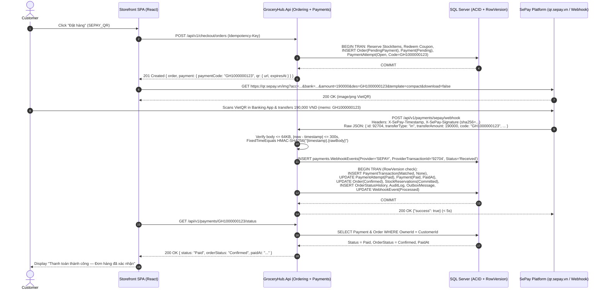
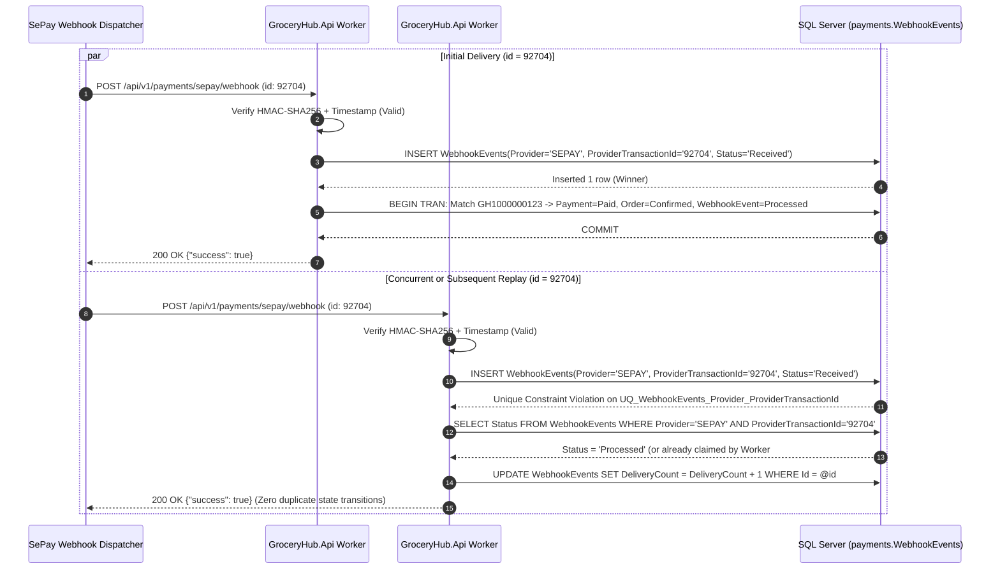
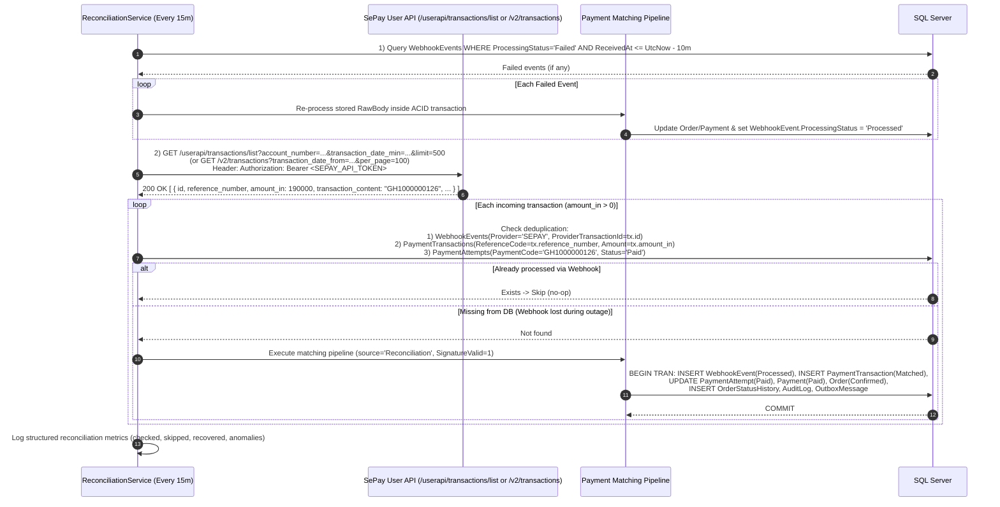
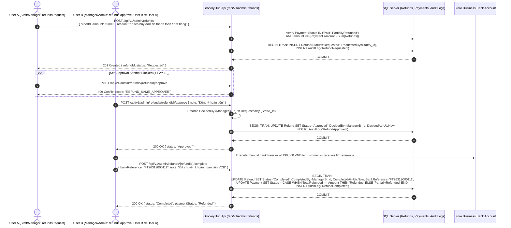

# 11 — SePay Integration (VietQR + Webhook)

- **Version:** 1.0 (Implementation-Ready Specification — Phase 03)
- **Status:** Finalized for Implementation (reconciles [`docs/spec/11-SEPAY-DIFFS.md`](./11-SEPAY-DIFFS.md), [`docs/spec/06-DATABASE-ERD.md`](./06-DATABASE-ERD.md), [`docs/spec/07-API-SPECIFICATION.md`](./07-API-SPECIFICATION.md), [`docs/security/threat-model.md`](../security/threat-model.md) `TM-PAY-01`..`TM-PAY-08`, and [`docs/progress/DECISIONS.md`](../progress/DECISIONS.md) `DEC-006`, `DEC-011`)
- **Official Docs:** https://developer.sepay.vn (legacy mirror: https://docs.sepay.vn)
- **Governed Requirements:** `FR-CUS-012`, `FR-CUS-013`, `FR-ADM-011`, `FR-ADM-016`, `FR-ADM-017`, `FR-STF-003`, `BR-06`, `BR-08`, `BR-15`, `NFR-003`, `NFR-005`, `NFR-008`

---

## 1. Core Principles
1. **Server-Side Cryptographic Proof Only (`TM-PAY-01`, `TM-PAY-05`):** The only way an online order (`SEPAY_QR`) becomes paid is via a **verified SePay webhook (or authenticated SePay API reconciliation record)** that matches the payment code, exact VND integer amount, and configured receiving bank account.
2. **Zero Client-Side Confirmation Path (`TM-PAY-05`):** The frontend only polls and displays server-provided status (`GET /api/v1/payments/{paymentCode}/status`). No client-callable endpoint, UI action, redirect URL, or query string can mark a payment or order as `Paid`.
3. **No Silent Drops or Auto-Heuristics (`TM-PAY-04`):** Every abnormal transaction (`UnknownCode`, `WrongAccount`, `AmountMismatch`, `Underpaid`, `Overpaid`, `LateAfterExpiry`, `DuplicatePayment`) is persisted and routed to the human anomaly review queue (`NeedsReview`, permission `payments.review`).
4. **Idempotent & Race-Safe (`TM-PAY-02`, `TM-PAY-03`):** Webhook ingestion is anchored by `UNIQUE (Provider, ProviderTransactionId)` on `payments.WebhookEvents` and guarded by optimistic concurrency (`RowVersion`) on `Payments`, `Orders`, and `StockItems` inside a single ACID database transaction.
5. **Secrets Isolation:** Webhook secrets (`SEPAY_WEBHOOK_SECRET`, `SEPAY_WEBHOOK_APIKEY`) and API tokens (`SEPAY_API_TOKEN`) live strictly in environment variables / Docker secrets and are never logged or returned by any API.

---

## 2. Preconditions, Test Mode & Payment Code Structure (`DIFF-02`, `DIFF-06`, `DEC-006`)

Before enabling `SEPAY_QR` in Staging or Production (communicated to the store owner in Vietnamese by the Project Manager):

1. **SePay Account, Built-In Test Mode & Sandbox (`DIFF-06`, `DEC-006`):**
   - **Production:** Log in to `https://my.sepay.vn` and link the store's real receiving bank account (or official Virtual Account / VA).
   - **Test Mode / Sandbox:** SePay provides a built-in **Test mode** toggle directly in the left sidebar of `https://my.sepay.vn` (enabled by default for `SuperAdmin`/`Admin` without waiting for SePay support; legacy sandbox `https://my.dev.sepay.vn` may also be used if separately activated by SePay support). Test mode provides isolated simulated bank accounts, VAs (`SBSEPAY...`), webhook logs, a transaction simulator (up to 500 transactions/day, `1,000`–`499,000,000` VND), and isolated Sandbox API tokens against `https://userapi-sandbox.sepay.vn/v2`.
   - **Local Development Defaults (`DEC-006`):** In local Dev/Test without external SePay credentials, configure placeholder `MBBank` / `0000000000` / `CONG TY TNHH GROCERYHUB` and use the development-only signed webhook simulator `POST /dev/sepay/simulate` (`TM-PAY-06`).
2. **Payment Code Structure — Mandatory 10-Digit Suffix (`DIFF-02`, `DEC-006`):**
   - Navigate to **Company → General settings → Payment code structure** (*Cấu hình Công ty → Cấu hình chung → Cấu trúc mã thanh toán*).
   - Configure **Prefix** (*Tiền tố*) = `GH` (2 characters).
   - **CRITICAL:** Change the suffix length (*Độ dài hậu tố*) away from SePay's default `6–8` to **Min `10` / Max `10` characters** (*Độ dài hậu tố tối thiểu = `10`*, *Độ dài hậu tố tối đa = `10`*) with character type **Digits only** (*Số nguyên* `0–9`). This ensures SePay extracts the full 12-character GroceryHub payment code (`GH` + 10 digits from `payments.PaymentCodeSeq`, e.g., `GH1000000001`) into the webhook `code` field without truncation or rejection.
3. **Webhook Configuration in SePay Dashboard:**
   - **URL:** `https://<domain>/api/v1/payments/sepay/webhook` (must be public HTTPS on port `443`; in local dev with SePay Test mode, expose via an HTTPS tunnel).
   - **Event type:** *Tiền vào* (`transferType = "in"`).
   - **Filter:** Filter by payment code prefix `GH` (do **not** skip transactions without code if you want uncoded transfers recorded in GroceryHub's `UnknownCode` review queue, or allow all `in` transfers on the dedicated receiving account/VA).
   - **Authentication:** Select **HMAC-SHA256 (Khuyến nghị)** and copy the generated secret once into `SEPAY_WEBHOOK_SECRET` (or select **API Key** and copy into `SEPAY_WEBHOOK_APIKEY`).
   - **Content-Type:** `application/json`.
   - **Auto-retry:** Enable *"Tự động gửi lại khi server trả lỗi"*.
4. **Reconciliation API Token:**
   - Generate an API token in SePay Dashboard and store it in `SEPAY_API_TOKEN`.
5. **Edge Proxy IP Allowlist (`DIFF-04`):**
   - Configure the reverse proxy (`nginx`) to allowlist SePay's published webhook dispatcher IPs (`https://developer.sepay.vn/vi/dia-chi-ip`):
     - **IPv4:** `172.236.138.20`, `172.233.83.68`, `171.244.35.2`, `151.158.108.68`, `151.158.109.79`, `103.255.238.139`, `45.57.137.67`
     - **IPv6:** `2400:8905::2000:8cff:fe98:45cd`, `2600:3c15::2000:8aff:fedd:874b`

---

## 3. Payment Code, Attempt Limits & VietQR URL Contract (`DIFF-03`, `DEC-011`)

### 3.1 Payment Code & Attempt Lifecycle
- **Format:** `GH` + 10 digits generated from SQL Server `SEQUENCE payments.PaymentCodeSeq` (starts at `1000000001`, increments by `1`, `NO CYCLE`, no separators because banks strip punctuation).
- **One Code per Attempt:** Each row in `payments.PaymentAttempts` gets a globally unique `PaymentCode`.
- **Max 5 Attempts per Order (`DEC-011` / `Q-010`):** A customer may call `POST /api/v1/me/orders/{id}/payment-attempts` (with `Idempotency-Key`) while the order is still in `PendingPayment` and has fewer than **5** attempts (`Count < 5`). Creating a new attempt transitions any existing `Open` attempt on that payment to `Superseded` and mints a fresh `PaymentCode` and QR URL. If the customer already has 5 attempts, the endpoint rejects with `409 CONFLICT` (`PAYMENT_ATTEMPT_LIMIT_REACHED`).
- **Superseded Attempt Acceptance (`T-PAY-13`):** If a customer scanned an older QR code (`Status = Superseded`) and completes the bank transfer before the order expires (`ExpiresAt + ExpiryGraceMinutes`), the webhook matches the `Superseded` attempt and confirms the order normally.
- **Expiry & Grace Window:**
  - `QrExpiryMinutes` (default `30` minutes): nominal countdown displayed to the customer in the UI (`expiresAt`).
  - `ExpiryGraceMinutes` (default `5` minutes): server-side grace window tolerated after `ExpiresAt` to absorb inter-bank NAPAS 247 and webhook delivery latency (`T-PAY-12`). `PaymentExpiryService` only cancels an unpaid order after `ExpiresAt + ExpiryGraceMinutes < UtcNow`.

### 3.2 Official SePay VietQR Image URL Contract (`DIFF-03`)
The server (never the client) constructs the VietQR image URL using `https://qr.sepay.vn/img`:

```text
https://qr.sepay.vn/img?acc={AccountNumber}&bank={BankShortName}&amount={Amount}&des={UrlEncodedTransferContent}&template=compact&download=false
```

| Query Parameter | Required | Type | Value / Encoding Rule |
|---|---|---|---|
| `acc` | **Yes** | `string` | Receiving bank account number or official VA number (`Uri.EscapeDataString`). |
| `bank` | **Yes** | `string` | Bank `short_name` (or `code` / `bin`) verified against `https://qr.sepay.vn/banks.json` (e.g., `MBBank`, `Vietcombank`, `ACB`, `BIDV`, `VietinBank`; `Uri.EscapeDataString`). |
| `amount` | **Yes** | `long` | Exact order total in integer VND (`> 0`, no decimals or thousand separators). |
| `des` | **Yes** | `string` | Transfer memo (`Content`) URL-encoded via `Uri.EscapeDataString`. Defaults to `{PaymentCode}` (e.g., `GH1000000123`), or `{TransferContentPrefix}{PaymentCode}` when bank-specific prefixes are required (e.g., `SEVQR GH1000000123` for VietinBank personal accounts or `TKP<va> GH1000000123` for TKP content VAs). |
| `template` | **Yes** | `string` | `compact` (renders standard VietQR + NAPAS + bank + SePay frame; also supports empty, `qronly`, `standee`). |
| `download` | **Yes** | `string` | `false` (ensures inline `image/png` rendering instead of `Content-Disposition: attachment`). |
| `showinfo`, `fullacc`, `holder`, `store` | Optional | `string` | Optional display flags supported by `qr.sepay.vn/img` (`holder` without Vietnamese diacritics). |

- **Bank Lookup Feed:** `https://qr.sepay.vn/banks.json` (mirrored at `https://vietqr.app/banks.json`) lists all 54 NAPAS institutions and marks 23 banks with `"supported": true` (see [`docs/spec/11-SEPAY-DIFFS.md` §3](./11-SEPAY-DIFFS.md)).
- **Bank-Specific VA / Memo Rules:**
  - **OCB, MSB, KienLongBank (all accounts) & BIDV (Personal/Household):** Require an official Virtual Account (`acc` must be the VA number).
  - **Vietcombank (Enterprise/Household):** Requires VA for webhook delivery.
  - **VietinBank (Personal/Household):** Transfer memo (`des`) **must** include `SEVQR` (configured via `SePay:TransferContentPrefix = "SEVQR "`).
- **Response Payload to Frontend (`POST /checkout/orders`, `POST /me/orders/{id}/payment-attempts`):**
  Returns `{ url, bank, accountNumber, accountName, amount, content, expiresAt }`. The UI displays both the QR image and copyable text fields (`bank`, `accountNumber`, `accountName`, `amount`, `content`) for customers who type transfers manually.
- **CSP Rule:** Reverse proxy `Content-Security-Policy` includes `img-src 'self' data: https://qr.sepay.vn`.

---

## 4. Payments Schema & State Machines (Aligned with `06-DATABASE-ERD.md` & `07-API-SPECIFICATION.md`)

### 4.1 Database Tables (`payments` Schema)

| Table | Columns | Constraints, Indexes & Notes |
|---|---|---|
| `payments.Payments` | `Id` (`uniqueidentifier` PK), `OrderId` (`uniqueidentifier` UQ), `Method` (`nvarchar(32)`: `COD`, `SEPAY_QR`), `Amount` (`bigint` VND), `Status` (`nvarchar(32)`: `Unpaid`, `Pending`, `Paid`, `Failed`, `Expired`, `PartiallyRefunded`, `Refunded`), `PaidAt` (`datetimeoffset` NULL), `CreatedAt`, `UpdatedAt`, `RowVersion` (`rowversion`) | `UQ_Payments_OrderId`; `CHECK (Amount >= 0)`; 1-to-1 with `ordering.Orders`. |
| `payments.PaymentAttempts` | `Id` (`uniqueidentifier` PK), `PaymentId` (`uniqueidentifier` FK), `PaymentCode` (`nvarchar(16)` UQ), `Amount` (`bigint` VND), `Status` (`nvarchar(32)`: `Open`, `Paid`, `Expired`, `Superseded`), `ExpiresAt` (`datetimeoffset`), `CreatedAt` (`datetimeoffset`) | `UQ_PaymentAttempts_PaymentCode` (`GH` + 10 digits from `payments.PaymentCodeSeq`); `IX_PaymentAttempts_PaymentId`; filtered `IX_PaymentAttempts_ExpiresAt WHERE Status = 'Open'`; max 5 attempts per order enforced in application (`DEC-011`). |
| `payments.WebhookEvents` | `Id` (`uniqueidentifier` PK), `Provider` (`nvarchar(32)`: `'SEPAY'`), `ProviderTransactionId` (`nvarchar(64)`), `RawBody` (`nvarchar(max)`), `SignatureValid` (`bit`), `ReceivedAt` (`datetimeoffset`), `ProcessingStatus` (`nvarchar(32)`: `Received`, `Processed`, `Ignored`, `Failed`), `Error` (`nvarchar(1000)` NULL), `ProcessedAt` (`datetimeoffset` NULL), `DeliveryCount` (`int` default 1) | **`UQ_WebhookEvents_Provider_ProviderTransactionId` (`Provider`, `ProviderTransactionId`)** = idempotency anchor; `IX_WebhookEvents_ProcessingStatus_ReceivedAt`. Retention ≥ 24 months. |
| `payments.PaymentTransactions` | `Id` (`uniqueidentifier` PK), `WebhookEventId` (`uniqueidentifier` UQ FK), `PaymentAttemptId` (`uniqueidentifier` NULL FK), `Direction` (`nvarchar(16)`: `in`, `out`), `Amount` (`bigint` VND), `AccountNumber` (`nvarchar(64)`), `Gateway` (`nvarchar(64)`), `ReferenceCode` (`nvarchar(128)` NULL), `Content` (`nvarchar(500)`), `TransactionTime` (`datetimeoffset`), `MatchStatus` (`nvarchar(32)`), `ReviewStatus` (`nvarchar(32)`: `None`, `NeedsReview`, `Resolved`), `ResolvedBy` (`uniqueidentifier` NULL), `ResolvedAt` (`datetimeoffset` NULL), `ResolutionNote` (`nvarchar(500)` NULL) | `UQ_PaymentTransactions_WebhookEventId`; `IX_PaymentTransactions_ReviewStatus`; `IX_PaymentTransactions_ReferenceCode`. `MatchStatus` enum: `Matched`, `UnknownCode`, `WrongAccount`, `AmountMismatch`, `Underpaid`, `Overpaid`, `LateAfterExpiry`, `DuplicatePayment`, `OutgoingIgnored`. |
| `payments.Refunds` | `Id` (`uniqueidentifier` PK), `PaymentId` (`uniqueidentifier` FK), `OrderId` (`uniqueidentifier`), `Amount` (`bigint` VND), `Reason` (`nvarchar(500)`), `Status` (`nvarchar(32)`: `Requested`, `Approved`, `Rejected`, `Completed`), `RequestedBy` (`uniqueidentifier`), `RequestedAt` (`datetimeoffset`), `DecidedBy` (`uniqueidentifier` NULL), `DecidedAt` (`datetimeoffset` NULL), `CompletedBy` (`uniqueidentifier` NULL), `CompletedAt` (`datetimeoffset` NULL), `BankReference` (`nvarchar(128)` NULL), `Note` (`nvarchar(500)` NULL) | `CHECK (Amount > 0)`; `CHECK (DecidedBy IS NULL OR DecidedBy <> RequestedBy)` (`BR-15` two-person rule enforced in Domain + DB); `IX_Refunds_PaymentId`, `IX_Refunds_Status`. |
| `payments.CodCollections` | `Id` (`uniqueidentifier` PK), `OrderId` (`uniqueidentifier` UQ), `Amount` (`bigint` VND), `CollectedBy` (`uniqueidentifier`), `CollectedAt` (`datetimeoffset`), `HandedOverAt` (`datetimeoffset` NULL), `HandedOverTo` (`uniqueidentifier` NULL) | `UQ_CodCollections_OrderId`; `CHECK (Amount >= 0)`. |

### 4.2 State Machines

#### A. `Payment.Status` State Machine
- **`Unpaid`** *(initial for `COD`)*:
  - $\rightarrow$ **`Paid`**: When delivery staff transitions order to `Delivered` with `codAmount == Order.Total` (creates `CodCollection`).
  - $\rightarrow$ **`Failed`**: If COD order is cancelled before payment collection.
- **`Pending`** *(initial for `SEPAY_QR`)*:
  - $\rightarrow$ **`Paid`**: Verified webhook or reconciliation matches an `Open` or `Superseded` `PaymentAttempt` while `Order.Status == PendingPayment` and `Amount == Payment.Amount`. Sets `PaidAt = TransactionTime` (or `UtcNow`) and transitions `Order.Status` from `PendingPayment` $\rightarrow$ `Confirmed`.
  - $\rightarrow$ **`Expired`**: `PaymentExpiryService` sweeps expired attempts after `ExpiresAt + ExpiryGraceMinutes` (or customer/staff cancels unpaid order).
  - $\rightarrow$ **`Failed`**: Administrative cancellation before payment.
- **`Expired`**:
  - $\rightarrow$ **`Paid`** *(Manager exception only)*: Manager executes `POST /api/v1/admin/payment-transactions/{id}/resolve` with `action = AttachToOrder` on a `LateAfterExpiry` transaction, **only if** the order can be revived and all `StockItems` can be re-reserved atomically.
- **`Paid`**:
  - $\rightarrow$ **`PartiallyRefunded`**: A `Refund` transitions to `Completed` where `Sum(CompletedRefunds.Amount) < Payment.Amount`.
  - $\rightarrow$ **`Refunded`**: A `Refund` transitions to `Completed` where `Sum(CompletedRefunds.Amount) == Payment.Amount`.
- **`PartiallyRefunded`**:
  - $\rightarrow$ **`Refunded`**: Subsequent `Refund` completes bringing total refunded equal to `Payment.Amount`.

#### B. `PaymentAttempt.Status` State Machine
- **`Open`** *(initial when created at checkout or via `POST /me/orders/{id}/payment-attempts`)*:
  - $\rightarrow$ **`Superseded`**: Customer requests a new QR attempt while order is `PendingPayment` (max 5 attempts per order).
  - $\rightarrow$ **`Paid`**: Verified webhook/reconciliation matches this attempt's `PaymentCode`.
  - $\rightarrow$ **`Expired`**: `PaymentExpiryService` runs after `ExpiresAt + ExpiryGraceMinutes < UtcNow` (or order is cancelled).
- **`Superseded`**:
  - $\rightarrow$ **`Paid`**: Customer paid using the older QR code before the order expired (`T-PAY-13`). Any currently `Open` attempt on the same payment is simultaneously marked `Expired`.
  - $\rightarrow$ **`Expired`**: Order expires or is cancelled.

#### C. `WebhookEvent.ProcessingStatus` State Machine
- **`Received`** *(inserted into inbox before business logic; transient in-memory/locked claim during execution)*:
  - $\rightarrow$ **`Processed`**: Matching and state transitions committed in ACID transaction (`PaymentTransaction` created).
  - $\rightarrow$ **`Ignored`**: `transferType != "in"` (`OutgoingIgnored` `PaymentTransaction` recorded).
  - $\rightarrow$ **`Failed`**: Unhandled database/concurrency exception occurred; `Error` message stored; HTTP `500` returned so SePay retries (or `ReconciliationService` retries after 10 minutes).
- **`Failed`**:
  - $\rightarrow$ **`Processed` / `Ignored`**: Retried by SePay webhook redelivery or `ReconciliationService` (`DeliveryCount` incremented).

#### D. `Refund.Status` State Machine (`BR-15`)
- **`Requested`** *(created by Staff/Manager/Admin with `refunds.request` via `POST /admin/refunds`, or auto-created when cancelling a `Paid` order, or via `Resolve -> Refund` on an anomaly)*:
  - $\rightarrow$ **`Approved`**: Manager/Admin with `refunds.approve` calls `POST /admin/refunds/{id}/approve` where `DecidedBy != RequestedBy` (`TM-PAY-07`, `REFUND_SAME_APPROVER`).
  - $\rightarrow$ **`Rejected`**: Manager/Admin with `refunds.approve` calls `POST /admin/refunds/{id}/reject` with mandatory reason (`DecidedBy != RequestedBy`).
- **`Approved`**:
  - $\rightarrow$ **`Completed`**: After manual bank transfer payout is executed outside GroceryHub, Manager/Admin with `refunds.approve` calls `POST /admin/refunds/{id}/complete` supplying `bankReference` (required) and optional `note`. Updates `Payment.Status` to `PartiallyRefunded` or `Refunded` and writes `audit.AuditLogs`.

---

## 5. Webhook Authentication, Payload & Response Contract (`DIFF-01`, `DIFF-04`, `DIFF-05`, `TM-PAY-01`..`TM-PAY-04`)

### 5.1 Endpoint & Raw-Body Authentication (`TM-PAY-01`, `TM-PAY-02`)
`POST /api/v1/payments/sepay/webhook` (`AllowAnonymous` at ASP.NET Core endpoint routing layer; authenticated strictly by cryptographic signature or API key):

1. **Body Size Limit & Raw Bytes:** Enforce a strict `65,536` byte (64 KB) limit (`413 Payload Too Large` / `400 Bad Request` on overflow, `T-PAY-23`). Enable buffering and read the exact **raw UTF-8 byte array** (`rawBodyBytes` / `rawBodyString`) **before** any JSON deserialization. Never re-serialize a parsed DTO to compute HMAC.
2. **Authentication Modes (`SePay:Webhook:AuthMode` — `Hmac` primary, `ApiKey` fallback; `None` forbidden outside Development):**
   - **Mode `Hmac` (Native SePay Recommended Mode):**
     - Require HTTP headers `X-SePay-Timestamp` (Unix epoch seconds integer) and `X-SePay-Signature` (format `sha256=<64-char lowercase hex>`).
     - **Replay Window Check (`TM-PAY-02`, `T-PAY-06`):** Parse `X-SePay-Timestamp` as `long`. Reject with `401 Unauthorized` if `Math.Abs(DateTimeOffset.UtcNow.ToUnixTimeSeconds() - timestamp) > SePay:Webhook:TimestampToleranceSeconds` (default `300` seconds = 5 minutes).
     - **HMAC-SHA256 Verification (`TM-PAY-01`, `T-PAY-04`, `T-PAY-05`):** Construct the signed payload bytes as ASCII `"{timestamp}."` concatenated with `rawBodyBytes`. Compute `HMACSHA256.HashData(secretBytes, signedPayloadBytes)` using `SEPAY_WEBHOOK_SECRET` (and optionally `SEPAY_WEBHOOK_SECRET_PREVIOUS` during a key rotation overlap window). Convert the expected hex signature to bytes and compare using **`CryptographicOperations.FixedTimeEquals(computedBytes, providedSignatureBytes)`**.
   - **Mode `ApiKey` (Fallback Mode, `T-PAY-07`):**
     - Require header `Authorization: Apikey <API_KEY>` (case-insensitive prefix `Apikey `). Compare UTF-8 bytes of `<API_KEY>` against `SEPAY_WEBHOOK_APIKEY` using **`CryptographicOperations.FixedTimeEquals`**.
   - **On Authentication Failure:** Return HTTP `401 Unauthorized` with body `{"success": false}`. Log a structured security warning with client IP and correlation ID (never log secrets or full auth headers). Perform **zero** business DB writes.

### 5.2 Official 12-Field SePay JSON Payload Contract (`DIFF-05`)

```json
{
  "id": 92704,
  "gateway": "MBBank",
  "transactionDate": "2026-11-15 14:22:09",
  "accountNumber": "0123456789",
  "subAccount": null,
  "code": "GH1000000123",
  "content": "MBVCB.7654321.GH1000000123 thanh toan don hang",
  "transferType": "in",
  "description": "BankAPINotify MBVCB.7654321.GH1000000123",
  "transferAmount": 190000,
  "accumulated": 12500000,
  "referenceCode": "FT26319888999"
}
```

| # | JSON Field | SePay JSON Type | C# DTO Property & Type | Nullability & Validation Rules |
|---|---|---|---|---|
| 1 | `id` | `integer` | `long Id` | Required (`>= 0`). Converted to `ProviderTransactionId = Id.ToString(CultureInfo.InvariantCulture)`. Stable across all retries and manual replays. *(Note: SePay Dashboard "Gửi thử" sends `id: 0`.)* |
| 2 | `gateway` | `string` | `string Gateway` | Required. Bank brand name (e.g., `"MBBank"`, `"Vietcombank"`). |
| 3 | `transactionDate` | `string` | `string TransactionDate` | Required. Format `"yyyy-MM-dd HH:mm:ss"` in Vietnam time (`Asia/Ho_Chi_Minh`, `UTC+07:00`). Parsed via `DateTime.ParseExact(dto.TransactionDate, "yyyy-MM-dd HH:mm:ss", CultureInfo.InvariantCulture)` and wrapped as `new DateTimeOffset(parsedLocal, TimeSpan.FromHours(7))`. |
| 4 | `accountNumber` | `string` | `string AccountNumber` | Required. Main bank account number. |
| 5 | `subAccount` | `string \| null` | `string? SubAccount` | Nullable/empty. Contains matched Virtual Account (VA) or TKP code if used. |
| 6 | `code` | `string \| null` | `string? Code` | Nullable/empty. Payment code extracted by SePay (`"GH1000000123"`). Treat `string.IsNullOrWhiteSpace(dto.Code)` as absent and run regex fallback over `content`. |
| 7 | `content` | `string` | `string Content` | Required (may be empty string). Raw transfer memo from the bank. |
| 8 | `transferType` | `string` | `string TransferType` | Required. `"in"` (money in) or `"out"` (money out). |
| 9 | `description` | `string \| null` | `string? Description` | Nullable/empty. Full bank notification body. |
| 10 | `transferAmount` | `integer` | `long TransferAmount` | Required (`> 0`). Transfer amount in integer VND. |
| 11 | `accumulated` | `integer` | `long Accumulated` | Required (`>= 0`). Running account balance after transaction (`0` if unsupported by bank). |
| 12 | `referenceCode` | `string \| null` | `string? ReferenceCode` | Nullable/empty. Bank reference number (e.g., `"FT26319888999"`, `"SB..."` in Test mode). |

Malformed JSON or missing required fields (`id`, `gateway`, `transactionDate`, `accountNumber`, `transferType`, `transferAmount <= 0`) returns HTTP `400 Bad Request` (`{"success": false}`).

### 5.3 Inbox Deduplication & Matching Pipeline (`TM-PAY-03`, `TM-PAY-04`)

1. **Inbox Insert First (`WebhookEvents`):**
   - Attempt `INSERT INTO payments.WebhookEvents (Id, Provider, ProviderTransactionId, RawBody, SignatureValid, ReceivedAt, ProcessingStatus, DeliveryCount) VALUES (@id, 'SEPAY', @txId, @rawBody, 1, @now, 'Received', 1)`.
   - **On `UQ_WebhookEvents_Provider_ProviderTransactionId` Violation (`T-PAY-02`, `T-PAY-03`):**
     - Load existing `WebhookEvent`.
     - If `ProcessingStatus` is `Processed` or `Ignored`: increment `DeliveryCount` and immediately return **HTTP `200 OK` with `{"success": true}`** (idempotent duplicate).
     - If `ProcessingStatus` is `Failed` (or stale `Received` older than 60s): atomically claim via conditional `UPDATE WebhookEvents SET ProcessingStatus = 'Received', DeliveryCount = DeliveryCount + 1 WHERE Id = @existingId AND ProcessingStatus = 'Failed'`. If `0` rows affected, another worker is processing it—return `200 {"success": true}`.
2. **Direction Check (`T-PAY-10`):**
   - If `!string.Equals(dto.TransferType, "in", StringComparison.OrdinalIgnoreCase)`: insert `PaymentTransaction` with `Direction = "out"`, `MatchStatus = OutgoingIgnored`, `ReviewStatus = None`, update `WebhookEvent.ProcessingStatus = Ignored`, and return `200 {"success": true}`.
3. **Payment Code Extraction:**
   - Use `dto.Code.Trim().ToUpperInvariant()` if `!string.IsNullOrWhiteSpace(dto.Code)`; otherwise match regex `\bGH\d{10}\b` (case-insensitive) against `dto.Content`.
4. **Validation & Decision Matrix (Executed Inside One ACID DB Transaction with `RowVersion` on `Payment`/`Order`):**

| Evaluation Order & Condition | State Mutation (`Payment` / `PaymentAttempt` / `Order`) | `PaymentTransactions.MatchStatus` | `ReviewStatus` |
|---|---|---|---|
| **1. Receiving Account Mismatch:** `dto.AccountNumber != SePay:AccountNumber` (and `dto.SubAccount != SePay:SubAccount` when VA is configured) | Record `PaymentTransaction` only; no order/payment change | `WrongAccount` | `NeedsReview` |
| **2. Missing Code:** No `GH\d{10}` code present in `code` or `content` | Record `PaymentTransaction` only | `UnknownCode` | `NeedsReview` |
| **3. Unknown Code:** Code not found in `payments.PaymentAttempts` | Record `PaymentTransaction` only | `UnknownCode` | `NeedsReview` |
| **4. Duplicate Payment (`T-PAY-14`):** `Payment.Status == Paid` or `Attempt.Status == Paid` or `Order.Status != PendingPayment` (and not `Cancelled`/`Expired`) | Record `PaymentTransaction` linked to `PaymentAttemptId`; no state change | `DuplicatePayment` | `NeedsReview` *(refund candidate)* |
| **5. Late After Expiry (`T-PAY-11`):** `Order.Status == Cancelled` or `Payment.Status == Expired` or `UtcNow > Attempt.ExpiresAt + ExpiryGraceMinutes` | Record `PaymentTransaction` linked to `PaymentAttemptId`; order remains `Cancelled`/`Expired` | `LateAfterExpiry` | `NeedsReview` |
| **6. Underpaid (`T-PAY-08`):** `dto.TransferAmount < Payment.Amount` | Record `PaymentTransaction` linked to `PaymentAttemptId`; order stays `PendingPayment` | `Underpaid` | `NeedsReview` |
| **7. Overpaid (`T-PAY-08`):** `dto.TransferAmount > Payment.Amount` | Record `PaymentTransaction` linked to `PaymentAttemptId`; order stays `PendingPayment` | `Overpaid` | `NeedsReview` |
| **8. Exact Match (`T-PAY-01`, `T-PAY-12`, `T-PAY-13`):** Attempt is `Open` or `Superseded`, `Order.Status == PendingPayment`, within `ExpiresAt + ExpiryGraceMinutes`, and `dto.TransferAmount == Payment.Amount` | - `PaymentAttempt.Status = Paid` (and any other `Open`/`Superseded` attempts on same payment $\rightarrow$ `Expired`)<br>- `Payment.Status = Paid`, `Payment.PaidAt = TransactionTime`<br>- `Order.Status = Confirmed`, `Order.PaymentStatus = Paid`, `Order.ConfirmedAt = UtcNow`<br>- `StockReservations.Status = Committed`<br>- Insert `OrderStatusHistory(PendingPayment -> Confirmed)` + `audit.AuditLogs` + `shared.OutboxMessages(OrderConfirmed)` | `Matched` | `None` |

### 5.4 Response Contract & SePay Retry Schedule (`DIFF-01`)
- **Success Response Contract:** Must return **HTTP `200 OK` (or `201 Created`)** with exact JSON body **`{"success": true}`** (`Content-Type: application/json`) within **`< 5 seconds` target** (hard SePay timeout is **30 seconds**: 15s connect + 30s total).
- **Critical SePay Rule:** Returning HTTP `200` without `"success": true` in the JSON body is logged as failed by SePay and **will NOT be auto-retried**. Returning any status code outside `200–299` (e.g., `500 Internal Server Error` when a transient DB failure occurs in `T-PAY-15`) triggers SePay's automatic retry queue.
- **Official SePay Retry Schedule (`DIFF-01`):**
  - SePay performs **7 retries (8 total deliveries)**:
    - Under SePay's exponential cap formula ($\text{Delay} = \min(2^{\text{attempt}} - 1, 30)\text{ minutes}$ for attempts $1\dots 7$): delays are **`1m, 3m, 7m, 15m, 30m, 30m, 30m`** (~**33 minutes** across the first 5 retries, and **1 hour 56 minutes** across all 7 retries).
    - *(Note: SePay's `/vi/sepay-webhooks/xu-ly-loi` page also documents a 7-retry Fibonacci schedule of `1m, 1m, 2m, 3m, 5m, 8m, 13m` = **33 minutes** total with a 5-hour retry queue cutoff. Because GroceryHub's `ReconciliationService` runs every **15 minutes** with a **24-hour lookback**, both schedules are fully covered.)*
  - Webhook delivery order is **not guaranteed** by SePay.

---

## 6. Background Jobs: Expiry & Reconciliation (`DIFF-07`)

### 6.1 `PaymentExpiryService` (Runs Every 1 Minute)
1. Queries `payments.PaymentAttempts` joined to `Payments` and `Orders` where `Order.Status == 'PendingPayment'` and `Payment.Method == 'SEPAY_QR'` and the latest attempt's `ExpiresAt + ExpiryGraceMinutes < UtcNow`.
2. For each expired order (in an isolated per-order ACID transaction guarded by `RowVersion`):
   - Marks all `Open` and `Superseded` `PaymentAttempts` as `Expired`.
   - Marks `Payment.Status = Expired`.
   - Marks `Order.Status = Cancelled`, `Order.PaymentStatus = Expired`, `Order.CancelledAt = UtcNow`, `Order.CancelReason = "PaymentExpired"`.
   - Releases all `inventory.StockReservations` (`Status = Released`) and decrements `StockItems.Reserved` (`StockMovements` type `Release`).
   - Releases any `promotions.CouponRedemptions` (`ReleasedAt = UtcNow`, decrements `Coupons.UsedCount`).
   - Appends `OrderStatusHistory` and `audit.AuditLogs` (`ActorUserId = null` / System).

### 6.2 `ReconciliationService` & Official SePay User API Contract (`DIFF-07`, `T-PAY-16`)
Runs every `SePay:Reconciliation:IntervalMinutes` (default **15 minutes**) with a `LookbackHours` window (default **24 hours**):

1. **Retry Local Failed Events:** Queries `payments.WebhookEvents` where `ProcessingStatus == 'Failed'` and `ReceivedAt <= UtcNow - 10 minutes` (up to 5 delivery attempts) and re-runs the matching pipeline (§5.3).
2. **Poll Official SePay Transactions API (`DIFF-07`):**
   - Authenticates with header **`Authorization: Bearer <SEPAY_API_TOKEN>`**.
   - Supports both SePay User API v1 (`https://my.sepay.vn/userapi`) and SePay API v2 (`https://userapi.sepay.vn/v2` for Production; `https://userapi-sandbox.sepay.vn/v2` for Sandbox):

| API Version | Endpoint Path | Query Parameters | Rate Limit & Pagination |
|---|---|---|---|
| **User API v1** *(Official v1 Contract)* | - `GET https://my.sepay.vn/userapi/transactions/list`<br>- `GET https://my.sepay.vn/userapi/transactions/details/{id}`<br>- `GET https://my.sepay.vn/userapi/transactions/count` | `account_number={AccountNumber}`, `transaction_date_min={yyyy-MM-dd HH:mm:ss}`, `transaction_date_max={yyyy-MM-dd HH:mm:ss}`, `limit=500`, `reference_number`, `since_id` | Returns `{"status": 200, "transactions": [...]}` where `id` is the numeric SePay transaction ID string (matching webhook `id`), `amount_in`, `amount_out`, `transaction_content`, `reference_number`, `code`, `sub_account`, `bank_brand_name`, `transaction_date`. |
| **User API v2** *(Production & Sandbox)* | - `GET https://userapi.sepay.vn/v2/transactions`<br>- `GET https://userapi.sepay.vn/v2/transactions/{id}`<br>- Sandbox: `https://userapi-sandbox.sepay.vn/v2/transactions` | `account_number` / `bank_account_id`, `transaction_date_from`, `transaction_date_to`, `transfer_type=in`, `per_page=100`, `page=1..N`, `since_id` | **3 requests/second per IP** (`HTTP 429` `Retry-After` respected). Returns `{"status": "success", "data": [...], "meta": {"pagination": ...}}` where `id` is a UUID and `amount_in` is an integer VND. |

3. **Cross-Version Deduplication Rule (`DIFF-07`):**
   - Before feeding a fetched API transaction into the §5.3 matching pipeline (with `source = Reconciliation` and `SignatureValid = true`), `ReconciliationService` treats the transaction as **already processed** if **any** of the following holds:
     1. `payments.WebhookEvents` already contains `(Provider = 'SEPAY', ProviderTransactionId = tx.Id)`.
     2. `payments.PaymentTransactions` already contains a record with the same non-empty `ReferenceCode == tx.ReferenceNumber` AND `AccountNumber == tx.AccountNumber` AND `Amount == tx.AmountIn`.
     3. The extracted `GH\d{10}` payment code already belongs to a `PaymentAttempt` with `Status == 'Paid'` and matching `Amount == tx.AmountIn`.
   - Any genuinely missing incoming transaction is normalized into the 12-field webhook DTO format and processed through §5.3 Steps 4–8, confirming the order once (`T-PAY-16`).

---

## 7. Anomaly Review Queue, COD & Two-Person Refund Workflow

### 7.1 Anomaly Review Queue (`payments.review` — Manager / Admin)
Endpoints: `GET /api/v1/admin/payment-transactions?reviewStatus=NeedsReview` and `POST /api/v1/admin/payment-transactions/{id}/resolve` with body `{ action: "AttachToOrder" | "Refund" | "Dismiss", orderId?, note }`:
- **`AttachToOrder`:** Links an `Underpaid` (after customer tops up), `Overpaid`, `UnknownCode` (customer typed wrong memo), or `LateAfterExpiry` transaction to `orderId`. For `LateAfterExpiry`, the service atomically checks whether all order items have sufficient `StockItems.OnHand - Reserved >= Quantity`; if stock can be re-reserved, it transitions `Order` from `Cancelled` $\rightarrow$ `Confirmed` and `Payment` $\rightarrow$ `Paid`. If stock is unavailable, it rejects with `409 INSUFFICIENT_STOCK` and instructs the Manager to choose `Refund`.
- **`Refund`:** Transitions `ReviewStatus = Resolved` and automatically creates a `Refund` in `Requested` status for the transaction amount.
- **`Dismiss`:** Marks `ReviewStatus = Resolved` with mandatory `note` (e.g., unrelated bank deposit).
- Every resolution writes an immutable record to `audit.AuditLogs`.

### 7.2 Cash on Delivery (`COD` — `BR-06`, `TM-PAY-08`)
- Allowed at checkout only when `Order.Total <= Payments:CodMaxAmount` (default `2,000,000` VND; `DEC-007`; rejects with `COD_LIMIT_EXCEEDED`).
- Initial state: `Order.Status = Placed`, `Payment.Method = COD`, `Payment.Status = Unpaid`.
- When delivery staff calls `POST /api/v1/admin/orders/{id}/transition` with `{ to: "Delivered", codAmount }`:
  - Server validates `codAmount == Order.Total` (`T-PAY-24`). If unequal, rejects with `409 COD_AMOUNT_MISMATCH`.
  - Inside one transaction: inserts `payments.CodCollections`, transitions `Payment.Status = Paid` (`PaidAt = UtcNow`), `Order.Status = Delivered`, commits stock (`Sale` movement), and writes `audit.AuditLogs`.

### 7.3 Two-Person Refund Workflow (`BR-15`, `TM-PAY-07`)
- **Step 1 — Request (`refunds.request` — Staff, Manager, or Admin):** `POST /api/v1/admin/refunds` with `{ orderId, amount, reason }`. Validates `amount > 0` and `amount <= Payment.Amount - Sum(ActiveOrCompletedRefunds)` (`REFUND_INVALID_AMOUNT`, `T-PAY-19`). Inserts `Refund` with `Status = Requested`, `RequestedBy = currentUserId`. (Also auto-triggered when a `Paid` order is cancelled.)
- **Step 2 — Approve or Reject (`refunds.approve` — Manager or Admin):** `POST /api/v1/admin/refunds/{id}/approve` or `/reject`. Enforces **` currentUserId != Refund.RequestedBy`** (`REFUND_SAME_APPROVER`, `T-PAY-18`, `TM-PAY-07`). Sets `DecidedBy = currentUserId`, `DecidedAt = UtcNow`, `Status = Approved` (or `Rejected`).
- **Step 3 — Complete Manual Bank Payout (`refunds.approve` — Manager or Admin):** Store transfers money back to the customer's bank account manually (SePay does not execute payouts). Manager/Admin calls `POST /api/v1/admin/refunds/{id}/complete` with `{ bankReference, note? }`. Transitions `Refund.Status = Completed`, updates `Payment.Status` to `PartiallyRefunded` or `Refunded`, and records `audit.AuditLogs`.

---

## 8. Sequence Diagrams (`sequenceDiagram`)

### 8.1 Diagram 1 — QR Happy Path


### 8.2 Diagram 2 — Duplicate Webhook Delivery (Sequential or Concurrent Replay)


### 8.3 Diagram 3 — Late Payment Arrival (Within Grace Window vs After Expiry)
```mermaid
sequenceDiagram
    autonumber
    actor Customer
    participant SePay as SePay Webhook Dispatcher
    participant API as GroceryHub.Api (Webhook & Admin)
    participant ExpiryJob as PaymentExpiryService (1-min Cron)
    participant DB as SQL Server
    actor Manager as Store Manager (payments.review)

    rect rgb(235, 248, 240)
        Note over Customer,DB: Scenario A — Arrives at T+32m (After 30m nominal ExpiresAt, WITHIN +5m ExpiryGraceMinutes)
        Customer->>SePay: Bank transfer completes at T+32m
        SePay->>API: POST /api/v1/payments/sepay/webhook (code: GH1000000124, amount: 190000)
        API->>DB: Verify Order == PendingPayment AND UtcNow <= ExpiresAt + 5m Grace
        API->>DB: BEGIN TRAN: PaymentAttempt=Paid, Payment=Paid, Order=Confirmed, MatchStatus=Matched
        DB-->>API: COMMIT
        API-->>SePay: 200 OK {"success": true}
    end

    rect rgb(253, 242, 240)
        Note over Customer,Manager: Scenario B — Arrives at T+40m (AFTER PaymentExpiryService cancelled order at T+36m)
        ExpiryJob->>DB: At T+36m (ExpiresAt + 5m < UtcNow):<br/>Order -> Cancelled(PaymentExpired), Payment -> Expired,<br/>Attempt -> Expired, Release StockReservations & Coupon
        Customer->>SePay: Late bank transfer completes at T+40m
        SePay->>API: POST /api/v1/payments/sepay/webhook (code: GH1000000125, amount: 190000)
        API->>DB: Insert WebhookEvent; detect Order == Cancelled / Payment == Expired
        API->>DB: INSERT PaymentTransaction(MatchStatus='LateAfterExpiry', ReviewStatus='NeedsReview'),<br/>UPDATE WebhookEvent(Processed) — Order remains Cancelled
        API-->>SePay: 200 OK {"success": true}

        Manager->>API: GET /api/v1/admin/payment-transactions?reviewStatus=NeedsReview
        API-->>Manager: Returns LateAfterExpiry transaction for Order DH261115-0009
        alt Stock can be re-reserved (Action = AttachToOrder)
            Manager->>API: POST /api/v1/admin/payment-transactions/{txId}/resolve { action: "AttachToOrder", orderId, note }
            API->>DB: BEGIN TRAN: Re-reserve StockItems (OnHand - Reserved >= Qty),<br/>Order -> Confirmed, Payment -> Paid, ReviewStatus -> Resolved, AuditLog
            DB-->>API: COMMIT
            API-->>Manager: 200 OK (Order revived & confirmed)
        else Stock out of stock or Customer prefers refund (Action = Refund)
            Manager->>API: POST /api/v1/admin/payment-transactions/{txId}/resolve { action: "Refund", note }
            API->>DB: BEGIN TRAN: ReviewStatus -> Resolved, INSERT Refund(Status='Requested'), AuditLog
            DB-->>API: COMMIT
            API-->>Manager: 200 OK (Routed to Two-Person Refund Workflow)
        end
    end
```

### 8.4 Diagram 4 — Reconciliation Job Recovery (`ReconciliationService`)


### 8.5 Diagram 5 — Two-Person Refund Workflow (`BR-15`, `TM-PAY-07`)


---

## 9. Configuration & Startup Validation (`appsettings.json` + Environment Variables)

```ini
SePay:Environment                         = Sandbox | Production
SePay:AccountNumber                       = 0000000000                        # receiving account or VA number on QR
SePay:SubAccount                          =                                   # optional VA / TKP sub-account
SePay:BankShortName                       = MBBank                            # verified against https://qr.sepay.vn/banks.json
SePay:AccountName                         = CONG TY TNHH GROCERYHUB           # displayed on QR page
SePay:PaymentCodePrefix                   = GH                                # 2 chars; suffix Min 10 / Max 10 in SePay
SePay:TransferContentPrefix               =                                   # e.g. "SEVQR " for VietinBank personal accounts
SePay:QrBaseUrl                           = https://qr.sepay.vn/img
SePay:Webhook:AuthMode                    = Hmac | ApiKey                     # Production: must not be None
SePay:Webhook:HmacSecret                  -> env SEPAY_WEBHOOK_SECRET
SePay:Webhook:HmacSecretPrevious          -> env SEPAY_WEBHOOK_SECRET_PREVIOUS # optional during key rotation overlap
SePay:Webhook:ApiKey                      -> env SEPAY_WEBHOOK_APIKEY          # fallback mode only
SePay:Webhook:TimestampToleranceSeconds   = 300                               # +/- 5 minutes replay protection
SePay:Webhook:MaxBodyBytes                = 65536                             # 64 KB
SePay:Webhook:AllowedIps                  = [ "172.236.138.20", "172.233.83.68", "171.244.35.2", "151.158.108.68", "151.158.109.79", "103.255.238.139", "45.57.137.67", "2400:8905::2000:8cff:fe98:45cd", "2600:3c15::2000:8aff:fedd:874b" ]
SePay:Api:BaseUrl                         = https://userapi-sandbox.sepay.vn/v2   # Production: https://my.sepay.vn/userapi or https://userapi.sepay.vn/v2
SePay:Api:Token                           -> env SEPAY_API_TOKEN
SePay:QrExpiryMinutes                     = 30
SePay:ExpiryGraceMinutes                  = 5
SePay:MaxAttemptsPerOrder                 = 5                                 # DEC-011 / Q-010
SePay:Reconciliation:IntervalMinutes      = 15
SePay:Reconciliation:LookbackHours        = 24
Payments:CodMaxAmount                     = 2000000                           # DEC-007 / Q-002 (2,000,000 VND)
```

- **Fail-Fast Startup Validation (`IValidateOptions<SePayOptions>`):** Fails application startup if `ASPNETCORE_ENVIRONMENT == "Production"` and `SePay:Environment != "Production"`, `AuthMode == "None"`, or any secret/account setting (`SEPAY_WEBHOOK_SECRET` / `SEPAY_API_TOKEN` / `AccountNumber`) is empty or equals the development placeholder (`0000000000`).
- **Readiness Health Check (`GET /health/ready`):** Reports whether the payments module and SePay configuration are valid without exposing secrets.
- **Development-Only Signed Simulator (`POST /dev/sepay/simulate`, `TM-PAY-06`, `T-PAY-22`):** Mapped strictly inside `if (app.Environment.IsDevelopment())`. Builds a realistic 12-field SePay JSON payload, signs `{timestamp}.{rawBody}` with the configured `SEPAY_WEBHOOK_SECRET`, and dispatches it through the real webhook handler without bypassing any verification or DB constraints. Returns `404 Not Found` in Staging/Production configurations.

---

## 10. Official SePay Documentation Verification References (`DIFF-01`..`DIFF-07`)

All official SePay pages below were verified on `2026-11-15` and documented in [`docs/spec/11-SEPAY-DIFFS.md`](./11-SEPAY-DIFFS.md) (raw capture in [`docs/evidence/phase-01/sepay-docs-check.txt`](../evidence/phase-01/sepay-docs-check.txt)):
- Webhooks Overview, Quick Start, Integration, Creation, Authentication (`/vi/sepay-webhooks/xac-thuc`), Security (`/vi/sepay-webhooks/bao-mat`), Error Handling & Retries (`/vi/sepay-webhooks/xu-ly-loi`), Payment Code Structure (`/vi/sepay-webhooks/cau-hinh-ma-thanh-toan`), Reconciliation (`/vi/sepay-webhooks/doi-soat-giao-dich`), Bank & VA Rules (`/vi/sepay-webhooks/tai-khoan-ngan-hang`).
- Public IP Allowlist: `https://developer.sepay.vn/vi/dia-chi-ip`.
- Dynamic VietQR Generator & Bank Feed: `https://developer.sepay.vn/vi/tien-ich-khac/tao-qr-code` and `https://qr.sepay.vn/banks.json`.
- Test Mode & API v1 / v2: `https://developer.sepay.vn/vi/tien-ich-khac/test-mode`, `https://docs.sepay.vn/api-giao-dich.html`, and `https://developer.sepay.vn/vi/sepay-api/v2/giao-dich/danh-sach`.

---

## 11. Automated Test Matrix (Phase 10 — Real SQL Server & Real HMAC Signatures)

Every test below runs against a real SQL Server container (`Testcontainers`) using signed payloads generated with the exact HMAC-SHA256 algorithm:

| ID | Threat / Diff Ref | Scenario | Expected Result |
|---|---|---|---|
| `T-PAY-01` | `TM-PAY-01` | Valid signed webhook (`transferType="in"`), exact amount, active attempt | `Payment=Paid`, `PaymentAttempt=Paid`, `Order=Confirmed`, `StockReservations=Committed`, 1 `OrderStatusHistory` row, 1 `AuditLog` entry, HTTP `200 {"success":true}` |
| `T-PAY-02` | `TM-PAY-02` | Same webhook `id` delivered twice sequentially | Second call hits `UQ(Provider, ProviderTransactionId)`, increments `DeliveryCount`, returns `200 {"success":true}`, zero extra state/audit rows |
| `T-PAY-03` | `TM-PAY-03` | Same webhook `id` delivered $\times 10$ concurrently | Exactly one state transition to `Paid`/`Confirmed`; all 10 requests return `200 {"success":true}` |
| `T-PAY-04` | `TM-PAY-01` | Tampered raw JSON body after signing | HTTP `401 Unauthorized` `{"success":false}`, zero rows in `WebhookEvents` / `PaymentTransactions` |
| `T-PAY-05` | `TM-PAY-01` | Wrong HMAC secret or missing `X-SePay-Signature` / `X-SePay-Timestamp` | HTTP `401 Unauthorized`, zero DB rows |
| `T-PAY-06` | `TM-PAY-02` | `X-SePay-Timestamp` 10 minutes old (`> 300s` tolerance) | HTTP `401 Unauthorized`, zero DB rows |
| `T-PAY-07` | `TM-PAY-01` | `AuthMode=ApiKey` with valid key vs wrong key (`Authorization: Apikey <key>`) | Valid $\rightarrow$ `200 {"success":true}`; Wrong $\rightarrow$ `401 Unauthorized` |
| `T-PAY-08` | `TM-PAY-04` | `transferAmount` lower (`Underpaid`) or higher (`Overpaid`) than `Payment.Amount` | Recorded with `MatchStatus = Underpaid` / `Overpaid`, `ReviewStatus = NeedsReview`; order stays `PendingPayment` |
| `T-PAY-09` | `TM-PAY-04` | Unknown `GH\d{10}` code, missing code, or wrong `accountNumber` | Recorded with `UnknownCode` / `WrongAccount`, `ReviewStatus = NeedsReview`; order unchanged |
| `T-PAY-10` | `TM-PAY-04` | Outgoing transfer (`transferType = "out"`) | `WebhookEvent = Ignored`, `MatchStatus = OutgoingIgnored`, `ReviewStatus = None`, returns `200 {"success":true}` |
| `T-PAY-11` | `TM-PAY-04` | Webhook arrives after `ExpiresAt + ExpiryGraceMinutes` (order already expired/cancelled) | Recorded with `MatchStatus = LateAfterExpiry`, `ReviewStatus = NeedsReview`; order stays `Cancelled` |
| `T-PAY-12` | `DIFF-03` | Webhook arrives after `ExpiresAt` but within `+5m` `ExpiryGraceMinutes` while order is `PendingPayment` | `MatchStatus = Matched`, `Payment = Paid`, `Order = Confirmed` |
| `T-PAY-13` | `DEC-011` | Customer pays against a `Superseded` attempt code before order expiry (and test 6th attempt rejected at max 5 limit) | `Superseded` attempt transitions to `Paid`, `Payment = Paid`, `Order = Confirmed`; 6th attempt request returns `409` |
| `T-PAY-14` | `TM-PAY-03` | Second distinct bank transfer (`id_2 != id_1`) arrives for an already `Paid` order | Recorded with `MatchStatus = DuplicatePayment`, `ReviewStatus = NeedsReview` (refund candidate) |
| `T-PAY-15` | `DIFF-01` | Transient DB failure mid-processing (fault injection) followed by SePay retry | First attempt marks `WebhookEvent = Failed` and returns `500`; retry claims `Failed` event and succeeds once (`200 {"success":true}`) |
| `T-PAY-16` | `DIFF-07` | `ReconciliationService` polls SePay API and recovers a missed transaction (and skips already-processed webhook tx) | Missing transaction confirmed once (`source = Reconciliation`); already-processed tx skipped without false `DuplicatePayment` |
| `T-PAY-17` | `TM-PAY-04` | `PaymentExpiryService` sweeps order past `ExpiresAt + ExpiryGraceMinutes` | `PaymentAttempt = Expired`, `Payment = Expired`, `Order = Cancelled(PaymentExpired)`, stock reservation & coupon released |
| `T-PAY-18` | `TM-PAY-07` | Refund workflow: same user requests and attempts to approve refund (`BR-15`) | Rejected with `409 Conflict` (`REFUND_SAME_APPROVER`) |
| `T-PAY-19` | `TM-PAY-07` | Refund requested with `amount > paid - refunded` | Rejected with `422`/`409` (`REFUND_INVALID_AMOUNT`) |
| `T-PAY-20` | `TM-PAY-05` | `GET /api/v1/payments/{paymentCode}/status` called by non-owner vs owner | Non-owner receives `404`/`403`; owner receives authoritative server state (`status`, `orderStatus`, `paidAt`, `expiresAt`) |
| `T-PAY-21` | `TM-PAY-05` | Static codebase verification for any client-callable "mark as paid" endpoint | Zero matches (script output archived in phase evidence) |
| `T-PAY-22` | `TM-PAY-06` | `POST /dev/sepay/simulate` in `Production` environment configuration | Returns `404 Not Found` |
| `T-PAY-23` | `TM-PAY-01` | Webhook POST with oversized body (`> 64 KB`) | Rejected with `413 Payload Too Large` / `400 Bad Request` before JSON parsing |
| `T-PAY-24` | `TM-PAY-08` | Staff transitions COD order to `Delivered` with `codAmount != Order.Total` | Blocked with `409 Conflict` (`COD_AMOUNT_MISMATCH`) |

---

## 12. Operational Runbook (`docs/ops/payments-runbook.md` — Authored in Phase 10/12)
Covers: (1) zero-downtime HMAC secret rotation using `SEPAY_WEBHOOK_SECRET` + `SEPAY_WEBHOOK_SECRET_PREVIOUS`, (2) replaying failed `WebhookEvents` from stored `RawBody`, (3) Manager resolution procedure for `LateAfterExpiry`, `Underpaid`, and `Overpaid` items in the review queue, (4) daily reconciliation health checks, and (5) executing and recording manual bank refund payouts under the two-person rule (`BR-15`).
