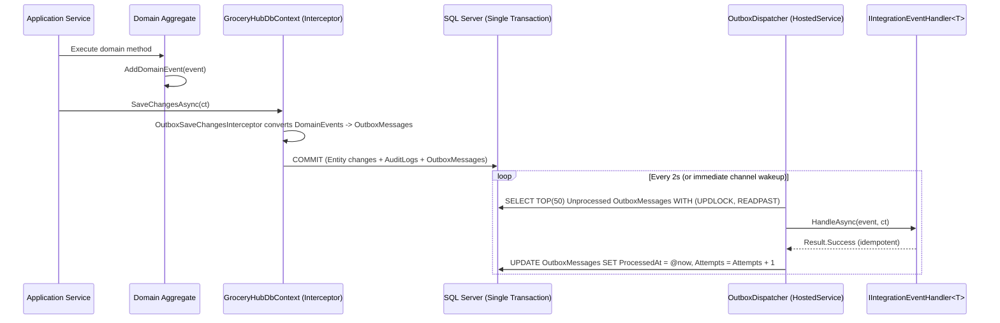

# GroceryHub — Domain & Integration Events Specification (`v1.0`)

- **Version:** `1.0` (Phase 03 Baseline)
- **Owner:** `backend-developer`
- **References:** `ADR-001`, `ADR-002`, `ADR-004`, `docs/spec/05-SYSTEM-ARCHITECTURE.md` §5, `docs/spec/06-DATABASE-ERD.md` (`shared.OutboxMessages`, `payments.WebhookEvents`, `ordering.IdempotencyKeys`)

---

## 1. Eventing Architecture & Transactional Outbox Pattern

In the GroceryHub modular monolith, cross-module **invariants** that must succeed or fail together (such as reserving stock and redeeming a coupon during `PlaceOrder`, or confirming an order during a verified SePay webhook) execute **synchronously within the same SQL Server transaction** via the contract ports defined in `docs/spec/module-contracts.md`.

Side effects that must be durable and decoupled from the primary transaction or handled asynchronously across module boundaries use **Domain Events persisted via the Transactional Outbox Pattern (`shared.OutboxMessages`)**.

### 1.1 Outbox Schema (`shared.OutboxMessages`)

| Column | SQL Server Type | Nullable | Description |
|---|---|---|---|
| `Id` | `uniqueidentifier` | `NOT NULL` (PK) | Deterministic or `Guid.CreateVersion7()` event message ID (`EventId`). |
| `Type` | `nvarchar(200)` | `NOT NULL` | Versioned logical event type name (e.g., `"ordering.order_placed.v1"`). |
| `Payload` | `nvarchar(max)` | `NOT NULL` | CamelCase JSON-serialized event record payload. |
| `CorrelationId` | `nvarchar(64)` | `NULL` | Propagated `X-Correlation-Id` from the originating HTTP request or background job. |
| `OccurredAt` | `datetimeoffset(7)` | `NOT NULL` | UTC timestamp from injected `TimeProvider`. |
| `ProcessedAt` | `datetimeoffset(7)` | `NULL` | UTC timestamp when all registered handlers succeeded. |
| `Attempts` | `int` | `NOT NULL` | Delivery attempt counter (starts at `0`). |
| `Error` | `nvarchar(2000)` | `NULL` | Last error message if a handler failed. |

**Filtered Index:** `IX_OutboxMessages_Unprocessed` on `(OccurredAt ASC) WHERE ProcessedAt IS NULL`.

### 1.2 Outbox Publishing & Dispatch Lifecycle



1. **Atomic Write:** `OutboxSaveChangesInterceptor` inspects tracked `AggregateRoot` instances before `SaveChangesAsync`, converts any queued `IDomainEvent` into `shared.OutboxMessages` rows, and commits them in the **exact same database transaction** as the aggregate state change.
2. **Polling & Concurrency Safety:** `OutboxDispatcher` queries batches of up to 50 unprocessed rows (`ProcessedAt IS NULL AND Attempts < 10`) using `WITH (UPDLOCK, READPAST)` so multiple worker instances never process the same row concurrently.
3. **Retry with Exponential Backoff:** If any `IIntegrationEventHandler<T>` throws or returns failure, `Attempts` is incremented and `Error` is recorded. Messages reaching `Attempts == 10` log a `Critical` structured alert (`OUTBOX_POISON_MESSAGE`) for operator inspection.

---

## 2. Inbox & Idempotency Rules Across the System

Every event handler and external write boundary in GroceryHub is **idempotent**:

| Mechanism | Storage Table & Unique Constraint | Scope & Deduplication Strategy |
|---|---|---|
| **1. Client Write Idempotency** | `ordering.IdempotencyKeys`<br>`UQ(Key, Scope)` | Required on `POST /api/v1/checkout/orders` (`Scope = "checkout.place_order:{userId}"`) and `POST /api/v1/me/orders/{id}/payment-attempts` (`Scope = "payments.create_attempt:{userId}:{orderId}"`). Stores SHA-256 `RequestHash`, `ResponseStatus`, and `ResponseBody` (TTL 24h). Same key + same hash returns cached response; same key + different hash returns `409 IDEMPOTENCY_KEY_REUSED`. |
| **2. SePay Webhook Inbox** | `payments.WebhookEvents`<br>`UQ(Provider, ProviderTransactionId)` | Every incoming SePay webhook (`POST /api/v1/payments/sepay/webhook`) or reconciliation item inserts a row into `payments.WebhookEvents` first. Duplicate deliveries with `ProcessingStatus IN ('Processed', 'Ignored')` short-circuit immediately and return `200 {"success": true}`. |
| **3. Internal Outbox Handler Idempotency** | Natural state guards & unique keys in target tables | Every `IIntegrationEventHandler<T>` is written to be safely re-entrant:<br>- `Audit`: checks or records deterministic `CorrelationId` + `EventId`.<br>- `Catalog` (`SoldCount` / `RatingAvg`): recomputes aggregates from authoritative rows (`SELECT AVG( CAST(Rating AS decimal(3,2)) ), COUNT(*) FROM reviews.Reviews WHERE ProductId = @id AND Status = 'Approved'`) or checks if already applied.<br>- `Identity` (`PermissionCache`): cache eviction is naturally idempotent. |

---

## 3. Catalog of Domain & Integration Events (15 Events)

### Summary Matrix

| # | Event Name (`Type`) | Publisher Module | Handler Module(s) | Primary Purpose |
|---:|---|---|---|---|
| 1 | `OrderPlacedEvent`<br>(`ordering.order_placed.v1`) | `Ordering` | `Audit`, `Identity` (email notification stub) | Record order placement audit trail and queue order confirmation notification |
| 2 | `OrderConfirmedEvent`<br>(`ordering.order_confirmed.v1`) | `Ordering` | `Audit` | Record transition to `Confirmed` (via Staff for COD or System for verified QR payment) |
| 3 | `OrderPackedEvent`<br>(`ordering.order_packed.v1`) | `Ordering` | `Audit` | Record warehouse picking/packing completion |
| 4 | `OrderShippedEvent`<br>(`ordering.order_shipped.v1`) | `Ordering` | `Audit` | Record transition to `Shipping` and stock commitment (`Sale` movement + `UnitCostSnapshot`) |
| 5 | `OrderDeliveredEvent`<br>(`ordering.order_delivered.v1`) | `Ordering` | `Catalog`, `Audit` | Recompute/increment `Products.SoldCount` for delivered items; record delivery audit |
| 6 | `OrderCancelledEvent`<br>(`ordering.order_cancelled.v1`) | `Ordering` | `Audit` | Record cancellation reason, actor, released reservation/coupon, and linked refund ID if paid |
| 7 | `PaymentVerifiedEvent`<br>(`payments.payment_verified.v1`) | `Payments` | `Audit` | Record verified SePay webhook or COD cash collection that transitioned `Payment -> Paid` |
| 8 | `PaymentAnomalyDetectedEvent`<br>(`payments.payment_anomaly_detected.v1`) | `Payments` | `Audit`, `Reporting` (dashboard counter) | Alert and audit `NeedsReview` transactions (`UnknownCode`, `WrongAccount`, `Underpaid`, `Overpaid`, `LateAfterExpiry`, `DuplicatePayment`) |
| 9 | `RefundStatusChangedEvent`<br>(`payments.refund_status_changed.v1`) | `Payments` | `Ordering`, `Audit` | Sync `Order.PaymentStatus` (`PartiallyRefunded` / `Refunded`) on `Completed` and audit `Requested -> Approved/Rejected -> Completed` |
| 10 | `ProductPriceChangedEvent`<br>(`catalog.product_price_changed.v1`) | `Catalog` | `Audit` | Audit `OldSelling -> NewSelling` and `OldList -> NewList` alongside `catalog.ProductPriceHistory` (`BR-01`) |
| 11 | `StockAdjustedEvent`<br>(`inventory.stock_adjusted.v1`) | `Inventory` | `Audit` | Audit manual stock adjustments (`Delta`, `Reason`, `BeforeOnHand`, `AfterOnHand`) (`BR-12`) |
| 12 | `GoodsReceiptPostedEvent`<br>(`purchasing.goods_receipt_posted.v1`) | `Purchasing` | `Audit` | Audit immutable `GoodsReceipt` posting, stock increase, and moving-average `CostPrice` recalculations (`BR-01`, `BR-11`) |
| 13 | `ReviewApprovedEvent`<br>(`reviews.review_approved.v1`) | `Reviews` | `Catalog`, `Audit` | Recompute `catalog.Products.RatingAvg` and `RatingCount` when a review is moderated (`Approved`/`Rejected`) (`BR-09`) |
| 14 | `RolePermissionsUpdatedEvent`<br>(`identity.role_permissions_updated.v1`) | `Identity` | `Identity` (`IPermissionService`), `Audit` | Evict server-side permission cache (`IMemoryCache`) and write before/after permission set to `audit.AuditLogs` (`FR-ADM-010`) |
| 15 | `CustomerLockedEvent`<br>(`customers.customer_locked.v1`) | `Customers` / `Identity` | `Identity` (`IPermissionService`, `RefreshTokens`), `Audit` | Revoke active refresh token families, evict permission cache, and audit customer lock/unlock (`FR-ADM-008`) |

---

## 4. Detailed Event Payloads & Idempotency Strategies

### 4.1 `OrderPlacedEvent` (`ordering.order_placed.v1`)
- **Publisher:** `Ordering` (`PlaceOrderHandler`)
- **Handlers:** `Audit` (`OrderAuditEventHandler`)
- **Idempotency Key / Strategy:** `EventId` (`OutboxMessages.Id`); `OrderId` is unique per placed order.
```csharp
public sealed record OrderPlacedEvent(
    Guid EventId,
    Guid OrderId,
    string OrderNumber,
    Guid UserId,
    string PaymentMethod,
    string InitialStatus,
    long Subtotal,
    string? CouponCode,
    long CouponDiscount,
    long ShippingFee,
    long Total,
    IReadOnlyList<OrderPlacedLineItem> Items,
    DateTimeOffset OccurredAt) : IIntegrationEvent;

public sealed record OrderPlacedLineItem(
    Guid ProductId,
    string Sku,
    int Quantity,
    long UnitPrice,
    long DiscountAllocated,
    long LineTotal);
```

### 4.2 `OrderConfirmedEvent` (`ordering.order_confirmed.v1`)
- **Publisher:** `Ordering` (`TransitionOrderHandler` / `OrderPaymentPort`)
- **Handlers:** `Audit`
- **Idempotency Key / Strategy:** `(OrderId, "Confirmed")`; an order transitions to `Confirmed` at most once (unless revived from `LateAfterExpiry` with explicit admin resolution).
```csharp
public sealed record OrderConfirmedEvent(
    Guid EventId,
    Guid OrderId,
    string OrderNumber,
    Guid? ActorUserId, // null when confirmed by verified SePay webhook
    string ConfirmationSource, // "Staff" | "SePayWebhook" | "AdminPaymentReview"
    DateTimeOffset ConfirmedAt,
    DateTimeOffset OccurredAt) : IIntegrationEvent;
```

### 4.3 `OrderPackedEvent` (`ordering.order_packed.v1`)
- **Publisher:** `Ordering` (`TransitionOrderHandler`)
- **Handlers:** `Audit`
- **Idempotency Key / Strategy:** `(OrderId, "Packed")`.
```csharp
public sealed record OrderPackedEvent(
    Guid EventId,
    Guid OrderId,
    string OrderNumber,
    Guid PackedByUserId,
    DateTimeOffset PackedAt,
    DateTimeOffset OccurredAt) : IIntegrationEvent;
```

### 4.4 `OrderShippedEvent` (`ordering.order_shipped.v1`)
- **Publisher:** `Ordering` (`TransitionOrderHandler`)
- **Handlers:** `Audit`
- **Idempotency Key / Strategy:** `(OrderId, ShippedAt)`; stock commitment (`StockReservations.Status = 'Committed'`) is guarded by conditional update `WHERE Status = 'Active'`.
```csharp
public sealed record OrderShippedEvent(
    Guid EventId,
    Guid OrderId,
    string OrderNumber,
    Guid ShippedByUserId,
    IReadOnlyList<OrderShippedCostSnapshotItem> Items,
    DateTimeOffset ShippedAt,
    DateTimeOffset OccurredAt) : IIntegrationEvent;

public sealed record OrderShippedCostSnapshotItem(
    Guid OrderItemId,
    Guid ProductId,
    int Quantity,
    long UnitCostSnapshot);
```

### 4.5 `OrderDeliveredEvent` (`ordering.order_delivered.v1`)
- **Publisher:** `Ordering` (`TransitionOrderHandler`)
- **Handlers:** `Catalog` (`ProductSoldCountHandler`), `Audit`
- **Idempotency Key / Strategy:** `(OrderId, "Delivered")`; `Deliver` is a terminal state so an order can reach `Delivered` only once. `Catalog` recomputes or increments `SoldCount` guarded by `OrderId`.
```csharp
public sealed record OrderDeliveredEvent(
    Guid EventId,
    Guid OrderId,
    string OrderNumber,
    Guid UserId,
    Guid DeliveredByUserId,
    string PaymentMethod,
    long Total,
    IReadOnlyList<ProductSoldDeltaDto> DeliveredItems,
    DateTimeOffset DeliveredAt,
    DateTimeOffset OccurredAt) : IIntegrationEvent;
```

### 4.6 `OrderCancelledEvent` (`ordering.order_cancelled.v1`)
- **Publisher:** `Ordering` (`CancelOrderHandler` / `TransitionOrderHandler` / `OrderPaymentPort`)
- **Handlers:** `Audit`
- **Idempotency Key / Strategy:** `(OrderId, "Cancelled")` (terminal state unless revived via manual payment review).
```csharp
public sealed record OrderCancelledEvent(
    Guid EventId,
    Guid OrderId,
    string OrderNumber,
    Guid UserId,
    string PreviousStatus,
    string PreviousPaymentStatus,
    Guid? CancelledByUserId, // null when cancelled by PaymentExpiryService
    string CancelledByRole, // "Customer" | "Staff" | "Manager" | "Admin" | "System"
    string CancelReason,
    bool StockReturnedFromShipping,
    Guid? AutoCreatedRefundId,
    DateTimeOffset CancelledAt,
    DateTimeOffset OccurredAt) : IIntegrationEvent;
```

### 4.7 `PaymentVerifiedEvent` (`payments.payment_verified.v1`)
- **Publisher:** `Payments` (`SePayWebhookProcessor` / `CodCollectionService` / `PaymentReviewService`)
- **Handlers:** `Audit`
- **Idempotency Key / Strategy:** `PaymentId` + `PaymentTransactionId` (or `CodCollectionId`).
```csharp
public sealed record PaymentVerifiedEvent(
    Guid EventId,
    Guid PaymentId,
    Guid OrderId,
    Guid? PaymentAttemptId,
    Guid? PaymentTransactionId,
    string Method, // "SEPAY_QR" | "COD"
    long Amount,
    string VerificationSource, // "SePayWebhook" | "SePayReconciliation" | "CodDelivery" | "AdminManualReview"
    DateTimeOffset PaidAt,
    DateTimeOffset OccurredAt) : IIntegrationEvent;
```

### 4.8 `PaymentAnomalyDetectedEvent` (`payments.payment_anomaly_detected.v1`)
- **Publisher:** `Payments` (`SePayWebhookProcessor` / `ReconciliationService`)
- **Handlers:** `Audit`
- **Idempotency Key / Strategy:** `WebhookEventId` (`UQ(Provider, ProviderTransactionId)`).
```csharp
public sealed record PaymentAnomalyDetectedEvent(
    Guid EventId,
    Guid PaymentTransactionId,
    Guid WebhookEventId,
    string ProviderTransactionId,
    Guid? MatchedPaymentAttemptId,
    Guid? MatchedOrderId,
    string? ExtractedPaymentCode,
    long TransferAmount,
    long? ExpectedAmount,
    string AccountNumber,
    string MatchStatus, // UnknownCode | WrongAccount | Underpaid | Overpaid | LateAfterExpiry | DuplicatePayment
    DateTimeOffset TransactionTime,
    DateTimeOffset OccurredAt) : IIntegrationEvent;
```

### 4.9 `RefundStatusChangedEvent` (`payments.refund_status_changed.v1`)
- **Publisher:** `Payments` (`RefundService`)
- **Handlers:** `Ordering` (updates `Order.PaymentStatus` when `ToStatus == "Completed"`), `Audit`
- **Idempotency Key / Strategy:** `(RefundId, ToStatus)`.
```csharp
public sealed record RefundStatusChangedEvent(
    Guid EventId,
    Guid RefundId,
    Guid PaymentId,
    Guid OrderId,
    long RefundAmount,
    string FromStatus,
    string ToStatus, // Requested | Approved | Rejected | Completed
    string ResultingPaymentStatus, // Paid | PartiallyRefunded | Refunded
    Guid ActorUserId,
    string? ReasonOrNote,
    string? BankReference,
    DateTimeOffset OccurredAt) : IIntegrationEvent;
```

### 4.10 `ProductPriceChangedEvent` (`catalog.product_price_changed.v1`)
- **Publisher:** `Catalog` (`UpdateProductPriceHandler`)
- **Handlers:** `Audit`
- **Idempotency Key / Strategy:** `PriceHistoryId` (`catalog.ProductPriceHistory.Id`).
```csharp
public sealed record ProductPriceChangedEvent(
    Guid EventId,
    Guid PriceHistoryId,
    Guid ProductId,
    string Sku,
    long OldListPrice,
    long NewListPrice,
    long OldSellingPrice,
    long NewSellingPrice,
    string Reason,
    Guid ChangedByUserId,
    DateTimeOffset ChangedAt,
    DateTimeOffset OccurredAt) : IIntegrationEvent;
```

### 4.11 `StockAdjustedEvent` (`inventory.stock_adjusted.v1`)
- **Publisher:** `Inventory` (`AdjustInventoryHandler`)
- **Handlers:** `Audit`
- **Idempotency Key / Strategy:** `StockMovementId` (`inventory.StockMovements.Id`).
```csharp
public sealed record StockAdjustedEvent(
    Guid EventId,
    long StockMovementId,
    Guid ProductId,
    int DeltaQuantity,
    int OldOnHand,
    int NewOnHand,
    int Reserved,
    string Reason,
    Guid AdjustedByUserId,
    DateTimeOffset OccurredAt) : IIntegrationEvent;
```

### 4.12 `GoodsReceiptPostedEvent` (`purchasing.goods_receipt_posted.v1`)
- **Publisher:** `Purchasing` (`PostGoodsReceiptHandler`)
- **Handlers:** `Audit`
- **Idempotency Key / Strategy:** `GoodsReceiptId` (`purchasing.GoodsReceipts.Id`, immutable).
```csharp
public sealed record GoodsReceiptPostedEvent(
    Guid EventId,
    Guid GoodsReceiptId,
    string GoodsReceiptCode,
    Guid? PurchaseOrderId,
    Guid SupplierId,
    string InvoiceNo,
    IReadOnlyList<GoodsReceiptCostChangeItem> Lines,
    Guid ReceivedByUserId,
    DateTimeOffset ReceivedAt,
    DateTimeOffset OccurredAt) : IIntegrationEvent;

public sealed record GoodsReceiptCostChangeItem(
    Guid ProductId,
    int QuantityReceived,
    long ReceiptUnitCost,
    long OldMovingAvgCost,
    long NewMovingAvgCost);
```

### 4.13 `ReviewApprovedEvent` (`reviews.review_approved.v1`)
- **Publisher:** `Reviews` (`ModerateReviewHandler`)
- **Handlers:** `Catalog` (`ICatalogReviewSummaryPort`), `Audit`
- **Idempotency Key / Strategy:** `(ReviewId, ModeratedAt)`. Handler recomputes `RatingAvg` and `RatingCount` directly from all `Approved` reviews for `ProductId` so repeated executions are 100% idempotent.
```csharp
public sealed record ReviewApprovedEvent(
    Guid EventId,
    Guid ReviewId,
    Guid ProductId,
    Guid OrderItemId,
    int Rating,
    string PreviousStatus,
    string NewStatus, // Approved | Rejected
    decimal UpdatedRatingAvg,
    int UpdatedRatingCount,
    Guid ModeratedByUserId,
    DateTimeOffset ModeratedAt,
    DateTimeOffset OccurredAt) : IIntegrationEvent;
```

### 4.14 `RolePermissionsUpdatedEvent` (`identity.role_permissions_updated.v1`)
- **Publisher:** `Identity` (`UpdateRolePermissionsHandler` / `UpdateStaffPermissionsHandler`)
- **Handlers:** `Identity` (`IPermissionService.InvalidateAllPermissionsCache()`), `Audit`
- **Idempotency Key / Strategy:** `EventId`; cache eviction is idempotent.
```csharp
public sealed record RolePermissionsUpdatedEvent(
    Guid EventId,
    Guid? RoleId,
    string? RoleName,
    Guid? TargetUserId,
    IReadOnlyList<string> BeforePermissions,
    IReadOnlyList<string> AfterPermissions,
    Guid ActorUserId,
    DateTimeOffset OccurredAt) : IIntegrationEvent;
```

### 4.15 `CustomerLockedEvent` (`customers.customer_locked.v1`)
- **Publisher:** `Customers` / `Identity` (`LockCustomerHandler`)
- **Handlers:** `Identity` (revokes all active `RefreshTokens` for `CustomerUserId` and evicts `perm:user:{CustomerUserId}` cache), `Audit`
- **Idempotency Key / Strategy:** `(CustomerUserId, IsLocked, OccurredAt)`.
```csharp
public sealed record CustomerLockedEvent(
    Guid EventId,
    Guid CustomerUserId,
    bool IsLocked, // true = Locked, false = Unlocked
    string Reason,
    Guid ActorUserId,
    DateTimeOffset OccurredAt) : IIntegrationEvent;
```
