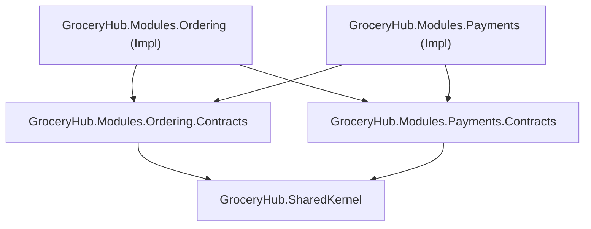

# GroceryHub — Cross-Module Contracts Specification (`v1.0`)

- **Version:** `1.0` (Phase 03 Baseline)
- **Owner:** `backend-developer` (co-owned with `payment-specialist` for `Payments.Contracts`)
- **References:** `ADR-001`, `ADR-004`, `ADR-006`, `ADR-007`, `docs/spec/05-SYSTEM-ARCHITECTURE.md` §4, `docs/spec/06-DATABASE-ERD.md`, `docs/spec/07-API-SPECIFICATION.md`

---

## 1. Contract Assembly Rules & Project Reference Graph

1. **One Contracts Assembly per Module:**
   Every module `GroceryHub.Modules.<Name>` has a companion contracts assembly `GroceryHub.Modules.<Name>.Contracts` containing **only**:
   - Public C# service port interfaces (`I<Name>Contract` / `I<Role>Port`)
   - Immutable C# `record` request/response DTOs and enums
   - Integration event records implementing `IIntegrationEvent` (`docs/spec/events.md`)
2. **Zero Implementation Leakage:**
   `GroceryHub.Modules.<Name>.Contracts` references **only** `GroceryHub.SharedKernel`. It must **never** reference EF Core, ASP.NET Core, another module's implementation project, or another module's `.Contracts` project.
3. **Return Types & Error Handling (`ADR-006`):**
   Every cross-module command or query method is asynchronous (`CancellationToken ct = default`) and returns `Task<Result<T>>` or `Task<Result>` from `GroceryHub.SharedKernel`.
4. **Resolving `Ordering <-> Payments` Without Cycles (`ADR-001`):**
   - `GroceryHub.Modules.Ordering` references `GroceryHub.Modules.Payments.Contracts` and calls `IPaymentService` (to create payments and QR payment attempts during checkout or retry).
   - `GroceryHub.Modules.Payments` references `GroceryHub.Modules.Ordering.Contracts` and calls `IOrderPaymentPort` (to transition `PendingPayment -> Confirmed` on verified SePay webhook, expire unpaid QR orders, record COD cash on delivery, or inspect order state for refunds/anomalies).
   - Because `Ordering` depends only on `Payments.Contracts` (which depends only on `SharedKernel`) and `Payments` depends only on `Ordering.Contracts` (which depends only on `SharedKernel`), the MSBuild project reference graph is a strict **Directed Acyclic Graph (DAG)** with **zero cycles**.



---

## 2. Complete Cross-Module Dependency Matrix

| # | Caller Module (`GroceryHub.Modules.<Caller>`) | Target Contracts Project (`GroceryHub.Modules.<Target>.Contracts`) | Interfaces Used | Purpose |
|---:|---|---|---|---|
| 1 | `Identity` | `Audit.Contracts` | `IAuditLogPort` | Record role/permission matrix changes, staff creation/status updates, and lock/unlock actions |
| 2 | `Customers` | `Identity.Contracts`, `Audit.Contracts` | `IIdentityUserPort`, `IAuditLogPort` | Query/lock/unlock/anonymize user account state in `identity.Users` and write audit entries |
| 3 | `Catalog` | `Inventory.Contracts`, `Audit.Contracts` | `IInventoryReadContract`, `IAuditLogPort` | Enrich storefront product queries with live `Available` stock flags (`inStock`, `lowStock`), initialize `StockItem` on product creation, and audit price/cost changes |
| 4 | `Inventory` | `Catalog.Contracts`, `Audit.Contracts` | `ICatalogProductContract`, `IAuditLogPort` | Verify product existence/status, fetch current `CostPrice` for `Sale` movement snapshots, and audit manual stock adjustments |
| 5 | `Purchasing` | `Catalog.Contracts`, `Inventory.Contracts`, `Audit.Contracts` | `ICatalogProductContract`, `IInventoryReceiptContract`, `IAuditLogPort` | Validate products on PO/GoodsReceipt lines, post received stock (`+OnHand`), update moving-average `CostPrice`, and audit receipts/PO transitions |
| 6 | `Promotions` | `Catalog.Contracts`, `Audit.Contracts` | `ICatalogProductContract`, `IAuditLogPort` | Validate product/category scopes when previewing or redeeming coupons; audit coupon CRUD |
| 7 | `Cart` | `Catalog.Contracts`, `Inventory.Contracts`, `Promotions.Contracts` | `ICatalogProductContract`, `IInventoryReadContract`, `IPromotionCouponContract` | Recompute live product prices, verify available stock and `MaxQuantityPerLine`, and preview coupon discounts |
| 8 | `Ordering` | `Cart.Contracts`, `Catalog.Contracts`, `Inventory.Contracts`, `Promotions.Contracts`, `Customers.Contracts`, `Payments.Contracts`, `Audit.Contracts` | `ICartCheckoutContract`, `ICatalogProductContract`, `IInventoryReservationContract`, `IPromotionCouponContract`, `ICustomerAddressContract`, `IPaymentService`, `IAuditLogPort` | Orchestrate checkout quote & order placement, reserve/release/commit stock, redeem/release coupons, snapshot delivery address, initialize `Payment`/`PaymentAttempt`, and audit cancellations/settings |
| 9 | `Payments` | `Ordering.Contracts`, `Inventory.Contracts`, `Audit.Contracts` | `IOrderPaymentPort`, `IInventoryReservationContract`, `IAuditLogPort` | Confirm order on verified SePay webhook, expire stale QR attempts & cancel order, verify stock availability when reviving a late payment (`AttachToOrder`), record COD collections, manage refunds, and write audit logs |
| 10 | `Reviews` | `Ordering.Contracts`, `Catalog.Contracts`, `Audit.Contracts` | `IOrderVerificationContract`, `ICatalogReviewSummaryPort`, `IAuditLogPort` | Verify `OrderItemId` belongs to a `Delivered` order owned by the customer (`BR-09`), update product `RatingAvg`/`RatingCount` upon moderation, and audit moderation actions |
| 11 | `Reporting` | *(Read-only projections in `GroceryHub.Persistence`)* | `IReportingQueryService` (own contract) | Execute read-only SQL/EF projections across `ordering`, `payments`, `inventory`, `catalog`, and `reviews` for dashboard KPIs, revenue, profit, top products, and stock valuation |
| 12 | `Audit` | *(None — leaf sink module)* | — | Persist and query immutable `audit.AuditLogs` rows; has zero outbound module dependencies |

> **Cycle Proof (Topological Order of `.csproj` References):**
> 1. `GroceryHub.SharedKernel` (0 dependencies)
> 2. All 12 `GroceryHub.Modules.*.Contracts` (depend only on `GroceryHub.SharedKernel`)
> 3. `GroceryHub.Persistence` (depends on `GroceryHub.SharedKernel` and `GroceryHub.Modules.*.Contracts`)
> 4. All 12 `GroceryHub.Modules.*` implementation assemblies (depend only on `SharedKernel`, `Persistence`, own `Contracts`, and target `Contracts` from Tier 2)
> 5. `GroceryHub.Api` (composition root; depends on Tier 3 and Tier 4)
> Because no Tier 4 assembly ever references another Tier 4 assembly and no Tier 2 assembly references another Tier 2 assembly, a dependency cycle is mathematically impossible.

---

## 3. Module Contract Specifications

### 3.1 `GroceryHub.Modules.Identity.Contracts`

- **Owned Tables (`identity`):** `Users`, `Roles`, `UserRoles`, `Permissions`, `RolePermissions`, `UserPermissions`, `RefreshTokens`, `StaffProfiles`
- **Domain Error Codes:** `UNAUTHENTICATED`, `FORBIDDEN`, `EMAIL_ALREADY_REGISTERED`, `ACCOUNT_LOCKED`, `EMAIL_NOT_VERIFIED`, `REFRESH_TOKEN_INVALID`, `NOT_FOUND`, `CONFLICT`, `VALIDATION_FAILED`

```csharp
namespace GroceryHub.Modules.Identity.Contracts;

public enum AccountStatus
{
    Active = 1,
    Locked = 2,
    Disabled = 3
}

public sealed record UserIdentitySummaryDto(
    Guid UserId,
    string Email,
    string FullName,
    string? PhoneNumber,
    AccountStatus Status,
    bool EmailConfirmed,
    IReadOnlyList<string> Roles,
    DateTimeOffset CreatedAt,
    DateTimeOffset? DeletedAt);

public sealed record LockUserAccountCommand(
    Guid UserId,
    bool IsLocked,
    string Reason,
    Guid ActorUserId);

public sealed record AnonymizeUserIdentityCommand(
    Guid UserId,
    string Reason,
    Guid ActorUserId);

public interface IIdentityUserPort
{
    Task<Result<UserIdentitySummaryDto>> GetUserSummaryAsync(
        Guid userId,
        CancellationToken ct = default);

    Task<Result> SetCustomerLockStateAsync(
        LockUserAccountCommand command,
        CancellationToken ct = default);

    Task<Result> AnonymizeCustomerIdentityAsync(
        AnonymizeUserIdentityCommand command,
        CancellationToken ct = default);
}

public interface IPermissionService
{
    Task<Result<IReadOnlySet<string>>> GetEffectivePermissionsAsync(
        Guid userId,
        CancellationToken ct = default);

    void InvalidateUserPermissionsCache(Guid userId);
    void InvalidateAllPermissionsCache();
}
```

---

### 3.2 `GroceryHub.Modules.Customers.Contracts`

- **Owned Tables (`customers` + `shared`):** `customers.Addresses`, `shared.Provinces`, `shared.Wards`, `shared.AdminUnitDataVersion`
- **Domain Error Codes:** `ADDRESS_LIMIT_REACHED`, `ADDRESS_NOT_SERVICEABLE`, `NOT_FOUND`, `FORBIDDEN`, `VALIDATION_FAILED`

```csharp
namespace GroceryHub.Modules.Customers.Contracts;

public sealed record CustomerAddressSnapshotDto(
    Guid AddressId,
    Guid UserId,
    string RecipientName,
    string Phone,
    string ProvinceCode,
    string ProvinceName,
    string WardCode,
    string WardName,
    string Street,
    string? Note);

public sealed record AdministrativeUnitCheckDto(
    string ProvinceCode,
    string ProvinceName,
    string WardCode,
    string WardName);

public interface ICustomerAddressContract
{
    Task<Result<CustomerAddressSnapshotDto>> GetAddressForCheckoutAsync(
        Guid userId,
        Guid addressId,
        CancellationToken ct = default);

    Task<Result<AdministrativeUnitCheckDto>> ValidateProvinceAndWardAsync(
        string provinceCode,
        string wardCode,
        CancellationToken ct = default);

    Task<Result<string>> GetProvinceNameAsync(
        string provinceCode,
        CancellationToken ct = default);
}
```

---

### 3.3 `GroceryHub.Modules.Catalog.Contracts`

- **Owned Tables (`catalog`):** `Categories`, `Brands`, `Products`, `ProductImages`, `ProductPriceHistory`, `Banners`
- **Domain Error Codes:** `PRODUCT_UNAVAILABLE`, `NOT_FOUND`, `CONFLICT`, `CONCURRENCY_CONFLICT`, `FILE_TYPE_NOT_ALLOWED`, `FILE_TOO_LARGE`, `VALIDATION_FAILED`

```csharp
namespace GroceryHub.Modules.Catalog.Contracts;

public enum ProductStatus
{
    Draft = 1,
    Active = 2,
    Hidden = 3
}

public sealed record ProductPricingSnapshotDto(
    Guid ProductId,
    string Sku,
    string Name,
    string Slug,
    Guid CategoryId,
    Guid? BrandId,
    string Unit,
    string? PackSize,
    string? PrimaryImageKey,
    long ListPrice,
    long SellingPrice,
    long CostPrice,
    ProductStatus Status,
    bool ExpiryTracked);

public sealed record UpdateMovingAverageCostCommand(
    Guid ProductId,
    int OldOnHandQuantity,
    int ReceivedQuantity,
    long ReceiptUnitCost,
    Guid ReferenceGoodsReceiptId,
    Guid ActorUserId);

public sealed record UpdateProductReviewAggregatesCommand(
    Guid ProductId,
    decimal RatingAvg,
    int RatingCount);

public sealed record IncrementProductSoldCountCommand(
    IReadOnlyList<ProductSoldDeltaDto> Items);

public sealed record ProductSoldDeltaDto(Guid ProductId, int QuantitySold);

public interface ICatalogProductContract
{
    Task<Result<IReadOnlyDictionary<Guid, ProductPricingSnapshotDto>>> GetProductsByIdsAsync(
        IReadOnlyCollection<Guid> productIds,
        CancellationToken ct = default);

    Task<Result<ProductPricingSnapshotDto>> GetProductByIdAsync(
        Guid productId,
        CancellationToken ct = default);

    Task<Result<long>> UpdateMovingAverageCostAsync(
        UpdateMovingAverageCostCommand command,
        CancellationToken ct = default);

    Task<Result> IncrementSoldCountAsync(
        IncrementProductSoldCountCommand command,
        CancellationToken ct = default);
}

public interface ICatalogReviewSummaryPort
{
    Task<Result> UpdateReviewAggregatesAsync(
        UpdateProductReviewAggregatesCommand command,
        CancellationToken ct = default);
}
```

---

### 3.4 `GroceryHub.Modules.Inventory.Contracts`

- **Owned Tables (`inventory`):** `StockItems`, `StockMovements`, `StockReservations`, `ExpiryLots`
- **Domain Error Codes:** `INSUFFICIENT_STOCK`, `PRODUCT_UNAVAILABLE`, `NOT_FOUND`, `CONFLICT`, `CONCURRENCY_CONFLICT`, `VALIDATION_FAILED`

```csharp
namespace GroceryHub.Modules.Inventory.Contracts;

public sealed record StockAvailabilityDto(
    Guid ProductId,
    int OnHand,
    int Reserved,
    int Available,
    int ReorderLevel,
    bool IsInStock,
    bool IsLowStock);

public sealed record StockReservationLineRequest(
    Guid ProductId,
    int Quantity);

public sealed record ReserveOrderStockCommand(
    Guid OrderId,
    IReadOnlyList<StockReservationLineRequest> Lines,
    DateTimeOffset? ExpiresAt,
    Guid ActorUserId);

public sealed record ReleaseOrderStockCommand(
    Guid OrderId,
    string Reason,
    Guid? ActorUserId);

public sealed record CommitOrderStockForShippingCommand(
    Guid OrderId,
    Guid ActorUserId);

public sealed record CommittedOrderLineCostDto(
    Guid ProductId,
    int Quantity,
    long UnitCostSnapshot);

public sealed record ReturnCancelledOrderStockCommand(
    Guid OrderId,
    IReadOnlyList<CommittedOrderLineCostDto> Lines,
    string Reason,
    Guid ActorUserId);

public sealed record ReceiveGoodsStockLineRequest(
    Guid GoodsReceiptLineId,
    Guid ProductId,
    int Quantity,
    long UnitCost,
    DateOnly? ExpiryDate);

public sealed record PostGoodsReceiptStockCommand(
    Guid GoodsReceiptId,
    string GoodsReceiptCode,
    IReadOnlyList<ReceiveGoodsStockLineRequest> Lines,
    Guid ActorUserId);

public interface IInventoryReadContract
{
    Task<Result<IReadOnlyDictionary<Guid, StockAvailabilityDto>>> GetAvailabilityByProductIdsAsync(
        IReadOnlyCollection<Guid> productIds,
        CancellationToken ct = default);

    Task<Result> EnsureStockItemExistsAsync(
        Guid productId,
        int initialReorderLevel,
        CancellationToken ct = default);
}

public interface IInventoryReservationContract
{
    /// <summary>
    /// Atomically increments StockItems.Reserved where OnHand - Reserved >= Quantity
    /// and writes Active StockReservations + Reserve StockMovements.
    /// Returns INSUFFICIENT_STOCK if any line fails.
    /// </summary>
    Task<Result> ReserveStockForOrderAsync(
        ReserveOrderStockCommand command,
        CancellationToken ct = default);

    /// <summary>
    /// Idempotently releases Active StockReservations for an order (on cancel or QR expiry),
    /// decrementing StockItems.Reserved and writing Release StockMovements.
    /// </summary>
    Task<Result> ReleaseOrderReservationAsync(
        ReleaseOrderStockCommand command,
        CancellationToken ct = default);

    /// <summary>
    /// Transitions Active reservations to Committed when Order moves Packed -> Shipping,
    /// decrementing both OnHand and Reserved, writing Sale StockMovements, and returning
    /// the current CostPrice per product to store as OrderItem.UnitCostSnapshot (BR-02).
    /// </summary>
    Task<Result<IReadOnlyDictionary<Guid, long>>> CommitOrderReservationOnShipAsync(
        CommitOrderStockForShippingCommand command,
        CancellationToken ct = default);

    /// <summary>
    /// Returns stock to OnHand (movement type Return) when an order in DeliveryFailed
    /// (where stock was already committed at Shipping) is cancelled by Manager/Admin (DEC-011 / Q-006).
    /// </summary>
    Task<Result> ReturnStockFromFailedDeliveryCancelAsync(
        ReturnCancelledOrderStockCommand command,
        CancellationToken ct = default);
}

public interface IInventoryReceiptContract
{
    Task<Result<IReadOnlyDictionary<Guid, int>>> ApplyGoodsReceiptAsync(
        PostGoodsReceiptStockCommand command,
        CancellationToken ct = default);
}
```

---

### 3.5 `GroceryHub.Modules.Purchasing.Contracts`

- **Owned Tables (`purchasing`):** `Suppliers`, `PurchaseOrders`, `PurchaseOrderLines`, `GoodsReceipts`, `GoodsReceiptLines`
- **Domain Error Codes:** `PO_INVALID_STATE`, `NOT_FOUND`, `CONFLICT`, `VALIDATION_FAILED`

```csharp
namespace GroceryHub.Modules.Purchasing.Contracts;

public enum PurchaseOrderStatus
{
    Draft = 1,
    Ordered = 2,
    PartiallyReceived = 3,
    Received = 4,
    Closed = 5,
    Cancelled = 6
}

public sealed record GoodsReceiptSummaryDto(
    Guid GoodsReceiptId,
    string Code,
    Guid? PurchaseOrderId,
    Guid SupplierId,
    string InvoiceNo,
    DateTimeOffset ReceivedAt,
    Guid ReceivedBy);
```

---

### 3.6 `GroceryHub.Modules.Promotions.Contracts`

- **Owned Tables (`promotions`):** `Coupons`, `CouponScopes`, `CouponRedemptions`
- **Domain Error Codes:** `COUPON_INVALID`, `COUPON_EXPIRED`, `COUPON_MIN_SUBTOTAL`, `COUPON_LIMIT_REACHED`, `NOT_FOUND`, `CONFLICT`, `CONCURRENCY_CONFLICT`, `VALIDATION_FAILED`

```csharp
namespace GroceryHub.Modules.Promotions.Contracts;

public enum CouponType
{
    Percent = 1,
    FixedAmount = 2,
    FreeShipping = 3
}

public sealed record CouponEvaluationLineInput(
    Guid ProductId,
    Guid CategoryId,
    long LineSubtotal);

public sealed record EvaluateCouponQuery(
    string CouponCode,
    Guid UserId,
    long Subtotal,
    long ShippingFee,
    IReadOnlyList<CouponEvaluationLineInput> Lines);

public sealed record CouponEvaluationResultDto(
    Guid CouponId,
    string Code,
    CouponType Type,
    long DiscountAmount,
    IReadOnlyDictionary<Guid, long> LineDiscountAllocations);

public sealed record RedeemCouponCommand(
    string CouponCode,
    Guid UserId,
    Guid OrderId,
    long Subtotal,
    long ShippingFee,
    IReadOnlyList<CouponEvaluationLineInput> Lines);

public sealed record ReleaseCouponRedemptionCommand(
    Guid OrderId,
    string Reason);

public interface IPromotionCouponContract
{
    /// <summary>
    /// Evaluates coupon validity, scope, minSubtotal, usage limits, and line allocations without mutating DB.
    /// Per DEC-011 / Q-009: FreeShipping sets DiscountAmount = ShippingFee and all LineDiscountAllocations = 0.
    /// </summary>
    Task<Result<CouponEvaluationResultDto>> EvaluateCouponAsync(
        EvaluateCouponQuery query,
        CancellationToken ct = default);

    /// <summary>
    /// Atomically increments Coupons.UsedCount (checking UsageLimit & PerUserLimit) and inserts CouponRedemption
    /// inside the order placement transaction (BR-04).
    /// </summary>
    Task<Result<CouponEvaluationResultDto>> RedeemCouponForOrderAsync(
        RedeemCouponCommand command,
        CancellationToken ct = default);

    /// <summary>
    /// Releases a coupon redemption when an order is cancelled or expires, setting ReleasedAt and decrementing UsedCount.
    /// </summary>
    Task<Result> ReleaseCouponRedemptionAsync(
        ReleaseCouponRedemptionCommand command,
        CancellationToken ct = default);
}
```

---

### 3.7 `GroceryHub.Modules.Cart.Contracts`

- **Owned Tables (`cart`):** `Carts`, `CartItems`
- **Domain Error Codes:** `CART_EMPTY`, `PRODUCT_UNAVAILABLE`, `INSUFFICIENT_STOCK`, `QUANTITY_LIMIT_EXCEEDED`, `COUPON_INVALID`

```csharp
namespace GroceryHub.Modules.Cart.Contracts;

public sealed record CartCheckoutItemDto(
    Guid ProductId,
    int Quantity);

public sealed record CartCheckoutSnapshotDto(
    Guid CartId,
    Guid UserId,
    string? CouponCode,
    IReadOnlyList<CartCheckoutItemDto> Items);

public interface ICartCheckoutContract
{
    Task<Result<CartCheckoutSnapshotDto>> GetCartForCheckoutAsync(
        Guid userId,
        CancellationToken ct = default);

    Task<Result> ClearCustomerCartAfterOrderAsync(
        Guid userId,
        CancellationToken ct = default);

    Task<Result> MergeGuestCartOnLoginAsync(
        Guid userId,
        string guestToken,
        CancellationToken ct = default);
}
```

---

### 3.8 `GroceryHub.Modules.Ordering.Contracts`

- **Owned Tables (`ordering`):** `Orders`, `OrderItems`, `OrderStatusHistory`, `ShippingZones`, `ShippingZoneProvinces`, `ShippingRates`, `IdempotencyKeys`
- **Domain Error Codes:** `ORDER_INVALID_TRANSITION`, `ORDER_NOT_CANCELLABLE`, `COD_LIMIT_EXCEEDED`, `ADDRESS_NOT_SERVICEABLE`, `PAYMENT_METHOD_UNAVAILABLE`, `IDEMPOTENCY_KEY_REUSED`, `NOT_FOUND`, `FORBIDDEN`

```csharp
namespace GroceryHub.Modules.Ordering.Contracts;

public enum OrderStatus
{
    PendingPayment = 1,
    Placed = 2,
    Confirmed = 3,
    Preparing = 4,
    Packed = 5,
    Shipping = 6,
    Delivered = 7,
    DeliveryFailed = 8,
    Cancelled = 9
}

public enum PaymentMethod
{
    COD = 1,
    SEPAY_QR = 2
}

public enum OrderPaymentStatus
{
    Unpaid = 1,
    Pending = 2,
    Paid = 3,
    Failed = 4,
    Expired = 5,
    PartiallyRefunded = 6,
    Refunded = 7
}

public sealed record OrderPaymentStateDto(
    Guid OrderId,
    string OrderNumber,
    Guid UserId,
    OrderStatus Status,
    PaymentMethod PaymentMethod,
    OrderPaymentStatus PaymentStatus,
    long Total,
    DateTimeOffset PlacedAt,
    DateTimeOffset? ExpiresAt,
    IReadOnlyList<OrderLineStockRequirementDto> Items);

public sealed record OrderLineStockRequirementDto(
    Guid ProductId,
    int Quantity);

public sealed record MarkOrderPaidCommand(
    Guid OrderId,
    Guid PaymentId,
    Guid? PaymentAttemptId,
    Guid PaymentTransactionId,
    DateTimeOffset PaidAt,
    string? Note);

public sealed record ExpireUnpaidOrderCommand(
    Guid OrderId,
    Guid PaymentId,
    DateTimeOffset ExpiredAt);

public sealed record SyncOrderRefundStatusCommand(
    Guid OrderId,
    OrderPaymentStatus NewPaymentStatus,
    Guid RefundId,
    Guid ActorUserId);

/// <summary>
/// Port implemented by Ordering and consumed by Payments (breaking the Ordering <-> Payments cycle).
/// </summary>
public interface IOrderPaymentPort
{
    Task<Result<OrderPaymentStateDto>> GetOrderPaymentStateAsync(
        Guid orderId,
        CancellationToken ct = default);

    /// <summary>
    /// Called by Payments when a verified SePay webhook (or manual review AttachToOrder) marks payment Paid.
    /// Transitions Order from PendingPayment -> Confirmed (or revives Cancelled(PaymentExpired) -> Confirmed if stock re-reserved).
    /// </summary>
    Task<Result> MarkOrderPaidAndConfirmAsync(
        MarkOrderPaidCommand command,
        CancellationToken ct = default);

    /// <summary>
    /// Called by PaymentExpiryService when QR payment attempt expires past grace window.
    /// Transitions Order from PendingPayment -> Cancelled(reason="PaymentExpired") and releases stock + coupon.
    /// </summary>
    Task<Result> CancelOrderOnPaymentExpiryAsync(
        ExpireUnpaidOrderCommand command,
        CancellationToken ct = default);

    /// <summary>
    /// Updates Order.PaymentStatus to PartiallyRefunded or Refunded when a Refund reaches Completed.
    /// </summary>
    Task<Result> UpdateOrderRefundStatusAsync(
        SyncOrderRefundStatusCommand command,
        CancellationToken ct = default);
}

public sealed record VerifiedOrderItemPurchaseDto(
    Guid OrderItemId,
    Guid OrderId,
    Guid UserId,
    Guid ProductId,
    OrderStatus OrderStatus,
    DateTimeOffset? DeliveredAt);

/// <summary>
/// Port implemented by Ordering and consumed by Reviews to verify BR-09 (Delivered order line owned by customer).
/// </summary>
public interface IOrderVerificationContract
{
    Task<Result<VerifiedOrderItemPurchaseDto>> VerifyPurchasedOrderItemAsync(
        Guid userId,
        Guid productId,
        Guid orderItemId,
        CancellationToken ct = default);
}
```

---

### 3.9 `GroceryHub.Modules.Payments.Contracts`

- **Owned Tables (`payments`):** `Payments`, `PaymentAttempts`, `WebhookEvents`, `PaymentTransactions`, `Refunds`, `CodCollections`
- **Domain Error Codes:** `PAYMENT_METHOD_UNAVAILABLE`, `PAYMENT_EXPIRED`, `PAYMENT_ALREADY_PAID`, `COD_AMOUNT_MISMATCH`, `REFUND_INVALID_AMOUNT`, `REFUND_SAME_APPROVER`, `IDEMPOTENCY_KEY_REUSED`, `NOT_FOUND`, `FORBIDDEN`, `CONFLICT`

```csharp
namespace GroceryHub.Modules.Payments.Contracts;

public sealed record QrPaymentDetailsDto(
    string Url,
    string Bank,
    string AccountNumber,
    string AccountName,
    long Amount,
    string Content);

public sealed record OrderPaymentInitializedDto(
    Guid PaymentId,
    Guid OrderId,
    string Method,
    string Status,
    long Amount,
    string? PaymentCode,
    DateTimeOffset? ExpiresAt,
    QrPaymentDetailsDto? Qr);

public sealed record InitializeOrderPaymentCommand(
    Guid OrderId,
    Guid UserId,
    string OrderNumber,
    string PaymentMethod,
    long Amount,
    DateTimeOffset Now);

public sealed record CreatePaymentAttemptCommand(
    Guid OrderId,
    Guid UserId,
    string IdempotencyKey);

public sealed record RecordCodCollectionCommand(
    Guid OrderId,
    long ExpectedOrderTotal,
    long CollectedAmount,
    Guid CollectedByUserId,
    DateTimeOffset CollectedAt);

public sealed record CreateAutoRefundOnOrderCancelCommand(
    Guid OrderId,
    string CancelReason,
    Guid RequestedByUserId);

/// <summary>
/// Service implemented by Payments and consumed by Ordering during checkout, delivery, and cancellation.
/// </summary>
public interface IPaymentService
{
    Task<Result<bool>> IsSePayQrEnabledAsync(CancellationToken ct = default);

    Task<Result<long>> GetCodMaxAmountAsync(CancellationToken ct = default);

    /// <summary>
    /// Creates the Payments row for a newly placed order.
    /// For COD: Status = Unpaid.
    /// For SEPAY_QR: Status = Pending, creates first PaymentAttempt (Open, code GH##########, ExpiresAt = now + QrExpiryMinutes).
    /// </summary>
    Task<Result<OrderPaymentInitializedDto>> InitializeOrderPaymentAsync(
        InitializeOrderPaymentCommand command,
        CancellationToken ct = default);

    /// <summary>
    /// Creates a new QR PaymentAttempt for an order in PendingPayment (max 5 attempts per DEC-011 / Q-010; marks previous Open attempt as Superseded).
    /// </summary>
    Task<Result<OrderPaymentInitializedDto>> CreateNewQrAttemptAsync(
        CreatePaymentAttemptCommand command,
        CancellationToken ct = default);

    /// <summary>
    /// Records cash collected on Shipping -> Delivered for COD orders (BR-06, Spec 11 §8).
    /// Returns COD_AMOUNT_MISMATCH if CollectedAmount != ExpectedOrderTotal.
    /// </summary>
    Task<Result> RecordCodCollectionOnDeliveryAsync(
        RecordCodCollectionCommand command,
        CancellationToken ct = default);

    /// <summary>
    /// Marks an Unpaid/Pending payment as Expired/Failed when an unpaid order is cancelled,
    /// OR automatically creates a Refund request in 'Requested' status when a Paid order is cancelled (BR-07, DEC-011 / Q-006).
    /// </summary>
    Task<Result<Guid?>> HandleOrderCancelledAsync(
        CreateAutoRefundOnOrderCancelCommand command,
        CancellationToken ct = default);
}
```

---

### 3.10 `GroceryHub.Modules.Reviews.Contracts`

- **Owned Tables (`reviews`):** `Reviews`
- **Domain Error Codes:** `REVIEW_NOT_ELIGIBLE`, `REVIEW_ALREADY_EXISTS`, `NOT_FOUND`, `FORBIDDEN`, `VALIDATION_FAILED`

```csharp
namespace GroceryHub.Modules.Reviews.Contracts;

public enum ReviewStatus
{
    Pending = 1,
    Approved = 2,
    Rejected = 3
}

public sealed record ProductReviewSummaryDto(
    Guid ProductId,
    decimal RatingAvg,
    int RatingCount);
```

---

### 3.11 `GroceryHub.Modules.Reporting.Contracts`

- **Owned Tables:** Read-only projections over `ordering`, `payments`, `inventory`, `catalog`, `reviews`
- **Domain Error Codes:** `VALIDATION_FAILED`, `FORBIDDEN`

```csharp
namespace GroceryHub.Modules.Reporting.Contracts;

public sealed record DateRangeQuery(
    DateOnly From,
    DateOnly To,
    string Granularity = "day");

public sealed record DashboardKpiDto(
    long TodayRevenue,
    long Last7DaysRevenue,
    long Last30DaysRevenue,
    IReadOnlyDictionary<string, int> OrdersByStatus,
    int LowStockCount,
    int PendingReviewsCount,
    int PaymentAnomaliesCount);
```

---

### 3.12 `GroceryHub.Modules.Audit.Contracts`

- **Owned Tables (`audit`):** `AuditLogs`
- **Domain Error Codes:** `VALIDATION_FAILED`, `FORBIDDEN`

```csharp
namespace GroceryHub.Modules.Audit.Contracts;

public sealed record WriteAuditLogCommand(
    Guid? ActorUserId,
    string? ActorRole,
    string Action,
    string EntityType,
    string EntityId,
    object? BeforeState,
    object? AfterState,
    string? IpAddress = null,
    string? CorrelationId = null);

public interface IAuditLogPort
{
    Task<Result> WriteAsync(
        WriteAuditLogCommand command,
        CancellationToken ct = default);
}
```
