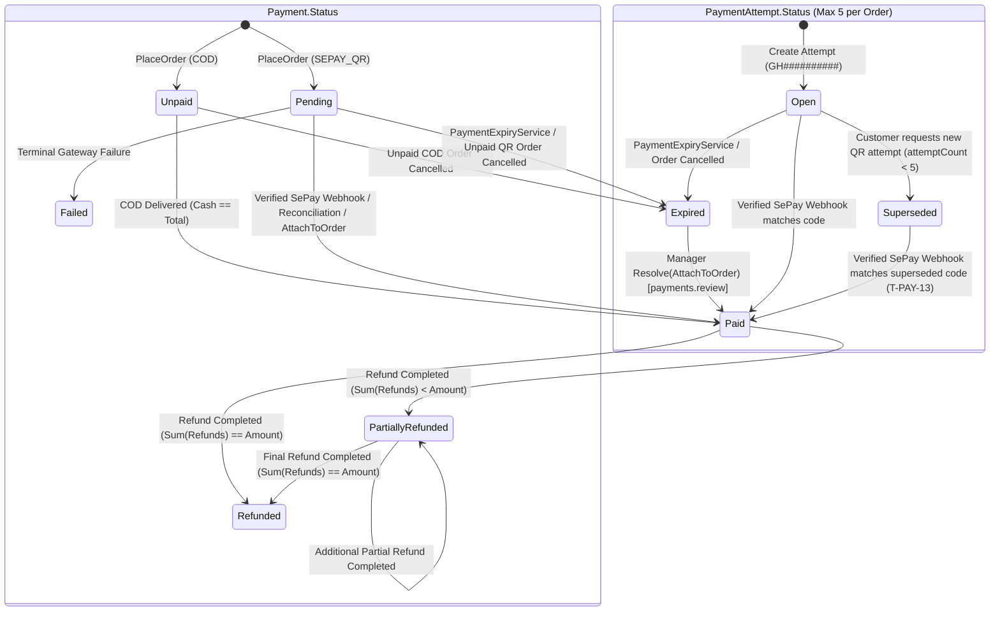
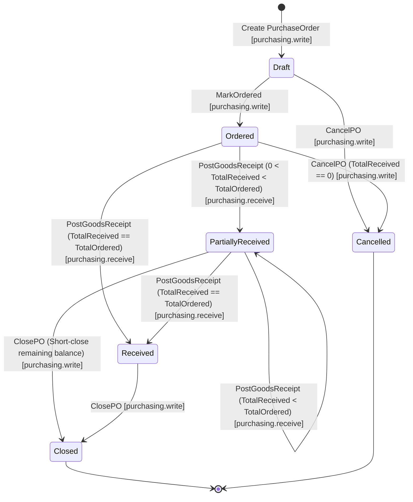
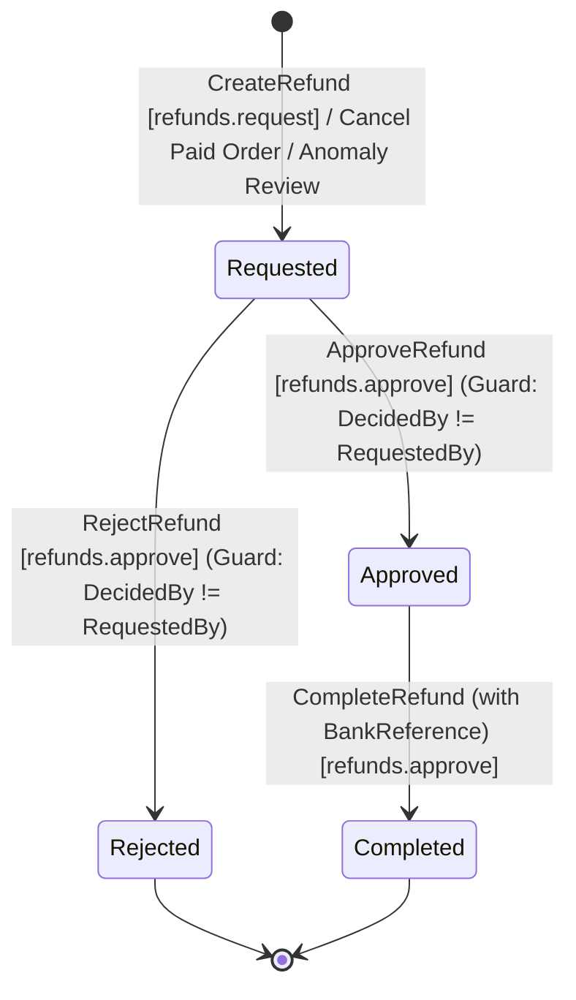
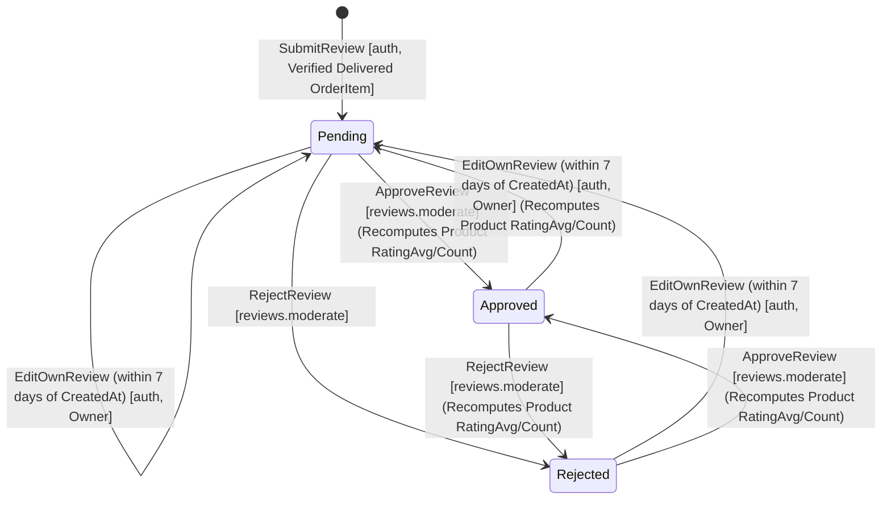

# GroceryHub — Domain State Machines Specification (`v1.0`)

- **Version:** `1.0` (Phase 03 Baseline)
- **Owner:** `backend-developer` (co-owned with `payment-specialist` for Payment/PaymentAttempt/Refund state machines)
- **References:** `docs/spec/02-PROJECT-REQUIREMENTS.md` (`BR-02`, `BR-06`..`BR-09`, `BR-11`, `BR-15`), `docs/spec/05-SYSTEM-ARCHITECTURE.md` §10, `docs/spec/11-SEPAY-INTEGRATION.md`, `docs/spec/permissions-seed.md`, `docs/progress/DECISIONS.md` (`DEC-011`)

---

## 1. Order Lifecycle State Machine (`ordering.Orders.Status`)

### 1.1 States (`OrderStatus`)
1. `PendingPayment` — Initial state for `SEPAY_QR` orders (`BR-06`, `BR-08`). Stock is reserved; coupon is redeemed; awaiting verified SePay transfer within `QrExpiryMinutes` (default `30m` + `5m` grace).
2. `Placed` — Initial state for `COD` orders (`BR-06`, `BR-08`). Stock is reserved; coupon is redeemed; awaiting Staff confirmation.
3. `Confirmed` — Order confirmed (automatically upon verified SePay QR payment, or by Staff for COD). Ready for warehouse picking.
4. `Preparing` — Warehouse Staff is picking items from aisles using the pick list (`FR-STF-002`).
5. `Packed` — Items picked, verified, and packed for dispatch (`FR-STF-002`).
6. `Shipping` — Handed to store delivery staff (`FR-STF-003`). Transitioning `Packed -> Shipping` **commits stock reservation** (`OnHand -= qty`, `Reserved -= qty`, `StockMovements(Type='Sale')` with `UnitCostSnapshot` copied onto `OrderItems` per `BR-02`).
7. `Delivered` — Terminal success state. Customer received goods; for `COD`, cash collection (`CodCollections`) is recorded and `Payment.Status` becomes `Paid` (`BR-06`). Verified purchase reviews (`BR-09`) and revenue/profit recognition (`BR-13`) are enabled.
8. `DeliveryFailed` — Delivery attempt failed (e.g., recipient unreachable). Can be retried (`DeliveryFailed -> Shipping`) or cancelled by `Manager`/`Admin` (`orders.cancel`, which returns committed stock to `OnHand`).
9. `Cancelled` — Terminal cancelled state (with one controlled exception: Manager manual payment review `AttachToOrder` reviving an order that expired due to late SePay transfer, only if stock can be re-reserved).

### 1.2 State Diagram (`OrderStatus`)

```mermaid
stateDiagram-v2
  [*] --> PendingPayment: PlaceOrder (SEPAY_QR)
  [*] --> Placed: PlaceOrder (COD)

  PendingPayment --> Confirmed: MarkOrderPaid (SePay Webhook / Reconciliation)
  PendingPayment --> Cancelled: CancelOrder (Customer / Staff orders.process / ExpiryJob)

  Placed --> Confirmed: Transition(Confirmed) [orders.process]
  Placed --> Cancelled: CancelOrder (Customer / Staff orders.process)

  Confirmed --> Preparing: Transition(Preparing) [orders.process]
  Confirmed --> Cancelled: CancelOrder (Customer / Staff orders.process if Unpaid; orders.cancel if Paid)

  Preparing --> Packed: Transition(Packed) [orders.process]
  Preparing --> Cancelled: Transition(Cancelled) [orders.cancel]

  Packed --> Shipping: Transition(Shipping) [orders.ship] (Commits Stock + Cost Snapshot)
  Packed --> Cancelled: Transition(Cancelled) [orders.cancel]

  Shipping --> Delivered: Transition(Delivered) [orders.ship] (Records COD Cash if COD)
  Shipping --> DeliveryFailed: Transition(DeliveryFailed) [orders.ship]

  DeliveryFailed --> Shipping: Transition(Shipping) [orders.ship] (Retry Delivery)
  DeliveryFailed --> Cancelled: Transition(Cancelled) [orders.cancel] (Returns Committed Stock)

  Cancelled --> Confirmed: ResolvePaymentAnomaly(AttachToOrder) [payments.review] (Only if PaymentExpired & Stock Re-reserved)

  Delivered --> [*]
  Cancelled --> [*]
```

### 1.3 Transition Matrix (`OrderStatus`)

> **Permission Rule for Order Cancellation (`DEC-011` / `Q-006`, `BR-07`, `permissions-seed.md`):**
> - **Customer (`auth` + owner):** May cancel own order in `PendingPayment`, `Placed`, or `Confirmed` (`POST /me/orders/{id}/cancel` with mandatory `reason`). If the order is already `Paid` (e.g., `Confirmed` QR order), cancelling automatically creates a `Refund` row in `Requested` state (`BR-07`).
> - **Staff (`orders.process`):** May cancel **unpaid** (`PaymentStatus != Paid`) orders in early states (`PendingPayment`, `Placed`, `Confirmed`) with mandatory `reason`.
> - **Manager / Admin (`orders.cancel`):** Required to cancel any order in `Preparing`, `Packed`, or `DeliveryFailed`, OR to cancel **any `Paid` order** from the admin portal (`POST /admin/orders/{id}/transition`).

| # | From State | To State | Trigger / Command | Actor / Permission | Guards / Invariants | Side Effects (DB / Events / Audit) | Error Code on Failure |
|---:|---|---|---|---|---|---|---|
| 1 | `[*]` | `PendingPayment` | `POST /checkout/orders` (`PlaceOrderCommand`) | Customer (`auth`) | Cart not empty; all products `Active`; `Quantity <= MaxQuantityPerLine` (`20`); `OnHand - Reserved >= Quantity`; province serviceable; `SEPAY_QR` enabled; valid coupon if provided. | Insert `Orders` (`PendingPayment`, `ExpiresAt = now + QrExpiryMinutes`), `OrderItems` (price snapshot), `OrderStatusHistory`, reserve `StockItems` (`Reserve`), redeem coupon, create `Payment` (`Pending`) + `PaymentAttempt` (`Open`), clear cart, emit `OrderPlacedEvent`. | `CART_EMPTY`, `PRODUCT_UNAVAILABLE`, `INSUFFICIENT_STOCK`, `QUANTITY_LIMIT_EXCEEDED`, `ADDRESS_NOT_SERVICEABLE`, `PAYMENT_METHOD_UNAVAILABLE`, `COUPON_*`, `IDEMPOTENCY_KEY_REUSED` |
| 2 | `[*]` | `Placed` | `POST /checkout/orders` (`PlaceOrderCommand`) | Customer (`auth`) | Same as row 1, plus `PaymentMethod == COD` and `Total <= CodMaxAmount` (`2.000.000 ₫` default per `DEC-007`). | Insert `Orders` (`Placed`), `OrderItems`, `OrderStatusHistory`, reserve `StockItems` (`Reserve`), redeem coupon, create `Payment` (`Unpaid`), clear cart, emit `OrderPlacedEvent`. | `COD_LIMIT_EXCEEDED`, `CART_EMPTY`, `INSUFFICIENT_STOCK`, `COUPON_*`, `IDEMPOTENCY_KEY_REUSED` |
| 3 | `PendingPayment` | `Confirmed` | `IOrderPaymentPort.MarkOrderPaidAndConfirmAsync` | System (`SePayWebhook` / `ReconciliationService`) or Manager (`payments.review`) | `PaymentMethod == SEPAY_QR`; verified payment amount matches `Order.Total`; order not past expiry+grace (unless manual review). | Set `Order.Status = Confirmed`, `Order.PaymentStatus = Paid`, `ConfirmedAt = now`; insert `OrderStatusHistory`; emit `OrderConfirmedEvent`. | `ORDER_INVALID_TRANSITION`, `PAYMENT_EXPIRED`, `CONCURRENCY_CONFLICT` |
| 4 | `PendingPayment` | `Cancelled` | `POST /me/orders/{id}/cancel`, `POST /admin/orders/{id}/transition`, or `PaymentExpiryService` | Customer (owner), Staff (`orders.process`), Manager (`orders.cancel`), or System (`PaymentExpiryService`) | Non-empty `reason`; `PaymentStatus != Paid`. | Set `Order.Status = Cancelled`, `CancelledAt = now`, `CancelReason = reason`; release `StockReservations` (`Release` movement); release `CouponRedemption`; mark `Payment`/`PaymentAttempt` `Expired`; insert `OrderStatusHistory` + `AuditLogs`; emit `OrderCancelledEvent`. | `ORDER_NOT_CANCELLABLE`, `ORDER_INVALID_TRANSITION`, `FORBIDDEN` |
| 5 | `Placed` | `Confirmed` | `POST /admin/orders/{id}/transition` (`{to: "Confirmed"}`) | Staff / Manager / Admin (`orders.process`) | `PaymentMethod == COD`; `Status == Placed`. | Set `Order.Status = Confirmed`, `ConfirmedAt = now`; insert `OrderStatusHistory`; emit `OrderConfirmedEvent`. | `ORDER_INVALID_TRANSITION`, `FORBIDDEN` |
| 6 | `Placed` | `Cancelled` | `POST /me/orders/{id}/cancel` or `POST /admin/orders/{id}/transition` | Customer (owner), Staff (`orders.process`), or Manager (`orders.cancel`) | Non-empty `reason`; `PaymentStatus == Unpaid`. | Set `Order.Status = Cancelled`, `CancelledAt = now`, `CancelReason = reason`; release `StockReservations`; release `CouponRedemption`; mark `Payment` `Expired`; insert `OrderStatusHistory` + `AuditLogs`; emit `OrderCancelledEvent`. | `ORDER_NOT_CANCELLABLE`, `ORDER_INVALID_TRANSITION`, `FORBIDDEN` |
| 7 | `Confirmed` | `Preparing` | `POST /admin/orders/{id}/transition` (`{to: "Preparing"}`) | Staff / Manager / Admin (`orders.process`) | `Status == Confirmed`; for `SEPAY_QR`, `PaymentStatus == Paid`. | Set `Order.Status = Preparing`; auto-assign `AssignedToUserId` if unassigned; insert `OrderStatusHistory`. | `ORDER_INVALID_TRANSITION`, `FORBIDDEN` |
| 8 | `Confirmed` | `Cancelled` | `POST /me/orders/{id}/cancel` or `POST /admin/orders/{id}/transition` | Customer (owner); Staff (`orders.process`) **only if Unpaid**; Manager/Admin (`orders.cancel`) if Paid or Unpaid (`DEC-011` / `Q-006`) | Non-empty `reason`. Staff without `orders.cancel` is rejected with `403 FORBIDDEN` if `PaymentStatus == Paid`. | Set `Order.Status = Cancelled`, `CancelledAt = now`, `CancelReason = reason`; release `StockReservations`; release `CouponRedemption`; if `PaymentStatus == Paid`, auto-create `Refunds` row (`Status = Requested`, `Amount = Order.Total`); write `OrderStatusHistory` + `AuditLogs`; emit `OrderCancelledEvent`. | `FORBIDDEN`, `ORDER_NOT_CANCELLABLE`, `ORDER_INVALID_TRANSITION` |
| 9 | `Preparing` | `Packed` | `POST /admin/orders/{id}/transition` (`{to: "Packed"}`) | Staff / Manager / Admin (`orders.process`) | `Status == Preparing`. | Set `Order.Status = Packed`, `PackedAt = now`; insert `OrderStatusHistory`; emit `OrderPackedEvent`. | `ORDER_INVALID_TRANSITION`, `FORBIDDEN` |
| 10 | `Preparing` | `Cancelled` | `POST /admin/orders/{id}/transition` (`{to: "Cancelled", reason}`) | Manager / Admin (`orders.cancel`) — Customer & Staff forbidden (`BR-07`, `DEC-011`) | Non-empty `reason`; caller has `orders.cancel`. | Set `Order.Status = Cancelled`, `CancelledAt = now`, `CancelReason = reason`; release `StockReservations` (still `Active` prior to `Shipping`); release `CouponRedemption`; if `PaymentStatus == Paid`, auto-create `Refund` (`Requested`); write `OrderStatusHistory` + `AuditLogs`; emit `OrderCancelledEvent`. | `FORBIDDEN`, `ORDER_NOT_CANCELLABLE`, `ORDER_INVALID_TRANSITION` |
| 11 | `Packed` | `Shipping` | `POST /admin/orders/{id}/transition` (`{to: "Shipping"}`) | Staff / Manager / Admin (`orders.ship`) | `Status == Packed`; `StockReservations` are `Active`. | Commit stock reservation (`OnHand -= qty`, `Reserved -= qty`, `StockReservations.Status = Committed`, `StockMovements(Type='Sale')`); snapshot `OrderItem.UnitCostSnapshot = Product.CostPrice`; set `Order.Status = Shipping`, `ShippedAt = now`; insert `OrderStatusHistory`; emit `OrderShippedEvent`. | `ORDER_INVALID_TRANSITION`, `INSUFFICIENT_STOCK`, `FORBIDDEN` |
| 12 | `Packed` | `Cancelled` | `POST /admin/orders/{id}/transition` (`{to: "Cancelled", reason}`) | Manager / Admin (`orders.cancel`) | Non-empty `reason`; caller has `orders.cancel`. | Same as row 10 (reservation is still `Active` in `Packed`, so `Release` movement runs). | `FORBIDDEN`, `ORDER_NOT_CANCELLABLE`, `ORDER_INVALID_TRANSITION` |
| 13 | `Shipping` | `Delivered` | `POST /admin/orders/{id}/transition` (`{to: "Delivered", codAmount?}`) | Staff / Manager / Admin (`orders.ship`) | `Status == Shipping`. If `PaymentMethod == COD`, `codAmount` is required and must equal `Order.Total` (`BR-06`, Spec 11 §8). | Set `Order.Status = Delivered`, `DeliveredAt = now`; if `COD`, insert `CodCollections` (`Amount = codAmount`), set `Payment.Status = Paid`, `Order.PaymentStatus = Paid`, `PaidAt = now`; insert `OrderStatusHistory`; emit `OrderDeliveredEvent` (+ `PaymentVerifiedEvent` for COD). | `COD_AMOUNT_MISMATCH`, `ORDER_INVALID_TRANSITION`, `FORBIDDEN` |
| 14 | `Shipping` | `DeliveryFailed` | `POST /admin/orders/{id}/transition` (`{to: "DeliveryFailed", reason}`) | Staff / Manager / Admin (`orders.ship`) | `Status == Shipping`; non-empty `reason`. (Note: direct `Shipping -> Cancelled` is forbidden; must go through `DeliveryFailed` first.) | Set `Order.Status = DeliveryFailed`; insert `OrderStatusHistory` with failure `reason`. | `ORDER_INVALID_TRANSITION`, `VALIDATION_FAILED`, `FORBIDDEN` |
| 15 | `DeliveryFailed` | `Shipping` | `POST /admin/orders/{id}/transition` (`{to: "Shipping"}`) | Staff / Manager / Admin (`orders.ship`) | `Status == DeliveryFailed` (stock remains committed from original dispatch). | Set `Order.Status = Shipping`; insert `OrderStatusHistory` (retry delivery). | `ORDER_INVALID_TRANSITION`, `FORBIDDEN` |
| 16 | `DeliveryFailed` | `Cancelled` | `POST /admin/orders/{id}/transition` (`{to: "Cancelled", reason}`) | Manager / Admin (`orders.cancel`) | `Status == DeliveryFailed`; non-empty `reason`; caller has `orders.cancel`. | Set `Order.Status = Cancelled`, `CancelledAt = now`, `CancelReason = reason`; **return committed stock** (`StockItems.OnHand += qty`, `StockMovements(Type='Return')` with `OrderItem.UnitCostSnapshot`); release `CouponRedemption`; if `PaymentStatus == Paid`, auto-create `Refund` (`Requested`); insert `OrderStatusHistory` + `AuditLogs`; emit `OrderCancelledEvent`. | `FORBIDDEN`, `ORDER_INVALID_TRANSITION` |
| 17 | `Cancelled` | `Confirmed` | `POST /admin/payment-transactions/{id}/resolve` (`{action: "AttachToOrder"}`) | Manager / Admin (`payments.review`) | Order was `Cancelled` due to `PaymentExpired`; late SePay payment arrived (`LateAfterExpiry`); stock for all lines can be atomically re-reserved (`OnHand - Reserved >= qty`). | Re-reserve stock (`StockReservations`), re-apply coupon redemption, set `Payment.Status = Paid`, `Order.PaymentStatus = Paid`, `Order.Status = Confirmed`, `CancelledAt = null`; write `OrderStatusHistory` + `AuditLogs`; emit `OrderConfirmedEvent`. | `INSUFFICIENT_STOCK`, `ORDER_INVALID_TRANSITION`, `FORBIDDEN` |

---

## 2. Payment (`payments.Payments.Status`) & PaymentAttempt (`payments.PaymentAttempts.Status`) State Machines

### 2.1 States
- **`PaymentStatus` (`payments.Payments.Status` & `ordering.Orders.PaymentStatus`):**
  - `Unpaid` — Initial state for `COD` orders (`BR-08`).
  - `Pending` — Initial state for `SEPAY_QR` orders while awaiting bank transfer (`BR-08`).
  - `Paid` — Full order total received (via verified SePay webhook/reconciliation, Manager anomaly resolution `AttachToOrder`, or COD cash collection at `Delivered`).
  - `Failed` — Payment attempt failed permanently.
  - `Expired` — QR payment window (`30m + 5m grace`) elapsed without payment, or unpaid order was cancelled before payment.
  - `PartiallyRefunded` — One or more `Refunds` reached `Completed` with cumulative refunded amount `< Payment.Amount`.
  - `Refunded` — Cumulative `Completed` refunds equal `Payment.Amount`.
- **`PaymentAttemptStatus` (`payments.PaymentAttempts.Status`):**
  - `Open` — Active VietQR code (`GH##########`) awaiting transfer before `ExpiresAt`.
  - `Superseded` — Replaced when the customer requests a new QR attempt (`POST /me/orders/{id}/payment-attempts`, up to **max 5 attempts per order** per `DEC-011` / `Q-010`). Note: per Spec 11 §5.7 (`T-PAY-13`), if a customer still transfers money using a `Superseded` attempt's code while the order is in `PendingPayment`, it is still accepted and marked `Paid`!
  - `Paid` — Attempt matched a verified incoming transfer.
  - `Expired` — Attempt expired without payment.

### 2.2 State Diagrams (`Payment` & `PaymentAttempt`)

### 2.3 Transition Matrix (`Payment` & `PaymentAttempt`)

| # | Entity | From State | To State | Trigger / Command | Actor / Permission | Guards / Invariants | Side Effects (DB / Events / Audit) | Error Code on Failure |
|---:|---|---|---|---|---|---|---|---|
| 1 | `Payment` | `[*]` | `Unpaid` | `IPaymentService.InitializeOrderPaymentAsync` (`COD`) | Customer (`auth` via `PlaceOrder`) | `PaymentMethod == COD`; `Amount <= CodMaxAmount`. | Insert `Payments` (`Status = Unpaid`, `Method = COD`, `Amount = Total`). | `COD_LIMIT_EXCEEDED` |
| 2 | `Payment` & `Attempt` | `[*]` | `Pending` / `Open` | `IPaymentService.InitializeOrderPaymentAsync` (`SEPAY_QR`) | Customer (`auth` via `PlaceOrder`) | `PaymentMethod == SEPAY_QR`; SePay enabled. | Insert `Payments` (`Status = Pending`) + `PaymentAttempts` #1 (`Status = Open`, `PaymentCode = GH##########` from `payments.PaymentCodeSeq`, `ExpiresAt = now + QrExpiryMinutes`). | `PAYMENT_METHOD_UNAVAILABLE` |
| 3 | `Attempt` | `Open` | `Superseded` (+ new `Open`) | `POST /me/orders/{id}/payment-attempts` | Customer (`auth`, owner) + `Idempotency-Key` | `Order.Status == PendingPayment`; `Payment.Status == Pending`; existing attempt count `< 5` (`DEC-011` / `Q-010`). | Mark current `Open` attempt `Status = Superseded`; insert new `PaymentAttempt` (`Status = Open`, new `GH##########` code, new `ExpiresAt = now + QrExpiryMinutes`); update `Order.ExpiresAt`. | `CONFLICT` (max 5 attempts reached), `PAYMENT_ALREADY_PAID`, `ORDER_INVALID_TRANSITION`, `IDEMPOTENCY_KEY_REUSED` |
| 4 | `Payment` & `Attempt` | `Pending` & (`Open` or `Superseded`) | `Paid` & `Paid` | `POST /payments/sepay/webhook` or `ReconciliationService` | System (HMAC / API-key verified webhook or API v2 reconciliation) | `transferType == "in"`; `accountNumber == SePay:AccountNumber`; `transferAmount == Payment.Amount`; `Order.Status == PendingPayment`; `now <= Attempt.ExpiresAt + ExpiryGraceMinutes`. | Insert `WebhookEvents` (`Processed`) + `PaymentTransactions` (`MatchStatus = Matched`, `ReviewStatus = None`); set `PaymentAttempt.Status = Paid`, `Payment.Status = Paid`, `PaidAt = now`; call `IOrderPaymentPort.MarkOrderPaidAndConfirmAsync`; emit `PaymentVerifiedEvent`. | Recorded as `PaymentTransaction` with `NeedsReview` (`WrongAccount`, `Underpaid`, `Overpaid`, `LateAfterExpiry`, `DuplicatePayment`); returns `200 {"success":true}` |
| 5 | `Payment` & `Attempt` | `Pending` & `Open` | `Expired` & `Expired` | `PaymentExpiryService` or Order Cancel | System (`PaymentExpiryService`) or Customer/Staff/Manager | `now > Attempt.ExpiresAt + ExpiryGraceMinutes` (for expiry job) and `Order.Status == PendingPayment`. | Set `PaymentAttempt.Status = Expired`, `Payment.Status = Expired`; call `IOrderPaymentPort.CancelOrderOnPaymentExpiryAsync` (releases stock & coupon). | `PAYMENT_ALREADY_PAID` |
| 6 | `Payment` | `Unpaid` | `Paid` | `IPaymentService.RecordCodCollectionOnDeliveryAsync` | Staff / Manager / Admin (`orders.ship`) | `Order.PaymentMethod == COD`; `Order.Status == Shipping`; `CollectedAmount == Payment.Amount` (`T-PAY-24`). | Insert `CodCollections` (`Amount`, `CollectedBy`, `CollectedAt`); set `Payment.Status = Paid`, `PaidAt = now`; emit `PaymentVerifiedEvent`. | `COD_AMOUNT_MISMATCH` |
| 7 | `Payment` | `Pending` or `Expired` | `Paid` | `POST /admin/payment-transactions/{id}/resolve` (`AttachToOrder`) | Manager / Admin (`payments.review`) | `PaymentTransaction.ReviewStatus == NeedsReview`; target order is `PendingPayment` or `Cancelled(PaymentExpired)` with re-reservable stock; `note` provided. | Set `PaymentTransaction.ReviewStatus = Resolved`, `Payment.Status = Paid`, `PaidAt = now`; confirm/revive order; write `AuditLogs`; emit `PaymentVerifiedEvent`. | `INSUFFICIENT_STOCK`, `PAYMENT_ALREADY_PAID`, `FORBIDDEN` |
| 8 | `Payment` | `Paid` or `PartiallyRefunded` | `PartiallyRefunded` or `Refunded` | `POST /admin/refunds/{id}/complete` | Manager / Admin (`refunds.approve`) | `Refund.Status == Approved`; `BankReference` provided. | If `Sum(Completed Refunds) < Payment.Amount` -> `PartiallyRefunded`; if `== Payment.Amount` -> `Refunded`; sync `Order.PaymentStatus`; emit `RefundStatusChangedEvent`. | `REFUND_INVALID_AMOUNT`, `CONFLICT` |

---

## 3. Purchase Order Lifecycle State Machine (`purchasing.PurchaseOrders.Status`)

### 3.1 States (`PurchaseOrderStatus` — `BR-11`)
1. `Draft` — Initial editable state when a Manager/Admin creates a Purchase Order (`POST /admin/purchase-orders`). Lines and quantities can be edited.
2. `Ordered` — Sent to supplier (`POST /admin/purchase-orders/{id}/order`). Lines are locked; ready to receive goods via `POST /admin/goods-receipts`.
3. `PartiallyReceived` — At least one `GoodsReceipt` has been posted against the PO, and `0 < Sum(QuantityReceived) < Sum(QuantityOrdered)`.
4. `Received` — All lines have `QuantityReceived >= QuantityOrdered`.
5. `Closed` — Terminal completed state. Reached from `Received` (or from `PartiallyReceived` when the manager closes the remaining short-shipped balance).
6. `Cancelled` — Terminal cancelled state. Allowed only from `Draft` or `Ordered` before any goods receipt has been posted (`Sum(QuantityReceived) == 0`).

### 3.2 State Diagram (`PurchaseOrderStatus`)

### 3.3 Transition Matrix (`PurchaseOrderStatus`)

| # | From State | To State | Trigger / Command | Actor / Permission | Guards / Invariants | Side Effects (DB / Events / Audit) | Error Code on Failure |
|---:|---|---|---|---|---|---|---|
| 1 | `[*]` | `Draft` | `POST /admin/purchase-orders` | Manager / Admin (`purchasing.write`) | Supplier exists and is active; $\ge 1$ line; all `QuantityOrdered > 0` and `UnitCost >= 0`. | Insert `PurchaseOrders` (`Status = Draft`, `Code = POyyMMdd-NNNN`) + `PurchaseOrderLines` (`QuantityReceived = 0`). | `VALIDATION_FAILED`, `NOT_FOUND`, `FORBIDDEN` |
| 2 | `Draft` | `Ordered` | `POST /admin/purchase-orders/{id}/order` | Manager / Admin (`purchasing.write`) | `Status == Draft`; has $\ge 1$ valid line. | Set `PurchaseOrders.Status = Ordered`; write `AuditLogs`. | `PO_INVALID_STATE`, `FORBIDDEN` |
| 3 | `Draft` or `Ordered` | `Cancelled` | `POST /admin/purchase-orders/{id}/cancel` | Manager / Admin (`purchasing.write`) | `Status IN (Draft, Ordered)` and `Sum(QuantityReceived) == 0` (no receipts posted). | Set `PurchaseOrders.Status = Cancelled`; write `AuditLogs`. | `PO_INVALID_STATE`, `FORBIDDEN` |
| 4 | `Ordered` or `PartiallyReceived` | `PartiallyReceived` | `POST /admin/goods-receipts` | Staff (with `purchasing.receive`), Manager, Admin (`purchasing.receive`) | `Status IN (Ordered, PartiallyReceived)`; for each line, `QuantityReceived + receiptQty <= QuantityOrdered`; `Sum(QuantityReceived) < Sum(QuantityOrdered)`. | Insert immutable `GoodsReceipts` + `GoodsReceiptLines`; update `PurchaseOrderLines.QuantityReceived`; increase `StockItems.OnHand` (`StockMovements(Type='Receipt')`); update `ExpiryLots` if `ExpiryDate` present; recompute `Products.CostPrice` (moving average `BR-01`); set `PO.Status = PartiallyReceived`; emit `GoodsReceiptPostedEvent`. | `PO_INVALID_STATE`, `VALIDATION_FAILED`, `FORBIDDEN` |
| 5 | `Ordered` or `PartiallyReceived` | `Received` | `POST /admin/goods-receipts` | Staff (with `purchasing.receive`), Manager, Admin (`purchasing.receive`) | Same as row 4, and after receipt every line has `QuantityReceived == QuantityOrdered`. | Same as row 4, and set `PurchaseOrders.Status = Received`; emit `GoodsReceiptPostedEvent`. | `PO_INVALID_STATE`, `VALIDATION_FAILED`, `FORBIDDEN` |
| 6 | `PartiallyReceived` or `Received` | `Closed` | `POST /admin/purchase-orders/{id}/close` | Manager / Admin (`purchasing.write`) | `Status IN (PartiallyReceived, Received)`. | Set `PurchaseOrders.Status = Closed`; write `AuditLogs`. | `PO_INVALID_STATE`, `FORBIDDEN` |

---

## 4. Refund Lifecycle State Machine (`payments.Refunds.Status`)

### 4.1 States (`RefundStatus` — `BR-15`)
1. `Requested` — Created either manually via `POST /admin/refunds` (`refunds.request`), via anomaly review `Refund` (`payments.review`), or automatically when a `Paid` order is cancelled (`BR-07`).
2. `Approved` — Approved by a Manager or Admin (`refunds.approve`) who is **strictly different from `RequestedBy`** (**Four-Eyes Rule `BR-15`**: `DecidedBy != RequestedBy`, otherwise rejected with `409 REFUND_SAME_APPROVER`).
3. `Rejected` — Terminal rejected state. Decided by a user with `refunds.approve` (`DecidedBy != RequestedBy`).
4. `Completed` — Terminal completed state (`POST /admin/refunds/{id}/complete` by `refunds.approve`) after the finance/store operator executes the manual bank transfer and records the mandatory `BankReference`. Updates `Payment.Status` and `Order.PaymentStatus` to `PartiallyRefunded` or `Refunded`.

### 4.2 State Diagram (`RefundStatus`)

### 4.3 Transition Matrix (`RefundStatus`)

| # | From State | To State | Trigger / Command | Actor / Permission | Guards / Invariants | Side Effects (DB / Events / Audit) | Error Code on Failure |
|---:|---|---|---|---|---|---|---|
| 1 | `[*]` | `Requested` | `POST /admin/refunds` or Auto-Cancel Paid Order or `ResolvePaymentTransaction(Refund)` | Staff / Manager / Admin (`refunds.request`) or System (on paid order cancel) | `Payment.Status IN (Paid, PartiallyRefunded)`; `Amount > 0`; `Amount + Sum(Active/Completed Refunds) <= Payment.Amount` (`T-PAY-19`); non-empty `Reason`. | Insert `payments.Refunds` (`Status = Requested`, `RequestedBy = currentUserId`, `RequestedAt = now`); write `AuditLogs`; emit `RefundStatusChangedEvent`. | `REFUND_INVALID_AMOUNT`, `CONFLICT`, `VALIDATION_FAILED`, `FORBIDDEN` |
| 2 | `Requested` | `Approved` | `POST /admin/refunds/{id}/approve` | Manager / Admin (`refunds.approve`) | `Status == Requested`; **`CurrentUser.Id != Refund.RequestedBy`** (`BR-15`, `T-PAY-18`); `Amount + Sum(Completed Refunds) <= Payment.Amount`. | Set `Refund.Status = Approved`, `DecidedBy = CurrentUser.Id`, `DecidedAt = now`, `Note = note`; write `AuditLogs`; emit `RefundStatusChangedEvent`. | `REFUND_SAME_APPROVER` (`409`), `REFUND_INVALID_AMOUNT`, `CONFLICT`, `FORBIDDEN` |
| 3 | `Requested` | `Rejected` | `POST /admin/refunds/{id}/reject` | Manager / Admin (`refunds.approve`) | `Status == Requested`; **`CurrentUser.Id != Refund.RequestedBy`**; non-empty rejection `note`. | Set `Refund.Status = Rejected`, `DecidedBy = CurrentUser.Id`, `DecidedAt = now`, `Note = note`; write `AuditLogs`; emit `RefundStatusChangedEvent`. | `REFUND_SAME_APPROVER` (`409`), `CONFLICT`, `VALIDATION_FAILED`, `FORBIDDEN` |
| 4 | `Approved` | `Completed` | `POST /admin/refunds/{id}/complete` | Manager / Admin (`refunds.approve`) | `Status == Approved`; non-empty `BankReference` (`BR-15`). | Set `Refund.Status = Completed`, `CompletedBy = CurrentUser.Id`, `CompletedAt = now`, `BankReference = bankReference`; update `Payment.Status` and `Order.PaymentStatus` to `PartiallyRefunded` or `Refunded`; write `AuditLogs`; emit `RefundStatusChangedEvent`. | `CONFLICT`, `VALIDATION_FAILED`, `FORBIDDEN` |

---

## 5. Product Review Lifecycle State Machine (`reviews.Reviews.Status`)

### 5.1 States (`ReviewStatus` — `BR-09`, `FR-CUS-016`, `FR-ADM-013`)
1. `Pending` — Initial state upon customer submission (`POST /products/{id}/reviews`) or when a customer edits their own review within 7 days of creation (`PUT /me/reviews/{id}`). Hidden from public storefront until moderated.
2. `Approved` — Approved by a Manager or Admin (`reviews.moderate` via `POST /admin/reviews/{id}/approve`). Visible on `GET /products/{id}/reviews` and included in `catalog.Products.RatingAvg` and `RatingCount`.
3. `Rejected` — Rejected by a Manager or Admin (`reviews.moderate` via `POST /admin/reviews/{id}/reject`). Hidden from public storefront and excluded from product rating aggregates.

### 5.2 State Diagram (`ReviewStatus`)

### 5.3 Transition Matrix (`ReviewStatus`)

| # | From State | To State | Trigger / Command | Actor / Permission | Guards / Invariants | Side Effects (DB / Events / Audit) | Error Code on Failure |
|---:|---|---|---|---|---|---|---|
| 1 | `[*]` | `Pending` | `POST /products/{id}/reviews` | Customer (`auth`) | `OrderItemId` belongs to an order where `Order.UserId == CurrentUser.Id`, `Order.Status == Delivered`, and `OrderItem.ProductId == id` (`BR-09`); no existing review for `OrderItemId` (`UQ_Reviews_OrderItemId`); `Rating BETWEEN 1 AND 5`; `Body` length `1..2000`. | Insert `reviews.Reviews` (`Status = Pending`, `CreatedAt = now`). | `REVIEW_NOT_ELIGIBLE` (`403`/`422`), `REVIEW_ALREADY_EXISTS` (`409`), `VALIDATION_FAILED` (`422`) |
| 2 | `Pending`, `Approved`, or `Rejected` | `Pending` | `PUT /me/reviews/{id}` | Customer (`auth`, owner: `Review.UserId == CurrentUser.Id`) | `now <= Review.CreatedAt.AddDays(7)` (`FR-CUS-016`); `Rating BETWEEN 1 AND 5`; `Body` length `1..2000`. | Update `Rating`, `Title`, `Body`, set `EditedAt = now`, reset `Status = Pending`, clear `ModeratedBy`/`ModeratedAt`; if previous state was `Approved`, recompute `Products.RatingAvg` & `RatingCount` (excluding this now-pending review). | `FORBIDDEN` (not owner), `CONFLICT` (7-day edit window expired), `VALIDATION_FAILED` |
| 3 | `Pending` or `Rejected` | `Approved` | `POST /admin/reviews/{id}/approve` | Manager / Admin (`reviews.moderate`) | Review exists. | Set `Status = Approved`, `ModeratedBy = CurrentUser.Id`, `ModeratedAt = now`; recompute `Products.RatingAvg` & `RatingCount`; write `AuditLogs`; emit `ReviewApprovedEvent`. | `NOT_FOUND`, `FORBIDDEN` |
| 4 | `Pending` or `Approved` | `Rejected` | `POST /admin/reviews/{id}/reject` | Manager / Admin (`reviews.moderate`) | Review exists. | Set `Status = Rejected`, `ModeratedBy = CurrentUser.Id`, `ModeratedAt = now`; if previous state was `Approved`, recompute `Products.RatingAvg` & `RatingCount`; write `AuditLogs`; emit `ReviewApprovedEvent`. | `NOT_FOUND`, `FORBIDDEN` |
| 5 | `Approved` (or any) | *(Same state)* | `POST /admin/reviews/{id}/reply` | Manager / Admin (`reviews.moderate`) | Review exists; non-empty `ReplyBody`. | Set `ReplyBody`, `ReplyBy = CurrentUser.Id`, `ReplyAt = now`; write `AuditLogs`. | `NOT_FOUND`, `VALIDATION_FAILED`, `FORBIDDEN` |
